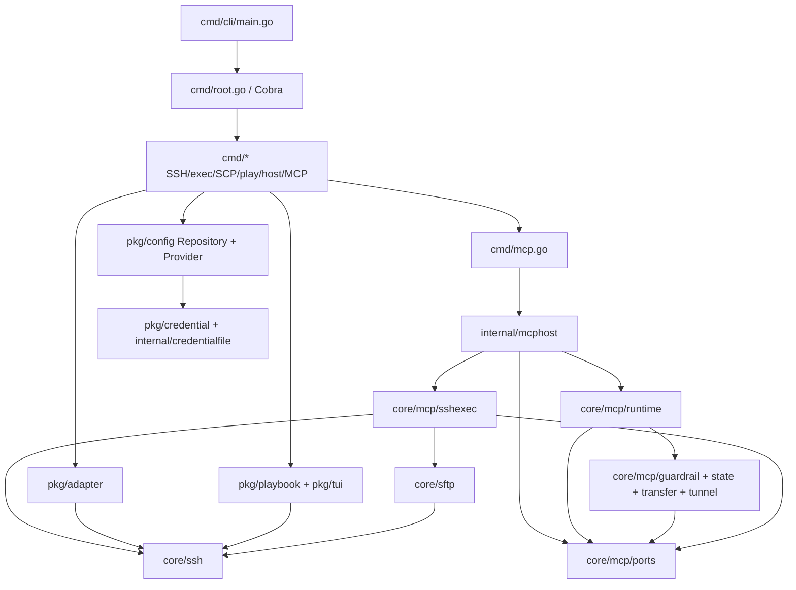

# XOps CLI 代码地图（供人和 Codex 快速进入代码）

基线：`master` @ `a12d52f`（2026-10-13）。以下是**按阅读到的源码和已有设计文档绘制的工作地图**，不是完整的函数级调用图。

## 系统功能

XOps 是 Go 编写的运维 CLI，覆盖主机/身份管理、SSH/SFTP/SCP、批量命令和 Playbook、TUI、端口转发，以及 stdio/HTTP MCP 服务。主要支持 Linux、Windows、macOS。详见仓库 `README.md`、`README_en.md`。

## 架构入口

**注意**：上图同时展示组合关系与包依赖方向（如 `core/mcp/runtime`、`core/mcp/sshexec`、`internal/mcphost` 均单向依赖契约包 `core/mcp/ports`；`core/sftp` 依赖 `core/ssh`）。要生成精确 Go import 图可使用 `go list -json ./...` 核对。

## 推荐按以下次序理解

1. **程序启动 / 模块组装**：`cmd/cli/main.go:main` -> `cmd/root.go:Execute` -> `cmd/{ssh,exec,mcp,play,credential}.go`。
2. **配置与凭据状态**：`pkg/config/{provider,repository,store,target,encrypted_runtime}.go`; `pkg/credential/service.go`; `internal/credentialfile`。
3. **连接/命令语义**：`pkg/adapter/ssh_adapter.go` -> `core/ssh/{connector,plan,command_plan,command_execution,execution_config,probe}.go`。
4. **MCP 分层**：`cmd/mcp.go:runMCPServer` -> `internal/mcphost/{config,host}.go` -> `core/mcp/runtime/{server,invocation}.go` -> `core/mcp/ports/types.go`, `core/mcp/sshexec/backend.go`, `core/mcp/guardrail/*`（注：CLI 模式下 `internal/mcphost.host` 直接实现 `StateSource` 与 `ExecutionGate`；动态发布宿主使用 `core/mcp/state.Coordinator`）。
5. **批量执行**：`cmd/exec.go`、`cmd/exec_execution.go` 和 `pkg/playbook/{engine,runner}.go`。
6. **交互**：`pkg/tui/*`、`cmd/sftpshell/*`、`internal/terminal/*`。

## “先读索引，再查源码”

- 源码边界最权威：`core/README.md`、`docs/development/shared-core-decoupling.md`。
- SSH 解释器演进：`docs/development/ssh-execution-compatibility.md`、`ssh-execution-implementation.md`、`ssh-execution-probe-{design,implementation}.md`。
- MCP 传输：`docs/development/mcp-http-transfer-design.md`、`docs/guide/mcp-http.md`。
- 离线库兼容性：`docs/development/compatibility.md`、`docs/development/credential-experience-design.md`。
- 测试与自动化：`.github/workflows/ci.yml`、`offline-compatibility.yml`、`Makefile`、`scripts/check_core.py`、`package.json`。

## 文档防腐约定

对任一模块只需记录：职责、不可承担的职责、源代码入口、依赖、资源/状态所有权、危险不变量、代表性测试、待验证问题、确认基线。不要按文件逐一翻译注释。

旧设计文档内出现的“计划”“历史基线”“待办”不能直接当作当前实现；遇到冲突以当前提交源码和最新测试为先，显式记录分歧。
