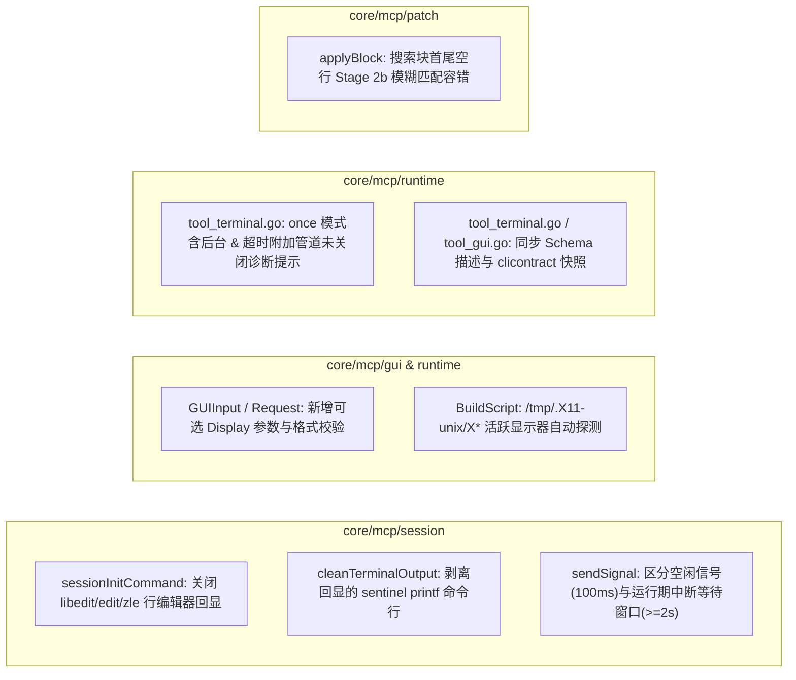

# 基于 FreeBSD 实机验证的 MCP 改进方案

状态：已实施。

---

## 1. 背景与实机测试发现汇总

在连接 FreeBSD 15.1-RELEASE (`amd64`, ZFS `zroot`) 远程节点执行 X11 图形桌面环境部署与改造后 MCP 全量工具（`nodes`、`terminal`、`file`、`transfer`、`tunnel`、`gui`）实机验证过程中，全部 6 类工具均跑通主流程，同时暴露出 5 项在跨平台（FreeBSD / 最小化 Unix）与真实网络/虚拟化场景下影响使用体验和可靠性的问题：

| 编号 | 级别 | 发现问题 | 根因定位 |
| :--- | :--- | :--- | :--- |
| **P1-1** | 高（输出污染） | 持久化 PTY 会话（`session != "once"`）在 FreeBSD 上每次返回均夹带用户命令回显与尾部的内部哨兵命令 `printf '\n%s%s_%d___\n' '___MCP_' 'DONE_<hex>' "$?"` | FreeBSD `/bin/sh` 在交互式 PTY 中默认开启 `libedit`（`set -o emacs`），`tcsh` 默认开启 `edit`，`zsh` 默认开启 `zle`。内置行编辑器在每次读取输入前重置终端 `termios` 并强制开启字符回显，覆盖了 `RequestPty(ECHO: 0)` 与 `stty -echo` |
| **P1-2** | 高（信号状态误报） | 在持久会话中向阻塞命令（如 `xwd`）发送 `SIGINT`/`SIGTERM` 时，返回 `[Status: Signal SIGINT sent; command still running]`，但命令随后即退出 | `core/mcp/session/manager.go` 的 `sendSignal` 无论会话是否正在运行命令均仅等待 `signalSettleWindow`（`100ms`）；在真实 SSH 网络与虚拟机环境中，进程退出、Shell `wait4` 回收并打印完成哨兵常需 `150ms–500ms` |
| **P2-1** | 中（显示器寻址受限） | 当 `:0` 因硬件驱动故障不可用而将 `Xvfb` 启动在 `:1` 时，`gui` 工具无法指定显示器，也无法自动发现 `/tmp/.X11-unix/X1` | `core/mcp/runtime/tool_gui.go` 的 `GUIInput` 缺少 `display` 参数，`core/mcp/gui/driver.go` 的 `BuildScript` 硬编码 `export DISPLAY="${DISPLAY:-:0}"` |
| **P2-2** | 中（超时诊断缺失） | 在 `session="once"` 下执行含后台进程命令（如 `Xvfb :1 & sleep 1; xdpyinfo`）未重定向标准流时，命令挂起 3 分钟直至报通用 `context deadline exceeded` | `session="once"` 使用非 PTY 的 SSH Exec 通道，后台子进程继承 `stdout/stderr` 管道导致远端 `sshd` 不发送 `CHANNEL_EOF`；超时报错缺少针对后台管道泄漏的诊断提示 |
| **P3-1** | 低（补丁容错） | `file(action="patch")` 在模型输出的 `<<<<` 搜索块首尾多出空行时直接报 `ErrNoMatch` | `core/mcp/patch/patch.go` 的 Stage 2 逐行空白忽略匹配要求 `searchLines` 行数与目标完全一致，未对搜索块首尾多余空行做回退容错 |

---

## 2. 已确认的工程决策

1. **采用方案**：
   - 在 `GUIInput`（`core/mcp/runtime/tool_gui.go`）中新增可选字段 `Display string`（`json:"display,omitempty"`）；
   - 同步更新 `gui` 与 `terminal` 的 Schema 描述文案，反映 FreeBSD/Unix X11 支持以及 `posix`、`fish`、`csh`/`tcsh` 执行与持久会话支持；
   - 通过 `go test ./internal/clicontract -update-mcp-contract` 同步更新 `internal/clicontract/testdata/mcp-stdio-tools.json` 与 `mcp-http-tools.json`。
2. **保持包边界与零外部依赖**：
   - 所有改动严格收敛在 `core/mcp/{session,gui,runtime,patch}` 与 `internal/clicontract/testdata`，不突破 `core/**` 零 CLI/外部依赖边界。

---

## 3. 各模块详细设计方案



### 3.1 `core/mcp/session`：持久化 PTY 会话回显抑制、Sentinel 过滤与信号等待窗口

#### 3.1.1 禁用交互式 Shell 行编辑器回显（`sessionInitCommand`）
在 `core/mcp/session/manager.go` 的 `sessionInitCommand(dialect ssh.LaunchDialect)` 中：
- **POSIX (`default`)**：在 `stty -echo noflsh` 前执行 `set +o emacs 2>/dev/null; set +o vi 2>/dev/null; unsetopt zle PROMPT_SP 2>/dev/null;`，同时清空一二级提示符 `PS1=''; PS2=''; PROMPT=''; PROMPT2='';`，关闭 FreeBSD `/bin/sh` (`libedit`)、`bash`/`ksh` 行编辑模式与 `zsh` (`zle`) 的强制字符回显。
- **C-Shell (`LaunchCsh`)**：在 `stty -echo noflsh >& /dev/null` 前执行 `unset edit; set prompt=''; set prompt2=''; set rprompt='';`，关闭 `tcsh` 内置行编辑器的输入回显。

```go
func sessionInitCommand(dialect ssh.LaunchDialect) string {
	switch dialect {
	case ssh.LaunchFish:
		return "stty -echo noflsh 2>/dev/null; function fish_prompt; end; function fish_right_prompt; end; function fish_mode_prompt; end; set -g fish_greeting ''; set -gx TERM dumb; set -gx NO_COLOR 1; set -gx DEBIAN_FRONTEND noninteractive; set -gx GIT_TERMINAL_PROMPT 0; set -gx CI true\n"
	case ssh.LaunchCsh:
		return "unset edit; set prompt=''; set prompt2=''; set rprompt=''; stty -echo noflsh >& /dev/null; setenv TERM dumb; setenv NO_COLOR 1; setenv DEBIAN_FRONTEND noninteractive; setenv GIT_TERMINAL_PROMPT 0; setenv CI true\n"
	default:
		return "set +o emacs 2>/dev/null; set +o vi 2>/dev/null; unsetopt zle PROMPT_SP 2>/dev/null; PS1=''; PS2=''; PROMPT=''; PROMPT2=''; stty -echo noflsh 2>/dev/null; export TERM=dumb NO_COLOR=1 DEBIAN_FRONTEND=noninteractive GIT_TERMINAL_PROMPT=0 CI=true\n"
	}
}
```

#### 3.1.2 防御性剥离回显的 Sentinel `printf` 命令行（`cleanTerminalOutput`）
在 `core/mcp/session/manager.go` 中新增预编译正则 `echoedSentinelCmdPattern`，在 `cleanTerminalOutput` 中剥离任何因远端 Shell 或子 Shell 开启回显而残留在输出中的内部哨兵命令：

```go
echoedSentinelCmdPattern = regexp.MustCompile(`(?m)^[^\n]*printf '\\n%s%s_%d` + sentinelEnd + `\\n' '` + sentinelHead + `' '` + sentinelTail + `[0-9a-f]+' [^\n]*\n?`)
```

#### 3.1.3 区分空闲信号与运行期命令中断等待窗口（`sendSignal`）
- 新增常量 `activeSignalSettleWindow = 2 * time.Second`；
- 当 `sentinel == ""`（空闲会话）时，保持 `signalSettleWindow = 100 * time.Millisecond`；
- 当 `sentinel != ""`（有正在运行的命令等待中断）时，`sendSignal` 接收调用方 `timeout`（默认使用 `activeSignalSettleWindow = 2s`，若调用方显式指定更大 `timeout` 则取较大值）调用 `waitSentinel(ctx, sentinel, settleTimeout)`。
- 由于 `waitSentinel` 基于 `s.notifyCh` 事件驱动唤醒，只要远端命令在收到信号后退出并由 Shell 打印完成哨兵，调用将在数毫秒至数百毫秒内立即返回 `StateCompleted`；仅当命令真正忽略信号时才会等待满窗口并返回 `StateRunning`。

---

### 3.2 `core/mcp/gui` 与 `core/mcp/runtime/tool_gui.go`：`display` 参数与活跃 X11 显示器自动探测

#### 3.2.1 Schema 与入参扩展（`GUIInput` & `gui.Request`）
在 `core/mcp/runtime/tool_gui.go` 中扩展 `GUIInput`：

```go
type GUIInput struct {
	NodeID  string `json:"nodeID" jsonschema:"Target SSH node ID or alias"`
	Action  string `json:"action" jsonschema:"GUI action: shot, click, double_click, right_click, move, type, key, scroll, or drag"`
	Coord   []int  `json:"coord,omitempty" jsonschema:"Normalized 0-1000 coordinates: [x, y] for click/move/scroll, or [start_x, start_y, end_x, end_y] for drag"`
	Text    string `json:"text,omitempty" jsonschema:"Text to input for type, key combination for key (e.g. ctrl+c, Return), or direction for scroll (up, down, left, right)"`
	Display string `json:"display,omitempty" jsonschema:"Optional X11 display (e.g. :0, :1); auto-detected when omitted"`
}
```

#### 3.2.2 安全校验与自动探测脚本生成（`core/mcp/gui/driver.go`）
1. **格式安全校验**：在 `Request.Validate()` 中校验非空 `Display` 必须匹配 `^:[0-9]+(\.[0-9]+)?$`，拒绝任何空白符、引号、命令替换或路径字符，从根源阻断 Shell 注入。
2. **智能显示器探测**：在 `BuildScript` 中：
   - 若指定了 `req.Display`，生成 `export DISPLAY=':1'`；
   - 若未指定 `req.Display`，当远端环境 `DISPLAY` 为空且 `/tmp/.X11-unix/X0` 套接字不存在时，自动遍历 `/tmp/.X11-unix/X*` 选取首个活跃的 X11 套接字（如 `Xvfb :1` 对应的 `/tmp/.X11-unix/X1`），兜底回退为 `:0`：
     ```sh
     if [ -z "${DISPLAY:-}" ]; then
       if [ ! -S /tmp/.X11-unix/X0 ]; then
         for _sock in /tmp/.X11-unix/X*; do
           if [ -S "$_sock" ]; then DISPLAY=":${_sock#/tmp/.X11-unix/X}"; break; fi
         done
       fi
       export DISPLAY="${DISPLAY:-:0}"
     fi
     ```

---

### 3.3 `core/mcp/runtime/tool_terminal.go`：`once` 模式后台进程管道阻塞超时诊断与 Schema 描述同步

1. **未重定向后台任务超时诊断提示**：
   - 新增辅助函数 `hasUnredirectedBackgroundJob(cmd string) bool`：扫描命令中非引号包裹的单 `&`（排除 `&&`、`>&`、`&>`、`2>&1` 等描述符复制语法），若该子命令段未同时包含 `/dev/null` 重定向，则在 `session="once"` 发生 `context.DeadlineExceeded` 时向 `TerminalOutput.Error` 追加明确提示：
     ```text
     (hint: background jobs '&' in session='once' inherit SSH stdout/stderr pipes and block channel closure; redirect '>/dev/null 2>&1 </dev/null &' or use a persistent session)
     ```
2. **Schema 描述同步**：
   - 更新 `TerminalInput.Session` 与 `TerminalInput.Execution` 的 `jsonschema` 描述，准确反映 `posix`、`fish`、`csh` 登录 Shell 持久会话支持以及 `csh`/`tcsh` 解释器支持。

---

### 3.4 `core/mcp/patch/patch.go`：搜索块首尾空行 Stage 2b 容错

在 `applyBlock(content string, block Block)` 中：
- 当 Stage 1（精确子串匹配）和 Stage 2（逐行 `TrimSpace` 匹配）均未命中时，检查 `searchLines` 是否存在首部或尾部空行（`strings.TrimSpace(line) == ""`）；
- 若剥离首尾空行后的 `trimmedSearchLines` 非空，则执行 Stage 2b 逐行匹配：
  - 若恰好唯一命中 1 处（`len(matchIndices) == 1`），按命中的行区间完成替换并计入 `fuzzy = true`（通过 `FileOutput.FuzzyBlocks` 提示调用方复核）；
  - 若命中多处，返回 `ErrAmbiguousMatch`；若仍未命中，返回 `ErrNoMatch`。

---

## 4. 涉及文件清单与验证标准

### 4.1 预计修改文件清单
- `core/mcp/session/manager.go`
- `core/mcp/session/manager_test.go`
- `core/mcp/gui/driver.go`
- `core/mcp/gui/driver_test.go`
- `core/mcp/runtime/tool_gui.go`
- `core/mcp/runtime/tool_terminal.go`
- `core/mcp/runtime/tool_minimal_test.go`
- `core/mcp/patch/patch.go`
- `core/mcp/patch/patch_test.go`
- `internal/clicontract/testdata/mcp-stdio-tools.json`
- `internal/clicontract/testdata/mcp-http-tools.json`
- `docs/development/mcp-minimal-tools-design.md` 及 `docs/en/development/mcp-minimal-tools-design.md`（实施时同步工具参数表）

### 4.2 验收与回归测试命令
```sh
# 1. 更新并校验 MCP 协议契约快照
go test ./internal/clicontract -update-mcp-contract
go test ./internal/clicontract ./internal/mcphost

# 2. 运行受影响包竞态与随机序单元测试
go test -race -shuffle=on -count=1 ./core/mcp/... ./internal/mcphost ./internal/clicontract

# 3. 校验 core 零外部依赖与架构边界
python3 -m unittest discover -s scripts -p test_check_core.py
python3 scripts/check_core.py --race

# 4. 全量构建、静态检查与双语文档对齐检查
go build ./...
golangci-lint run ./...
npm run docs:check
```
