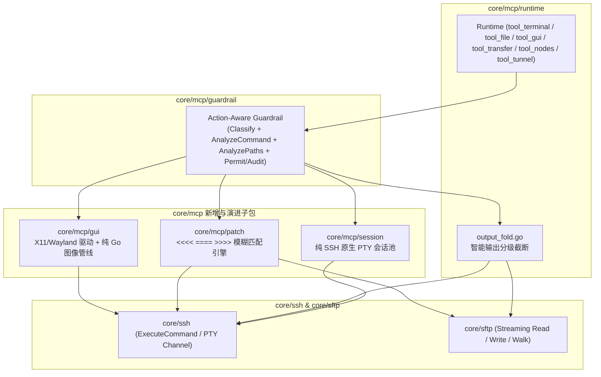

# MCP 极简全能型工具架构重构设计方案

状态：已实施。

---

## 1. 背景、目标与已确认的核心决策

### 1.1 现状痛点
当前 `core/mcp/runtime` 共注册 **16 个细粒度 MCP 工具**（stdio 模式 12 个、HTTP 模式 12 个，`internal/clicontract/testdata/mcp-stdio-tools.json` 达 1,194 行，单次 `list_tools` 消耗约 4,500+ Tokens）：
1. **上下文窗口挤占**：大量细粒度文件与目录工具（`xops_fs_ls`、`xops_fs_mkdir`、`xops_fs_touch`、`xops_fs_mv`、`xops_fs_rm`、`xops_fs_cp`、`xops_read_file`、`xops_write_file`）各自携带冗长 Schema。
2. **能力缺失与交互低效**：
   - `xops_ssh_run` 仅支持单次无状态执行，缺少**持久 PTY 会话**（无法启动后台开发服务、交互式 REPL 或增量抓日志）及**智能输出分级折叠**。
   - `xops_read_file` 采用字节偏移（`offset`/`limit`），缺少带行号分页；`xops_write_file` 仅支持全量覆盖或追加，缺少高 Token 效率的**代码块 `patch`（含缩进容错与语法预检）**。
   - 缺少面向远程桌面与浏览器自动化的 **Computer Use (`gui`)** 能力。

### 1.2 重构最高目标与已拍板决策
本次重构**不考虑向后兼容**，以**代码优雅、模块正交、极低上下文开销**为最高目标。经确认的三项关键工程决策如下：

| 决策项 | 已确认方案 | 核心约束与设计要点 |
| :--- | :--- | :--- |
| **1. 工具矩阵与命名** | **极致极简（方案 A）** | 全面去掉 `xops_` 前缀，采用多态 `action` 分发（Action Dispatch）。4 个核心操作原语为 **`terminal`、`file`、`gui`、`transfer`**；2 个无法被覆盖的多机/跨网段能力收敛为 **`nodes`** 与多态 **`tunnel`**。Stdio 总工具数从 12 个降至 **6 个**，HTTP 模式降至 **5 个**。 |
| **2. `terminal` 持久会话** | **纯 SSH 原生 PTY 会话池（方案 A）** | 由 MCP Server 内存维护常驻 SSH PTY Channel（`core/mcp/session`），**不依赖远端预装 `tmux`**，任何 POSIX 节点开箱即用，随 `Runtime.Shutdown` 自动回收。 |
| **3. 图像与编译约束** | **严格保持零 CGO 纯 Go 编译** | 全仓保持 `CGO_ENABLED=0` 可编译，不引入任何 C 绑定库（如 `libwebp` CGO 封装），确保 Linux / macOS / Windows 跨平台构建与 CI 一致性。 |

---

## 2. 工具收敛全景映射矩阵

### 2.1 新旧工具映射表

| 新工具名 | 暴露模式 | 吸收 / 替代的原工具 | 处置方式与核心演进 |
| :--- | :--- | :--- | :--- |
| **`terminal`** | stdio & http | `xops_ssh_run`<br>`xops_fs_mkdir`, `xops_fs_touch`, `xops_fs_mv`, `xops_fs_rm`, `xops_fs_cp` | **收敛 + 升级**：统一单次命令（`session="once"`）与持久 PTY 会话（`session="<id>"`）；内置非交互环境变量注入、信号发送（`SIGINT`/`EOF`）、智能输出折叠与 `$HOME/.cache/xops-mcp/cmd-*.log` 转存。删除 `tool_fs.go` 中的冗余 SFTP 包装工具。 |
| **`file`** | stdio & http | `xops_read_file`<br>`xops_write_file`<br>`xops_fs_ls` | **收敛 + 升级**：通过 `action="read"\|"write"\|"patch"\|"stat"` 多态分发。`read` 强制带行号按行分页；`patch` 支持 `<<<< ==== >>>>` 缩进容错替换与即时语法预检；`stat` 支持单文件元信息与自动降噪的紧凑目录树。 |
| **`gui`** | stdio & http | *(全新能力)* | **新增**：支持 `action="shot"\|"click"\|"double_click"\|"right_click"\|"move"\|"type"\|"key"\|"scroll"\|"drag"`，自适应 Wayland / X11，0~1000 归一化坐标，内存等比缩放 `1280px` 压缩返回，变更操作自动附带最新截图。 |
| **`transfer`** | stdio & http | stdio: `xops_upload`, `xops_download`<br>http: `xops_prepare_upload`, `xops_prepare_download`, `xops_transfer_status`, `xops_transfer_cancel` | **收敛**：stdio 下通过 `direction="push"\|"pull"` 直接流式传输宿主机与远端文件/目录；HTTP 模式下复用多态参数承载带外流式传输生命周期（`prepare` / `status` / `cancel`）。 |
| **`nodes`** | stdio & http | `xops_list_nodes` | **保留并精简**：多主机资产发现入口，支持按 `tag` 过滤，为其余工具提供目标 `node` ID。 |
| **`tunnel`** | 仅 stdio | `xops_tunnel_create`<br>`xops_tunnel_list`<br>`xops_tunnel_status`<br>`xops_tunnel_stop` | **保留并多态合并**：将 4 个跨本机/远端网络命名空间的 SSH 端口转发工具合并为单个 `tunnel(action="create"\|"list"\|"status"\|"stop")` 工具。 |

---

## 3. 极简 JSON Schema 规范（Micro-Descriptions）

### 3.1 核心 4 工具 + 保留 2 工具 Schema 摘要（权威生成快照见 `internal/clicontract/testdata/mcp-stdio-tools.json` 与 `mcp-http-tools.json`）

为避免手工维护的 JSON 片段与代码生成的 Schema 发生漂移，完整 `inputSchema`、`outputSchema` 与 `annotations` 以 `go test ./internal/clicontract -update-mcp-contract` 生成的契约快照为唯一权威来源；下表汇总各工具的入参契约：

| 工具名 | 传输模式 | 必填参数 (`required`) | 可选参数 (`properties`) | 核心说明 |
| :--- | :--- | :--- | :--- | :--- |
| **`nodes`** | stdio & http | *(无)* | `tag` | 列出已配置 SSH 节点（支持按 `tag` 过滤） |
| **`terminal`** | stdio & http | `nodeID` | `cmd`, `cwd`, `session`, `timeout`, `sudo`, `execution` | 执行无状态命令（`session='once'`，支持 `sudo` 与 `execution` 覆盖）或操作持久 PTY 会话（`cmd` 为空轮询增量输出，或传 `SIGINT`/`EOF`/`SIGTERM`/`SIGKILL`） |
| **`file`** | stdio & http | `nodeID`, `action`, `path` | `content`, `range` | SFTP 文件与目录操作：`read`（带行号分页，上限 512 KiB）、`write`（原子替换，自动建父目录）、`patch`（`<<<< ==== >>>>` 原子替换，上限 512 KiB）、`stat`（元信息或 2 层降噪目录树）。原子替换会创建新 inode（需保留硬链接或扩展 ACL 时请用 `terminal`） |
| **`gui`** | stdio & http | `nodeID`, `action` | `coord`, `text` | 远端 Linux 桌面（X11，或带 `ydotool`/`grim` 的 Wayland）视觉自动化：0–1000 归一化坐标，每次动作后返回 `<= 1280px` 压缩截图；键盘动作（`type`/`key`）评为 `Dangerous` |
| **`transfer`** | stdio | `nodeID`, `direction`, `localPath`, `remotePath` | *(无)* | 本机与远端节点流式传输文件或目录（`direction: "push" \| "pull"`） |
| **`transfer`** | http | `action` | `nodeID`, `remotePath`, `requestID`, `transferID`, `size`, `sha256`, `overwrite` | HTTP 带外流式传输生命周期（`action: "prepare_push" \| "prepare_pull" \| "status" \| "cancel"`），配合 `/v1/transfers/{id}/content` 数据面 |
| **`tunnel`** | 仅 stdio | `action` | `nodeID`, `tunnelID`, `requestID`, `mode`, `listenHost`, `listenPort`, `targetHost`, `targetPort`, `ttlSeconds`, `state` | 进程托管的 SSH TCP 端口转发隧道（`action: "create" \| "list" \| "status" \| "stop"`） |

---

## 4. 核心工程机制详细设计



### 4.1 `terminal`：无状态命令 + 纯 SSH 原生 PTY 会话池

#### 4.1.1 `session="once"` 单次执行与非交互环境注入
1. **工作目录与环境变量注入**：
   - 在 `LaunchPOSIX` 方言下，自动在命令前注入非交互式导出变量，杜绝 `apt`、`git`、`systemctl` 挂起等待终端输入或分页器：
     ```sh
     export DEBIAN_FRONTEND=noninteractive GIT_TERMINAL_PROMPT=0 PAGER=cat SYSTEMD_PAGER=cat CI=true;
     ```
   - 若指定 `cwd`，通过 POSIX 单引号安全转义后前置 `cd -- '<escaped_cwd>' && `。
2. **智能输出截断与转存（Smart Output Compression）**：
   - **当 `exit_code == 0` 且输出行数 `> 60`**：保留前 15 行 + 最后 30 行，中间插入折叠提示：
     `[... 380 lines omitted. Full log saved to /home/ops/.cache/xops-mcp/cmd-20261029T120000-8f9a1c2b3d4e.log ...]`
   - **当 `exit_code != 0` 且输出行数 `> 100`**：保留前 20 行与末尾 80 行错误堆栈。
   - **远端日志转存**：发生折叠时，通过当前节点的 SFTP 会话将完整未截断输出写入 `$HOME/.cache/xops-mcp/cmd-<时间>-<随机>.log`（目录 `0700`，文件以独占方式创建、权限 `0600`，不使用共享 `/tmp`，最多保留最近 32 份），供模型后续按需用 `file(action="read")` 或 `rg` 检索。

#### 4.1.2 `session != "once"` 纯 SSH 原生 PTY 会话池（`core/mcp/session`）
不依赖远端 `tmux`，直接基于 `golang.org/x/crypto/ssh` 的 `Session` 与 PTY 机制在 `core/mcp/session` 中实现有界生命周期管理：

1. **会话标识与隔离**：
   - 键结构：`SessionKey{Scope: string, NodeID: string, Name: string}`。不同 HTTP 客户端 `Scope` 或不同节点的同名会话严格隔离。
2. **PTY 初始化**：
   - 首次调用某个命名 `session` 时，通过已准入 `Permit` 拨号获取底层连接，开启 `ssh.Session` 并调用 `RequestPty("xterm-256color", 40, 120, ssh.TerminalModes{ssh.ECHO: 0, ssh.NOFLSH: 1})`（关闭回显与信号输入队列刷新），随后启动 `Shell()` 并注入 `stty -echo noflsh; PS1=''; export TERM=dumb NO_COLOR=1 ...`。
   - 若传入 `cwd`，在命令前下发 `cd -- '<escaped_cwd>'`。
3. **输入下发、控制信号与增量输出采集**：
   - **控制信号**：
     - `cmd` 为 `"SIGINT"`：向 PTY 写入 `0x03` 并发送 `session.Signal(ssh.SIGINT)`。
     - `cmd` 为 `"EOF"`：向 PTY 写入 `0x04`。
     - `cmd` 为 `"SIGTERM"`：发送 `session.Signal(ssh.SIGTERM)`。
     - `cmd` 为 `"SIGKILL"`：发送 `session.Signal(ssh.SIGKILL)`，无论当前有命令运行还是会话处于空闲状态，均强制关闭并移除该 PTY 会话。
   - **输出采集器（RingBuffer + Sentinel）**：
     - 后台读取协程持续消费 PTY `stdout/stderr` 写入带互斥锁的环形增量缓冲区（上限 256KB），自动剥离 ANSI 转义序列并折叠单行 `\r` 进度刷新帧。
     - 写入 `cmd + "\n"` 后，等待以下任一条件满足即返回当前增量输出（并同样经过智能输出折叠器）：
       1. 命令结束的内部边界标记（Sentinel Marker，通过 `printf '\n%s%s_%d___\n' '___MCP_' 'DONE_<token>' "$?"` 拆分参数输出 `___MCP_DONE_<token>_<code>___`，避免命令回显误触发完成）；
       2. 超过调用方指定的 `timeout`（默认 5s，适合 `npm run dev` 等长驻前台进程，超时后返回已产生的启动日志，而**不杀死后台 PTY 会话**）；
       3. PTY 通道自然关闭（会话退出，返回 `outcome=unknown` 并自动从会话池移除）。
4. **资源所有权与回收不变量**：
   - 每个会话持有空闲计时器（默认 Idle TTL `30m`，后台运行中会话为 `60m`；仅客户端 `Execute` 交互刷新活动时间，绝对最长生命周期 `12h`），到期无客户端交互由后台回收协程自动关闭 `ssh.Session` 与底层连接。
   - 会话绑定目标 `Generation`（组合 `ConnectionKey`、`Version` 与 `ExecutionVersion`），当节点连接参数、凭据或执行配置变更时，在下一次调用时自动关闭旧会话并重建。
   - `Runtime.shutdown` 阶段调用 `sessionManager.Shutdown(ctx)`，关闭所有活跃 PTY Channel 并汇合读取与回收协程，保证 `goleak` 零泄漏。

---

### 4.2 `file`：精准读写、缩进容错 Patch 与降噪目录树

#### 4.2.1 `action="read"`：强制行号分页
- 解析 `range` 参数（格式 `[start_line, end_line]`，1-based 闭区间；缺省读取前 500 行，底层单次最多读取前 512 KiB 并标记 `truncated`）。
- 输出带行号格式（`%4d | %s`）及总行数 `totalLines`。

#### 4.2.2 `action="write"`：全量写入与父目录自动创建
- 目标不存在时通过 SFTP 先执行 `MkdirAll(path.Dir(targetPath))`，再通过同目录私有临时文件 + `posix-rename`（或新建文件时使用 SFTP v3 `Rename`）原子替换，随后触发 **4.2.4 即时语法预检**。

#### 4.2.3 `action="patch"`：缩进容错匹配引擎（`core/mcp/patch`）
解析 `content` 中的一个或多个替换块：
```text
<<<<
[old lines]
====
[new lines]
>>>>
```
每个替换块按如下算法在内存文本中顺序应用：
1. **归一化换行符**：识别原文件换行风格（LF 或 CRLF），内部统一按 LF 处理，写回时还原原文件换行风格。
2. **第一阶段：精确子串匹配（Exact Match）**：
   - 若 `[old lines]` 在原文件中精确出现 **1 次**，直接替换为 `[new lines]`。
   - 若出现 **> 1 次**，返回明确错误：`patch block #N matched K locations; include more surrounding context lines`。
3. **第二阶段：缩进容错匹配（Whitespace-Insensitive Fallback）**：
   - 当精确匹配为 0 次时，将文件与 `[old lines]` 均按行切分，逐行去除首尾空白符（`strings.TrimSpace`）后进行滑窗序列比对。
   - 若唯一命中原文件行区间 $[i, j]$：
     - 计算原文件首行 $i$ 的前导空白前缀 $P_{\text{file}}$ 与 `[old lines]` 首行的前导空白前缀 $P_{\text{old}}$。
     - 将 `[new lines]` 中每一行相对于 $P_{\text{old}}$ 的缩进偏移量叠加到 $P_{\text{file}}$ 上，实现**自动对齐原有缩进层级**，并在 `fuzzyBlocks` 中报告空白容错命中块数。
4. **写回与并发校验**：所有块全部匹配成功后，校验目标文件 size、mtime 与 SHA-256 内容哈希未变再写回；任一块失败则不产生半写入副作用。

#### 4.2.4 即时语法预检（Auto-Linting）
`write` 或 `patch` 写回成功后，对 `.json` 文件直接在 MCP Server 进程内用 Go 标准库 `json.Unmarshal` 校验（0 网络开销）；若存在语法错误，在 `lintWarning` 字段返回告警信息。

#### 4.2.5 `action="stat"`：单文件元信息与降噪目录树
- 若目标为文件：返回权限、字节大小、修改时间。
- 若目标为目录：遍历最多 2 层（最多 200 个条目）并输出紧凑树形文本，**内置忽略集合**：
  `.git`, `node_modules`, `__pycache__`, `.venv`, `venv`, `target`, `dist`, `build`。

---

### 4.3 `gui`：X11 / Wayland 自适应与纯 Go 零 CGO 图像管线（`core/mcp/gui`）

#### 4.3.1 远端显示协议自适应脚本
每次 `gui` 调用通过单次 POSIX 脚本在远端探测图形环境并执行动作：
1. **环境准备**：
   - 默认设置 `DISPLAY="${DISPLAY:-:0}"`，若未显式设置 `XAUTHORITY` 且 `$HOME/.Xauthority` 可读则自动补齐；使用 `mktemp -d` 创建 `0700` 私有临时目录存放截图并在退出时清理。
2. **分辨率获取与 0~1000 坐标映射**：
   - 将模型输入的 `coord = [x, y]`（归一化范围 $0 \sim 1000$）按实际桌面分辨率 $(W, H)$ 换算为像素坐标：
     $$X = \operatorname{round}\left(\frac{x \cdot W}{1000}\right), \quad Y = \operatorname{round}\left(\frac{y \cdot H}{1000}\right)$$
3. **键鼠注入适配**：
   - **Wayland (`$WAYLAND_DISPLAY` 非空且安装 `ydotool`/`grim`)**：使用 `ydotool`（`mousemove --absolute`、`click`、`type`、`key`）与 `grim`/`spectacle`。
   - **X11 / Xvfb**：使用 `xdotool`（`mousemove`、`click`、`type --clearmodifiers`、`key`）与 `maim`/`import`/`scrot`。
4. **动作后自动截屏闭环**：
   - 若 `action == "shot"`：直接采集屏幕图像输出到 stdout。
   - 若 `action` 为变更类动作（`click`、`double_click`、`right_click`、`type`、`key`、`scroll`、`drag`）：执行动作后 `sleep 0.5` 等待 UI 渲染，随后立即在同一脚本内采集最新截图输出到 stdout。

#### 4.3.2 严格零 CGO 的纯 Go 图像缩放与编码方案
为严格遵守 **零 CGO (`CGO_ENABLED=0`)** 底线，图像管线采用纯 Go 实现：
1. **远端采集**：脚本采集原始截图并以 Base64 帧输出到 stdout（捕获上限 48 MiB，发生截断时直接报错）。
2. **MCP 端纯 Go 处理**：
   - 若输入已为 WebP 字节流则直接透传；否则在内存中使用纯 Go 标准库 `image/png`、`image/jpeg` 解码，并用纯 Go 双线性插值将长边等比缩放至 `<= 1280px`、编码为 JPEG（Quality 75）。
   - 封装为 MCP 标准 `&mcp.ImageContent`，全程零 CGO 依赖，100% 兼容 `linux`/`darwin`/`windows` 交叉编译。

---

## 5. 安全护栏（Guardrail）与架构边界设计

### 5.1 多态 Action 感知的风险评估（`core/mcp/guardrail`）
重构 `core/mcp/guardrail/risk.go` 中的 `RiskInput` 与 `Classify`，使其原生理解 `(ToolName, Action)` 二元组：

| 工具名 (`ToolName`) | 分发动作 (`Action` / 模式) | 基准风险 (`Base Risk`) | 动态提权规则 |
| :--- | :--- | :--- | :--- |
| **`nodes`** | - | `Safe` | 始终只读 |
| **`terminal`** | `session == "once"` | 由 `AnalyzeCommandWithDialect` 决定 | 命中 `blockedPatterns` 直接 `Deny`；命中 `dangerousPatterns` 为 `Dangerous`；含 `sudo=true` 最低 `Moderate` |
| **`terminal`** | `session != "once"` (持久 PTY) | `Moderate` | 命中 `dangerousPatterns` 提至 `Dangerous`；命中 `blockedPatterns` 直接 `Deny` |
| **`file`** | `action == "read" \| "stat"` | `Safe` | `AnalyzePaths([path])`：触及 `/etc`、`/root` 等敏感路径提至 `Moderate` |
| **`file`** | `action == "write" \| "patch"` | `Moderate` | `AnalyzePaths([path])`：触及 `/` 或空路径直接 `Dangerous` |
| **`gui`** | `action == "shot" \| "move"` | `Safe` | 只读视觉观测或移动光标 |
| **`gui`** | `click` / `double_click` / `right_click` / `drag` / `scroll` | `Moderate` | 鼠标交互变更动作 |
| **`gui`** | `type` / `key` | `Dangerous` | 键盘输入可跨多次调用拼接命令并回车执行，一律按高风险要求审批，且文本同时受 `IsBlocked` 与 `BlockedPatterns` 拦截 |
| **`transfer`** | `pull` / `prepare_pull` / `status` / `cancel` | `Safe` | `AnalyzePaths([remote_path])` |
| **`transfer`** | `push` / `prepare_push` | `Moderate` | `AnalyzePaths([remote_path])` |
| **`tunnel`** | `action == "list" \| "status"` | `Safe` | 元数据只读 |
| **`tunnel`** | `action == "stop"` | `Moderate` | 停止已有隧道 |
| **`tunnel`** | `action == "create"` | `Moderate` (本地回环) / `Dangerous` (暴露网卡或 `-R`) | 与现有 `tunnelRisk` 完全一致 |

### 5.2 不可破坏的 `Permit` / `Binding` 不变量
- 每次工具调用仍严格走 `Runtime.withOperation` / `withMetadata` 管线：`Resolve` 快照 -> 计算包含 `(ToolName, Action, Input)` 的 `ports.Bind` 摘要 -> `Guardrail` 审批与审计 -> `ExecutionGate.Enter` 换取有界 `Permit` -> 传入 `Backend` 执行。
- `ports.FileSession` 移除仅被旧 `xops_fs_rm` / `xops_fs_cp` 使用的 `RemoveAll` 与 `RemoteCopy` 接口方法，保持接口最小化。

---

## 6. 重构后的代码目录结构与文件清单

```text
core/mcp/
├── patch/
│   ├── patch.go                  # [新增] <<<< ==== >>>> 解析、精确匹配、缩进容错匹配
│   └── patch_test.go             # [新增] 覆盖精确匹配、多处匹配冲突、缩进偏移对齐、CRLF 兼容单测
├── session/
│   ├── manager.go                # [新增] 纯 SSH 原生 PTY 会话池、Sentinel/静默窗口读取、信号控制、TTL 与 Shutdown
│   └── manager_test.go           # [新增] 并发会话隔离、SIGINT/EOF、超时留存后台、goleak 零泄漏测试
├── gui/
│   ├── driver.go                 # [新增] X11/Wayland 探测与操控脚本生成、0-1000 坐标换算、纯 Go 1280px 图像缩放编码
│   └── driver_test.go            # [新增] 坐标映射、图像缩放、协议探测单测
├── guardrail/
│   ├── risk.go                   # [重构] 升级为 (ToolName, Action) 多态风险分类
│   ├── risk_test.go              # [重构] 覆盖 6 大工具所有 action 的风险分级测试
│   └── analyzer.go               # [保持] 命令词法与敏感路径分析
├── ports/
│   └── types.go                  # [精简 + 扩展] FileSession 瘦身；新增 PTYSession / Stream 输出支持
└── runtime/
    ├── registry.go               # [重构] 注册 nodes, terminal, file, gui, transfer, tunnel
    ├── output_fold.go            # [新增] 智能输出分级截断（60行/100行规则）与远端 $HOME/.cache/xops-mcp/cmd-*.log 转存
    ├── tool_nodes.go             # [重构] nodes 工具（原 xops_list_nodes）
    ├── tool_terminal.go          # [重构] terminal 工具（整合单次执行、非交互环境注入、输出折叠、PTY 会话池）
    ├── tool_file.go              # [重构] file 工具（read 行号分页、write、patch + 语法预检、stat 降噪目录树）
    ├── tool_gui.go               # [新增] gui 工具（Computer Use 多模态截图返回）
    ├── tool_transfer.go          # [重构] transfer 工具（stdio push/pull + HTTP prepare/status/cancel）
    └── tool_tunnel.go            # [重构] tunnel 多态单工具（action: create/list/status/stop）
    # [删除] tool_ssh.go, tool_fs.go, tool_fs_test.go, tool_sftp.go, tool_sftp_test.go, copy_path_regression_test.go
```

---

## 7. 分阶段实施路线与验证矩阵

1. **阶段一：核心纯算法与独立子包构建（`core/mcp/patch`、`core/mcp/gui`、`core/mcp/runtime/output_fold.go`）**
   - 实现 `patch` 精确与缩进容错匹配引擎、智能输出折叠器、纯 Go 图像缩放管线与 X11/Wayland 脚本生成器，完成 100% 独立单元测试。
2. **阶段二：纯 SSH 原生 PTY 会话池（`core/mcp/session` & `core/ssh`）**
   - 扩展 `ports.Backend` 与 `sshexec.Backend` / `mcphost.backend` 支持打开受 `Permit` 约束的 PTY Session，实现 `session.Manager` 及 `goleak` 并发回收测试。
3. **阶段三：Runtime 6 大工具替换与 Guardrail 多态升级（`core/mcp/runtime` & `core/mcp/guardrail`）**
   - 切换 `registry.go` 至 `nodes`、`terminal`、`file`、`gui`、`transfer`、`tunnel`；删除旧 `tool_fs.go`、`tool_sftp.go`、`tool_ssh.go`。
4. **阶段四：契约基线刷新与全量验证（`internal/clicontract` & `docs`）**
   - 使用 `-update-mcp-contract` 更新 `mcp-stdio-tools.json` 与 `mcp-http-tools.json`。
   - 执行全量验证门禁：
     ```bash
     python3 -m unittest discover -s scripts -p test_check_core.py
     python3 scripts/check_core.py --race
     CGO_ENABLED=0 go build ./...
     go test -race -shuffle=on -count=1 ./core/mcp/... ./core/ssh/... ./internal/mcphost ./internal/clicontract
     golangci-lint run ./...
     npm run docs:check
     ```

## 实现修订（代码评审后）

以下约束在九轮实现评审后补充，优先于上文描述：

- **持久会话结果语义与清理**：只有观测到完成哨兵才返回 `outcome=completed` 与退出码；等待超时返回 `status=running`、`outcome=unknown`；会话在哨兵之前结束（或因 `EOF`/`SIGKILL` 关闭，其中 `EOF` 等待最长 1s）返回 `status=failed`、`outcome=unknown`，均不携带退出码并立即从会话池移除。新建（或过期/重配后重建）持久会话时在输出结构体中返回 `newSession=true`。哨兵由 `printf` 的两个参数拼接，命令回显不会被误判为完成；格式不合法的候选会被跳过。输出自动剥离 ANSI 转义序列并折叠单行 `\r` 进度刷新帧。
- **会话忙碌保护、非阻塞互斥与信号语义**：会话使用 `TryLock` 非阻塞获取执行锁；当已有调用持有执行锁时，并发下发新命令或空 `cmd` 轮询立即返回 `ErrSessionInUse`；并发发送控制信号（`SIGINT`/`EOF`/`SIGTERM`/`SIGKILL`）仅在该会话**确实有命令正在运行**（命令 payload 写入与写 stdin 的信号 `SIGINT`/`EOF` 由同一把会话输入锁 `inputMu` 串行化，确保 `SIGINT`/`EOF` 排在完整 payload 写入之后；而不写 stdin 的 SSH 通道请求信号 `SIGTERM`/`SIGKILL` 不获取 `inputMu`，即使命令 payload 写入因远端流控阻塞也能立即穿透投递并通过 `SIGKILL` 关闭 PTY 解除写入阻塞；底层 `ptySession` 通过 `writeMu` 串行化对 SSH channel stdin 的写入以及 `Close()` 中 `session.Close()` 之后的 `stdin.Close()`，避免与 `x/crypto/ssh` 内部缓冲池或 `sentEOF` 产生并发竞态）时才直接穿透投递以中断等待中的命令，若执行锁仅被空闲轮询或其它短暂操作占用则同样返回 `ErrSessionInUse`；当无调用正在等待但上一条命令仍在后台运行时，提交新命令返回 `ErrSessionBusy`；对不存在、已过期或因配置/凭据变更被淘汰的会话发送信号或空 `cmd` 轮询直接返回 `ErrSessionNotFound`（附带淘汰原因如 `reconfigured`，绝不静默新建会话）。发送 `SIGINT`/`EOF`/`SIGTERM` 后，仅当在等待窗口内实际观测到完成哨兵才解除忙碌状态；若前台进程忽略信号继续运行，会话保持 `StateRunning`（忙碌），防止后续命令被注入到前台进程 stdin；`SIGKILL` 无论会话忙碌或空闲（即使进程在等待窗口内刚好输出完成哨兵）均无条件强制关闭并从会话池移除会话。持久会话中仅切换 `cwd`（空 `cmd`）评为 `Moderate`。
- **会话生命周期与配额**：会话代数 `Generation` 组合目标 `ConnectionKey`、`Version` 与 `ExecutionVersion`（配合 `state.Coordinator` 更新屏障排空在途许可，按相等比较），并在同一把管理器锁内完成代数与过期校验，节点连接参数、凭据或执行配置变更后在下次调用时自动关闭旧会话并重建（若旧会话不再被调用，其持有的底层连接租约与隧道一致，最长保留至空闲 TTL 到期由后台回收协程或 `Shutdown` 清理）；单 `Scope` 最多 16 个会话、全局最多 64 个会话，名额在 `Dial` 之前即预占（通过 `defer` 保证即使 `Dial` 失败或 panic 也必定释放）并对相同 `Key` 与 `Generation` 的并发新建请求去重复用同一在途拨号（仅当领头拨号方自身的 `context` 已取消或超时且等待方 `context` 仍有效时，等待方才自动接力重试拨号；若后端连接超时而领头方 `context` 未取消，所有等待方立即共享该错误返回而不串行重试）；空闲 TTL（默认 30m，运行中为 60m，仅由客户端 `Execute` 交互续期，绝对生命周期上限 12h）由后台回收协程及容量满时的按需清理执行，`Shutdown` 负责回收协程与全部会话。持久会话不支持 `sudo`/`execution`，非 POSIX 登录 shell 直接拒绝。折叠日志保存在 `$HOME/.cache/xops-mcp`（0700 目录、0600 独占文件），最多保留最近 32 份。
- **`file`**：先校验 `action` 再打开 SFTP；`write`/`patch` 优先通过同目录私有临时文件 + `posix-rename`（新建文件时在无 `posix-rename` 扩展的服务端使用 SFTP v3 `Rename`）原子替换并保留原权限与属主（`Chown`），注意原子替换会生成新 inode（若需保留硬链接或扩展 ACL 请使用 `terminal`）；临时文件创建被服务端明确拒绝（如 `EEXIST`/`EACCES`）时绝不删除未拥有路径；若目标已存在且为普通文件，但服务端不支持 `posix-rename`、父目录无写权限创建临时文件、或临时文件无法保留原属主/属组，则回退为在原普通文件上原地覆写并在返回结果中标记 `inPlace=true`；始终拒绝替换符号链接；`patch` 写回前校验 size、mtime 与 SHA-256 内容哈希防止覆盖并发修改；超过 512 KiB 的文件拒绝 `patch`，`read` 会标记 `truncated`。整文件精确匹配失败后的空白容错匹配会在 `fuzzyBlocks` 中报告。
- **`gui`**：仅支持 Linux（X11，或带 `ydotool`/`grim` 的 Wayland）。截图使用 `mktemp -d` 私有目录，输出上限 48 MiB 且截断即报错；`type` 与 `key` 一律评为 `Dangerous`（防止跨调用分段输入绕过命令分析，默认策略下需交互审批或在节点策略中调整阈值），同时匹配阻断规则并在审批与审计详情中展示输入内容。

