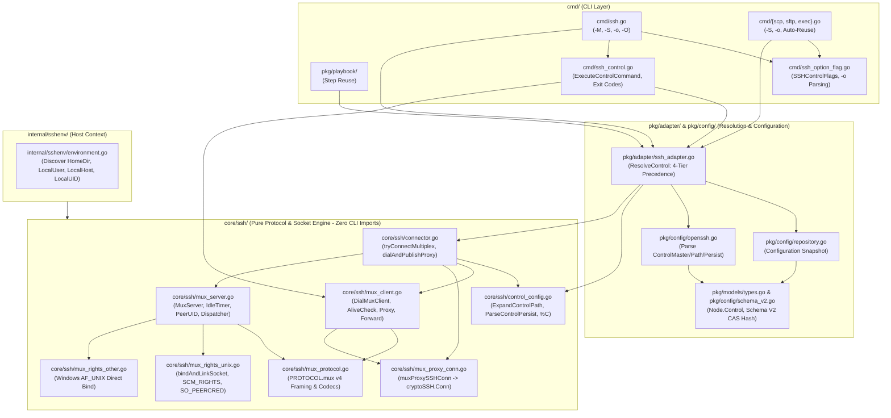
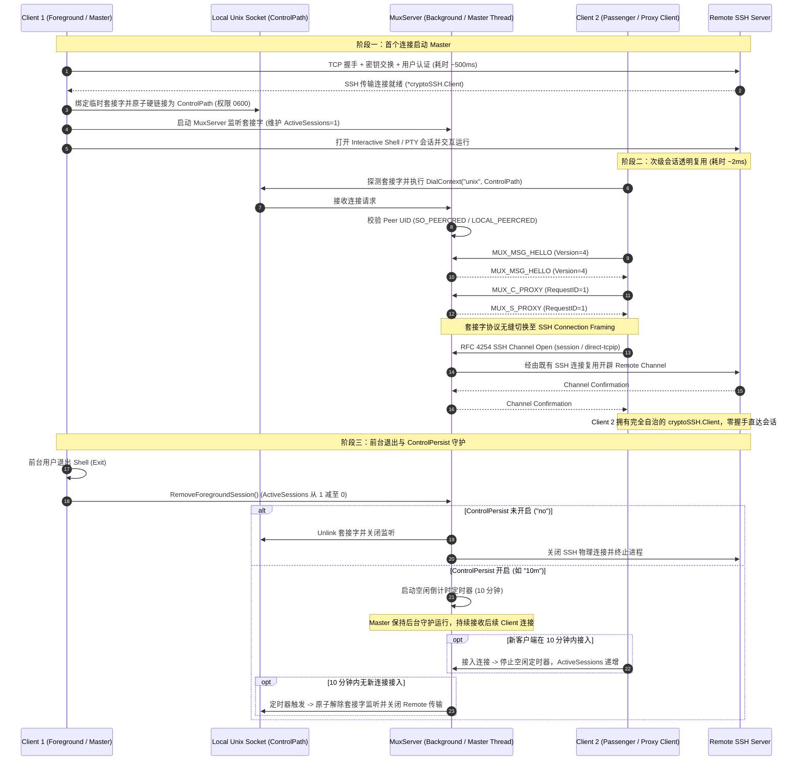

# OpenSSH 连接多路复用 (-M / -S / -O & ControlMaster / ControlPath / ControlPersist) 永久设计规范

**文档状态**：已实施并验证通过（M1–M4 全量完成）  
**依据文档**：[代码架构与治理地图](./governance/architecture-map.md)、[公共代码与 MCP 接口解耦设计](./shared-core-decoupling.md)、[SSH 诊断设计](./ssh-diagnostics.md)  
**语言版本**：中文开发规范（English version: [openssh-multiplexing-design.md](../en/development/openssh-multiplexing-design.md)）

---

## 1. 背景与目标

### 1.1 背景与业务痛点

在分布式系统管理、批量执行、自动化运维与 Playbook 编排场景中，CLI 工具频繁对同一批目标节点发起远程连接。传统的 SSH 客户端每次建立连接都需要执行完整的网络握手、TCP 建立、SSH 版本交换、密钥交换（KEX）、服务端主机密钥验证、用户身份认证（公钥/密码/MFA/OTP 挑战）以及会话通道协商。在跨地域网络、跳板机（Bastion/Jump Host）或开启多因素认证的环境下，单个会话的握手耗时通常在数百毫秒至数秒之间。

OpenSSH 原生通过连接多路复用（Connection Multiplexing，基于 `-M`、`-S`、`-O` 及 `ControlMaster`、`ControlPath`、`ControlPersist` 配置指令）解决了这一痛点：首个会话作为 Master 建立主传输连接并在本地监听 Unix 域套接字（或 Windows 10+ 的 `AF_UNIX` 套接字）；后续客户端通过该套接字与 Master 进程通信，直接复用已认证的 SSH 传输通道，实现“零额外网络握手、零二次认证、毫秒级会话建立”。

为了与现代开发运维工具链（包括 Ansible、系统原生 `/usr/bin/ssh`、内部运维平台）深度互操作，`xops-cli` 必须提供与 OpenSSH 完全兼容的连接复用能力，同时保证自身的架构分层与核心解耦规范不受破坏。

### 1.2 核心设计原则

1. **严格兼容 OpenSSH Wire 协议 (`PROTOCOL.mux` v4)**：
   通信协议层严格遵循 OpenSSH 官方规范，二进制帧格式、字段大端序编码、操作码定义（`MUX_MSG_HELLO`、`MUX_C_*`、`MUX_S_*`）完全一致，具备与系统原生 OpenSSH 共享控制套接字的能力。
2. **上层功能零降级 (`MUX_C_PROXY`)**：
   复用连接通过 `MUX_C_PROXY` 协议将本地套接字流平滑切换为 SSH 传输模式，经由 `muxProxySSHConn` 包装为标准的 `golang.org/x/crypto/ssh.Conn` 并构造 `*cryptoSSH.Client`，使得交互式 PTY 终端、SFTP 传输、批量远程执行、sudo/su 探测缓存等所有既有能力 100% 保持原生行为，无任何功能降级或分支特化。
3. **严格的 `core/ssh` 单向解耦不变量**：
   复用核心协议与引擎完全驻留在 `core/ssh` 中，绝不依赖上层 CLI、配置模型或内部辅助包（通过 `scripts/check_core.py --race` 验证）。宿主环境信息（用户名、UID、主机名、家目录）统一通过 `core.Environment` 显式注入。
4. **纵深防御的安全模型**：
   Unix 域套接字必须严格限制权限（0600）、防范硬链接竞争（link(2) 原子创建）、校验对端真实身份（Peer UID 校验，Linux `SO_PEERCRED` / Darwin `LOCAL_PEERCRED`），阻断多用户环境下的未授权劫持或提权攻击。
5. **清晰的 4 层配置继承体系**：
   会话级命令行参数（CLI Flags） > 节点级配置（Node Config） > 全局默认配置（Global Defaults） > OpenSSH 系统配置（`~/.ssh/config`），支持细粒度覆盖与单次显式禁用（`-S none`）。

### 1.3 目标与非目标

| 纳入范围 (Goals) | 不包含的承诺 (Non-Goals) |
| :--- | :--- |
| OpenSSH `PROTOCOL.mux` 版本 4 二进制协议编解码 | 兼容历史已被废弃的 Version 1–3 废弃协议 |
| `xops ssh` 完整支持 `-M`（单 master）、`-M -M`（确认 master）、`-S`、`-o`、`-O` | 在未安装原生 `AF_UNIX` 的古董 Windows（Win10 1803 之前）上提供模拟套接字 |
| `-O` 控制指令支持：`check`、`exit`、`stop`、`forward`、`cancel`、`proxy`、`conninfo`、`channels` | 支持无需 Master 存在的无状态控制指令 |
| `ControlMaster` 模式支持：`no`、`yes`、`ask`、`auto`、`autoask` | 绕过本地系统文件权限体系创建全局可写的公开控制套接字 |
| `ControlPath` 令牌展开：`%%`, `%h`, `%p`, `%r`, `%n`, `%u`, `%l`, `%L`, `%i`, `%d`, `%j`, `%C`（SHA-1 哈希）及 `~`、`${ENV}` | 允许未经校验的任意超长路径（突破 OS `sockaddr_un` 108/104 字节上限） |
| `ControlPersist` 支持：`no`、`yes`/`0`（永久驻留）、时间格式（`10m`, `1h`, `600s`, `1d`, `1w` 等）及空闲超时自动退出 | 保证不受操作系统 OOM 杀进程或宿主意外断电影响的套接字存续 |
| `scp`、`sftp`、`exec`、`play` 自动感知并透明复用已激活的 `ControlPath` 套接字 | 修改远程服务端 SSH 协议本身（所有复用均在客户端与本地 Master 之间协商） |
| 跨平台支持：Linux、macOS、BSD、Windows 10+（通过 `MUX_C_PROXY` 原生免 fd 传递） | 在非 Unix 平台支持 Unix 特有的 `SCM_RIGHTS` 文件描述符传递 |

---

## 2. 总体架构与数据流

### 2.1 模块边界与分层架构

整体架构严格遵守 `AGENTS.md` 规定的单向依赖关系与边界划分：



### 2.2 连接复用与握手时序

下图展示了首个客户端创建 Master 以及后续客户端复用连接的完整生命周期：



### 2.3 `core/ssh` 解耦不变量

遵循仓库最高架构契约（`AGENTS.md` 与 `docs/development/shared-core-decoupling.md`）：
- `core/ssh/` 内的代码与测试**严禁** import `cmd/**`、`pkg/**` 或根目录 `internal/**`（`python3 scripts/check_core.py --race` 自动化静态检查为 0 违规）。
- 本地系统环境的探测全部收敛于 `internal/sshenv/environment.go:Discover()`，并通过 `core.Environment` 结构体传入：
  ```go
  type Environment struct {
      InitializationError error
      KnownHostsFile      string
      AgentSocket         string
      DefaultKeyPaths     []string
      ResolveKeyPath      func(string) string
      InteractiveIO       InteractiveIO
      InputBridge         InputBridge
      HomeDir             string // 用户主目录 (~ 展开)
      LocalUser           string // 当前登录用户名 (%u 展开)
      LocalHost           string // 本地 FQDN 主机名 (%l 展开)
      LocalUID            string // 当前本地用户 UID (%i 展开)
  }
  ```

---

## 3. OpenSSH 二进制线缆协议与协议帧 (`PROTOCOL.mux` v4)

### 3.1 协议版本与消息类型定义

`core/ssh/mux_protocol.go` 完整实现了 OpenSSH `PROTOCOL.mux` 版本 4 的二进制线缆帧协议。所有的 MUX 数据包均采用网络字节序（Big-Endian）编码：

```
+-------------------------------+-------------------------------+
|     uint32 packet_length      |      uint32 packet_type       |
|    (4 + len(payload) 字节)    |          (消息操作码)          |
+-------------------------------+-------------------------------+
|                        payload 字节流 ...                      |
+---------------------------------------------------------------+
```

协议常量严格对应 OpenSSH 原生定义：

```go
const (
    MuxProtoVersion    uint32 = 4
    MuxProtocolVersion uint32 = 4
)

// Client -> Master 请求消息类型
const (
    MUX_MSG_HELLO        uint32 = 0x00000001
    MUX_C_NEW_SESSION    uint32 = 0x10000002
    MUX_C_ALIVE_CHECK    uint32 = 0x10000004
    MUX_C_TERMINATE      uint32 = 0x10000005
    MUX_C_OPEN_FWD       uint32 = 0x10000006
    MUX_C_CLOSE_FWD      uint32 = 0x10000007
    MUX_C_NEW_STDIO_FWD  uint32 = 0x10000008
    MUX_C_STOP_LISTENING uint32 = 0x10000009
    MUX_C_PROXY          uint32 = 0x1000000f
    MUX_C_EXT_INFO       uint32 = 0x20000001
)

// Master -> Client 响应消息类型
const (
    MUX_S_OK                uint32 = 0x80000001
    MUX_S_PERMISSION_DENIED uint32 = 0x80000002
    MUX_S_FAILURE           uint32 = 0x80000003
    MUX_S_EXIT_MESSAGE      uint32 = 0x80000004
    MUX_S_ALIVE             uint32 = 0x80000005
    MUX_S_SESSION_OPENED    uint32 = 0x80000006
    MUX_S_REMOTE_PORT       uint32 = 0x80000007
    MUX_S_TTY_ALLOC_FAIL    uint32 = 0x80000008
    MUX_S_PROXY             uint32 = 0x8000000f
    MUX_S_EXT_INFO          uint32 = 0x90000001
)

// 端口转发类型
const (
    MUX_FWD_LOCAL   uint32 = 1
    MUX_FWD_REMOTE  uint32 = 2
    MUX_FWD_DYNAMIC uint32 = 3
)
```

### 3.2 代理模式切换 (`MUX_C_PROXY`) 与 `muxProxySSHConn` 包装

对于内部 CLI 会话（`ssh`、`scp`、`sftp`、`exec`、`play`），`xops-cli` 优先使用 `MUX_C_PROXY` 协议模式：
1. 客户端连接 Unix 套接字，完成 `MUX_MSG_HELLO` 握手（Master 在 Hello 扩展中通告 `target@xops` 规范目标身份，客户端据此校验静态 `ControlPath` 是否指向同一远端目标，不匹配时立即以 `ErrControlTargetMismatch` 失败关闭，防止跨主机串用）。
2. 客户端发送 `MUX_C_PROXY (request_id=1)`。
3. 服务端回复 `MUX_S_PROXY (request_id=1)`，随后主动下发一条无应答全局通知包（`hostkeys-00@openssh.com`，`WantReply: false`）并在代理读循环中响应 OpenSSH `SSH_MSG_PING (192)` -> `SSH_MSG_PONG (193)`。
4. 从此时起，Unix 域套接字上的数据流直接作为 SSH Connection Protocol（RFC 4254）传输载体。
5. 客户端调用 `cryptoSSH.NewControlClientConn(rawConn)` 进行信道握手，并使用自定义 `muxProxySSHConn` 包装：
   ```go
   type muxProxySSHConn struct {
       cryptoSSH.Conn
       rawConn    net.Conn
       target     TargetContext
       remoteAddr net.Addr
       localAddr  net.Addr
       user       string
   }
   ```
6. 调用 `cryptoSSH.NewClient(proxyConn, chans, reqs)` 构筑完备的 `*cryptoSSH.Client`。此对象对上层逻辑（如 SFTP 客户端创建、Interactive PTY 请求、环境变量注入、Probe 方言探测缓存）完全透明，无任何行为差异。
7. **流量控制与通道保序**（`core/ssh/mux_server.go:proxySessionState`）：
   - 下行方向严格遵循客户端在通道 open 中声明的接收窗口与最大包长。Master 在发送每个数据包前先 `clientFlowWindow.reserve` 精确预留额度，并在 `SSH_MSG_CHANNEL_WINDOW_ADJUST` 中归还额度；忽略该窗口会让客户端 `x/crypto` 在 2 MiB 后以 `ssh: remote side wrote too much` 终止整条复用连接（大文件下载/高吞吐命令才会暴露）。
   - 上行方向不阻塞读循环：客户端数据经每通道 `orderedQueue` 交给专属 relay goroutine 写入远端通道，仅在写入成功后才回窗口额度。否则一个远端不再读取 stdin 的通道会占住共享读循环，导致同一 Master 上所有其他通道（含 `-O` 查询与新会话）一起挂死。
   - 全局请求（`tcpip-forward`、keepalive 等）同样经有序列化 worker 转发：RFC 4254 的全局回复不携带请求 ID，并发回复会把结果错配到别的请求。
   - 客户端已关闭的通道不再接收任何迟到包：`x/crypto` 对未知通道 ID 的非请求包会让整条 mux 连接失败。
   - **通道关闭必须回应且只能回应一次**：客户端主动发送 `SSH_MSG_CHANNEL_CLOSE` 时，Master 必须回发一条 close（RFC 4254 §5.3；`x/crypto` 只有收到该回应才会释放客户端通道并唤醒被阻塞的读者）。`proxyChan.closeSent` 在 `writeMu` 保护下作为唯一关闭标记：`handleClose` 与远端流自然结束都调用同一个 `closeChannel`，保证只发一包；此后所有通道级包（data/extended-data/EOF/window-adjust/channel-request/成功失败回复）都被 `writeChannelPacket` 直接丢弃，避免“关闭后再发”把客户端 mux 打死。整个代理会话断连（`closeAll`）同样由 `writeChannelPacket`/`writePacket`/`closeChannel` 的 `closed` 检查拦截：被唤醒的 relay 协程不再向已关闭的传输写包，也不再等待不会到来的应答。

### 3.3 传统 Passenger 模式与 Unix `SCM_RIGHTS` fd 传递

为了兼容系统原生 `/usr/bin/ssh` 作为客户端连入 `xops-cli` Master 套接字的场景，在 Unix 平台（Linux/macOS/BSD）通过 `core/ssh/mux_rights_unix.go` 实现了标准 Passenger 模式：
- **`MUX_C_NEW_SESSION`**：按 OpenSSH `PROTOCOL.mux` v4 规范将 `want_tty`、`want_x11_forwarding`、`want_agent`、`subsystem_flag` 编码为 4 字节 `uint32`（`0` 或 `1`）。Master 接收 Unix 控制消息中的 3 个文件描述符（标准输入、标准输出、标准错误，通过 `recvFDs(unixConn, 3)` 使用 `net.UnixConn.ReadMsgUnix` 与 `unix.ParseUnixRights` 解析），在 Master 持有的远程 SSH 连接上直接打开底层 `"session"` 通道（`sshClient.OpenChannel("session", nil)`），支持 `exec`、`shell` 与 `subsystem`（如 `sftp`），在本地 `stdin` EOF 时向远端通道发送 `CloseWrite()`（`SSH_MSG_CHANNEL_EOF`），并在会话终止且释放继承的描述符后回传 `MUX_S_EXIT_MESSAGE`。
- **描述符接收契约**：OpenSSH `mm_send_fd` 每个描述符单独发送一条控制消息，因此 `recvFDs` 必须循环累加直到收满，不能假设一次 `recvmsg` 携带全部 fd；接收上限为 5s（`passengerFDReceiveTimeout`），每个 fd 立即 `SetFD(FD_CLOEXEC)`，超出请求数量的 fd 直接关闭而不是交给调用方。
- **单一所有权**：接收到的 fd 由 `recvFiles` 交给 `*os.File`，此后只能通过 `File.Close()` 释放。handler 不得再次 `unix.Close` 同一 fd 编号——第二次关闭可能命中并发 goroutine 刚复用的无关描述符；`MUX_C_NEW_STDIO_FWD` 在两个方向的复制都退出后才返回，避免 deferred 清理与在途写竞态。
- **`MUX_C_NEW_STDIO_FWD`**：`connect_port` 遵循 `PROTOCOL.mux` v4 编码为 `uint32`；接收 2 个文件描述符（输入与输出），通过 Master 的 `Client.Dial("tcp", host:port)` 进行流式转发，并在本地输入 EOF 时调用半关闭 `CloseWrite()` 等待远端响应排空。
- **跨平台降级**：在 Windows 平台（`core/ssh/mux_rights_other.go`），由于 Windows 的 Winsock `AF_UNIX` 不支持文件描述符传递机制（fd passing / `SCM_RIGHTS`），若接收到 Passenger 模式请求，服务安全拒绝并明确提示使用 `MUX_C_PROXY`。

### 3.4 资源限制与 DOS 防护

为防止恶意客户端或异常报文导致内存耗尽（OOM），协议层硬性限制：
- `MaxMuxPacketLength = 256 * 1024` (256 KB)
- `MaxMuxStringLength = 64 * 1024` (64 KB)
- 严禁分配未经校验长度的切片，读取时先验证长度范围再执行 `io.ReadFull`。

---

## 4. Unix 域套接字安全与生命周期

### 4.1 严格权限控制

套接字文件是多用户本地系统中的安全边界。未经授权的本地用户若能写入该套接字，即可通过 Master 劫持远程主机访问权限。
- 控制套接字父目录创建时权限强制为 `0700` (`rwx------`)。
- 控制套接字文件本身的权限强制为 `0600` (`rw-------`)。
- 为避免修改进程级全局掩码（`unix.Umask`）导致与其他并发线程/文件写入操作竞争，`xops-cli` 严禁调用进程级 `Umask`，而是在套接字创建后通过明确的 `os.Chmod(targetPath, 0600)` 执行权限收敛。

### 4.2 临时硬链接原子创建与竞争防御

当多个客户端几乎同时决定担任 Master 时，如果简单地以 `net.Listen("unix", path)` 竞争，容易引发文件覆盖与 TOCTOU 竞争漏洞。

`core/ssh/mux_rights_unix.go` 实现了基于 POSIX `link(2)` 的原子创建算法（`bindAndLinkSocket`）：
1. **三级路径预算策略**：受操作系统 `sockaddr_un.sun_path` 上限约束（Linux/Windows 108 字节，Darwin/BSD 104 字节）：
   - 若目标路径末尾剩余空间 $\ge 8$ 字节，追加小后缀生成临时路径（形如 `path.m%04x.t`）；
   - 否则若所在目录剩余空间 $\ge 8$ 字节，在目录下生成紧凑临时路径（形如 `dir/.m%04x.t`）；
   - 若剩余空间耗尽（极端长路径），平滑降级为目标路径直接绑定并配合权限收敛。
2. **原子硬链接**：在临时路径上绑定并 `chmod 0600`，随后调用 `os.Link(tempPath, targetPath)`：
   - 若硬链接成功：说明本进程赢得了 Master 资格，立即解除临时路径（`os.Remove(tempPath)`）。
   - 若返回 `EEXIST`：说明已有其他 Master 并发创建成功，安全关闭本进程监听并返回 `ErrMasterAlreadyExists`。

### 4.3 对端 Peer UID 校验（双向）

即使文件权限限制为 `0600`，本地 root 用户或拥有特殊提权能力的用户仍可能连接套接字。为了满足防御深度：
- **Linux** (`mux_peer_linux.go`)：通过 `unix.GetsockoptUcred(fd, unix.SOL_SOCKET, unix.SO_PEERCRED)` 获取连入客户端的进程凭据 `ucred.Uid`。
- **macOS / FreeBSD** (`mux_peer_darwin.go` / `mux_peer_freebsd.go`)：通过 `unix.GetsockoptXucred(fd, unix.SOL_LOCAL, unix.LOCAL_PEERCRED)` 获取 `xucred.Uid`。
- **校验逻辑**：Master 校验连入对端的 UID 必须与期望 UID（当前执行用户 UID）完全一致；若不匹配立即切断连接并记录安全审计日志，返回 `ErrUnauthorizedPeer`。
- **客户端侧同等校验**：`DialMuxClient` / `DialMuxProxyStream` / `DialControlProxy` 在握手前调用同一个 `checkPeerUID`，要求 Master 端 UID 等于本进程有效 UID（默认 `localPeerUID()`）或 `0`（root）。否则任何本地用户在 `/tmp` 等共享目录抢先创建同名套接字，即可冒充 Master 收取受害者的命令、提权口令与传输内容。`WithExpectedPeerUID` 只能改期望的 UID，不能关闭校验：`0` 表示“期望对端是 root”，因此以 root 运行的客户端同样会拒绝普通用户预先植入的套接字（先前把 `0` 当作“跳过校验”会让 root 会话被劫持）。仅缺少对端凭据能力的平台（Windows）由 `checkPeerUID` 自身 no-op。
- **Windows** (`mux_rights_other.go`)：由于 Windows AF_UNIX 依赖 NTFS 安全描述符（DACL）隔离用户安全边界且不支持 `SO_PEERCRED`，因此在此平台上 `localPeerUID()` 返回 `0` 并安全跳过 UID 检查。
- **服务端默认值**：`StartMuxServer` 在 `Environment.LocalUID` 缺失或无法解析时回退到 `localPeerUID()`（Unix 下即有效 UID），绝不因宿主漏注入宿主上下文而静默关闭 Master 侧校验；显式 `LocalUID` 仍优先。`Connector` 用同一个 `expectedPeerUIDFromEnvironment` 派生客户端侧期望值，使容器等注入 UID 与有效 UID 不一致时两端仍然一致。

### 4.4 僵死套接字（Stale Socket）探测与清理

若先前的 Master 进程由于崩溃（`kill -9` 或断电）异常终止，磁盘上会遗留无效的套接字文件。
- 客户端在连接套接字前，先通过 `os.Lstat` 与 `isControlSocketFileInfo` 确认目标路径确实为 Unix 域套接字（在 Unix 平台上绝不把普通文件或目录当作套接字清理），且仅在允许创建新 Master 的模式（`Master != no`）且连接明确返回 `ECONNREFUSED` 时才将其判定为僵死套接字（握手超时等瞬时阻塞不会误删正在运行的繁忙 Master）。
- 清理竞争防护：为了防止清理时误删刚刚由并发进程启动的新 Master 套接字，清理逻辑通过 `os.SameFile(origFi, currentFi)` 校验：只有当前磁盘文件的 `Inode` / 设备号与先前探测失败时的文件元数据完全一致时，才执行 `os.Remove(targetPath)`，杜绝并发竞争删除。

---

## 5. 配置模型与 4 层解析继承体系

### 5.1 4 层继承优先级

`pkg/adapter/ssh_adapter.go:ResolveControl` 严格按以下优先级由高到低解析复用配置：

$$\text{Tier 1 (CLI Session Overrides)} > \text{Tier 2 (Node Config)} > \text{Tier 3 (Global Defaults)} > \text{Tier 4 (OpenSSH Config)}$$

1. **Tier 1 (CLI 会话参数覆盖)**：命令行传入的 `-M`、`-M -M`、`-S <path>`、`-S none`、`-o Key=Value`。
2. **Tier 2 (Node 级配置)**：当前节点在 `config.yaml` 中配置的 `nodes[name].control`。
3. **Tier 3 (Global 全局配置)**：全局配置中定义的默认 `control`。
4. **Tier 4 (OpenSSH 系统配置)**：解析 `~/.ssh/config` 中针对该 Host 匹配的 `ControlMaster`、`ControlPath`、`ControlPersist`。在 Tier 4 内部，具体的 Host 声明（非通配符）优先于泛通配符（如 `Host *`）。

### 5.2 字段级合并语义 (Orthogonal Field-by-Field Merging)

三项关键配置（`Master`、`Path`、`Persist`）是彼此正交的独立字段，逐层按字段级合并：
- 每一层若未显式指定某个字段，则向下继承更低层级的字段值。
- **禁用语义 (`-S none` 或 `Path: "none"`)**：当任何高优先级层级显式指定了 `Path: "none"`，该指令具有全局最高禁用意图——强制将合并后的 `Master` 归一化为 `"no"`，清除 `Persist` 为空，并立即退出复用链路，回退至原生直接连接。

### 5.3 ControlPath 路径令牌展开机制

`core/ssh/control_config.go:ExpandControlPath` 完全兼容 OpenSSH `ssh_config(5)` 的令牌展开：

| 令牌 | 展开含义 | 示例 |
| :--- | :--- | :--- |
| `%%` | 转义为单个 `%` 字符 | `%` |
| `%h` | 目标远程主机名或目标 IP | `192.168.1.10` / `prod-app01` |
| `%p` | 目标远程端口（默认 22） | `22` / `2222` |
| `%r` | 目标远程登录用户名 | `root` / `ubuntu` |
| `%n` | 命令行原始输入的目标主机别名 | `app-alias` |
| `%u` | 本地当前登录用户名 | `wuyue` |
| `%l` | 本地当前主机 FQDN 全称 | `devbox.localdomain` |
| `%L` | 本地当前主机名（首个点号前的前缀） | `devbox` |
| `%i` | 本地当前用户数字 UID | `1000` |
| `%d` | 本地当前用户主目录 | `/home/wuyue` |
| `%j` | ProxyJump 跳板机名称（若存在） | `bastion.corp` |
| `%C` | **连接特征哈希**（40 位十六进制 SHA-1） | `b4a2...3f1c` |
| `~` | 路径开头的波浪号展开为本地用户主目录 | `~/.ssh/sockets` -> `/home/wuyue/.ssh/sockets` |
| `${VAR}` | 环境变量展开 | `${XDG_RUNTIME_DIR}/ssh.sock` |

### 5.4 `%C` 散列令牌与套接字路径长度限制

Unix domain socket 对地址长度有严格的内核上限：
- Linux / Windows: 108 字节
- macOS (Darwin) / FreeBSD / OpenBSD: 104 字节

若使用类似 `~/.ssh/cm-%r@%h:%p` 的模板，在长域名、长用户名或深层嵌套路径下极易超出 104 字节引发 `bind: invalid argument` (EINVAL)。为此，OpenSSH 推出了 `%C` 令牌。
`ComputeConnectionHash` 严格遵循 OpenSSH 算法：

$$\text{Hash} = \text{SHA-1}(\%l + \%h + \%p + \%r + \%j)$$

输出固定为 40 个字符的十六进制小写字符串。推荐的生产标准路径模式为：
`~/.ssh/cm-%C`（全长约 54 字节，安全适配所有 Unix 内核限制）。

### 5.5 Schema V2 配置声明与 CAS 实体版本化

在 `pkg/config/types.go` 与 `schema_v2.go` 中，`ControlConfig` 深度嵌入模型：

```yaml
# config.yaml (Schema V2)
control:
  master: auto
  path: ~/.ssh/cm-%C
  persist: 10m

nodes:
  web01:
    host: 10.0.0.1
    user: ops
    control:
      master: "yes"
      path: /tmp/custom-%h-%p
      persist: 0
```

- **验证保护**：`ValidateControlConfig` 校验模式必须属于合法枚举，校验 `Persist` 格式，校验未展开路径的语法合法性。
- **CAS 版本哈希**：`ControlConfig` 纳入 `nodeEntityVersion`（`NodeRef`）的 CAS 内容哈希计算（`pkg/config/repository.go:nodeEntityVersion`），配置变更自动使依赖该节点的上层 `NodeRef` 乐观并发校验失效；认证机密版本 `nodeAuthVersion` 仍只覆盖认证材料，不包含复用配置。

---

## 6. CLI 命令与控制子命令交互

### 6.1 CLI 选项规范

`cmd/ssh_option_flag.go` 为各个子命令注册与 OpenSSH 规范一致的参数：

- **`xops ssh`**：
  - `-M`：启用 Master 模式（相当于 `-o ControlMaster=yes`）。
  - `-M -M`（重复指定）：启用确认 Master 模式（相当于 `-o ControlMaster=ask`）。
  - `-S <path>`：指定控制套接字路径（或 `-S none` 显式禁用连接共享）。
  - `-o Key=Value`：传递通用 SSH 参数（支持 `ControlMaster`、`ControlPath`、`ControlPersist`、`Port`、`User`、`IdentityFile`、`ProxyJump`）。
  - `-O <ctl_cmd>`：向正在运行的 Master 进程发送控制指令。
- **`xops scp`、`xops sftp`、`xops exec`**：
  - 注册 `-S` 与 `-o` 参数。
  - 默认自动执行 4 层解析：如果检测到对应目标已有激活的 Master 套接字，直接透明复用，无需用户添加额外参数。
- **`xops play`**：
  - 在同一 Playbook 任务流中，针对同一节点的连续 step 自动保持套接字连接复用，消除多步骤编排中的握手累积开销。

### 6.2 `-O` 控制指令实现与标准 OpenSSH 输出

`cmd/ssh_control.go` 实现了与 OpenSSH 完全对齐的控制指令：

| 指令 (`-O`) | 功能描述 | 成功标准输出/错误输出 (stderr) | 正常退出码 |
| :--- | :--- | :--- | :--- |
| `check` | 查询 Master 进程是否存活并获取其 PID | `Master running (pid=<pid>)` | 0 |
| `exit` | 请求 Master 进程立即切断连接并退出 | `Exit request sent.` | 0 |
| `stop` | 请求 Master 停止监听新连接，但保留既有会话；没有会话需要排空时立即退出 | `Stop listening request sent.` | 0 |
| `forward` | 在活动 Master 上动态增加本地/远程/动态端口转发（配合 `-L`、`-R`、`-D`） | `Allocated port <port>...` / `Forwarding request sent.` | 0 |
| `cancel` | 取消活动 Master 上的指定端口转发（配合 `-L`、`-R`、`-D`） | `Forwarding cancel request sent.` | 0 |
| `proxy` | 对齐 OpenSSH `-O proxy` 语义：通过 `MUX_C_PROXY` 连接活动 Master 并在该复用连接上执行请求的远程命令或交互会话（需指定目标 `<host>` 或 `--host <host>`） | 远程命令或会话的标准输出/错误输出 | 远程命令退出码（连接或校验失败为 255） |
| `proxy-stream` | （扩展指令）将当前进程标准输入输出切换为与 Master 的原始 `MUX_C_PROXY` 二进制字节流管道（指定 `-S` 时可省略 `<host>`） | 二进制标准输入输出流转发 | 0 |
| `conninfo` | （扩展查询）获取 Master 基础连接元数据 | 连接摘要文本 | 0 |
| `channels` | （扩展查询）获取 Master 当前活跃通道清单 | 活跃通道清单 | 0 |

### 6.3 `-O` 查询的只读解析契约

`-O` 是"对既有 Master 的查询"，不得产生任何配置副作用：

- 配置通过只读 `config.Provider` 加载（`cmd/ssh_control.go:loadReadOnlyControlProvider`），绝不走 `Repository.PrepareNodeContext` 或任何持久化路径；`-O check` 不会因为 `remember=always` 之类策略改写 `xops_config.yaml`。
- 目标解析使用 `ResolveSelector`，歧义（`AmbiguousNodeError`）与未找到一律返回退出码 `255`，不再静默降级为空节点。
- `ControlPath` 令牌（`%h/%p/%r/%j/%C`）始终基于**解析后的连接目标**展开（`cmd/ssh_option_flag.go:controlSocketPath`），与 `Connector.buildTargetContext` 完全一致；即使显式传入 `-S`，也先解析节点再展开，避免用户用节点别名调用时算出与 Master 实际路径不同的套接字。

### 6.4 严格错误格式与退出码传递

OpenSSH 客户端对控制指令有明确的行业契约：
1. **退出码规范**：执行成功退出码为 `0`；任何失败（如套接字不存在、连接被拒、Master 内部错误、参数非法）退出码必须严格为 `255`。参数层失败同样如此：`-O restart`、`-O check -M`、`-O check -S none`、`-O` 搭配非法 `-o` 都在接触套接字前以 `ControlExitError{Code: 255}` 返回，并由主入口以纯文本输出一次（`Reported` 标记避免重复打印）。
2. **错误消息格式**：当连接套接字失败时，标准错误必须输出与系统调用一致的格式：
   `Control socket connect(/path/to/socket): No such file or directory` 或
   `Control socket connect(/path/to/socket): Connection refused`
   绝不在错误前追加额外噪音前缀（如 `Error: `）。
3. **主入口支持**：在 `cmd/cli/main.go` 中，优先通过 `cmd.ExitCodeFromError(err)` 提取 `ControlExitError` 的 255 退出码，阻止 Cobra 默认的 Exit(1) 覆盖；`cmd.ErrorAlreadyReported(err)` 为假时由主入口打印消息（不经 `logger.PrintError` 着色）。
4. **无需目标的 `-O`**：除开启远程会话的 `-O proxy` 仍要求指定目标主机外，其余管理与流管道指令（`check`/`exit`/`stop`/`forward`/`cancel`/`proxy-stream`/`conninfo`/`channels`）在显式指定 `-S /path/to/socket` 时可以省略 `<host>`，因为请求直接寻址套接字本身；不带 `-S` 时仍必须能从节点、全局默认或 OpenSSH 配置解析出套接字，缺失目标依旧报错。

---

## 7. ControlPersist 后台守护与生命周期管理

### 7.1 Persist 语法支持

`core/ssh/control_config.go:ParseControlPersist` 支持丰富的 OpenSSH 时间格式：
- `"no"` / `"false"` / `""`：禁用持久化，前台会话退出后 Master 立即关闭。
- `"yes"` / `"true"` / `"0"`：无限期保持，即使前台退出，Master 也常驻后台，直至被 `-O exit` 终止或操作系统关闭。
- **时间量词序列**：兼容 `sshd_config(5)` 时间定义：
  - `s` / `S`：秒（不带单位的纯数字也默认为秒，如 `"600"` -> 600s）
  - `m` / `M`：分钟（如 `"10m"` -> 600s）
  - `h` / `H`：小时（如 `"1h"` -> 3600s，`"1h30m"` -> 5400s）
  - `d` / `D`：天（如 `"1d"` -> 86400s）
  - `w` / `W`：周（如 `"1w"` -> 604800s）

### 7.2 前台会话保护与空闲超时状态机

`core/ssh/mux_server.go` 内部维护了并发安全的状态机：
1. **活跃会话计数器 (`activeSessions atomic.Int32`)**：
   - 启动前台 Master（如交互式终端）时，调用 `srv.AddForegroundSession()`，会话数设为 1。
   - 连入 Passenger 或 Proxy 客户端时，会话数相应自增。
   - 只要 `activeSessions > 0`，空闲定时器处于绝对停止状态，绝不会发生会话中途断开。
2. **会话释放与倒计时触发**：
   - 当客户端退出调用 `removeActiveSession()` 使 `activeSessions` 归零时：
     - 若 `Persist` 未启用：Master 立即触发优雅停机（`s.Shutdown()`）。
     - 若 `Persist` 为无限期（`indefinite=true`）：Master 保持运行，不设定时器。
     - 若 `Persist` 为指定时长：使用代际递增计数器（`idleGen`）启动 `time.Timer`。
3. **竞态防范 (Generation-based TOCTOU Protection)**：
   - 若在空闲倒计时期间有新客户端连接，`addActiveSession()` 会在互斥锁保护下递增 `idleGen` 并取消当前定时器。
   - 即使旧定时器的回调函数恰好并发执行，检查 `currentGen != timerGen` 会立即丢弃过期超时事件，彻底避免误杀活跃 Master。

### 7.3 后台守护进程转换与 `srv.Wait()`

在运行 `xops ssh -f -N` 或前台会话结束转入后台时：
- 主线程通过 `srv.Wait()` 监听 Master 的停机通知通道。
- 无论是收到系统的终止信号（SIGINT/SIGTERM）、接收到客户端的 `-O exit` 请求，还是空闲超时到期，Master 均通过统一的 `shutdownOnce` 执行资源清理：关闭监听套接字、解除磁盘套接字链接（Unlink）、优雅断开所有子通道、关闭底层的 SSH 物理传输连接。

### 7.4 Master 所有权与 `ControlPersist` 交接（实施契约）

复用配置只有在 Master 真正存活时才有意义，因此所有权必须显式：

1. **Master 归启动它的 `Connector` 所有**：`Connector.masters` 记录本实例启动的每个 `MuxServer`；`Connector.CloseAll()` 在关闭连接池前先 `Shutdown()` 这些 Master，解除控制套接字与 `activeMuxServers` 注册。否则 `xops exec/scp/sftp/play/ssh` 退出后磁盘上会残留指向已关闭传输的"僵死但可连"套接字，后续命令必须再做一次探测与清理。
   - **Connector 自身就是一个活跃会话**：`maybeStartMasterListener` 以 `MuxMasterOptions.InitialActiveSessions = 1` 创建 Master，直到 `ReleaseMaster` 或 `CloseAll` 才释放。没有这份引用时，`ControlPersist=30s` 的 Master 会在创建瞬间启动空闲定时器，`sftp`/`scp`/`exec`/`play`（以及跳板节点）运行超过该时长就会被自己的 Master 掐断；`ControlPersist=no` 时，另一个客户端断开也会把 `activeSessions` 降到 0 并触发同样的误杀。
   - **`ReleaseMaster` 只释放引用、不停机**：交接前用它把 Master 变为"可空闲"，Master 仍留在 `Connector.masters` 中，交接失败时 `CloseAll` 依旧负责收尾，重复调用也不会把计数减成负数。
2. **`-N` 进程持有 Master 直到停机**：`xops ssh -M -N`（含 `-f -N` 子进程）直接保留 `Connector` 创建 Master 时持有的唯一前台会话引用（`InitialActiveSessions = 1`），并在 `runConnectedSession` 中等待 `select { <-runCtx.Done(); <-srv.Wait() }`，既避免重复计数（`activeSessions == 2`），也防止空闲倒计时或首个客户端断开误杀 `-N` 进程。
3. **一次性/交互会话结束后交接给后台守护**：当 `ControlPersist` 启用且前台会话（命令或交互 Shell）结束时，`SshOptions.handoffPersistentMaster` 先释放并关闭本 `Connector` 启动的全部 Master（含 `ProxyJump` 跳板节点 Master）以释放套接字，再以 `XOPS_CLI_SSH_MUX_DAEMON=1` + `XOPS_CLI_SSH_BG_CHILD=1` re-exec 一个只服务控制套接字的子进程（强制 `-N`、清空命令、跳过 `--*-stdin` 读取、标准流指向 `/dev/null`），最后在 `waitForControlSocket` 的有界等待（10s）内确认新 Master 可用。交接失败只写 stderr 警告，不改变已执行命令的退出状态。
   - **不交接的场景**：`-N` 进程本身持有 Master（无需二次 fork）、`-f` 后台子进程、守护子进程自身（`XOPS_CLI_SSH_MUX_DAEMON=1`）、`ControlMaster=ask/autoask`（脱离终端的后台守护进程无法弹出交互确认提示，强行交接会导致后续复用请求永远因无确认源而被拒）、**仅来自 Tier 4 (`~/.ssh/config`) 的隐式复用配置**（`ControlConfig.ImplicitTier4 == true`，当用户未在 CLI 参数或 `xops` Node/Global 配置中显式声明复用时，允许透明复用既有套接字，但在单次命令退出时不静默拉起长生命周期后台守护进程），以及会话被取消（`Ctrl-C`/context 取消）——后者若再拉起守护进程，等于复活用户刚刚停止的连接。
   - **安全与凭据校验隔离**：凭据有效性验证（`adapter.VerifyConnection`）与 MCP Host 运行时连接器显式调用 `adapter.WithControlMultiplexing(false)` 禁用外部控制套接字复用与创建，确保凭据校验始终对远端执行真实认证握手，且受控的 MCP 会话不会跨边界复用或暴露本地共享套接字。
   - **一次性凭据不交接**：使用 `--otp` 的会话不会拉起守护进程——该验证码已被父进程消费，子进程重放必然失败并可能触发服务端 MFA 失败锁定。
   - **守护进程早退不再阻塞**：父进程通过 `cmd.Wait()` 监听子进程退出，`waitForControlSocket` 一旦发现子进程先于套接字就绪退出就立刻返回并告警，而不是空等满 10 秒就绪超时。
   - **守护进程不占用前台会话计数**：`ControlPersist=10m` 等有界持久化必须让空闲定时器正常到期退出；守护进程启动连接后立即 `Connector.ReleaseMaster` 放弃自己那份引用，`activeSessions` 因此归零，空闲定时器正常布防。若守护进程像前台进程一样保留引用，`activeSessions` 恒大于 0，空闲定时器永不触发，进程将永久泄漏。`-N` 前台主进程则相反，必须计入前台会话，否则首个客户端断开就会误杀它。
   - **交接前先释放引用**：`handoffPersistentMaster` 在 `PrepareHandoff()` 之前调用 `Connector.ReleaseMaster`，否则 Master 永远不满足"无活跃会话"，交接必定被拒。
   - **仅在 Master 排空外部用户后交接**：前台会话（`ssh`/`scp`/`sftp`/`exec`）退出时先通过 `drainOwnedMasters`（`MuxServer.WaitForDrain`）等待附属在该 Master 上的其他客户端会话与 `-O forward` 转发排空（期间保留 Connector 的前台引用防止空闲计时器早退），随后调用 `Connector.ReleaseMaster` 与 `MuxServer.PrepareHandoff()` 原子预占（此后 `addActiveSession` 与 `-O forward` 一律拒绝；多跳链路中任一跳预占失败则通过 `CancelHandoff` 回滚）；若已收到 `-O stop`/`-O exit` 则排空后直接退出，绝不切断正在使用该套接字的其他进程，也不会把用户刚刚停止的 Master 重新拉起。
4. **`-f` 父进程不得抢占套接字**：`runParentDaemon` 只做连通性与隧道预校验，构建 Connector 时以**节点级** `SessionControlOptions{Path: "none"}`（`disableSessionControlForParent`）强制禁用共享，由后台子进程独占 `ControlPath`。为什么必须是节点级：`buildAdapterOptions` 可能已为该节点注入会话级 `-M/-S/-o` 覆盖，而节点级覆盖优先于全局默认，用 `WithGlobalSessionControl` 会失效。否则父进程会先绑定套接字、随即 `client.Close()` 退出，子进程只能连入一个即将消失的 Master。
5. **跳板链目标优先复用**：`Connector.connectPlan` 在构建 ProxyJump 链之前，先对最终目标尝试缓存复用与既有 Master 附着（`reuseJumpChainedTarget`）。命中时完全不再拨号、认证跳板机；否则每次复用都要对跳板机重新认证（含 OTP/MFA）。链上已缓存的中间跳仍会先做健康探测，避免“跳板已停止应答但其转发仍在工作”被目标自身探测掩盖。
6. **`-M` 不降级为从属客户端**：`ControlMaster=yes/ask` 探测到已有存活 Master 时不再作为 Proxy 客户端复用，而是继续建立自己的独立连接并由后续绑定报告冲突（对齐 OpenSSH"已存在控制套接字则禁用复用"的行为）。
7. **`ControlMaster=ask/autoask` 必须真正确认**：`MuxServerOptions.AskConfirmation` + `ConfirmSession` 由 `Connector.WithSessionConfirmer` 注入（CLI 使用 `cmd.InteractionHandler`）。无确认源、确认报错或用户拒绝一律返回 `MUX_S_PERMISSION_DENIED`，绝不静默放行。

---

## 8. 国际化与多语言 (Localization & i18n)

CLI 帮助与参数提示在 `pkg/i18n/locales/` 中配置中英文词条映射（`active.zh.yaml` 与 `active.en.yaml`）。`-O` 的运行时输出不在此列：`check`/`exit`/`stop`/`forward`/`cancel` 的文本与错误前缀是对系统原生 `ssh -O` 的兼容契约（第 6.4 节），必须保持 OpenSSH 原文并由测试逐字断言，不能本地化。

| 词条 Key | 中文翻译 | 英文翻译 |
| :--- | :--- | :--- |
| `flag_ssh_master` | 启用连接共享 Master 模式；重复指定进入确认模式 | Places the ssh client into 'master' mode for connection sharing; repeated flags place ssh into confirmation mode |
| `flag_ssh_control_path` | 指定连接共享控制套接字路径，或使用 'none' 禁用 | Specify path to control socket for connection sharing, or 'none' to disable |
| `flag_ssh_option` | 以 Key=Value 格式传递配置选项 | Can be used to give options in the format used in the configuration file (Key=Value) |
| `flag_ssh_control_command` | 向运行中的主进程发送控制命令：check, exit, stop, forward, cancel, proxy, proxy-stream, conninfo, channels | Send control command to active master: check, exit, stop, forward, cancel, proxy, proxy-stream, conninfo, channels |

---

## 9. 测试与质量保证矩阵 (Testing & Quality Assurance Matrix)

为了防止未来迭代产生功能回退，项目建立了分层的多维度质量门禁：

| 验证层级 | 测试目标与验证项 | 验证命令 | 验收门槛 |
| :--- | :--- | :--- | :--- |
| **架构解耦测试** | 验证 `core/**` 对 `cmd/**`、`pkg/**`、`internal/**` 的零依赖不变量 | `python3 -m unittest discover -s scripts -p test_check_core.py`<br>`python3 scripts/check_core.py --race` | 0 违规，纯净 core 单元测试全过 |
| **线缆与协议单元测试** | `core/ssh` 报文编解码、大端序、长度保护、哈希计算、令牌展开 | `go test -v -race ./core/ssh/` | 100% 通过，无数据竞争 |
| **套接字并发与压力测试** | Master 并发代理请求、通道争用、异步 WaitGroup 同步 | `go test -v -race -shuffle=on -count=1 ./core/ssh/` | 100% 通过，无死锁、无泄漏 |
| **配置与 4 层继承测试** | 4-tier 优先级覆盖、`-S none` 禁用、OpenSSH `~/.ssh/config` 解析 | `go test -v -race ./pkg/config/... ./pkg/adapter/...` | 100% 通过 |
| **CLI 控制与退出码测试** | `-O` 指令执行、255 退出码传播、stderr 格式、`-M`/`-S`/`-o` 解析 | `go test -v -race ./cmd/...` | 100% 通过 |
| **Playbook 连贯复用测试** | 多步骤任务与跨节点套接字共享、零二次握手验证 | `go test -v -race ./pkg/playbook/` | 100% 通过 |
| **代码静态质量与规范** | 全仓库代码风格、复杂度和潜在缺陷扫描 | `golangci-lint run ./...` | 0 告警、0 错误 |
| **双语文档同步性检查** | 中英文文档路径、章节与公开页面一致性验证 | `npm run docs:check` | 0 差异，Page paths match |
