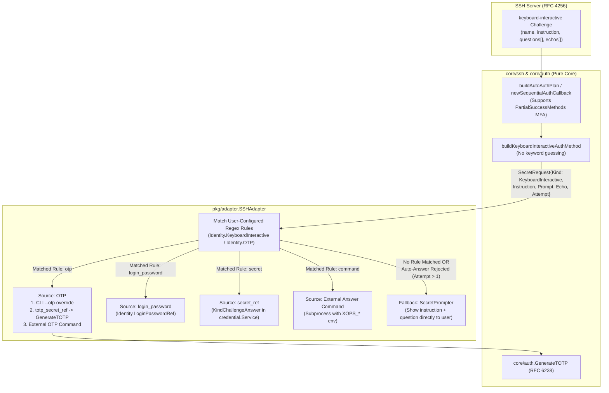

# SSH OTP 与 `keyboard-interactive` 登录设计方案

**文档状态**：已实施（M1–M4 全量完成与验证）

**依据文档**：[凭据零配置体验设计](./credential-experience-design.md)、[公共代码与 MCP 接口解耦设计](./shared-core-decoupling.md)、[SSH 诊断设计](./ssh-diagnostics.md)

**语言版本**：中文开发文档

---

## 1. 背景与目标

### 1.1 背景

当前 `xops-cli` 的 SSH 认证链路（`core/ssh/connector.go`、`core/ssh/auth.go`）仅支持 `publickey`（显式私钥、SSH Agent、默认密钥）和传统 `password` 认证方式，尚未接入 RFC 4256 `keyboard-interactive`（`ssh.KeyboardInteractiveChallenge`）与 OTP/2FA 动态口令能力。

在实际运维场景中，堡垒机、PAM 模块（如 `pam_google_authenticator.so`、`pam_oath.so`、`pam_unix.so`）以及启用多因素认证（如 `AuthenticationMethods publickey,keyboard-interactive` 或 `password,keyboard-interactive`）的 OpenSSH 服务端广泛使用 `keyboard-interactive` 质询应答机制。此外，服务端下发的质询问题文本可能是任意语言、任意提示格式或动态生成的字符，若依赖客户端内置关键字猜测问题类型（如猜测是密码还是 OTP），不仅脆弱易误判，还存在将一次性验证码误存为登录密码的安全隐患。

### 1.2 核心设计原则

1. **不做内置关键字猜测**：
   客户端绝不通过内置关键字列表自动推断服务端 `keyboard-interactive` 问题属于密码还是 OTP。问题类型的判断与应答策略完全交由用户决定。
2. **未匹配问题原样直通用户**：
   当识别到登录方式进入 `keyboard-interactive` 且问题未命中用户显式配置的自动化规则时，客户端直接将服务端下发的提示横幅（`name`/`instruction`）、问题文本（`question`）及回显标志（`echo`）经终端安全清洗后呈现给用户，由用户自行决定输入内容；交互输入内容不触发自动密码持久化（`PasswordCallback`）。
3. **显式配置驱动自动化登录**：
   - **显式 OTP 配置 (`otp`)**：支持配置受管 TOTP 种子引用（`totp_secret_ref`，遵循 RFC 6238 / RFC 4226）或外部 OTP 提供者命令（`command`），实现动态口令自动注入。
   - **问题正则匹配与自动应答规则 (`keyboard_interactive.rules`)**：支持通过正则表达式（`prompt_pattern` 及可选 `instruction_pattern`）匹配服务端问题文本，并绑定指定答案来源自动填入答案。
   - **外部答案/OTP 提供者 (`command`)**：支持在 OTP 配置和问答规则中配置外部可执行命令，认证时从外部密码器或脚本（如 `1password`/`op`、`oathtool`、`pass`、企业内部凭据助手）动态获取答案。

### 1.3 目标与非目标

| 纳入范围 | 不包含的承诺 |
| :--- | :--- |
| RFC 4256 `keyboard-interactive` 单阶段认证与多阶段 `PartialSuccessMethods` MFA | 通过内置关键字启发式猜测问题是否为登录密码或 OTP |
| 未配置规则时将服务端问题原样（清洗控制字符后）交由终端用户输入 | 将 `keyboard-interactive` 交互回答自动作为 `login_password` 写回凭据库 |
| 身份级显式 `otp` 配置（RFC 6238 TOTP 种子引用或外部命令）及 CLI `--otp` 覆盖 | 在 `config.yaml` 中直接存储明文 TOTP 种子或明文静态挑战答案 |
| 基于正则表达式的问题匹配规则（`prompt_pattern` / `instruction_pattern`）与自动应答 | 使用 `sh -c` 拼接执行未经转义的外部命令字符串 |
| 支持四类自动答案源：`otp`、`login_password`、`secret`（凭据引用）、`command`（外部命令） | 自动应答被服务端拒绝后无限制重复提交同一答案导致死循环 |

---

## 2. 总体架构与认证数据流



### 2.1 认证方法编排与多阶段 MFA (`PartialSuccessMethods`)

1. **`auth_type` 取值范围**：
   扩展 `Identity.AuthType` 与 `core/ssh.Config.AuthType`，支持：
   - `"auto"`（默认）：候选顺序为 `显式私钥 (publickey) -> ssh-agent (publickey) -> 默认私钥 (publickey) -> password -> keyboard-interactive`。
   - `"keyboard-interactive"`：优先使用 `keyboard-interactive`（若服务端多阶段要求配合 `password`，由 `AuthCallback` 按服务端 `AllowedMethods` 协调）。
   - `"otp"`：优先使用 `keyboard-interactive` 并启用显式 OTP 应答（同时兼容 `password + keyboard-interactive` 多阶段 MFA）。
   - `"key"` / `"agent"` / `"password"`：保持主认证语义不变；当第一阶段通过后服务端返回 `SSH_MSG_USERAUTH_FAILURE (partial_success=true)` 且 `ctx.AllowedMethods` 要求 `"keyboard-interactive"` 时，自动衔接 `keyboard-interactive` 完成第二阶段认证。

2. **`PartialSuccessMethods` 阶段推进**：
   在 `core/ssh/auth.go:newSequentialAuthCallback` 中按 `stage := len(ctx.PartialSuccessMethods)` 维护每阶段已尝试的候选集合。当 `stage` 增加时，表明前一认证方法已达成阶段性成功（例如 `publickey` 验证通过，服务端继续要求 `keyboard-interactive`），此时重置当前阶段的候选遍历状态，从而支持 `publickey -> keyboard-interactive`、`password -> keyboard-interactive` 等组合。

### 2.2 `keyboard-interactive` 问题处理与回退规则

1. **空问题包兼容 (`len(questions) == 0`)**：
   根据 RFC 4256，PAM 服务端常在正式提问前发送仅含 `name` 或 `instruction` 的空问题包（`len(questions) == 0`）。客户端不得将其视为异常或触发非交互模式失败；若其中包含非空文本，将其缓存并合并到同一次握手中下一轮非空提问的 `SecretRequest.Instruction` 中，直接返回 `nil, nil`。

2. **规则匹配优先级（仅在 `Attempt == 1` 时触发自动应答）**：
   对于每个问题 `questions[i]`：
   - **步骤 1（匹配 `keyboard_interactive.rules`）**：按配置顺序遍历 `Identity.KeyboardInteractive.Rules`。若 `rule.PromptPattern` 匹配 `questions[i]`（且在配置了 `rule.InstructionPattern` 时同时匹配 `Instruction`），则按该规则的 `source` 获取答案。
   - **步骤 2（匹配显式 `otp` 配置）**：若未命中上述规则，检查 `Identity.OTP` 或命令行单次覆盖 `--otp`：
     - 若配置了 `OTP.PromptPattern`，则当 `OTP.PromptPattern` 匹配 `questions[i]` 时使用 OTP 应答；
     - 若未配置 `OTP.PromptPattern`，且当前有效 `AuthType == "otp"`（或命令行显式传入了 `--otp` / `--otp-stdin`）且本次质询仅包含单个问题（`len(questions) == 1`），则直接使用 OTP 应答。
   - **步骤 3（直通用户交互）**：若未命中任何自动化规则，返回 `ssh.ErrInteractionRequired`，由 `SecretPrompter` 将清洗后的 `Instruction`、`Prompt`（`questions[i]`）和 `Echo`（`echos[i]`）直接呈现给终端用户。

3. **自动应答失败防死循环 (`Attempt > 1`)**：
   在同一 SSH 握手中，客户端按问题文本统计尝试次数 `Attempt`。若 `Attempt == 1` 时通过规则或 OTP 自动提交了答案，但服务端拒绝并再次下发同一问题（`Attempt >= 2`），客户端**不再重复调用 `SecretResolver` 提交相同的自动答案**，而是直接回退至 `SecretPrompter` 由用户手动输入（在 MCP 或批量非交互模式下直接返回 `ErrInteractionRequired` 终止连接）。

---

## 3. 配置模型与 Schema V2 规范

### 3.1 `config.yaml` 配置示例

```yaml
schema_version: 2
identities:
  # 场景 1：显式配置托管 TOTP 种子，单步 OTP 登录
  jump-totp:
    user: devops
    auth_type: otp
    otp:
      totp_secret_ref:
        store_id: default
        item_id: 11111111111111111111111111111111
      prompt_pattern: "(?i)(verification code|otp|动态口令)"

  # 场景 2：多问题 keyboard-interactive + 外部命令提供者
  bastion-pam:
    user: ops
    auth_type: keyboard-interactive
    login_password_ref:
      store_id: default
      item_id: 22222222222222222222222222222222
    otp:
      command: /usr/local/bin/op
      args: ["item", "get", "bastion-otp", "--otp"]
      timeout: 10s
    keyboard_interactive:
      rules:
        - name: unix-password
          prompt_pattern: "^Password:\\s*$"
          source: login_password
        - name: google-auth-otp
          prompt_pattern: "^Verification code:\\s*$"
          source: otp
        - name: dynamic-pin
          prompt_pattern: "^Enter Security PIN:"
          source: command
          command: /usr/local/bin/get-security-pin
          args: ["--env", "prod"]
          timeout: 5s
        - name: static-challenge
          prompt_pattern: "^Department Code:"
          source: secret
          secret_ref:
            store_id: default
            item_id: 33333333333333333333333333333333
```

### 3.2 Go 领域模型 (`pkg/models/types.go`)

```go
// OTPConfig 定义身份的显式 OTP 自动化配置（支持托管 TOTP 种子或外部获取命令）。
type OTPConfig struct {
	TOTPSecretRef *credential.Ref `yaml:"totp_secret_ref,omitempty" json:"totp_secret_ref,omitempty"`
	Command       string          `yaml:"command,omitempty" json:"command,omitempty"`
	Args          []string        `yaml:"args,omitempty" json:"args,omitempty"`
	Timeout       time.Duration   `yaml:"timeout,omitempty" json:"timeout,omitempty"`
	PromptPattern string          `yaml:"prompt_pattern,omitempty" json:"prompt_pattern,omitempty"`
}

// ChallengeAnswerSource 定义 keyboard-interactive 规则的答案来源类型。
type ChallengeAnswerSource string

const (
	ChallengeSourceOTP           ChallengeAnswerSource = "otp"
	ChallengeSourceLoginPassword ChallengeAnswerSource = "login_password"
	ChallengeSourceSecret        ChallengeAnswerSource = "secret"
	ChallengeSourceCommand       ChallengeAnswerSource = "command"
)

// ChallengeRule 定义单条 keyboard-interactive 问题正则匹配与自动应答规则。
type ChallengeRule struct {
	Name               string                `yaml:"name,omitempty" json:"name,omitempty"`
	PromptPattern      string                `yaml:"prompt_pattern" json:"prompt_pattern"`
	InstructionPattern string                `yaml:"instruction_pattern,omitempty" json:"instruction_pattern,omitempty"`
	Source             ChallengeAnswerSource `yaml:"source" json:"source"`
	SecretRef          *credential.Ref       `yaml:"secret_ref,omitempty" json:"secret_ref,omitempty"`
	Command            string                `yaml:"command,omitempty" json:"command,omitempty"`
	Args               []string              `yaml:"args,omitempty" json:"args,omitempty"`
	Timeout            time.Duration         `yaml:"timeout,omitempty" json:"timeout,omitempty"`
}

// KeyboardInteractiveConfig 定义 keyboard-interactive 自动应答规则集。
type KeyboardInteractiveConfig struct {
	Rules []ChallengeRule `yaml:"rules,omitempty" json:"rules,omitempty"`
}
```

### 3.3 Schema V2 校验规则 (`pkg/config/schema_v2.go`)

1. **零明文红线校验 (`checkForbiddenPlaintextFields`)**：
   严禁在 `identities.<id>` 或 `keyboard_interactive.rules` 下出现明文机密字段（如 `totp_secret`、`otp_secret`、`answer`、`secret`）。所有静态机密必须通过 `credential.Ref` 引用凭据存储后端（`KindTOTPSecret = "totp_secret"`、`KindChallengeAnswer = "challenge_answer"`）。
2. **`OTPConfig` 合法性校验**：
   - `totp_secret_ref` 与 `command` 至少配置其一，且二者互斥；
   - 若配置了 `totp_secret_ref`，其引用格式必须合法且 `store_id` 在 `credential.stores` 中已定义；
   - 若配置了 `command`，不能为空且禁止包含 Shell 元字符（`;|&\`$\n`）；
   - 若配置了 `prompt_pattern`，必须通过 `regexp.Compile` 校验；
   - `timeout` 不得为负数。
3. **`KeyboardInteractiveConfig` 合法性校验**：
   - 每条规则的 `prompt_pattern` 必须非空且通过 `regexp.Compile` 校验；若配置了 `instruction_pattern`，同样必须通过 `regexp.Compile` 校验；
   - 若规则配置了 `name`，在同一 Identity 内必须唯一；当 `source: secret` 时，`name` 必须非空（用于定位规则凭据引用）；
   - 按 `source` 校验专属字段：
     - `source: otp`：规则自身不得携带 `secret_ref` 或 `command`（可关联 Identity `otp` 块或运行时 `--otp`）；
     - `source: login_password`：规则自身不得携带 `secret_ref` 或 `command`；
     - `source: secret`：必须配置合法的 `secret_ref`（`store_id` 在 `credential.stores` 中已定义），且不得携带 `command`；
     - `source: command`：必须配置非空且无禁用元字符的 `command`，且不得携带 `secret_ref`。

---

## 4. 外部答案与 OTP 提供者协议 (`internal/credentialhelper`)

为支持从外部系统（如 `1password` CLI、`oathtool`、`pass`、HashiCorp Vault 或自定义脚本）获取动态口令或问题答案，在 `internal/credentialhelper/answer_command.go` 中复用 `internal/credentialhelper/process.go` 的安全子进程执行基础设施：

1. **进程启动与防注入**：
   - 直接调用 `exec.CommandContext(execCtx, command, args...)`，**绝不通过 `/bin/sh -c` 或 `cmd.exe /c` 执行**；
   - 子进程 `Stdin` 固定绑定到 `os.DevNull`，防止子进程阻塞等待终端标准输入。
2. **上下文环境变量注入**：
   在继承当前进程基础环境变量的同时，注入以下只读上下文变量供外部脚本按需使用：
   - `XOPS_NODE`：目标节点名称
   - `XOPS_HOST`：目标主机地址
   - `XOPS_USER`：SSH 登录用户名
   - `XOPS_IDENTITY`：身份配置名称
   - `XOPS_PROMPT`：清洗控制字符后的服务端问题文本（`question`）
   - `XOPS_INSTRUCTION`：清洗控制字符后的服务端提示文本（`name`/`instruction`）
   - `XOPS_ECHO`：`"true"` 或 `"false"`
   - `XOPS_NON_INTERACTIVE`：非交互模式下为 `"1"`，交互模式下为 `"0"`
3. **输出读取与超时生命周期**：
   - 默认超时 `15s`（可通过 `timeout` 字段自定义）；超时或上下文取消时调用 `session.KillTree()` 终止整个子进程树；
   - `Stdout` 限制最大读取 `4096` 字节，仅剥离末尾的单个换行符（`\r\n` 或 `\n`）作为答案返回；
   - 若退出码非 0，对 `Stderr` 进行敏感信息脱敏（`SanitizeDiagnostic`）后返回错误。

---

## 5. 分模块实施清单

### 5.1 `core/auth`：零依赖 RFC 6238 TOTP 生成器
- **新增文件**：`core/auth/totp.go`、`core/auth/totp_test.go`
- **职责**：
  - 使用 Go 标准库（`crypto/hmac`、`crypto/sha1`、`crypto/sha256`、`crypto/sha512`、`encoding/base32`、`net/url`）实现 RFC 4226 / RFC 6238，不引入任何第三方依赖；
  - `ParseTOTPSecret(raw string) (TOTPConfig, error)`：支持直接解析 Base32 密钥（容忍空格、连字符、大小写及省略的 `=`）或 `otpauth://totp/...` URI；
  - `GenerateTOTP(rawSecret string, now time.Time) (string, error)`：生成指定时间的动态验证码。

### 5.2 `core/ssh`：`keyboard-interactive` 与多阶段认证
- **修改文件**：
  - `core/ssh/types_api.go`：新增 `SecretKindOTP`、`SecretKindKeyboardInteractive`；在 `SecretRequest` 中扩展 `Instruction`、`Prompt`、`Echo`、`Attempt`、`NumPrompts` 字段；
  - `core/ssh/keyboard_interactive.go`（新增）：实现 `buildKeyboardInteractiveAuthMethod`，处理空问题包合并、限制单次握手最多 16 次提问、按 `Attempt` 调度 `SecretResolver` 与 `SecretPrompter`；
  - `core/ssh/auth.go`：新增 `autoAuthProtocolKeyboardInteractive`，在 `buildAutoAuthPlan` 和 `newSequentialAuthCallback` 中支持 `keyboard-interactive` 候选与 `PartialSuccessMethods` 多阶段状态重置；
  - `core/ssh/connector.go`：在 `buildSSHConfig` 中接入 `"keyboard-interactive"` 与 `"otp"` 认证模式，并允许 `"key"` / `"agent"` / `"password"` 在服务端要求二次验证时衔接 `keyboard-interactive`。

### 5.3 `pkg/credential`、`pkg/models`、`pkg/config` 与 `internal/mcphost`
- **修改文件**：
  - `pkg/credential/ref.go`、`pkg/credential/service.go`、`pkg/credential/journal.go`：新增 `KindTOTPSecret`、`KindChallengeAnswer` 及 `Target.RuleName`；
  - `pkg/models/types.go`：新增 `OTPConfig`、`ChallengeRule`、`KeyboardInteractiveConfig` 并挂载至 `Identity`；
  - `pkg/config/schema_v2.go`：扩展 `IdentityV2`，实现 YAML 编解码、正则与命令安全校验、明文拦截；
  - `pkg/config/repository.go`、`credential_edit.go`、`asset_delete.go`、`backup_references.go`、`migration_backend_plan.go`、`migration_finalize.go`：将 `TOTPSecretRef` 与规则 `SecretRef` 纳入 `nodeAuthVersion` 版本哈希、CAS 更新、持久化确认、资产删除级联清理、备份引用收集及后端迁移计划；
  - `internal/mcphost/credential_binding.go`：将 `OTP` 与 `KeyboardInteractive` 关联的凭据引用及配置纳入 MCP 连接绑定版本计算。

### 5.4 `internal/credentialhelper` 与 `pkg/adapter`
- **修改/新增文件**：
  - `internal/credentialhelper/answer_command.go`（新增）：实现 `RunAnswerCommand`；
  - `pkg/adapter/ssh_adapter.go`：扩展 `SessionAuth.OTP`；在 `ResolveSecret` 中实现正则规则匹配、OTP 生成及外部命令调用。

### 5.5 `cmd`、`pkg/tui` 与 `pkg/i18n`
- **修改文件**：
  - `cmd/ssh_interaction.go`：清洗服务端 `Instruction` 与 `Prompt` 控制字符，原样展示问题文本并按 `request.Echo` 选择 `ReadLine` 或 `ReadSecret`；
  - `cmd/ssh.go`、`cmd/exec.go`、`cmd/exec_input.go`、`cmd/scp.go`、`cmd/sftp.go`：新增 `--otp` 与 `--otp-stdin` 会话级参数；
  - `cmd/identity.go`、`cmd/utils/credential.go`：支持通过 `identity set-secret` / `identity credential set|delete` 管理 `totp_secret` 与 `challenge_answer`（含 `--rule`）凭据引用；
  - `pkg/tui/form.go`、`pkg/i18n/locales/active.{zh,en}.yaml`：更新节点表单认证类型选项与国际化文案。

---

## 6. 验证与测试矩阵

1. **纯核隔离与算法测试**：
   ```bash
   python3 -m unittest discover -s scripts -p test_check_core.py
   python3 scripts/check_core.py --race
   go test -v -race ./core/auth/...
   ```
2. **SSH `keyboard-interactive` 与 MFA 握手测试**：
   ```bash
   go test -v -race -shuffle=on -count=1 ./core/ssh/...
   ```
   - 覆盖未配置规则时的任意问题直通提示（含 `Instruction`、`Prompt`、`Echo=true/false`）且不触发 `PasswordCallback`；
   - 覆盖正则规则自动应答、自动应答被拒后（`Attempt == 2`）回退交互提示、空问题探测包（`len(questions) == 0`）以及 `publickey -> keyboard-interactive` / `password -> keyboard-interactive` 多阶段 MFA。
3. **外部命令、配置 Schema V2 与 Adapter 测试**：
   ```bash
   go test -v -race ./internal/credentialhelper/... ./pkg/credential/... ./pkg/config/... ./pkg/adapter/... ./internal/mcphost/...
   ```
4. **CLI、TUI、文档与静态检查**：
   ```bash
   go test -v ./cmd/... ./pkg/tui/... ./internal/clicontract/...
   npm run docs:check
   golangci-lint run ./...
   ```
