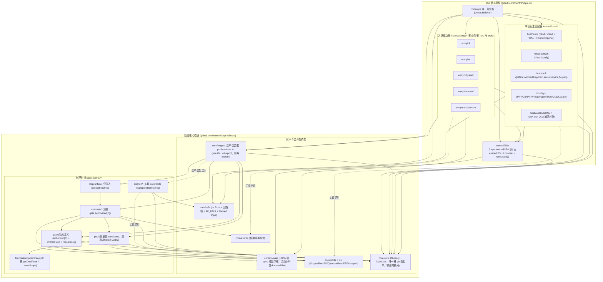

# XOps v2 全新架构定稿规范（Architecture RFC）

> **状态**：架构施工终稿（**v2.3.3 — Phase 0 双模型独立设计与红队复审校准终稿**，完成 Phase 0–5 全量架构闭环；后续已合入 **全仓国际化（i18n）架构规范（Plan v2.2，新增 ADR-017、第 10 分析器 `i18nguard` 与无环 i18n 内部叶包架构）**）  
> **审查基线**：`feat/openssh-compatibility` @ `b15df20`（2026-11-23）；Phase 0 基线 `refactor/v2-architecture` @ `94f828e`（2026-11-24）；i18n M3 闭环基线 `3e054fa`（2026-11-28）  
> **实施约束**：**Go 1.27+** · **零历史兼容包袱** · **禁止打补丁** · **显式大于隐式** · **类型即证明** · **机器强制取代人为约定**

---

## 0. 已拍板架构决策总表（ADR 001–017）

以下 17 项顶层架构决策已全部锁定，作为 Phase 0–5 及后续 v2 演进不可违背的设计宪法：

| 编号 | 决策域 | 最终定稿方案 |
| :--- | :--- | :--- |
| **ADR-001** | **语言、工具链与模块隔离（含 Go Module SIV）** | 锁定 **Go 1.27+** 与 `encoding/json/v2`（遵循 `json/v2` 与 YAML 序列化铁律：持久化/序列化 DTO 禁裸 `time.Duration`，自定义 `algebraic.Duration` 与不透明值对象实现 `TextAppender`/`TextMarshaler`，`SecretBox` 故意不实现编码接口以白嫖 `SemanticError` 失败关闭，规范编码统一开启 `Deterministic(true)`）；采用 **Go Multi-Module Workspace**（`core/go.mod` + CLI 根 `go.mod` + `tools/xopsvet/go.mod`，三模块 0 `replace`）。严守 Go Module SIV：`core/go.mod` 模块路径保持 `github.com/wentf9/xops-cli/core`（无 `/v2` 后缀），全仓正式发版 Tag 统一标定为 **`core/v1.0.0`**。 |
| **ADR-002** | **多模块职责切分** | 完整无宿主六边形核心入 `core/`（纯领域核、端口契约/TCK、结构化并发原语、Actor 连接池、事件流、能力护栏、通用用例服务、MCP 运行时、纯 SSH/SFTP/Mux/OSFS 适配器）；CLI 宿主仅保留本机配置存储、本机 Vault、OpenSSH 解析器、CLI/TUI/SFTPShell 入口与组合根。 |
| **ADR-003** | **`core/` 对外暴露面（正交拆分最小公开面）** | 极简公开 **6 个契约包** + 实现全锁 `core/internal/`：`core/` 仅公开 `core/domain/...`、`core/ports`（含 `tck`）、`core/events`、`core/osfs`、**`core/conc`**（仅含零依赖 `Nursery` + `CtxMutex`，全仓**唯一**裸 `go` 白名单，纯非 I/O stdlib）与 `core/engine`；含 **0 条裸 `go`** 的纯内存 `actor.DualActor` + `ringQueue` 保留于 `core/internal/foundation/actor`，连同 `foundation/trace`（零例外纯非 I/O + 显式 `io.Reader` 熵注入）、连接池、SSH/SFTP 线缆实现、护栏内部状态机、`Authorized[C]` 与 `sim` 全部物理锁入 `core/internal/`。 |
| **ADR-004** | **OpenSSH 集成边界** | 保留完整核心 OpenSSH 体验（`~/.ssh/config` 实时只读虚拟节点、四层选项幺半群、`ProxyJump`/`ProxyCommand`、`ControlMaster`/`ControlPersist`），全部收拢为单一纯代数求解与统一 `NodeOrigin` 和类型。 |
| **ADR-005** | **业务能力范围** | 保留全部现有业务能力（SSH/Mux/转发含 TUN、SCP/SFTP Shell、Batch Exec、Playbook、TUI 含监控与日志流、MCP 含 stdio/HTTP/Transfer/Tunnel/GUI、离线 Vault/Keychain/Helper），全部按新架构干净重写。 |
| **ADR-006** | **零兼容契约与统一导入扩展口** | 全面重塑配置文件（YAML vNext）、离线 Vault 格式、判别式 Playbook YAML、强类型判别式 MCP Tool Schema 与干净 CLI 参数体系（仅标准 OpenSSH 短参数 `-p/-l/-i/-J/-L/-R/-D/-o/-O/-M/-S` 保持肌肉记忆）。**100% 零 v1 迁移代码**，但配置 Schema 显式版本化并在导入/初始化层预留统一 `FormatImporter` / `ImportBundle` 扩展入口。 |
| **ADR-007** | **持久化、双模态本地 FS 端口、Windows 旁路锁与本地 IPC（`AF_UNIX` / Named Pipe）隔离** | 零 CGO（`CGO_ENABLED=0`）纯 Go 静态单二进制：静态配置走人类可读 **YAML vNext**，Saga/传输恢复/审计走结构化 **WAL/JSONL**；根 CLI `go.mod` 在 `CGO_ENABLED=0` 下获批引入纯 Go 系统适配依赖 `github.com/ebitengine/purego`（macOS `Security.framework`）与 `github.com/godbus/dbus/v5`（Linux Secret Service），所有句柄与符号地址驻留适配器结构体字段（0 `init()`、0 包级 `var`）。本地文件端口显式拆分为两个物理隔离接口：① **`ScopedRootFS`**（基于 Go `*os.Root`，专供全部写操作、`~/.xops`、SCP 下载目标与全部 MCP/Agent 路径）；② **`OperatorReadFS`**（仅提供 `WithOperatorRead(path, symlinkPolicy, fn)` 供 CLI/Playbook 读取人工指定的跨盘符/软链只读源文件及 `SSHFPLookupPort` 读取 `/etc/resolv.conf`，**物理上绝不注入 `mcpruntime`**）。`core/osfs` 写锁一律加在同 `os.Root` 下的旁路锁文件 `<name>.lock`，绝不对数据文件本身加锁后 `Rename`；`core/osfs` 统一独占常规文件 OS 句柄、旁路锁、ACL、`os.Root`、本地 `AF_UNIX`（`SocketSlot`/`ProbeStaleUnixSocket`/`DialUnixVerified`）及受验 Windows Named Pipe 客户端拨号 **`DialWindowsNamedPipeVerified(ctx, pipePath) (net.Conn, error)`**（`OPEN_EXISTING`、`FILE_FLAG_OVERLAPPED \| SECURITY_SQOS_PRESENT \| SECURITY_IDENTIFICATION`、`FILE_TYPE_PIPE`、`GetSecurityInfo(SE_KERNEL_OBJECT, OWNER\|DACL)` + `WindowsACLPipeServerSafe` 阻断非受信任主体 `FILE_CREATE_PIPE_INSTANCE=0x04 \| WRITE_DAC \| WRITE_OWNER \| GENERIC_ALL \| GENERIC_WRITE` 同时放行 `LocalSystem` `openssh-ssh-agent` 的合法双工 `FILE_WRITE_DATA`，对 `archbound/osfs_net.go` 与 `core/ports` 零改动）；`core/osfs` 严禁导入 `net/*` 子包与 `os/exec`，导入 `"net"` 由 `archbound/osfs_net.go` 实施**四道 fail-closed 符号防线**（18 项包级白名单 + 3 含 `ctx` 受控方法与 3 包级 Unix 直接绑定 + 零同构克隆/零匿名嵌入/`vetssa` 零擦除 + 完整类型树与字面量白名单）。 |
| **ADR-008** | **包级能力门控、`O(1)` 崩溃对账与 `Halted` 熔断** | **`Authorized[C]` 直接定义于 `core/internal/gate`**（内置正向门控 `valid bool` + `revoked *atomic.Bool`，由 Go 包可见性 100% 物理锁死全仓仅 `gate` 可构造；`core/domain/security` 保持纯数学的 `Capability` 幻影类型、格与 `ApprovalEnvelope`），统一经包级泛型函数 **`gate.WithAuthorized[C](ctx, g, req, run)`** 签发。审计采用 **`~/.xops/run/<ProcessInstanceID>.lock` 进程生命周期内核锁**（记录本进程活跃未闭合 `OperationID`）：干净启动 **O(1) 零扫描 `audit.jsonl`**；发现残留锁先独占 `TryLock` 确认进程死亡并防多进程重复补写，短跨进程追加锁补写 `AbortedByCrash` 后原子删锁。`StrictAgentProfile` 遇 `AuditPostWriteError` 立即触发 **`Halted` 熔断**，经 `OnHaltFunc` 出站回调通知池吊销全部活跃 `ManagedHandle` 并拒绝一切新请求。 |
| **ADR-009** | **六边形解耦连接池与双通道 Actor 硬规约** | `core/internal/pool` **严禁导入 `core/internal/sshnet`**，仅依赖 `core/ports`（生产由 `core/engine` 注入 `sshnet`；`core/engine` 生产源码严禁导入 `core/ports/tck` 与 `core/internal/sim`，仿真装配走 `core/engine/*_test.go`）。底层调度 **`actor.DualActor`**（位于 `core/internal/foundation/actor`，含 0 条裸 `go`、纯内存非 I/O stdlib）配合连接池双模式零裸指针所有权（Scoped `WithLease`/`WithMultiLease` + Generational SlotMap `ManagedHandle`）遵循 6 条并发铁律：① 双通道（有界 `acquireCh` + 永不阻塞 `controlCh`，配对称入站发送者屏障与 panic LIFO `defer` 零分配 `ringQueue.reset()`）；② `actor.DualActor` 主循环采用**两段式 `select`**（先非阻塞排空 `controlCh` 再阻塞监听双通道，`acquireCh` 支路排空 `controlCh` 后必须复核停机状态转 `drainAndStopWithPending(req)`，全停机路径确定性 `stopCh` 优先于 `ctx.Done()`）；③ Actor 主循环 100% 纯内存非阻塞（零 `osfs` 锁/Audit/网络 I/O）；④ 控制面与数据面彻底分离（PTY/转发/10GiB 直走原子 `Epoch`+`ctx` 并发传输）；⑤ **严格嵌套序：`gate.WithAuthorized` 恒包在 `pool.WithLease` 外层**，且所有 `controlCh` 发送必须监听 `actorDone` 防关闭挂起；⑥ `trace.LeaseScope` 为**全局单层不可重入连接租约作用域**，**仅限连接池在即将进入用户回调 `fn(scopedCtx, sess)` 时注入**（严禁 `gate`/`vault`/`osfs` 借用，不误伤池内多跳 DAG 拨号），`domain` 仅只读诊断标签，多租约强制走拓扑序 `WithMultiLease`。 |
| **ADR-010** | **事件流与背压模型** | **作用域化双层事件流**：每次用例调用拥有独立隔离的 `OperationStream`（确定性 EOF、按事件类差异化 `BlockWithContext` / `CoalesceLatest` 背压、支持纯 `Fold`）；审计走同步 Fail-Closed `AuditSink`；池与诊断走有界非阻塞 `SystemBus`（`DropAndCount`）。 |
| **ADR-011** | **全闭包零 `mustclose`、双层护栏矩阵与特权白名单分离** | 严格区分「能力白名单」「生产源码」与「测试文件」：全仓允许行内 `//nolint:` 严格锁定为 **8 个特权包的生产源码文件**，其余全部包及**全仓所有测试文件（含 8 特权包白盒 `*_test.go`、`cmd/xops`、`core/internal/sim`、`core/internal/foundation/actor`、`tools/xopsvet` 及全部外置 `*_test`）100% 禁止行内 `//nolint:`**。全仓对外**彻底消灭命令式 `mustclose` 裸句柄**（含 `SecretVault`/`CredentialService` 统一 `WithSecret(ctx, ref, func(box *SecretBox) error)` + `secret.WithBytes` 仅标 `//xops:syncclosure` + `//xops:borrowed`、禁标 `//xops:secretuse`）。确立**生产 / 测试与 `core/ports/tck` 夹具双层契约**（`tck`/`sim` 0 生产可达），构建元信息统一由 `cmd/xops` 精确路径 `package main` 非测试文件以六重门控只读 **`//xops:buildvar`** 接收 `-X 'main.build*'` 并经显式 `BuildInfo` 注入 `entry/cli`。 |
| **ADR-012** | **纵向 Walking Skeleton 交付节奏** | 在 `Gate G2` 通过后立即插入 **`Phase 2.5 Walking Skeleton`（Gate G2.5）** 纵向纯 v2 薄切片，第一时间在 Linux/Windows(ConPTY)/macOS 三平台真机验证最小 `xops ssh` 闭环并锁定端口契约，再双轨并行铺开 Phase 3 与 Phase 4。 |
| **ADR-013** | **复杂度与体量红线校准** | 用认知复杂度 **`gocognit <= 15`** 取代 `gocyclo <= 15`（与 `sumexhaust` 扁平 `type switch` 零冲突）；单包生产代码上限 **3,000 LOC**；单文件业务/状态机上限 **500 LOC**，纯声明式 ADT/选项表/规范编码文件（显式命名 `*_spec.go` / `*_variants.go` / `*_codec.go`）上限 **800 LOC**。 |
| **ADR-014** | **地道 Go 函数式克制与 `domain` 纯数学白名单** | 保留 Sealed Sum Types、幺半群、有界格、纯 Mealy FSM、`NonEmpty[T]`、`FirstWins[T]`；移除泛化 `Result[T]` 回归地道 `(T, error)`；`Option[T]` 仅限结构体可选字段；`SecretBox` 为单协程借用（含正向门控 `valid bool` + `wiped bool` + 常量时间 `Equal(other *SecretBox) bool`）且 `Authorized[C]` 迁入 `gate`，确保 **`core/domain/**` 100% 零 `sync` 与零 `sync/atomic`**；纯数学白名单纳入官方纯数学包 **`golang.org/x/text/unicode/norm`**（供 `pathalg` NFC/NFD），子包独占放行 `core/domain/option` → `"crypto/sha1"`（专供 OpenSSH `%C`）与 `core/domain/secret` → `"runtime/secret"`（专供 Go 1.27 `goexperiment.runtimesecret` 钩子）。 |
| **ADR-015** | **`ssh.Channel` 取消看门狗与 `goleak` 保障** | `core/internal/sshnet/dial` 中所有基于 `ssh.Channel`（无 `SetDeadline`）的多跳虚拟 `net.Conn` 必须封装 **`core/conc.Nursery`**（`RunScoped`）监督的 Cancel/Deadline Watchdog，超时立即 `channel.Close()` 唤醒阻塞 `Read`。 |
| **ADR-016** | **诚实安全边界（`SecretBox` 与 SFTP v3）** | ① `SecretBox` 工程目标严格界定为阻断日志/审计/错误/事件/YAML/计划/摘要泄露与自有缓冲 `clear()` 零化（不 fork `x/crypto/ssh`，由 `core/domain/secret` 独占 `"runtime/secret"` 预留 `//go:build goexperiment.runtimesecret` 钩子）；② SFTP v3 两阶段规范化首要防御 AI Agent 困惑副手与静态软链逃逸，并在 `sshnet/sftp` 写路径施加纵深防护（非截断打开 + `SSH_FXP_FSTAT` 类型/`(dev,ino)` 锚定比对 + 同目录临时文件原子 `posix-rename@openssh.com`）。 |
| **ADR-017** | **全仓双语国际化、纯数据延迟渲染与第 10 分析器 `i18nguard`** | 采用「核心纯数据延迟本地化 + 根模块纯叶层词库渲染」分离架构：`core/domain/i18n` 为 `core/domain/**` 绝对叶包（零仓内依赖、零文案库、零运行期 `Locale`，下沉无环内部叶包 `internal/{textalg,errchain,corecatalog/{common,domain,ports,runtime,usecase}}` 保 3,000 LOC 永久可扩展）；根模块新增纯叶层 `internal/i18n`（`LayerInternalI18n`，含唯一 6 重门控只读 `//go:embed embed.FS`、无环叶包 `internal/rootcatalog` 与 11 对中英镜像 YAML 共 1,506 条词条；`archbound` 放行 `core/domain/**` 与 `core/conc` 供 `cross_layer_render_test.go` 校验全领域错误渲染，生产源码实际仅依赖 `core/domain/i18n`、`core/conc` 与 `internal/rootcatalog`，`core/conc` 维持零仓内依赖不动摇）；统一错误链折叠代数保证 `enLoc.RenderError(err) == err.Error()`；机器契约（`ApprovalEnvelope.Digest()`、MCP 7 工具、`audit.jsonl`、OpenSSH `-O`、JSON 键/`error_code`）恒为规范英文，人类界面（CLI/TUI `L` 热切/SFTP Shell/`InteractionPort`）延迟双语渲染；`tools/xopsvet` 扩展为 **10 大分析器**，新增 `i18nguard`（规则 1–5）并联动加固 `archbound`/`noimplicit`/`secretfact`/`secrettaint`（详见 §6）。 |

---

## 1. 现状架构诊断摘要（基线 `b15df20`）

基线 `b15df20` 生产代码 **157,496 LOC**、测试代码 **296,952 LOC**，经 P0–P7 与 W0–W19 共 20 轮对抗审计仍反复出现同类变体缺陷，根源在于 8 大结构性病灶（详见 [invariants.md](./archive/v1/governance/invariants.md)）：
1. **包级物理隔离失效**：`core/ssh` 单包 47,157 LOC（107 文件、122 导出类型、704 导出函数、136 裸 `go`、72 锁、280 channel、63 `reflect`）；`cmd` import 26 包；`pkg/config` 18,966 LOC import 14 包。
2. **可变贫血结构体与假和类型**：`ClientConfig`/`ConnectionConfig` 镜像并存；`playbook.Step`/`TunnelPolyInput`/`SshOptions`(72 字段且被嵌入)允许非法状态构造。
3. **入口层承载编排导致多路径漂移**：`cmd/ssh.go`(3,652 行)/`sftpshell`(3,172 行)/`scp.go`(2,232 行)/`exec.go`(1,685 行) 与双套 MCP 后端包装。
4. **隐性约定泛滥**：鸭子类型接口嗅探、`context.WithValue` 偷渡安全策略与无类型信封、全局可变单例与 `init()`。
5. **连接池分裂与 6 锁层级**：`Connector` 混杂 `pool`/`plans`(嵌套子 Connector)/`masters`；6 把锁靠注释保序；裸 `PlanConnection.Client`；1ms `Ticker` 轮询 `TryLock`。
6. **观测与审计机制割裂**：6 套不兼容通知/回调机制，终态审计散落导致孤儿记录。
7. **安全逃生口与语法级脆弱检查**：`g == nil` 静默放行、`FileSession.Do(*pkgsftp.Client)`、函数名正则检查、43 处 `//nolint:forbidigo` + 19 处 `//nolint:gocyclo`。
8. **持久化迁移耦合运行时域**：7 个 `migration*.go` 与目标/选项解析深度缠绕。

---

## 2. 三模块六边形架构与物理边界

### 2.1 Go Multi-Module 工作区拓扑

本地开发经 `go.work` 协同，全仓 3 个 `go.mod` 严禁 `replace`；开发与分支 CI 阶段对 `core/` 与 `tools/xopsvet/` 强制执行 **`GOWORK=off`** 独立验证，根 CLI 模块经 `go.work` 联合验证；遵循 Go Module SIV（`core/go.mod` 保持 `github.com/wentf9/xops-cli/core` 无 `/v2` 后缀），正式发版打 **`core/v1.0.0`** Tag 锁定根 `go.mod` 依赖后补跑三模块全量 `GOWORK=off` 验收：

```text
xops-cli/
├── go.work                                 # 本地协同 (use ., ./core, ./tools/xopsvet)
├── go.mod                                  # 模块 1: github.com/wentf9/xops-cli (Go 1.27+ CLI 宿主)
├── cmd/xops/                               # 【唯一组合根】零 init、经 -X main.build* + //xops:buildvar 注入只读 BuildInfo、装配 Catalog/Locale/ScopedRootFS/OperatorReadFS、逆序关闭
├── internal/
│   ├── i18n/                               # 【根模块纯叶层 LayerInternalI18n】唯一六重门控只读 //go:embed embed.FS + 11 对双语 YAML(1,506 词条) + Catalog/Localizer + 零仓内依赖叶包 internal/rootcatalog；archbound 放行 core/domain/** 与 core/conc（供 cross_layer_render_test.go 校验全领域错误渲染），生产源码实际仅依赖 core/domain/i18n、core/conc 与 internal/rootcatalog
│   ├── host/                               # 【CLI 出站基础设施适配器】实现 core/ports，仅依赖 core/{domain,ports,osfs,conc} 与 internal/i18n
│   │   ├── store/                          # YAML vNext 原子 CAS 存储 + 全图校验 + WAL + FormatImporter 注册点
│   │   ├── openssh/                        # ~/.ssh/config 只读解析器 + 虚拟节点源 + StreamDiagnostic 双轨本地化 + ControlPersist 规格
│   │   ├── vault/                          # 路由门面 + 5 子包隔离: {offline(Argon2id+XChaCha20-Poly1305/dirfd),wincred,keychain(purego),secretservice(godbus/dbus/v5),helper}
│   │   ├── sys/                            # PTY/ConPTY + Windows JobObject ConsoleRelay + ProcessStdioConn + SSHAgentPort + TUNDevicePort(Linux/macOS) + TTY InteractionPort(/dev/tty, atomic.Pointer Localizer) + SSHFPLookupPort(经 OperatorReadFS) + 跨平台语种探测 locale*.go
│   │   └── audit/                          # Fail-Closed 原子 JSONL + ~/.xops/run/<ProcessInstanceID>.lock O(1) 崩溃对账
│   └── entry/                              # 【CLI 入站驱动适配器】零业务逻辑，仅依赖 core/{domain,events,engine,conc} 与 internal/i18n，严禁 import internal/host/* 与 core/osfs
│       ├── cli/                            # 极薄 CLI 壳（显式 BuildInfo + 命令感知 ScanPreFlags --lang/--json + Flags -> Typed Request -> core/engine -> Stream Renderer）
│       ├── tui/                            # Bubble Tea 工作台（全状态延迟渲染 + L 键实时语种热切 + OperationStream/SystemBus -> tea.Msg 投影 + core/conc.Nursery）
│       ├── sftpshell/                      # 交互式 SFTP 行编辑器（双语 REPL -> TransferService/SessionService）
│       ├── mcpcmd/                         # MCP stdio / Streamable HTTP 宿主监听入口
│       └── muxdaemon/                      # ControlPersist 后台守护进程入口
│
├── core/                                   # 模块 2: github.com/wentf9/xops-cli/core（Go 1.27+ 无宿主六边形核心，首版发版 Tag: core/v1.0.0，演进发 core/v1.x.y）
│   ├── go.mod                              # 严禁依赖 CLI 模块、Cobra、BubbleTea 或个人宿主路径
│   ├── domain/                             # 【公开契约 1：100% 纯函数数学核】零 I/O、零 context、零 sync/atomic、零 reflect（白名单含 x/text/unicode/norm）
│   │   ├── i18n/                           # 【绝对叶包】零仓内依赖、零文案库、零运行期 Locale；含 Locale/MessageID/Param/Message/Error/LocalizableNode 及无环内部叶包 internal/{textalg,errchain,corecatalog/{common,domain,ports,runtime,usecase}}
│   │   ├── algebraic/                      # Option[T](仅结构体可选字段), NonEmpty[T], FirstWins[T], Duration(json/v2 TextAppender)
│   │   ├── secret/                         # SecretBox(单协程 //xops:borrowed, valid+wiped 门控, Use+Equal+WithBytes+clear(), 零 json/v2 编码器, 独占 runtime/secret 钩子)
│   │   ├── netaddr/                        # Endpoint, HostPort, CanonicalHost(零值无效 + TextAppender)
│   │   ├── pathalg/                        # RemotePath, RemoteName, LocalRootedDest, SymlinkPolicy, ProtectedPathMatcher(x/text/unicode/norm)
│   │   ├── option/                         # 四层 OpenSSH 选项幺半群(独占 crypto/sha1 供 %C): OptionLayer, PathList, AlgoPolicy, ProxyRoute, ControlPolicy, EnvFilter
│   │   ├── security/                       # 纯数学安全核: Verdict/RiskLevel/Decision 格, Capability 幻影类型, Policy, ApprovalEnvelope
│   │   ├── execution/                      # LaunchDialect, Interpreter, LoginMode, CommandPlan, ExecutionOutcome(ADT)
│   │   ├── inventory/                      # Host, Identity, Node, AuthMethod(ADT), NodeOrigin(ADT), ProxyJump DAG, ImportBundle(+ImportWarning 双轨本地化)
│   │   ├── plan/                           # HopSpec, SealedConnectionPlan, Merkle HopDigest(零 reflect), ManagedHandle[K]
│   │   ├── playbook/                       # Playbook AST, StepAction(ADT), FoldPlaybookReport
│   │   └── fsm/                            # 5 大纯 Mealy 状态机: VaultSagaFSM, ApprovalFSM, TransferFSM, EnsureFSM, PendingEnrollFSM
│   ├── ports/                              # 【公开契约 2：六边形出站端口接口】仅依赖 core/domain
│   │   ├── store.go                        # InventoryStore, JournalStore, FormatImporter, DurabilityOutcome
│   │   ├── vault.go                        # SecretVault(WithSecret 作用域借用), KeySignerPort, HostTrustPort
│   │   ├── transport.go                    # DialerPort, MuxSocketPort, RemoteFSPort
│   │   ├── localfs.go                      # ScopedRootFS(os.Root 沙箱) 与 OperatorReadFS(CLI 人工只读源，绝不注入 MCP)
│   │   ├── system.go                       # ProcessPort, TerminalPort, Clock, Entropy, EnvPort
│   │   ├── audit.go                        # AuditSink, AuditReconciler
│   │   ├── interaction.go                  # InteractionPort(含可选结构化 TitleMessage/BodyMessage)
│   │   └── tck/                            # 测试契约夹具套件（Technology Compatibility Kit，0 生产可达）
│   ├── events/                             # 【公开契约 3：作用域化双层事件流】Sealed Event ADT + OperationStream + SystemBus
│   ├── osfs/                               # 【公开契约 4：句柄安全 OS 原语】唯一允许裸调 OS 文件/锁/ACL/os.Root/本地 AF_UNIX SocketSlot/Windows Named Pipe 核验拨号(DialWindowsNamedPipeVerified)
│   ├── conc/                               # 【公开契约 5：零依赖结构化并发】Nursery(双吸收态无私哨 RunWait/RunScoped/PanicError) + CtxMutex（全仓唯一裸 go 白名单，纯非 I/O stdlib，维持零仓内依赖）
│   ├── engine/                             # 【公开契约 6：极简装配门面】生产仅装配 pool<-sshnet、gate.OnHaltFunc->pool、用例与 MCP（生产禁导 tck/sim；仿真装配走 core/engine/*_test.go）
│   └── internal/                           # 【物理封锁的核心内部实现】外部宿主与 CLI 均不可见！
│       ├── foundation/
│       │   ├── actor/                      # 两段式 select DualActor[Req, Ctrl] + ringQueue（0 裸 go，纯内存非 I/O stdlib，含停机复核/发送者屏障与零分配 reset）
│       │   └── trace/                      # 只读 TraceID/OpID（纯函数 + 显式 io.Reader 注入，零 crypto/rand）与全局单层非重入 LeaseScope（唯一 context.WithValue 白名单）
│       ├── pool/                           # 双通道纯内存 Actor Merkle 池（仅依赖 core/ports，严禁 import sshnet/osfs！）
│       ├── gate/                           # Authorized[C]（含 valid bool）唯一定义与签发包（包级 gate.WithAuthorized[C] + OnHaltFunc + Halted 熔断 + internal/reasonmsg 规范原因双轨投影）
│       ├── usecase/                        # 6 大权威用例服务: inventory, credential(+DoctorFinding 双轨本地化), session, transfer, automation, observability
│       ├── mcpruntime/                     # MCP 协议运行时（stdio + Streamable HTTP，物理不接收 OperatorReadFS，规范英文机器契约）
│       ├── sshnet/                         # 纯协议适配器: dial(含 ssh.Channel Watchdog), hostkey, mux, sftp(含 FSTAT), forward, priv(明文白名单), probe
│       └── sim/                            # 确定性仿真适配器（0 生产可达，含 SimClock/SeededRand/SimVault/SimScopedRootFS/SimOperatorReadFS/FaultInjector）
│
└── tools/xopsvet/                          # 模块 3: github.com/wentf9/xops-cli/tools/xopsvet（Go 1.27+ 自建编译器护栏）
    ├── go.mod                              # 独立依赖 golang.org/x/tools
    ├── cmd/xopsvet/main.go                 # multichecker 入口 (go vet -vettool=xopsvet ./...)
    ├── internal/{vetutil,vetssa,secretfact}/ # 共享底座（AST 工具、SSA 流/擦除引擎、//xops:secretuse + //xops:syncclosure 前置 Fact）
    └── analyzers/                          # 10 大正交分析器: archbound(含 osfs_net 四防线与 i18n 叶包 DAG), sumexhaust, linearlease, failclosed, secretbox, secrettaint, osboundary, noimplicit, digestcover, i18nguard(规则 1-5)
```

### 2.2 全景依赖与接线拓扑



### 2.3 强制依赖矩阵（Go 模块 + `xopsvet/archbound` 双重锁死）

| 源码位置 | 允许导入的内部层与受控依赖 | 编译器/护栏强制禁止 |
| :--- | :--- | :--- |
| `core/domain/i18n`（及 `internal/**`） | **绝对叶包**：主包仅导入自身与 `internal/{textalg,errchain,corecatalog}`；`corecatalog` 路由包仅导入直属域分片 `corecatalog/{common,domain,ports,runtime,usecase}`；内部叶包零仓内依赖（`corecatalog/**` 生产仅允许 `"slices"`，其余遵循 `domain` 29 纯 stdlib 白名单） | 同层其余 `core/domain/*`（含 `algebraic`）、任何其他 XOps 仓内包、所有外部三方包（含 `x/text/unicode/norm` 在内部叶包内亦禁）及非白名单 stdlib（叶包外置 `*_test` 仅放行 `testing*` 与直接被测包，禁反向导入仓内其他包） |
| `core/domain/**` | 仅同层下级 `core/domain/**`、29 个纯 stdlib（`crypto/sha256`, `crypto/subtle`, `slices`, `strings`, `unicode`, `encoding/binary`, `net/netip`, `time` 仅类型解析等）与 **`golang.org/x/text/unicode/norm`**；子包独占放行：`core/domain/option` → `"crypto/sha1"`（仅 OpenSSH `%C`），`core/domain/secret` → `"runtime/secret"`（`goexperiment.runtimesecret` 钩子） | **`context`, `os`, `net`, `os/exec`, `syscall`, `sync`, `sync/atomic`, `reflect`, `time.Now`, `math/rand`, `core/ports`, `core/events`, `core/osfs`, `core/conc`, `core/internal`**（`core/domain/**` 测试源码同样物理禁止 `os`/`net`/`os/exec`/`sync`/`core/conc`/`sim`/`goleak`） |
| `core/ports/**`（非 `tck`） | `core/domain/**` | `core/internal/**`, `core/osfs`, `core/conc`, `x/crypto/ssh`, `pkg/sftp`, CLI 模块 |
| `core/ports/tck`（测试夹具层） | `core/domain/**`, `core/ports`, `core/ports/tck`, `core/conc`, `go.uber.org/goleak` | `core/internal/**`, `core/osfs`, `core/engine`, CLI 模块；**严禁被任何生产源码（含 `core/engine`）导入，保证 0 生产可达** |
| `core/events` | `core/domain/**` | `core/internal/**`, `core/ports`, `core/osfs`, `core/conc`, `os`, `net` |
| `core/osfs` | `core/domain/{i18n,pathalg,security}`, `core/ports`（实现 `ScopedRootFS` / `OperatorReadFS`）；允许导入 `"net"` 仅用于本地 `AF_UNIX` `SocketSlot`/`ProbeStaleUnixSocket`/`DialUnixVerified` 及受验 Windows Named Pipe 拨号 `DialWindowsNamedPipeVerified`（复用既有四道 fail-closed 符号防线，对 `archbound/osfs_net.go` 与 `core/ports` 零改动） | `core/internal/**`, `core/events`, `core/conc`, **`net/*` 子包**, `os/exec`（及全部非白名单 `net` 符号/类型/成员/克隆/嵌入/擦除） |
| `core/conc`（公开契约 5） | 仅自身与纯内存非 I/O stdlib（含 `context`, `errors`, `fmt`, `runtime/debug`, `sync`, `sync/atomic`, `strings`, `time` 等）；全仓唯一裸 `go` 白名单，**维持零仓内依赖不动摇** | 全部其他仓库层（含 `core/domain`、`core/internal/**`）、全部外部包（生产代码）、`os`/`os/*`/`net`/`net/*`/`syscall`/`unsafe`/`reflect`/`math/rand`/`math/rand/*`/`crypto/rand`/`path/filepath`/`io/ioutil`/`log/syslog`/`plugin`/`embed` |
| `core/internal/foundation/actor` | `core/domain/**`, `core/internal/foundation/{actor,trace}` 与纯内存非 I/O stdlib（与 `core/conc` 零例外同等非 I/O 约束；0 裸 `go`；测试源码允许导入 `core/conc` 驱动） | `core/conc`（生产代码防环）、`core/ports`, `core/events`, `core/osfs`、全部外部包（生产代码）、`os`/`os/*`/`net`/`net/*`/`syscall`/`unsafe`/`reflect`/`math/rand`/`math/rand/*`/`crypto/rand`/`path/filepath`/`io/ioutil`/`log/syslog`/`plugin`/`embed` |
| `core/internal/foundation/trace` | `core/domain/**`, `core/internal/foundation/trace` 与纯内存非 I/O stdlib（与 `conc`/`actor` 零例外同等非 I/O 约束；纯函数 + 显式 `io.Reader` 熵注入，`trace_test.go` 同样禁导 `crypto/rand`；全仓唯一 `context.WithValue` 白名单） | `core/conc`（生产代码）、`core/internal/foundation/actor`、`core/ports`, `core/osfs`, `core/internal/{pool,gate,usecase,sshnet,mcpruntime,sim}`、全部外部包与上述全部非纯内存 I/O stdlib；全路径封死未登记 `core/internal/foundation/*` 子包 |
| `core/internal/pool` | `core/domain/**`, `core/ports`, `core/events`, `core/conc`, `core/internal/foundation/{actor,trace}` | **`core/internal/sshnet/**`**（依赖倒置，由 `core/engine` 注入 `core/ports`！）、**`core/osfs`**、`core/internal/{usecase,gate,mcpruntime}` |
| `core/internal/gate` | `core/domain/**`, `core/ports`, `core/events`, `core/conc`, `core/internal/foundation/{actor,trace}`（含内部叶包 `gate/internal/reasonmsg`） | `core/internal/{pool,sshnet,mcpruntime}`, `core/osfs`（经 `OnHaltFunc` 回调解耦通知池） |
| `core/internal/usecase/**` | `core/domain/**`, `core/ports`, `core/events`, `core/conc`, `core/internal/{foundation/{actor,trace},pool,gate}` | `core/internal/sshnet`, `core/internal/mcpruntime`, **`core/osfs`** |
| `core/internal/mcpruntime` | `core/domain/**`, `core/ports`（仅限 `ScopedRootFS`，禁引 `OperatorReadFS`）、`core/events`, `core/conc`, `core/internal/{foundation/{actor,trace},gate,usecase}` | `core/internal/{pool,sshnet}`, `core/osfs`, **`ports.OperatorReadFS`** |
| `core/engine` | `core/domain/**`, `core/ports`（不含 `tck`）、`core/events`, `core/conc`, `core/internal/**`（不含 `sim` 与未登记 `foundation/*`；唯一核心内部生产装配点，仅装配真实传输 `sshnet`；**仿真装配直接走 `core/engine/*_test.go`**） | **`core/ports/tck`、`core/internal/sim`（生产源码双禁，确保全仓 0 生产二进制可达 `tck` 与 `sim`）**、CLI 模块 |
| `internal/i18n`（`LayerInternalI18n` 及 `internal/rootcatalog`） | 根模块纯叶层：`archbound` 放行 `core/domain/**` 与 `core/conc`（供 `cross_layer_render_test.go` 校验全领域错误渲染）、自身、最小权限 17 纯内存 stdlib（`bytes`/`cmp`/`context`/`embed`/`errors`/`fmt`/`io`/`io/fs`/`iter`/`maps`/`path`/`slices`/`strconv`/`strings`/`time`/`unicode`/`unicode/utf8`）与 `go.yaml.in/yaml/v3`（生产源码实际仅依赖 `core/domain/i18n`、`core/conc` 与无环叶包 `internal/rootcatalog`）；`internal/rootcatalog` 零仓内依赖且生产仅导 `"slices"` | `os`/`net`/`os/exec`/`syscall`/`reflect`、非确定性 `time` 符号（`Now`/`Since`/`Until`/`Sleep`/`Local` 等，由 `archbound/symbols.go` 封禁）、其余外部包、`internal/{host,entry}/**`、`cmd/xops`、`core/{ports,events,osfs,engine,internal/**}`、`tools/**`（并由 `.golangci.yml` `i18n-decoupling` 双重兜底） |
| `internal/host/**`（CLI） | **`core/{domain,ports,osfs,conc}`、`internal/i18n`**（根 CLI `go.mod` 在 `CGO_ENABLED=0` 下获批引入 `github.com/ebitengine/purego` 供 `vault/keychain` 与 `github.com/godbus/dbus/v5` 供 `vault/secretservice`，句柄/符号驻留结构体字段，0 `init()`、0 包级 `var`） | `core/engine`, `core/internal/**`, `internal/entry/**` |
| `internal/entry/**`（CLI） | **`core/{domain,events,engine,conc}`、`internal/i18n`** | **`internal/host/**`**, **`core/osfs`**, `core/internal/**` |
| `cmd/xops` | 唯一外部组合根（组装 `i18n` + `host` + `osfs` + `conc` + `engine` + `entry`；链接期经 `-X 'main.build*'` + `//xops:buildvar` 接收只读构建元信息并封装为显式 `BuildInfo` 传入 `entry/cli`） | 严禁编写业务逻辑、协议解析或并发状态机（禁止 `//nolint:`；`//xops:buildvar` 严守 6 重门控且全包含测试零运行期篡改） |

#### `core/osfs` 本地 `AF_UNIX` 四道 fail-closed `net` 符号防线（`archbound/osfs_net.go`）

为支撑 `P2-T2` `SocketSlot` / `ProbeStaleUnixSocket` 同时物理杜绝 TCP/UDP/DNS/IP 逃逸，`core/osfs` 禁止导入 `net/*` 子包，导入 `"net"` 时由 `archbound/osfs_net.go` 强制实施四道正交防线：
1. **防线 1（18 项包级 `net` 符号白名单）**：仅放行 `ListenUnix`/`ListenUnixgram`/`ResolveUnixAddr`、`FileListener`/`FileConn`/`FilePacketConn`、`UnixAddr`/`UnixConn`/`UnixListener`、`ListenConfig`/`Dialer`、`Listener`/`Conn`/`PacketConn`/`Addr`/`Error`、`OpError`/`ErrClosed`（彻底移除 `net.DialUnix`/`Listen`/`ListenPacket`/`DialTimeout` 与全部 TCP/UDP/IP/Resolver 符号）。
2. **防线 2（3 个含 `ctx` 受控方法 + 3 个包级 Unix 函数直接调用绑定与精确常量网络名）**：仅允许直接调用（禁函数值、方法值、点导入与 `MethodExpr` 偏移绕过）且指定参数位为精确编译期常量：
   - `(*net.Dialer).DialUnix`（arg 1：`unix|unixpacket|unixgram`）；
   - `(*net.ListenConfig).Listen`（arg 1：`unix|unixpacket|unixgram`）；
   - `(*net.ListenConfig).ListenPacket`（arg 1：`unix|unixpacket|unixgram`）；
   - `net.ListenUnix`（arg 0：`unix|unixpacket`）、`net.ListenUnixgram`（arg 0：`unixgram`）、`net.ResolveUnixAddr`（arg 0：`unix|unixpacket|unixgram`）。
3. **防线 3（零同构克隆 + 零命名/匿名嵌入 + `vetssa` 零接口与泛型擦除）**：
   - 扫描全包 `*ast.TypeSpec`：禁止定义任何底层 `*types.Struct` 含有 `field.Pkg().Path() == "net"` 字段的非 `net` 命名类型（精确封死 `type myDialer net.Dialer` 类同构克隆，**绝不误杀** `type SocketSlot struct { ln *net.UnixListener }`）；
   - 扫描全包 `*ast.StructType`（含匿名结构体）：禁止任何嵌入字段（`len(f.Names) == 0`）类型为 `net.Dialer`/`net.ListenConfig`（值或指针），彻底封死 `&struct{ net.Dialer }{}`；
   - 接入 `vetssa.CheckNoErasure`（使用 `vetutil.ContainsExportedValueType` 匹配 `net.Dialer`/`net.ListenConfig`）：封死直接、容器、匿名结构体与导出/嵌入字段形式的 `MakeInterface`/`ChangeInterface`/`ChangeType` 及 `TypesInfo.Instances` 全部类型实参（含 `any` 约束），同时放行仅以未导出非嵌入字段持有的具名结构体（如 `LocalFS`）实现 `ports.ScopedRootFS`（配合 `core/osfs` 物理禁导 `crypto/tls`/`log/syslog`/`reflect` 与非 `x/sys/{unix,windows}` 第三方包，零绕过）。
4. **防线 4（完整类型树 + 复合字面量字段白名单）**：复用 `vetutil.TypeContains` / `vetutil.TypeContainsLocalPred`（含 `Interface`/`Tuple`/`TypeParam`/`Union`/`Signature`）检查所有成员与表达式类型，对 `net.Dialer`（字段仅 `{Timeout, Deadline, LocalAddr, Control, ControlContext}`、方法仅 `{DialUnix}`）与 `net.ListenConfig`（字段仅 `{Control}`、方法仅 `{Listen, ListenPacket}`）的复合字面量及 `Uses` 实施严格字段白名单，禁止无键位置初始化与引入 `*net.Resolver`/`net.KeepAliveConfig`/`*net.TCPConn`/`*net.UDPConn`/`*net.IPConn`。

#### `core/osfs` Windows Named Pipe 本地 IPC 核验拨号（`DialWindowsNamedPipeVerified`）

- 与 Unix `DialUnixVerified` 对称，`core/osfs` 统一拥有常规文件 OS 句柄、旁路锁、ACL、`os.Root`、本地 `AF_UNIX` `SocketSlot` 及受验 Windows Named Pipe 客户端拨号 **`DialWindowsNamedPipeVerified(ctx, pipePath) (net.Conn, error)`**（直接复用既有 `net.Conn`/`net.Addr`/`net.OpError`/`net.ErrClosed` 白名单，对 `archbound/osfs_net.go` 与 `core/ports` **零改动**）：
  - 强制使用 `OPEN_EXISTING` 与 `FILE_FLAG_OVERLAPPED | SECURITY_SQOS_PRESENT | SECURITY_IDENTIFICATION` 打开管道句柄，避免隐式创建与冒名提权；
  - 调用 `GetFileType` 校验句柄类型为 `FILE_TYPE_PIPE`（拒绝非管道设备或常规文件）；
  - 调用 `GetSecurityInfo(SE_KERNEL_OBJECT, OWNER|DACL)` 核验服务端所有者受信任主体与 DACL，并新增 **`WindowsACLPipeServerSafe`** 评估策略——阻断非受信任主体具备 `FILE_CREATE_PIPE_INSTANCE=0x04 | WRITE_DAC | WRITE_OWNER | GENERIC_ALL | GENERIC_WRITE`（防管道抢注与 DACL 篡改），同时合法放行 `LocalSystem` 所属 `openssh-ssh-agent` 为客户端授予的双工 `FILE_WRITE_DATA`（对同用户进程在 `OpenProcess` 可达时同步核验 `ProcessUserSID`）。

---

## 3. 关键核心契约规范（v2.3.3 精确签名）

### 3.1 `core/internal/gate` 独占 `Authorized[C]` 与包级泛型门控

```go
// core/domain/security/capability.go（100% 纯数学，零 sync/atomic）
type Capability interface { sealedCapability() }
type CapInspect  struct{ sealedCapability }
type CapExecute  struct{ sealedCapability }
type CapFileRead struct{ sealedCapability }
type CapFileMut  struct{ sealedCapability }
type CapTransfer struct{ sealedCapability }
type CapTunnel   struct{ sealedCapability }
type CapMutate   struct{ sealedCapability }

// core/internal/gate/authorized.go（Go 包可见性 100% 物理锁死全仓仅 gate 可签发！）
type Authorized[C security.Capability] struct {
    opID    security.OperationID
    binding security.OperationBinding
    profile PolicyProfileKind
    valid   bool         // 正向有效门控（零值恒无效，兼容 failclosed 对 atomic.Bool 检查）
    revoked *atomic.Bool // 退出回调或 Gate 进入 Halted 熔断态立即置 true
}

type Authorizer interface {
    evaluateAndAudit(ctx context.Context, req rawGateRequest) (issuedPermit, error)
    finalizeAudit(ctx context.Context, permit issuedPermit, runErr error) error
    isHalted() bool
}

// 包级泛型函数：完全兼容 Go 1.27+ 接口抽象与依赖注入
func WithAuthorized[C security.Capability](
    ctx context.Context,
    g   Authorizer,
    req GateRequest[C],
    run func(ctx context.Context, auth Authorized[C]) error,
) error
```

### 3.2 `core/ports` 作用域机密与双模态本地 FS 端口

```go
// core/ports/vault.go — 彻底消灭最后一块命令式 mustclose 裸句柄！
type SecretVault interface {
    // 提供方负责打开/解密并保证在回调返回后无条件 defer box.Wipe()；
    // 方法必须显式标注 //xops:syncclosure 与 //xops:borrowed，由 xopsvet/linearlease 静态禁止逃逸闭包。
    //xops:syncclosure
    //xops:borrowed
    WithSecret(ctx context.Context, ref secret.Ref, fn func(box *secret.SecretBox) error) error
    PutAndVerify(ctx context.Context, ref secret.Ref, box *secret.SecretBox) error
    Delete(ctx context.Context, ref secret.Ref) error
}

// core/ports/localfs.go — 物理隔离沙箱写与操作员显式只读
type ScopedRootFS interface {
    // 基于 Go *os.Root 绑定单一目录；所有写操作、~/.xops 配置/Vault/WAL、scp 下载落盘、MCP/Agent 路径强制走此接口。
    // 写锁一律落于同 Root 下的旁路锁文件 <name>.lock，绝不对数据文件本身加锁后 Rename。
    //xops:syncclosure
    //xops:borrowed
    WithRoot(dir pathalg.LocalDir, fn func(root RootHandle) error) error
}

type OperatorReadFS interface {
    // 仅注入 CLI/Playbook DirectOperatorProfile 用例，物理上绝不注入 mcpruntime！
    // 支持操作员显式传入跨盘符路径（如 C:\Temp\a.tgz）与受 SymlinkPolicy 管控的只读源文件（如软链私钥）。
    //xops:syncclosure
    //xops:borrowed
    WithOperatorRead(ctx context.Context, path pathalg.LocalSourcePath, policy pathalg.SymlinkPolicy, fn func(r io.Reader, size int64) error) error
}
```

- **`SecretBox` 零值门控、常量时间比对与入站构造契约（A6 / A8）**：
  - `core/domain/secret.SecretBox` 为单协程借用不透明值容器，内置正向有效门控 **`valid bool`** 与销毁标记 **`wiped bool`**（零值恒无效，严格满足 `failclosed`），销毁时 `clear()` 零化底层字节；
  - 提供常量时间比对方法 **`Equal(other *SecretBox) bool`**（基于 `crypto/subtle.ConstantTimeCompare`），免除 `core/ports/tck` 等测试夹具的明文消费需求；
  - 入站构造器 **`secret.WithBytes(raw []byte, fn func(box *SecretBox) error) error`** 深拷贝并立即 `clear(raw)`、回调退出无条件 `defer box.Wipe()`，仅标注 `//xops:syncclosure` + `//xops:borrowed`，**严禁标注 `//xops:secretuse`**，确保 `core/ports/tck` 与 `internal/host/sys` 等非明文消费白名单包可合法完成入站构造。

### 3.3 `core/conc.Nursery`、`actor.DualActor` 与连接池并发铁律

- **`core/conc.Nursery` 双模式与无私哨双吸收态单调状态机（v2.3.3）**：
  - 废除歧义 `Run`，显式提供 `//xops:syncclosure` 双入口：**`conc.RunWait(ctx, fn)`**（Fork-Join：主回调正常返回先 `Wait()` 等待所有子任务完成后再释放取消；出错或 panic 立即 `Cancel + Wait`）与 **`conc.RunScoped(ctx, fn)`**（守护/Watchdog：无论主回调正常返回还是出错/panic，退场一律先 `Cancel` 再 `Wait`）。
  - **彻底废除未导出私有哨兵 `errScopeCompleted`**，改由受 `n.mu` 保护的 4 态严格单调状态机管理生命周期：`nurseryRunning -> (Wait) -> nurseryWaiting -> (Cancel/Close/fault) -> nurseryCanceled`（不可逆吸收态），以及 `nurseryRunning -> (closeCompleted 且锁外观测 parentCanceled==false && ctx.Err()==nil && len(errs)==0) -> nurseryScopedCompleting`（不可逆吸收态）。
  - `closeCompleted()` 严禁持 `n.mu` 调用外部 `n.parentCtx.Err()`（必须锁外先读）；一旦进入 `nurseryScopedCompleting`，后续 `Cancel`/`Close`/`recordError` 均不得改写状态；退出时统一调用 `n.cancel(nil)`，使 `childCtx.Err()` 与 `context.Cause(childCtx)` 恒为标准 `context.Canceled`，从根源杜绝任何私有哨兵外泄。
  - `RunScoped` 预期退场错误过滤 **`filterExpectedScopeCancel(err error) error`**（含 `nonScopeCancelLeaf` / `checkMultiScopeCancel`，全部返回 `error`，**零弱化 `xopsvet/failclosed`**、0 `//nolint:`）：仅在 `n.state == nurseryScopedCompleting && n.ctx.Err() != nil && (n.parentCtx == nil || n.parentCtx.Err() == nil)` 时，过滤裸叶子 `context.Canceled` 及其非空 `multiUnwrapper` 组合；**任何具名单值包装故障（`singleUnwrapper`，如 `*os.PathError`、`*AuditPostWriteError`、`fmt.Errorf("flush: %w", ...)`）均 100% 原样保留绝不吞噬**。
- **`actor.DualActor`（位于 `core/internal/foundation/actor`，含 0 条裸 `go`、纯内存非 I/O stdlib）两段式 `select`、停机线性化与零分配清理**：
  ```go
  for {
      // 阶段 1：非阻塞排空所有高优控制回传（ReleaseLease / DialCompleted / Evict / GateHalted）
      a.drainControls()
      if stopped, err := a.checkShutdown(ctx); stopped { // 确定性 stopCh 优先于 ctx.Done()
          return err
      }
      // 阶段 2：阻塞等待任一事件或关闭
      select {
      case <-a.controlReady:
          a.drainControls()
      case req := <-a.acquireCh:
          a.drainControls()
          if stopped, err := a.isShutdown(ctx); stopped {
              a.drainAndStopWithPending(req) // 严格 FIFO 排空 req 后再排空剩余 acquireCh
              return err
          }
          a.onRequest(req)
      case <-a.stopCh:
          a.drainAndStop()
          return nil
      case <-ctx.Done():
          // 统一停机确定性：在 beginStop 关闭 stopCh 之前先检测 stopCh 是否已关闭，
          // 确保 Stop() 与 ctx 取消并发就绪时优先返回 nil。
          var exitErr error
          select { case <-a.stopCh: default: exitErr = ctx.Err() }
          a.drainAndStop()
          return exitErr
      }
  }
  ```
  - **入站发送者屏障与零分配 panic 清理**：`SendAcquire(ctx, req)` 采用对称 `acqMu + acqClosed + acqSenders (sync.WaitGroup)` 屏障（严格按「无锁 `isStopping()` → 持锁外校验 `ctx.Err()` → 锁 `acqMu` 判 `acqClosed` 并 `Add(1)`」顺序执行，杜绝停机 TOCTOU 丢请求与锁内调用外部 `ctx.Err()`）；`drainAndStop()` / `drainAndStopWithPending(req)` 严格按 `beginStop() -> acqSenders.Wait() -> drainControls() -> [onDrainRequest(req)] -> drainAcquireCh() -> closeAndDrainControls()` 排空；`Run(ctx)` 设 LIFO 异常防护 `defer` 置 `acqClosed = true`、关 `stopCh`、在 `ctrlMu` 下置 `ctrlClosed = true` 并调用零分配 `ctrlQueue.reset()` 清空滞留指针（不调 `acqSenders.Wait()` 防自锁）。
- **嵌套序与关闭防挂起**：全仓用例强制 **`gate.WithAuthorized` 包裹 `pool.WithLease`**；`defer` 向 `controlCh` 发送 `ReleaseLease` 时一律监听 `actorDone`，杜绝池关闭后延迟归还挂起。
- **`trace.LeaseScope` 全局单层不可重入与显式熵注入契约**：`LeaseScope` 锁定为**全局单层不可重入连接租约作用域**（从根源消除多池嵌套 AB-BA 死锁），**仅限连接池在签发租约并即将进入用户回调 `fn(scopedCtx, sess)` 时注入**（严禁 `gate`/`vault`/`osfs` 借用；池内多跳 DAG 拨号与前置交互不携带该标记，避免误伤内部多跳解析）；`domain` 字段仅为只读诊断归属标签，跨 `domain` 嵌套重入同样拒绝并返回 `ErrReentrantLease`。`TraceID`/`OpID` 彻底移除隐式 `"crypto/rand"`，提供纯函数 `TraceIDFromBytes`/`OpIDFromBytes` 与显式 `NewTraceIDFrom(io.Reader)`/`NewOpIDFrom(io.Reader)`（对接 `ports.Entropy` 与 `sim.SeededRand`）。
- **`ssh.Channel` 看门狗（ADR-015）**：`core/internal/sshnet/dial` 为每个基于上游 `ssh.Channel` 的多跳连接封装 **`core/conc.Nursery`**（`RunScoped`）监督的 Cancel/Deadline Watchdog，超时立即 `channel.Close()` 解除阻塞 `Read`。

### 3.4 `O(1)` 跨进程安全审计崩溃对账协议

- 每个 `Engine` 启动时在 `~/.xops/run/<ProcessInstanceID>.lock` 创建并持有进程生命周期级非阻塞内核文件锁（Unix `flock` / Windows `LockFileEx`），采用**只追加协议（Append-Only：`+<opID>\n` / `-<opID>\n`，仅当内存活跃集归零或排空后才允许 `Truncate(0)`）**避免单进程并发下截断重写窗口丢失在途操作。
- **正常启动 O(1) 零扫描快路径**：启动时扫描 `run/*.lock`；若无任何可抢占的已死亡进程锁文件，**完全不读取 `audit.jsonl`**，启动零额外开销。
- **多终端并发安全恢复**：对每个残留 `.lock` 尝试非阻塞独占 `TryLock`——运行中的其他终端因锁仍被持有会被跳过；唯有真正遇 `SIGKILL`/断电的死亡实例会被单个获胜进程抢到独占锁，慢路径核对 `audit.jsonl` 确认真实未闭合 `OperationID` 后，在短生命周期 `audit.jsonl.lock` 跨进程追加锁下补写 `OperationFinalized{Outcome: AbortedByCrash}`，随后在持锁态截断清空 `.lock`、解锁关闭句柄并 `Remove`（忽略 `ErrNotExist`，兼容 Windows 共享模式）。

### 3.5 Go 1.27 `encoding/json/v2` 与 YAML 序列化纯函数领域核规则

- 禁止在持久化/序列化 DTO（`Event`、`AuditEntry`、`MCP DTO`、持久化 `Config`——特指 `host/store`、含非 `"-"` `json`/`yaml` 标签或显式 `//xops:dto` / 精确 DTO 后缀结构体，**不含纯内存运行期构造参数**）中使用裸 `time.Duration`；统一采用 `core/domain/algebraic.Duration`（实现值接收者 `encoding.TextAppender`/`TextMarshaler`/`TextUnmarshaler`）。
- `noimplicit/duration_dto` 对顶层与嵌套结构体采用统一字段可见性规则（跳过非嵌入未导出字段）；遇自定义编码器前**必须先递归检查泛型类型实参 `named.TypeArgs()`**（永不豁免 `time.Duration` 自身，保证 `Option[time.Duration]` 被拦）；值接收者 `TextAppender`/`TextMarshaler` 在 JSON/YAML 下均安全停钻，而 YAML DTO（含 `yaml` 标签或 `internal/host/store`）遇仅实现 `json.Marshaler`/`MarshalerTo` 或 `map[K]T` 指针接收者 `(*T).MarshalText` 时严禁停钻。
- 所有需参与 JSON/YAML/审计序列化的全私有字段值对象（`Endpoint`、`RemotePath`、`OperationID`、`HopDigest` 等）必须显式实现 `encoding.TextAppender`/`TextMarshaler`（或 `jsonv2.MarshalerTo`）；`SecretBox` 故意不实现任何编码接口，触发 `json/v2` 原生 `SemanticError` 失败关闭。
- 凡用于规范摘要或测试黄金比对的 JSON 编码，一律开启 `jsonv2.Deterministic(true)`。

### 3.6 封闭和类型（ADT）、代数律与五大纯状态机（`core/domain/**`）

1. **核心封闭和类型清单**（均含私有 `sealed*()` 方法并由 `sumexhaust` 穷尽检查；失败路径统一地道 Go `(T, error)`，无泛化 `Result[T]`）：
   - `inventory.AuthMethod`：`AuthPassword(SecretRef) | AuthPrivateKey(NonEmpty[KeyPathSpec], Option[KeyPassphraseBinding], []CertPathSpec) | AuthAgent(Option[AgentSpec]) | AuthKeyboardInteractive(NonEmpty[ChallengeRule]) | AuthComposite(NonEmpty[AuthMethod])`（`KeyPassphraseBinding` 结构强制口令必绑指纹）；
   - `inventory.ChallengeRule`：`RuleTOTP | RuleSecretRef | RuleCommand | RuleLoginPassword`；
   - `inventory.NodeOrigin`：`OriginManaged | OriginOpenSSHVirtual | OriginOpenSSHDerived | OriginAdHoc`；
   - `option.ProxyRoute`：`ProxyUnset | ProxyDisabled | ProxyJumpChain(NonEmpty[HopTarget]) | ProxyCommandSpec(SanitizedCmd)`；
   - `execution.ExecutionOutcome`：`OutcomeNotStarted(StartPhase, err) | OutcomeCompleted(ExitStatus, truncated) | OutcomeUnknown(ExecPhase, err)`（仅 `OutcomeNotStarted.CanRetry() == true`）；
   - `security.GuardrailDecision`：`DecisionDeny | DecisionNeedApproval | DecisionAllow`；
   - `playbook.StepAction`：`StepShell | StepScript | StepCopy | StepTemplate | StepEnsure(Check, Action)`；
   - `fsm.TransferState`、`fsm.VaultSagaState`、`events.Event`。
2. **代数结构求解**：
   - **OpenSSH 四层选项幺半群 `(OptionLayer, ⊕, Unset)`**：由以下正交子幺半群直积构成，并通过唯一纯入口求解：
     - `FirstWins[T]`：标量选项与多路复用各槽；
     - `AlgoPolicy`：单指令表达列表算子 `Unset | Exact | Append(+) | Remove(-, 独占支持 */? 通配) | Prepend(^)`，跨指令与跨层合并严格走 **`FirstWins` 幺半群**——非 `Unset` 左吸收低层以保证 `ssh -G` 差分等价并阻断 `t4` 算法向高层泄漏，仅在最终求解边界对内置默认集 $L_0$ 单次执行 `Apply(L_0)`，结果为空失败关闭；
     - `PathList`：专用于 `IdentityFile`/`CertificateFile` 单指令单路径多行累积——三态 `Unset | Disabled | Set` + `terminated` 封口位，左零元 `Disabled ⊕ x = Disabled` 吸收低优先级层，且 `Set(A, false) ⊕ Disabled = Set(A, true)` 右封口保结合律；
     - `KnownHostsList`：专用于 `UserKnownHostsFile`——单指令支持空白分隔多路径或独立 `none` 且禁止混用，跨指令与跨层严格走 **`FirstWins` 幺半群**，杜绝 HostKey 信任锚点跨层污染；
     - `ProxyRoute`：忠实嵌入 `FirstWins[JumpSlot] × FirstWins[CmdSlot]` 子幺半群的双槽遮蔽封闭和类型，`ProxyCommand=none` 全禁用、`ProxyJump=none` 仅消低层跳板并显露低层命令；
     - `ControlPolicy`：三槽 `FirstWins` 直积保结合律与 `ssh -G` 原始槽位对齐，当 `!Path().IsEnabled()` 时运行期投影 `EffectiveMaster()`/`EffectivePersist()` 一律失败关闭归零；
     - `EnvFilter`：正规形式 `(clear, added)` `SendEnv -PATTERN` 减法幺半群——同层及单份 `~/.ssh/config` 内按遭遇序自上而下 `next ⊕ acc` 折叠以对齐 `ssh -G`，跨四层按 `higher ⊕ lower` 折叠以保证高层覆盖低层；
     - **唯一纯入口与四层求解序**：全平面（拨号、`-f`、`-O`、`ControlPersist`、`exec`、`scp`、`play`、`mcp`）共用唯一纯函数 `option.ResolveEffectivePolicy(origin, endpoint, t1, t2, t3, t4) (EffectivePolicy, error)`，四层严格固定为 **`t1(CLI) > t2(SavedNode) > t3(XOpsGlobal) > t4(OpenSSHConfig)` + 内置兜底 `DefaultOptionLayer()`**；非 OpenSSH 来源（`OriginManaged`/`OriginAdHoc`）按 `INV-D2` **仅对 `t4` 执行安全裁剪**（严格仅保留 `OptionClassMux ∪ OptionClassTransport`，保持 `t3` 完整不裁剪）；
     - **OpenSSH `%C` 协议哈希**：由 `core/domain/option` 独占使用 `"crypto/sha1"` 按 `SHA1(%l%h%p%r%j)` 计算，其中 `%j` 在 `ProxyJumpChain` 激活时严格取**末跳无方括号规范主机名**（其余路由为空串）。
   - **安全有界格**：`Verdict` 交半格（`Deny=0` 零值吸收集）、`RiskLevel` / `Decision` 并半格（`max` 折叠 `NodeOverrides`、多路径、祖先目录与软链解析前后路径），交换/结合/幂等律彻底消除 Go `map` 序依赖。
3. **五大纯 Mealy 状态机**（`Transition(S, I) -> (S', []Effect, []Event)`）：
   - `VaultSagaFSM`：Vault 先写常量时间回读 → 配置 CAS 提交 → 旧引用 5 处无引用确认后 GC；`Applied && !Durable` 进 `UncertainDurability` 停机禁重试禁删凭据；
   - `ApprovalFSM`：词法预检 → SFTP 规范化 → 升级判定（含 `Protected-A -> Protected-B` 软链重定向）→ 加密信封挑战 → 令牌校验签发；Round-2 探测失败立即作废令牌；
   - `TransferFSM`：MCP HTTP 10 GiB 分片流、双版本 Journal、`Streaming -> Commit` 原子交接与崩溃恢复；
   - `EnsureFSM`：Playbook `ensure` 幂等收敛（`OutcomeUnknown` 严禁自动重试）；
   - `PendingEnrollFSM`：首连「先验证后入库」作用域租约状态机。

---

## 4. 六大权威用例服务、零兼容对外契约与 SFTP 纵深防护

### 4.1 统一用例服务与作用域化双层事件流

- **六大用例服务**（全部业务逻辑唯一实现，按 `PolicyProfile` 经 `gate.WithAuthorized[C]` 鉴权，本地 IO 走 `ScopedRootFS` / `OperatorReadFS`）：
  1. **`InventoryService`**：Host/Identity/Node CAS CRUD、跨命名空间 Tarjan DAG 校验、5 位置引用删除、`FormatImporter` 调度（`openssh`/`csv`，预留未来迁移扩展口，100% 零 v1 代码）、`Doctor`、`WithPendingEnrollment`。
  2. **`CredentialService`**：Vault 生命周期（init/unlock/lock/doctor）、`VaultSagaFSM` 轮换/删除与 5 处引用 GC、作用域 `WithSecret`。
  3. **`SessionService`**：不可变 `CommandPlan` 执行、交互 PTY、`sudo`/`sudo-rs`/`su` 提权、2 阶段 Shell 探针、SlotMap 持久 PTY、`-L`/`-R`/`-D`/`-W`/StreamLocal/TUN 转发、ControlMaster `-O` 与 `ControlPersist` 移交。
  4. **`TransferService`**：并行分片 `scp`（`OperatorReadFS` 读源 + `ScopedRootFS` 写目标、断点续传、`--no-clobber`、`Lstat` 悬空软链检查、单次展开 `UploadExact`、软链策略 `(b)`）、交互 SFTP 工作区、远端原子 `read`/`write`/`patch`/`stat`、MCP HTTP 10 GiB 流式传输与恢复。
  5. **`AutomationService`**：并行批量 `exec`（含排除过滤、`--stream`/`--out-dir`）与声明式 Playbook（不可变快照、`on_error`、`EnsureFSM`、纯 `FoldPlaybookReport`）。
  6. **`ObservabilityService`**：TUI 指标流、远端/Docker 日志流、POSIX Bourne 强校验 GUI 操作。
- **双层事件流（`core/events`）**：同步 Fail-Closed `AuditSink`；每调用隔离 `OperationStream`（确定性 EOF，`BlockWithContext` 用于输出/步骤，`CoalesceLatest` 用于进度/TUI 指标）；有界非阻塞 `SystemBus`（`DropAndCount`，承载池与协议脱敏诊断）。

### 4.2 零兼容对外契约与 SFTP v3 纵深边界

```yaml
# YAML vNext 配置示例（version: 2，强判别式，零 v1 明文字段与迁移代码）
version: 2
vault:
  default_store: local-offline
  remember_prompted: ask # always | ask | never
  stores:
    local-offline:
      kind: offline_aead # offline_aead | os_keychain | external_helper | none
      path: ~/.xops/vault
policy:
  cli_default: direct_operator # direct_operator | strict
  mcp_default: strict_agent
  guardrail:
    approval_threshold: moderate
    no_elicit_fallback: deny
    audit_log: ~/.xops/audit.jsonl
    protected_paths: ["/etc/**", "/root/**", "C:/Windows/**"]
inventory:
  hosts:
    web-01-host: { address: 192.0.2.10, port: 22 }
  identities:
    deploy-id:
      user: deploy
      auth:
        kind: private_key # password | private_key | agent | keyboard_interactive | composite
        key_paths: ["~/.ssh/id_ed25519"]
        passphrase_ref: { store: local-offline, item: "a1b2c3..." }
        key_fingerprint: "SHA256:..."
  nodes:
    web-01:
      host: web-01-host
      identity: deploy-id
      aliases: ["w1"]
      tags: ["web", "prod"]
      proxy: { kind: jump, hops: ["bastion-01"] }
      execution: { launch_dialect: posix, interpreter: sh, login: disabled }
```

- **Vault vNext & WAL**：`internal/host/vault` 作为路由门面并将各后端物理隔离至 5 个子包 **`internal/host/vault/{offline,wincred,keychain,secretservice,helper}`**，确保 FFI/`unsafe` 后端的 `unsafe.Slice` / `uintptr->unsafe.Pointer` 永不触发 `vault/offline`（Argon2id 隔离 KDF Helper + XChaCha20-Poly1305 AEAD + `core/osfs` dirfd 旁路 `<name>.lock` 原子落盘）中的 `hasUnsafeVaultForge`；根 CLI `go.mod` 在 `CGO_ENABLED=0` 下批准引入 `github.com/ebitengine/purego`（macOS `Security.framework`）与 `github.com/godbus/dbus/v5`（Linux Secret Service），所有句柄与符号地址存储于适配器结构体字段（0 `init()`、0 包级 `var`）；CRC/版本化 WAL/JSONL。
- **Playbook / MCP / CLI**：Playbook 步骤显式 `kind: shell|script|copy|template|ensure`；MCP 7 个强类型判别工具（`nodes`、`terminal_exec`、`terminal_session`、`file`、`transfer`、`tunnel`、`gui`）；CLI 保留 OpenSSH 标准短参数肌肉记忆（`-p/-l/-i/-J/-L/-R/-D/-o/-O/-M/-S`），统一提供 `--json`、`--policy` 与 `config import` 统一扩展入口；构建元信息由 `cmd/xops` 经 `-X 'main.buildVersion/buildCommit/buildTime'` + `//xops:buildvar` 接收（未注入时回退 `runtime/debug.ReadBuildInfo()`）并以显式 `BuildInfo` 值结构体传入 `entry/cli`。
- **SFTP v3 纵深防护（ADR-016）**：诚实界定两阶段规范化防的是 AI Agent 困惑副手与静态软链绕过（协议无 `openat`/`O_NOFOLLOW`）；写/改路径执行非截断打开 + `SSH_FXP_FSTAT` 文件类型/`(dev,ino)` 锚定比对 + 同目录随机临时文件原子 `posix-rename@openssh.com`。

---

## 5. 四位一体工程防御体系详规（v2.3.3 双层契约与特权矩阵）

1. **物理隔离与校准红线**：Go 1.27+ 三模块 `GOWORK=off`（正式发版 Tag `core/v1.0.0`）；`core/` 仅公开 6 个契约包；`core/engine` 生产禁导 `core/ports/tck` 与 `core/internal/sim`（0 生产可达）；`pool` 仅依赖 `ports`；`mcpruntime` 物理不可见 `OperatorReadFS`；`core/osfs` 受四道 `net` 符号防线约束；`core/conc` 与 `foundation/{actor,trace}` 零例外纯内存非 I/O stdlib 且封死 `FoundationOther`；平台特异实现拆入构建标签文件（规避 `go/ssa` 死块剪枝）；单包 ≤ 3,000 LOC；业务逻辑/状态机单文件 ≤ 500 LOC，显式声明式文件（`*_spec.go`/`*_variants.go`/`*_codec.go`）≤ 800 LOC；认知复杂度 **`gocognit <= 15`**。
2. **封装不变式与全作用域闭包**：全私有字段、零值即拒绝/无效；`Authorized[C]` 与 `SecretBox` 均具备正向门控 `valid bool`；`SecretBox` 提供常量时间 `Equal(other *SecretBox) bool`，`secret.WithBytes` 仅标 `//xops:syncclosure` + `//xops:borrowed`（禁标 `//xops:secretuse`）；`WithLease`/`WithMultiLease`、`WithSecret`+`Use`、`WithRoot`/`WithOperatorRead`、`gate.WithAuthorized` 实现全仓**零命令式 `mustclose` 裸句柄** + 运行时借用失效哨兵。
3. **精准编译器护栏 `tools/xopsvet` — 十大正交分析器（共享 `vetutil`/`vetssa`/`secretfact` 底座）双层契约矩阵**：

| 分析器 | 生产源码 (`!_test.go && !tck`) | 非 `domain` 测试与 `core/ports/tck` | `core/domain/**` 测试源码 (`*_test.go`) |
| :--- | :--- | :--- | :--- |
| **`archbound`** | 100% 严格 DAG（**`core/engine` 生产禁导 `tck` 与 `sim`**；`core/domain/i18n` 绝对叶包；`LayerInternalI18n` 最小 17 stdlib + `yaml/v3` + 禁非确定性 `time` 符号；`core/domain/i18n/internal/**` 与 `internal/i18n/internal/rootcatalog` 单向无环叶包且 `corecatalog/**`/`rootcatalog/**` 生产仅 `"slices"`）+ `core/osfs` 四道 `net` 符号防线（18 符号 + 3 含 `ctx` 方法 + 3 包级直接绑定 + 零同构克隆/零匿名嵌入/`vetssa` 零擦除）+ `core/conc`/`foundation/{actor,trace}` 零例外纯内存非 I/O stdlib（禁 `crypto/rand`/`filepath`/`ioutil`/`syslog`/`plugin`/`embed`，封死 `FoundationOther`）+ `mcpruntime` 禁 `OperatorReadFS` + `domain` 纯白名单 | 严格 DAG + 放行 `testing*`、被测主包、`core/conc`、`go.uber.org/goleak`（`trace_test.go` 同样禁导 `crypto/rand`；`i18n` 内部叶包测试不放行 `conc`/`goleak` 与跨包仓内导入）；`core/` 非 `domain`/`conc`/`other` 层测试放行 `core/internal/sim`；适配器层测试放行 `core/ports/tck` | 严格 29 纯 stdlib + `x/text/unicode/norm`（及 `option`/`secret` 专属项）+ `testing*` + 被测主包（**物理禁止 `os`/`net`/`os/exec`/`sync`/`sync/atomic`/`reflect`/`time.Now`/`core/conc`/`sim`/`goleak`**；`core/domain/i18n/internal/**` 外置测试亦禁导入其他仓内包与三方包） |
| **`osboundary`（OS/env/exec & Unix Listen）** | **100% 强制**（含 `syscall.CreateProcess`/`unix.Exec`、`x/sys/{unix,windows}` 进程与环境变量原语；文件/锁/ACL/`os.Root`/`SocketSlot`/`DialWindowsNamedPipeVerified` 与 SSA Unix Listen 仅 `core/osfs`，SSA Unix Listen 覆盖 `$thunk`/`$bound`/`Phi`/窄接口；`windows.CreateFile`、`windows.GetSecurityInfo`、`os.NewFile`、`unix.Fstat` 在 `core/osfs` 外 **100% 封禁、零动态路径校验器豁免**；env/exec 仅 `internal/host/sys`；`LayerHostSys`（`internal/host/sys/**` 非外置测试生产文件）仅放行直接调用 `golang.org/x/sys/unix.Open` 且 arg 0 为精确编译期字面量 `"/dev/net/tun"`（Linux TUN/TAP，由 `TUNSETIFF` 校验）或 `"/dev/tty"`（Unix 管道 stdin 下 `InteractionPort` 控制终端，由 `term.IsTerminal`/`IoctlGetTermios` 校验）、置位 `O_CLOEXEC` 且不含 `O_CREAT`；`SSHFPLookupPort` 经注入 `ports.OperatorReadFS`（`SymlinkFollow`）读 `/etc/resolv.conf`（0 豁免）；`TUNDevicePort` 支持 Linux `/dev/net/tun`、macOS `AF_SYSTEM` `utun`，Windows/FreeBSD 返回 `ports.ErrUnsupported` 并保留未导出 `driverOpener` 测试接缝供 `tck.RunTUNDeviceSuite` + 原生内核冒烟测试；`pkg.init` 按 `ResolvePos` 指令位置判测试） | 豁免（`tck` 已被 `archbound` 锁死 0 生产可达，测试与 `tck` 合法读 `XOPS_DST_SEEDS`、执行 `ssh -G`、构造 `t.TempDir()` 与本地 Unix 夹具） | 由 `archbound` 物理禁止导入 `os`/`os/exec`/`syscall`/`net` |
| **`osboundary`（`RemotePath`）** | 100% 强制：SSA `RemotePath` 保持 field-sensitive（含嵌套结构体路径与闭包双向投影，不染值构造器非远端字段），全槽位禁调 `path/filepath.*` | 100% 强制 | 100% 强制 |
| **`noimplicit`** | 100% 强制（禁 `init()`/可变包级 `var` 含 `new(expr)` 与 Map Key/保护全包级 `error` 哨兵含 `core/domain/i18n.Sentinel`、`internal/i18n.Sentinel` 同域非空常量构造及跨包只读哨兵重导出/禁泛型与匿名接口断言/持久化 DTO 禁裸 `time.Duration` 且顶层嵌套一致、`TypeArgs()` 优先、JSON 与 YAML 语义分流；`//xops:buildvar` 仅限精确 `cmd/xops` `package main` 非测试未导出单内置 `string`；只读 `//go:embed embed.FS` 仅限精确 `internal/i18n` 非测试未导出单变量六重门控；`context.WithValue` 与 `Value(any) any` 擦除/调用含 `ChangeType`/`IsInvoke` 仅限 `trace`，保留嵌入 `context.Context` 声明豁免；`//nolint:` 仅限 8 个特权包生产源码） | 100% 强制（禁止声明 `//xops:buildvar` 与 `//go:embed embed.FS`；`cmd/xops/*_test.go` 禁止篡改 `buildvar`，`internal/i18n/*_test.go` 禁止篡改或取址 `embed.FS`；**全仓所有白盒与外置测试 100% 禁 `//nolint:`**） | 100% 强制 |
| **`sumexhaust`** | 100% 强制（类型优先 + 前置紧邻否定极性对偶复用数字边界分词 + `CompositeLit`/`new(T)`/`error(nil)` 闭环） | 100% 强制（`inTest` 同时包含 `IsPosInTestFile` 与 **`LayerCorePortsTCK`**，允许 `default: t.Fatal`/`t.Error`） | 100% 强制 |
| **`failclosed`** | 100% 强制（零包白名单、零弱化；禁吞噬新产生局部 `error` 返裸 `bool`，精确豁免纯 `errors.Is`/`AsType`；`zerovalue` 覆盖 `sync/atomic.Bool` 并实施前导否定前缀检查，禁止指针类型充当正向门控） | 100% 强制 | 100% 强制 |
| **`digestcover`** | 100% 强制（编译期校验 `//xops:canonicalhash` 全字段覆盖，零 `reflect`） | 100% 强制 | 100% 强制 |
| **`secretbox`** | 100% 强制（Rule 1 使用不入接口方法与签名的 `ContainsValueType` 永不误杀 `ports.SecretVault`；Rule 3 明文消费 5 包白名单；全 `*ast.StructType` 零匿名嵌入；`vetssa.CheckNoErasure` 零接口与含 `any` 泛型擦除） | 100% 强制（外置 `*_test` 剥夺白名单；经 `AllowMakeInterface` **联合精确豁免** `core/domain/secret` 白盒测试按调用点 `ResolvePos` 直调 `jsonv2.{Marshal,MarshalWrite,MarshalEncode}`） | 100% 强制（含上述 `secret` 白盒唯一精确豁免） |
| **`secrettaint`** | 100% 强制（聚焦 Rule 2 SSA：出参全面 Fail-Closed；联动 `secretfact` 封死 `core/domain/i18n`（28 符号）与 `internal/i18n`（21 符号）全部 49 处 `SinkError` 汇点，强制汇点与 `//xops:syncclosure` 互斥，闭环 `checkMakeClosure`/`checkYieldClosure` 闭包 `retMask != 0` 失败关闭拦截含局部捕获型 IIFE；全局 `sinks.go` 精确符号级纯 AEAD 密码学消费表不含 `argon2`/`AEAD.Open`/整包 `ssh`，`hash.Hash.Write` 验标准库 SSA 源头，`AEAD.Seal` 不染 `dst`；未知回调全路径 Fail-Closed 且 `//xops:secretuse` 仅放行直接 `*ssa.Parameter` 并审计赋值站点；放行嵌套同步 `box.Use`/`runtime/secret.Do`；严隔 `CallerParam` 并反溯写后子切片根分配；`sinks_narrow.go` 仅对非外置测试生产文件按精确子包门控落地 Phase 4 窄钩子，见 §5.5） | 100% 强制（外置 `*_test` 剥夺明文白名单） | 100% 强制 |
| **`linearlease`** | 100% 强制（裸 `go` 仅限唯一白名单 **`core/conc`**；彻底废除 `With*`/`Use` 命名猜测，仅认显式 Fact + `(*secret.SecretBox).Use` + `runtime/secret.Do` + IIFE + 白名单同步 `iter.Seq`；全量 SSA 零逃逸含 `new`/`append`/`comma-ok`/`<-ch`/`Defer`/`Go`/Loop `Phi`/写后子切片反溯/`CallerParam`） | 100% 强制（全仓测试经 `core/conc` 派生协程，仅 `core/conc` 内部白盒测试允许裸 `go`） | 100% 强制（且 `domain` 禁导 `core/conc`） |
| **`i18nguard`** | **100% 强制（规则 1–5 全仓合闸）**：规则 1（`MessageID` 强类型与属主门控、禁包外 `*WithFallback`/禁 `MessageIDInvalid`/禁跨域错配）；规则 2（禁 `errors.New`/`fmt.Errorf` 与底层 `string` 自定义错误，自定义 `error` 强制实现匹配接收者集合的 `LocalizableNode`，永久基础设施白名单仅 `{core/domain/i18n, core/conc, core/internal/sim, core/ports/tck, tools/xopsvet}`）；规则 3（禁 `unicode.Han` 及 `U+3000..U+303F`/`U+FF00..U+FFEF` 全角标点）；规则 4（禁动态明细原语传非空常量、禁 `EF`/`WrapS` 传 `common.detail` 及安全红线/具名业务哨兵用弱模板）；规则 5（禁 `Str`/`BoundStr` 对 `reason`/`detail`/`op` 传非空常量，禁 `field`/`kind`/`component`/`feature`/`expected`/`action` 传含 ASCII 空白字符散文） | 跳过 `*_test.go`、外置 `*_test`、`core/ports/tck`、`core/internal/sim`、`tools/xopsvet` | 跳过 `*_test.go` 与外置 `*_test` |

4. **特权白名单总表（明确区分「能力白名单」「生产源码」与「白盒/外置测试」）**：

| 特权能力 | 唯一合法白名单包（外置 `*_test` 一律剥夺特权） | 生产源码允许 `//nolint:` | 包内白盒 `*_test.go` 允许 `//nolint:` |
| :--- | :--- | :---: | :---: |
| 裸 OS 文件 / 锁 / ACL / `os.Root` / 本地 `AF_UNIX` `SocketSlot` / 受验 Windows Named Pipe 拨号 (`DialWindowsNamedPipeVerified`) | `core/osfs` | 是 | **否** |
| 裸 `go` 语句 | `core/conc`（仅含 `Nursery` + `CtxMutex`，全仓唯一） | 是 | **否** |
| `context.WithValue` / `ctx.Value` | `core/internal/foundation/trace` | 是 | **否** |
| `os.Getenv` / `exec.Command` / PTY / Console Relay / 窄常量 `unix.Open`（`"/dev/net/tun"`、`"/dev/tty"`） | `internal/host/sys` | 是 | **否** |
| 明文机密 `[]byte` 消费（生产路径，4 包） | `core/domain/secret`、`internal/host/vault`（含隔离后端子包 `{offline,wincred,keychain,secretservice,helper}`）、`core/internal/sshnet/dial`、`core/internal/sshnet/priv` | 是 | **否** |
| 明文机密 `[]byte` 消费（仿真 Vault，第 5 包） | `core/internal/sim`（AES-GCM 密文仿真，0 生产可达，仍严格过规则 1/2） | **否** | **否** |
| 链接期只读构建元信息（`//xops:buildvar`） | `cmd/xops`（精确路径 + `package main` + 非测试 + 未导出单内置 `string`） | **否** | **否** |
| 只读嵌入词库（`//go:embed embed.FS`） | `internal/i18n`（六重门控：精确路径 + 非测试 + 原始 `//go:embed ` + 未导出单变量无初值 + 精确 `embed.FS` + 至多 1 个且禁改禁取址） | **否** | **否** |
| 裸 `errors.New` / `fmt.Errorf`（`i18nguard` 规则 2） | `core/domain/i18n`（精确主包，不含 `internal/*`）、`core/conc`（及非生产 `sim`/`tck`/`xopsvet`） | 仅 `core/conc` 允许（其余 **否**） | **否** |

> **铁律**：全仓允许行内 `//nolint:` 的仅限上述 **8 个特权包的生产源码文件**（`core/osfs`、`core/conc`、`core/internal/foundation/trace`、`internal/host/sys`、`internal/host/vault`、`core/internal/sshnet/dial`、`core/internal/sshnet/priv`、`core/domain/secret`）；其余全部包及**全仓所有测试文件（含 8 特权包白盒 `*_test.go`、`cmd/xops`、`internal/i18n`、`core/domain/i18n`、`core/internal/sim`、`core/internal/foundation/actor`、`tools/xopsvet` 及所有外置 `*_test`）100% 禁止行内 `//nolint:`**。

5. **`P4-T1` / `P4-T4` 外部协议结构化受限窄模式钩子与 `vault` 子包隔离契约（A8，0 `//nolint:`）**：
   - 禁止引入行内 `//nolint:` 或放宽全局规则（全局 `sinks.go` 始终保持纯 AEAD），所有外部协议窄写入统一经 `tools/xopsvet/analyzers/secrettaint/sinks_narrow.go` 的按包/子包精确门控受限钩子完成（仅放行非外置测试生产文件，并在消费完成后立即零化中间缓冲）：
     - **`P4-T1`（`core/internal/sshnet/dial` 与 `core/internal/sshnet/priv`）**：`sshnet/dial` 适配 `golang.org/x/crypto/ssh.KeyboardInteractiveChallenge`（唯一流向 `ssh.KeyboardInteractive` 的挑战闭包内经同步 `box.Use` 写入局部 `answers []string` 并在槽 0 返回，强制槽 1 `error` 零染毒与闭包全量复审）；`sshnet/priv` 仅按正向来源白名单放行向已验证的 SSH 通道/`StdinPipe` 写入提权明文。
     - **`P4-T4`（`internal/host/vault/{offline,wincred,keychain,secretservice,helper}` 子包隔离 + 4 项精确子包窄钩子）**：为避免 FFI/`unsafe` 后端的 `unsafe.Slice` / `uintptr->unsafe.Pointer` 触发 `vault/offline`（Argon2id + XChaCha20-Poly1305 AEAD dirfd）中的 `hasUnsafeVaultForge`，OS 与外部后端按子包物理隔离；根 CLI `go.mod` 在 `CGO_ENABLED=0` 下批准引入 `github.com/ebitengine/purego`（macOS `Security.framework`）与 `github.com/godbus/dbus/v5`（Linux Secret Service），所有句柄与符号地址存储于适配器结构体字段（0 `init()`、0 包级 `var`）。`sinks_narrow.go` 定稿 4 项子包级窄钩子：
       1. `internal/host/vault/wincred`（兼容 `internal/host/vault` Phase 0 回归夹具）：`CREDENTIALW` 作用域自有结构体字段存储 + `LazyProc.Call`；
       2. `internal/host/vault/keychain`：`purego.SyscallN`（强制 arg 0 `fn uintptr` 未染毒）；
       3. `internal/host/vault/secretservice`：DH AES-128-CBC（`crypto/cipher.NewCBCEncrypter` + `(cipher.BlockMode).CryptBlocks` 严格限定于 `sinks_narrow.go` 的 `vault/secretservice` 子包，保持全局 `sinks.go` 纯 AEAD）与 `plain` 会话回退（`dbusSecret.Value` 作用域自有字段存储 + `(dbus.BusObject|*dbus.Object).{CallWithContext,Call}` 仅限精确常量方法 `"org.freedesktop.Secret.Collection.CreateItem"` / `"org.freedesktop.Secret.Item.SetSecret"` 且接收者/`ctx`/`flags`/`method` 未染毒）；
       4. `internal/host/vault/helper`：`(ports.ProcessPort).Run(ctx, spec, stdin)`（接收者、`ctx`、`spec` 均未染毒，仅允许 arg 2 `stdin io.Reader` 携带污点）。
6. **契约、早验与确定性测试**：`core/ports/tck`（含 `ScopedRootFS`/`OperatorReadFS`）、代数律/Fuzz、10,000 种子 DST（覆盖 `O(1)` 崩溃对账、`Halted` 熔断、两段式 `actor.DualActor` 满邮箱压测、重入拒绝、5 大全局不变量）、`ssh -G` 差分（保证单份配置文件 `ssh -F <cfg> -G` 语义等价，并显式界定两项跨层安全精化：`IdentityFile=none` 对低层吸收，以及 4 层 `SendEnv` 坚持高层覆盖低层而非 OpenSSH `-o` 先于配置文件的解析序），以及 **`Phase 2.5 Walking Skeleton`** 起即跑通三平台原生 CI。

---

## 6. 全仓国际化（i18n）架构规范

### 6.1 纯数据延迟渲染原则（`core/domain/i18n` vs `internal/i18n`）

XOps v2 严格分离「核心语义载荷构造」与「边界多语种文本渲染」，在不引入任何全局可变单例、零 `init()`、零新增三方库且不破坏 `core/domain` 纯数学边界的前提下实现全仓双语（`en` / `zh`，BCP-47 可扩展）：

- **`core/domain/i18n`（零文案库、零运行期 `Locale`、零仓内依赖绝对叶包）**：
  - 仅依赖 `archbound` 允许的纯函数 stdlib，严禁导入 `core/domain/algebraic` 或任何其他仓内包（从根源消除 `domain/i18n ↔ domain/algebraic` 循环依赖）；
  - 导出零值失败关闭（`//xops:opaque`、`//xops:failclosed`）值对象：`Locale`（`LocaleInvalid`/`LocaleEn`/`LocaleZh`，提供 `Next()` 供 TUI 轮换）、`MessageID`（零值常量 `MessageIDInvalid = ""`）、`Param`（8 种封闭 `ParamKind` 变体，零 `any`、零 `reflect`、时长以 `durNanos int64` 存储满足 `noimplicit/duration_dto`，拒绝 `NaN`/`±Inf`、`-0.0` 归零、限制嵌套深度 `<= 4`、参数个数 `<= 16`、单值字节上限并拒绝 JSON 显式 `null` 旁路字段）、`Message`（`count int64` + `hasCount bool` 替代 `Option`，支持深度 `Equal` 与确定性 `encoding/json/v2` 编解码）、`Error` 与 `LocalizableNode`；
  - 核心层永不持有运行期 `Locale` 或多语种 YAML 词库，仅构造结构化 `Message` / `*Error` / `LocalizableNode`；`err.Error()` 恒定输出规范英文。
- **`internal/i18n`（根模块纯叶层词库 `LayerInternalI18n` 与不可变 `Localizer`）**：
  - 仅在 `internal/i18n/embed_fs.go` 持有全仓唯一受 `noimplicit` 六重门控保护的只读 `//go:embed locales/*/*.yaml` `embed.FS`；
  - 词库按领域拆分为 11 对中英镜像 YAML（`common`、`cli_help`、`cli`、`tui`、`sftpshell`、`interact`、`core_domain`、`core_ports`、`core_runtime`、`core_usecase`、`host`），共 **1,506** 条双语词条；
  - `Entry.UnmarshalYAML` 手工遍历 `yaml.Node`，确定性拦截重复键、未知字段、空值、非标量节点、YAML 别名与非法 `{placeholder}` 语法；`LoadCatalog()` 纯内存校验全量键覆盖与英中占位符对称性；
  - `Catalog` 与 `Localizer` 均不可变且零值失败关闭（零值或 `nil` `*Localizer` 对 `Render(msg)` 回退 `msg.Canonical()`、对 `RenderError(err)` 回退 `err.Error()`、对 `T(id)`/`TPlural(id)` 返回 `string(id)`）；`DefaultLocalizer()` 纯内存零触盘构造英文兜底，保证既有未显式注入的构造器与测试夹具零回归。

### 6.2 3,000 LOC 永久可扩展无环内部叶包架构

为长期严守单包 prod `<= 3,000 LOC` 与 `*_spec.go <= 800 LOC` 红线且零破坏公共 API，两处 i18n 包均采用单向无环内部叶包分解：

- **`core/domain/i18n` 内部叶包 DAG**：
  - `core/domain/i18n/internal/textalg`：纯模板/占位符/Locale/JSON 守卫算法（`FormatTemplate`、`HasMissingPlaceholder`、`CollectFormatPlaceholderKeys`、`ParsePlaceholderKeys`、`BoundDisplayText`、`BoundNonBlankText`、`NormalizeLocaleCore`、`RejectNullObjectMembers` 等）；
  - `core/domain/i18n/internal/errchain`：泛型错误链折叠渲染代数引擎（`Render`、`UnwrapDirect`、`FindFirst`、`IsExactLeafSentinel`）；
  - `core/domain/i18n/internal/corecatalog`（薄路由）→ `corecatalog/{common,domain,ports,runtime,usecase}`（5 个纯查表域叶分片，生产仅允许导入 `"slices"`，横向扩容至 18,000+ LOC，承接 889 条核心消息的规范英文兜底与键枚举，含包内私有 `keyCommonDetail`）。
- **`internal/i18n` 内部叶包 DAG**：
  - `internal/i18n/internal/rootcatalog`：承接根模块 617 条消息的键枚举及错误/诊断/提示类规范英文兜底（生产仅允许导入 `"slices"`；纯展示/UI/Help/TUI/SFTP 键仅驻留 YAML，由 `catalog_test.go` 断言 `RootKeys() \ RootErrorKeys()` 零影子兜底）。
- **静态与测试双锁死**：`archbound/rules.go` 物理锁死上述全部 `internal` 叶包零反向仓内依赖（含外置 `*_test`）及最小 stdlib；`internal/i18n/catalog_test.go` 强制断言 `CoreKeys() + RootKeys()` 与 `en`/`zh` YAML 100% 双射、`CanonicalFallback`/`rootFallback` 与 `en/*.yaml` 逐字一致，以及错误模板自包含语义校验（剥离占位符后英文含有效英文实词、中文含 `>= 2` 汉字）。

### 6.3 统一错误链折叠代数与 `enLoc.RenderError(err) == err.Error()` 恒等式

- **非穿透节点视图**：`LocalizableNode` 刻意不嵌入 `error`，使边界经 `InspectNode`（`any(err).(LocalizableNode)`）与 `UnwrapDirect`（包内具名 `singleUnwrapper`/`multiUnwrapper`）逐层检查单层节点，**零触发 `errorlint` 且零 `//nolint:`**；`ErrorNode` 携带显式 `SuppressedSentinels []error` 声明渲染期被替代的同义源哨兵（绝不进入 `Unwrap()` 污染 `errors.Is`）。
- **形式化折叠规则 M1–M6（`RenderErrorChain` / `CanonicalError` → `internal/errchain.Render`）**：
  1. **M1 纯门面映射节点**：未命中当前抑制集 `S` 时渲染门面头段，且恒合并 `S' = S ∪ {Sentinel} ∪ SuppressedSentinels` 向下传播；
  2. **M2 裸结构化哨兵**：仅当未命中 `S` 时渲染；
  3. **M3 带上下文结构化节点**：永不被 `S` 抑制，并携带 `S' = S ∪ SuppressedSentinels` 穿透展开 `Cause`；
  4. **M4 `errors.Join` 容器**：识别纯拼接多错误容器，向每个子分支传入独立不可变 `S`（零跨分支污染），省略空分支后以 `"\n"` 拼接；
  5. **M5 精确裸叶子核验（CORE-2）**：`IsExactLeafSentinel` 以 O(1) 零递归校验 `errors.Is(err, target) && err.Error() == targetText`，绝不覆盖或吞噬携带自定义诊断文本的叶子错误；
  6. **M6 防重入与双预算终止**：对任意 `LocalizableNode` 永不调用 `.Error()`，在 `MaxRenderDepth=64`、`MaxVisitNodes=256`、`MaxSuppressed=32` 约束下确定性终止。
- **紧凑原语族与动态明细闭环**：提供 `Sentinel`/`E`/`EF`/`Wrap`/`WrapS`/`WrapSentinel`；将 `keyCommonDetail`（`"common.detail"`）私有化于 `core/domain/i18n` 包内，对外导出零歧义原语 **`WrapSentinelDetail(sentinel, cause, detail, replaced...)`**（强制走规则 M1 保哨兵头段语义与 `replaced` 抑制）与 **`DynamicDetailError(detail)`**（有界有效 UTF-8 纯动态对端叶子，不绑哨兵）。跨模块 `*WithFallback` 桥接收敛为 4 原语且由 `i18nguard` 规则 1 封禁 `{core/domain/i18n, internal/i18n}` 外引用。
- **`ensureErrorMessage` 缺失占位符闭环**：快路径采用与 `FormatTemplate` 词法同构的 O(n) 零分配 `textalg.HasMissingPlaceholder`；慢路径经 `textalg.CollectFormatPlaceholderKeys` 识别必填槽位、优先保序抢救有效参数、递归闭合嵌套 `ParamKindMessage` 并对缺失占位符回填 `"<invalid>"`（超 `MaxMessageParams` 病态模板降级 `KeyCommonInvalidArgument`），彻底杜绝 `{key}` 裸露。
- **3 钩子薄适配器与数学恒等式**：`internal/i18n/render_error.go` 仅向 `RenderErrorChain` 注入 3 个钩子——`RenderMessage`、`JoinCausal`（直接查 YAML `common.error_join` 并用 `FormatTemplate` 直插 `head`/`tail`，不经 `BoundStr` 截断）与 `RenderUnstructured`（精确叶子映射 `context.{Canceled,DeadlineExceeded}` 与 6 个 `conc.Err*`，O(1) 非穿透渲染 `*conc.PanicError`，使 `core/conc` 保持零仓内依赖不动摇），从数学上严格保证任意错误链满足 **`enLoc.RenderError(err) == err.Error()`**。

### 6.4 机器契约规范英文 vs 人类界面双语边界

| 边界类别 | 覆盖范围 | 语种与稳定性不变量 |
| :--- | :--- | :--- |
| **机器契约（恒定规范英文）** | `ApprovalEnvelope.Digest()` 与 `ScopeSummary()`、MCP 7 工具描述/Schema 与全部 JSON-RPC 错误响应、`audit.jsonl` 审计日志、`core/events` 事件载荷、OpenSSH `-O` 兼容输出、CLI `--json` 全部字段名/`error_code`/`approval_challenge.reason`/`doctor --json` & `config import --json` 规范字段、交互确认词 ASCII `[y/N]` / `[approve/N]`、`mcpcmd`/`muxdaemon` 就绪摘要行 | **100% 规范英文，不受 `--lang`/`XOPS_LANG` 影响**；`ApprovalEnvelope.Digest()` 逐字节零漂移；MCP 端到端测试强制零 Han 字符断言 |
| **人类可读界面（延迟双语渲染）** | CLI 帮助/版本标签/退出码诊断/人类摘要、`--json` 的 `ErrorEnvelope.Error`、TUI 全状态视图 + 大写 `L` 热切（过滤态守卫、区分小写 `l` 日志流、经 `OnLocaleChange` 联动 `Interaction.SetLocalizer` 同步接管会话提示）、SFTP Shell、`InteractionPort` 全部 13+ 处提示（`atomic.Pointer[i18n.Localizer]`） | 在入站边界经 `Catalog.For(locale)` 延迟渲染；远端 PAM 质询非空原文保持 `BodyMessage = None` 原样脱敏透传 |

### 6.5 状态机、策略与诊断双轨本地化

- **门控与审批原因双轨投影（`core/internal/gate/internal/reasonmsg`）**：
  - `core/domain/security` 与 `ApprovalEnvelope.Digest()` 零字节变更；`fsm.ApprovalState` 进入 `ApprovalPhaseChallengePending` 保留规范英文 `reason`；
  - `core/internal/gate/internal/reasonmsg` 提供纯函数 `ProjectMessage`/`Param`/`ErrorForSentinel`，将安全/FSM/门控封闭规范英文原因确定性投影为 `KeyGateReason*`（规范英文兜底与原串逐字同构，未命中外部自由文本安全回退 `BoundStr`/`WrapSentinelDetail`）；
  - `gate.(*ApprovalChallengeError).ReasonParam` 与 `engine.ApprovalChallenge.ReasonParam` 将结构化原因跨层透传至 `clikit.Runtime.Fail` 与 `sftpshell`（零值/无效态失败关闭至 `KeyGateReasonApprovalRequired`），同时 `Reason()` 保留规范英文供 `--json` 契约输出。
- **三类诊断对象单源双轨**：
  - `credential.DoctorFinding`：`Message` 恒为规范英文；新增 `Localized algebraic.Option[domi18n.Message]` 与 `Cause error`（均标 `json:"-"` 物理屏蔽于 JSON/MCP 之外），经 `NewLocalizedDoctorFinding` 单源派生，CLI 文本模式延迟递归本地化；
  - `openssh.StreamDiagnostic`：保留规范英文 `Message`，新增可选 `Localized algebraic.Option[domi18n.Message]`；
  - `inventory.ImportWarning`：不透明值对象经 `NewLocalizedImportWarning` 由结构化 `Message` 单源派生规范英文 `Message()`，并提供 `LocalizedMessage()` 供展示层渲染（不参与 JSON 编解码与 `Equal` 规范相等性比对）。

### 6.6 启动期语种探测优先级与命令感知预扫描

- **探测优先级链**（全路径零 `os/exec`、零触盘）：
  `--lang <en|zh>` > `XOPS_LANG` > `LC_ALL` > `LC_MESSAGES` > `LANG` > 平台 OS 区域 > `en`
  - **POSIX 截断与归并**：`MatchEnvLocale` 遵循 POSIX 覆盖语义——`LC_ALL=C`/`POSIX` 或非空未支持标签（如 `fr_FR.UTF-8`）显式解析为 `(LocaleEn, true)` 阻断向低优先级穿透；忽略 GNU `LANGUAGE` 冒号列表；`zh_*`（`zh_CN`/`zh_Hans`/`zh_TW`/`zh_Hant` 等）归并至 `LocaleZh`；显式 `--lang` 仅接受已知合法标签，非法或缺失值失败关闭返回 `ErrUsage`。
  - **平台 OS 区域探测（`internal/host/sys/locale*.go`）**：仅当 4 个环境变量全空时调用 `detectOSLocaleTag()`；Windows（`locale_windows.go`）在函数局部按需构造 `windows.NewLazySystemDLL("kernel32.dll").NewProc("GetUserDefaultLocaleName")`（0 包级 `var`、先判 `proc.Find()`、配 `runtime.KeepAlive`、异常失败关闭返 `""`）；Unix/macOS（`locale_unix.go`）直接返回 `""` 严守零子进程零触盘。
- **命令/选项语法感知预扫描（`internal/entry/cli/clikit/lang_scan.go`）**：
  - `cli.App.Run` 统一调用 `clikit.ScanPreFlags(args)`（及薄包装 `ScanLangFlag`）：全局前置区跳过带值标志（`-F`/`--policy`/`--ssh-config`）；进入 `ssh`/`exec` 后跳过对应带值短/长选项，**遇 `--` 或首个位置参数（目标主机/远端命令起点）立即停止**，彻底杜绝误拦 `xops ssh web mytool --lang=fr` 等远端参数；其余子命令扫描 `--` 前全部位置并遵守末次覆盖语义；`--help`/`version` 全路径零触盘且完整支持 `--lang`。

### 6.7 第 10 分析器 `i18nguard` 与多分析器联动护栏

- **`tools/xopsvet/analyzers/i18nguard`（规则 1–5 全仓生产合闸）**：
  1. **规则 1（`MessageID` 强类型完整性）**：禁止在 `{core/domain/i18n, internal/i18n}`（排除 `internal/*` 子包）外声明 `MessageID` 常量/类型别名或引用 `*WithFallback` 桥接符号；全 AST 节点拦截字面量、非 `MessageID` 转换、多层指针、`~string` 非标准库泛型实例化、`MessageIDInvalid` 传入及跨域 Key 错配；
  2. **规则 2（禁裸错误构造与强制 `LocalizableNode`）**：基于 `TypesInfo.Uses` 拦截 `errors.New`/`fmt.Errorf`（放行 `errors.Join`），禁包外声明底层 `string` 自定义错误，要求所有具体自定义 `error` 在匹配接收者方法集实现 `LocalizableView() core/domain/i18n.ErrorNode`；永久基础设施白名单仅 `{core/domain/i18n（主包）, core/conc, core/internal/sim, core/ports/tck, tools/xopsvet}`；
  3. **规则 3（禁硬编码 CJK 与全角标点）**：拦截全仓生产源码 `STRING`/`CHAR` 字面量（解码后）中的 `unicode.Han` 及 `U+3000..U+303F`/`U+FF00..U+FFEF` 全角标点；
  4. **规则 4（动态明细与哨兵防吞噬）**：4A 禁向 `WrapSentinelDetail`（arg 2）与 `DynamicDetailError`（arg 0）传非空编译期常量；4B 禁 `{core/domain/i18n, internal/i18n}.{EF, WrapS}` 传入 `"common.detail"`、对安全/不可逆红线哨兵（`ErrOutcomeUnknown`/`ErrAuditHalted`/`ErrGateHalted`/`ErrUncertain*` 等）使用 `"common.*"` 弱模板，以及对非通用输入/格式哨兵使用泛化空壳骨架键；
  5. **规则 5（编译期常量参数散文拦截）**：5A 拦截 `Str`/`BoundStr` 对 `"reason"`/`"detail"`/`"op"` 传入任何非空编译期常量；5B 拦截对 `"field"`/`"kind"`/`"component"`/`"feature"`/`"expected"`/`"action"` 传入含 ASCII 空白字符（空格/制表/换行）的散文常量。
- **跨分析器联动闭环**：
  - `archbound` + `.golangci.yml` `i18n-decoupling`：锁死 `LayerInternalI18n`、绝对叶包 `core/domain/i18n` 与全部 `internal` 叶包单向无环 DAG 及非确定性 `time` 符号封禁；
  - `noimplicit`：放行六重门控只读 `//go:embed embed.FS`（仅 `internal/i18n` 非测试文件）、同域 `i18n.Sentinel(constID)` 与跨包只读哨兵重导出，并升级 `ClassifyPass` 阻断 `*_test` 目录伪装；
  - `secretfact` + `secrettaint`：登记 `core/domain/i18n`（28 符号）与 `internal/i18n`（21 符号）共 49 处 `SinkError` 汇点，强制高危公共汇点与 `//xops:syncclosure` 互斥（拒绝导出 `SyncFact` 并纵深拒绝），并闭环 `checkMakeClosure`/`checkYieldClosure` 的 `retMask != 0` 失败关闭拦截（含局部捕获型 IIFE）。

---

## 7. 分阶段重建路线与后续演进总览

完整 28 项重建任务、7 道硬门禁命令及后续 **全仓国际化（i18n）M1–M4** 实施记录详见 [v2-implementation-plan.md](./v2-implementation-plan.md)：
**Phase 0（`G0`）→ Phase 1（`G1`）→ Phase 2（`G2`）→ Phase 2.5 Walking Skeleton（`G2.5` 三平台真机闭环）→ Phase 3 ∥ Phase 4（`G3` & `G4`）→ Phase 5（`G5` 发布验收）→ v2 演进：全仓国际化（i18n M1–M4）**。
