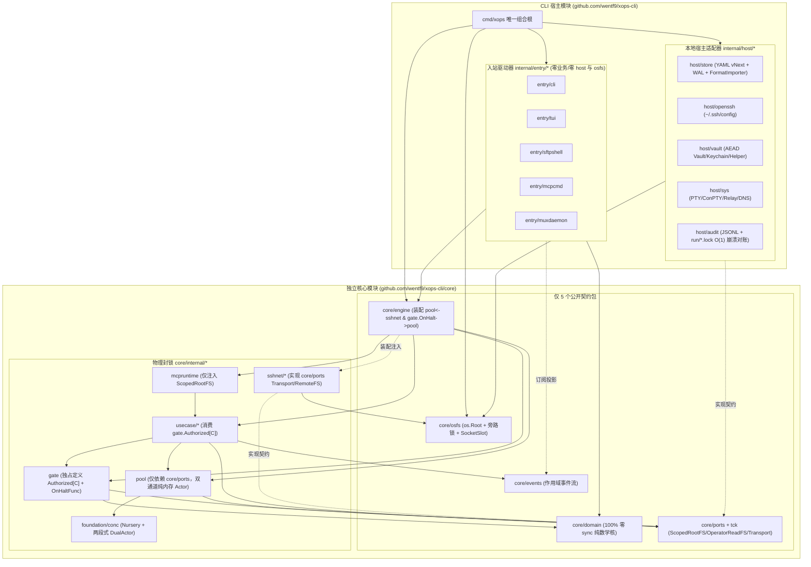

# XOps v2 全新架构定稿规范（Architecture RFC）

> **状态**：架构施工终稿（v2.2 — 已完成两轮架构评审与 6 项施工前微观校准，可直接启动 Phase 0）  
> **审查基线**：`feat/openssh-compatibility` @ `b15df20`（2026-11-23）  
> **实施约束**：**Go 1.27+** · **零历史兼容包袱** · **禁止打补丁** · **显式大于隐式** · **类型即证明** · **机器强制取代人为约定**

---

## 0. 已拍板架构决策总表（ADR 001–016，v2.2 校准终稿）

以下 16 项顶层架构决策已全部锁定，作为 Phase 0–5 不可违背的设计宪法：

| 编号 | 决策域 | 最终定稿方案 |
| :--- | :--- | :--- |
| **ADR-001** | **语言、工具链与模块隔离** | 锁定 **Go 1.27+** 与 `encoding/json/v2`（遵循 `json/v2` 铁律：禁裸 `time.Duration`，自定义 `algebraic.Duration` 与不透明值对象实现 `TextAppender`/`TextMarshaler`，`SecretBox` 故意不实现编码接口以白嫖 `SemanticError` 失败关闭，规范编码统一开启 `Deterministic(true)`）；采用 **Go Multi-Module Workspace**（`core/go.mod` + CLI 根 `go.mod` + `tools/xopsvet/go.mod`）。 |
| **ADR-002** | **多模块职责切分** | 完整无宿主六边形核心入 `core/`（纯领域核、端口契约/TCK、Actor 连接池、事件流、能力护栏、通用用例服务、MCP 运行时、纯 SSH/SFTP/Mux/OSFS 适配器）；CLI 宿主仅保留本机配置存储、本机 Vault、OpenSSH 解析器、CLI/TUI/SFTPShell 入口与组合根。 |
| **ADR-003** | **`core/` 对外暴露面** | 极简公开契约面 + 实现全锁 `core/internal/`：`core/` 仅公开 `core/domain/...`、`core/ports`（含 `tck`）、`core/events`、`core/osfs` 与 `core/engine`；Actor 连接池、SSH/SFTP 线缆实现、护栏内部状态机与 `Authorized[C]` 全部物理锁入 `core/internal/`。 |
| **ADR-004** | **OpenSSH 集成边界** | 保留完整核心 OpenSSH 体验（`~/.ssh/config` 实时只读虚拟节点、四层选项幺半群、`ProxyJump`/`ProxyCommand`、`ControlMaster`/`ControlPersist`），全部收拢为单一纯代数求解与统一 `NodeOrigin` 和类型。 |
| **ADR-005** | **业务能力范围** | 保留全部现有业务能力（SSH/Mux/转发含 TUN、SCP/SFTP Shell、Batch Exec、Playbook、TUI 含监控与日志流、MCP 含 stdio/HTTP/Transfer/Tunnel/GUI、离线 Vault/Keychain/Helper），全部按新架构干净重写。 |
| **ADR-006** | **零兼容契约与统一导入扩展口** | 全面重塑配置文件（YAML vNext）、离线 Vault 格式、判别式 Playbook YAML、强类型判别式 MCP Tool Schema 与干净 CLI 参数体系（仅标准 OpenSSH 短参数 `-p/-l/-i/-J/-L/-R/-D/-o/-O/-M/-S` 保持肌肉记忆）。**100% 零 v1 迁移代码**，但配置 Schema 显式版本化并在导入/初始化层预留统一 `FormatImporter` / `ImportBundle` 扩展入口。 |
| **ADR-007** | **持久化、双模态本地 FS 端口与 Windows 旁路锁** | 零 CGO 纯 Go 静态单二进制：静态配置走人类可读 **YAML vNext**，Saga/传输恢复/审计走结构化 **WAL/JSONL**。本地文件端口显式拆分为两个物理隔离接口：① **`ScopedRootFS`**（基于 Go `*os.Root`，专供全部写操作、`~/.xops`、SCP 下载目标与全部 MCP/Agent 路径）；② **`OperatorReadFS`**（仅提供 `WithOperatorRead(path, symlinkPolicy, fn)` 供 CLI/Playbook 读取人工指定的跨盘符/软链只读源文件，**物理上绝不注入 `mcpruntime`**）。`core/osfs` 写锁一律加在同 `os.Root` 下的旁路锁文件 `<name>.lock`，绝不对数据文件本身加锁后 `Rename`。 |
| **ADR-008** | **包级能力门控、`O(1)` 崩溃对账与 `Halted` 熔断** | **`Authorized[C]` 直接定义于 `core/internal/gate`**（由 Go 包可见性 100% 物理锁死全仓仅 `gate` 可构造；`core/domain/security` 保持纯数学的 `Capability` 幻影类型、格与 `ApprovalEnvelope`），统一经包级泛型函数 **`gate.WithAuthorized[C](ctx, g, req, run)`** 签发。审计采用 **`~/.xops/run/<ProcessInstanceID>.lock` 进程生命周期内核锁**（记录本进程活跃未闭合 `OperationID`）：干净启动 **O(1) 零扫描 `audit.jsonl`**；发现残留锁先独占 `TryLock` 确认进程死亡并防多进程重复补写，短跨进程追加锁补写 `AbortedByCrash` 后原子删锁。`StrictAgentProfile` 遇 `AuditPostWriteError` 立即触发 **`Halted` 熔断**，经 `OnHaltFunc` 出站回调通知池吊销全部活跃 `ManagedHandle` 并拒绝一切新请求。 |
| **ADR-009** | **六边形解耦连接池与双通道 Actor 硬规约** | `core/internal/pool` **严禁导入 `core/internal/sshnet`**，仅依赖 `core/ports`（由 `core/engine` 注入 `sshnet` 或 `sim`）。采用双模式零裸指针所有权（Scoped `WithLease`/`WithMultiLease` + Generational SlotMap `ManagedHandle`）与 6 条并发铁律：① 双通道（有界 `acquireCh` + 永不阻塞 `controlCh`）；② `DualActor` 主循环采用**两段式 `select`**（先非阻塞排空 `controlCh` 再阻塞监听双通道）；③ Actor 主循环 100% 纯内存非阻塞（零 `osfs` 锁/Audit/网络 I/O）；④ 控制面与数据面彻底分离（PTY/转发/10GiB 直走原子 `Epoch`+`ctx` 并发传输）；⑤ **严格嵌套序：`gate.WithAuthorized` 恒包在 `pool.WithLease` 外层**，且所有 `controlCh` 发送必须监听 `actorDone` 防关闭挂起；⑥ `trace.LeaseScope` **仅在即将进入用户回调 `fn(scopedCtx, sess)` 时注入**（不误伤池内多跳 DAG 拨号），多租约强制走拓扑序 `WithMultiLease`。 |
| **ADR-010** | **事件流与背压模型** | **作用域化双层事件流**：每次用例调用拥有独立隔离的 `OperationStream`（确定性 EOF、按事件类差异化 `BlockWithContext` / `CoalesceLatest` 背压、支持纯 `Fold`）；审计走同步 Fail-Closed `AuditSink`；池与诊断走有界非阻塞 `SystemBus`（`DropAndCount`）。 |
| **ADR-011** | **全闭包零 `mustclose` 与精准 `xopsvet` 零豁免策略** | 按安全原语包物理白名单授权，白名单外 **100% 禁止行内 `//nolint`**。全仓对外**彻底消灭最后一处命令式 `mustclose` 裸句柄**（包括将 `SecretVault`/`CredentialService` 统一改为 **`WithSecret(ctx, ref, func(box *SecretBox) error)`**，由提供方 `defer box.Wipe()` 并标为 `//xops:borrowed`）。`xopsvet` 聚焦 **5 大高确定性 AST/Types 分析器 + 精准局部版 `linearlease`（禁裸 `go` + 闭包借用零逃逸 + 运行时失效哨兵）+ 类型/局部直连版 `secrettaint` + 精细边界版 `failclosed`（豁免纯 `errors.Is`/`AsType` 分类谓词）**。 |
| **ADR-012** | **纵向 Walking Skeleton 交付节奏** | 在 `Gate G2` 通过后立即插入 **`Phase 2.5 Walking Skeleton`（Gate G2.5）** 纵向纯 v2 薄切片，第一时间在 Linux/Windows(ConPTY)/macOS 三平台真机验证最小 `xops ssh` 闭环并锁定端口契约，再双轨并行铺开 Phase 3 与 Phase 4。 |
| **ADR-013** | **复杂度与体量红线校准** | 用认知复杂度 **`gocognit <= 15`** 取代 `gocyclo <= 15`（与 `sumexhaust` 扁平 `type switch` 零冲突）；单包生产代码上限 **3,000 LOC**；单文件业务/状态机上限 **500 LOC**，纯声明式 ADT/选项表/规范编码文件（显式命名 `*_spec.go` / `*_variants.go` / `*_codec.go`）上限 **800 LOC**。 |
| **ADR-014** | **地道 Go 函数式克制与 `domain` 零 `sync` 纯净度** | 保留 Sealed Sum Types、幺半群、有界格、纯 Mealy FSM、`NonEmpty[T]`、`FirstWins[T]`；移除泛化 `Result[T]` 回归地道 `(T, error)`；`Option[T]` 仅限结构体可选字段；`SecretBox` 为单协程借用（普通 `wiped bool`）且 `Authorized[C]` 迁入 `gate`，从而保证 **`core/domain/**` 100% 零 `sync` 与零 `sync/atomic`**！ |
| **ADR-015** | **`ssh.Channel` 取消看门狗与 `goleak` 保障** | `core/internal/sshnet/dial` 中所有基于 `ssh.Channel`（无 `SetDeadline`）的多跳虚拟 `net.Conn` 必须封装 `conc.Nursery` 监督的 Cancel/Deadline Watchdog，超时立即 `channel.Close()` 唤醒阻塞 `Read`。 |
| **ADR-016** | **诚实安全边界（`SecretBox` 与 SFTP v3）** | ① `SecretBox` 工程目标严格界定为阻断日志/审计/错误/事件/YAML/计划/摘要泄露与自有缓冲 `clear()` 零化（不 fork `x/crypto/ssh`，可预留 `goexperiment.runtimesecret` 钩子）；② SFTP v3 两阶段规范化首要防御 AI Agent 困惑副手与静态软链逃逸，并在 `sshnet/sftp` 写路径施加纵深防护（非截断打开 + `SSH_FXP_FSTAT` 类型/`(dev,ino)` 锚定比对 + 同目录临时文件原子 `posix-rename@openssh.com`）。 |

---

## 1. 现状架构诊断摘要（基线 `b15df20`）

基线 `b15df20` 生产代码 **157,496 LOC**、测试代码 **296,952 LOC**，经 P0–P7 与 W0–W19 共 20 轮对抗审计仍反复出现同类变体缺陷，根源在于 8 大结构性病灶（详见 [invariants.md](./governance/invariants.md)）：
1. **包级物理隔离失效**：`core/ssh` 单包 47,157 LOC（107 文件、122 导出类型、704 导出函数、136 裸 `go`、72 锁、280 channel、63 `reflect`）；`cmd` import 26 包；`pkg/config` 18,966 LOC import 14 包。
2. **可变贫血结构体与假和类型**：`ClientConfig`/`ConnectionConfig` 镜像并存；`playbook.Step`/`TunnelPolyInput`/`SshOptions`(72 字段且被嵌入)允许非法状态构造。
3. **入口层承载编排导致多路径漂移**：`cmd/ssh.go`(3,652 行)/`sftpshell`(3,172 行)/`scp.go`(2,232 行)/`exec.go`(1,685 行) 与双套 MCP 后端包装。
4. **隐性约定泛滥**：鸭子类型接口嗅探、`context.WithValue` 偷渡安全策略与无类型信封、全局可变单例与 `init()`。
5. **连接池分裂与 6 锁层级**：`Connector` 混杂 `pool`/`plans`(嵌套子 Connector)/`masters`；6 把锁靠注释保序；裸 `PlanConnection.Client`；1ms `Ticker` 轮询 `TryLock`。
6. **观测与审计机制割裂**：6 套不兼容通知/回调机制，终态审计散落导致孤儿记录。
7. **安全逃生口与语法级脆弱检查**：`g == nil` 静默放行、`FileSession.Do(*pkgsftp.Client)`、函数名正则检查、43 处 `//nolint:forbidigo` + 19 处 `//nolint:gocyclo`。
8. **持久化迁移耦合运行时域**：7 个 `migration*.go` 与目标/选项解析深度缠绕。

---

## 2. 三模块六边形架构与物理边界

### 2.1 Go Multi-Module 工作区拓扑

本地开发经 `go.work` 协同，全仓 3 个 `go.mod` 严禁 `replace`；开发与分支 CI 阶段对 `core/` 与 `tools/xopsvet/` 强制执行 **`GOWORK=off`** 独立验证，根 CLI 模块经 `go.work` 联合验证；正式发版打 `core/v2.0.0` Tag 后补跑三模块全量 `GOWORK=off` 验收：

```text
xops-cli/
├── go.work                                 # 本地协同 (use ., ./core, ./tools/xopsvet)
├── go.mod                                  # 模块 1: github.com/wentf9/xops-cli (Go 1.27+ CLI 宿主)
├── cmd/xops/                               # 【唯一组合根】零 init、零全局单例、装配 ScopedRootFS/OperatorReadFS、逆序关闭
├── internal/
│   ├── host/                               # 【CLI 出站基础设施适配器】实现 core/ports，仅依赖 core/{domain,ports,osfs}
│   │   ├── store/                          # YAML vNext 原子 CAS 存储 + 全图校验 + WAL + FormatImporter 注册点
│   │   ├── openssh/                        # ~/.ssh/config 只读解析器 + 虚拟节点源 + ControlPersist 规格
│   │   ├── vault/                          # 离线 AEAD 加密库(Argon2id + XChaCha20-Poly1305/dirfd) + OS Keychain + Helper
│   │   ├── sys/                            # PTY/ConPTY + Windows JobObject ConsoleRelay + ProcDialer + SSHFP DNS
│   │   └── audit/                          # Fail-Closed 原子 JSONL + ~/.xops/run/<ProcessInstanceID>.lock O(1) 崩溃对账
│   └── entry/                              # 【CLI 入站驱动适配器】零业务逻辑，严禁 import internal/host/* 与 core/osfs
│       ├── cli/                            # 极薄 Cobra 壳（Flags -> Typed Request -> core/engine -> Stream Renderer）
│       ├── tui/                            # Bubble Tea 工作台（OperationStream/SystemBus -> tea.Msg 投影）
│       ├── sftpshell/                      # 交互式 SFTP 行编辑器（纯 REPL -> TransferService/SessionService）
│       ├── mcpcmd/                         # MCP stdio / Streamable HTTP 宿主监听入口
│       └── muxdaemon/                      # ControlPersist 后台守护进程入口
│
├── core/                                   # 模块 2: github.com/wentf9/xops-cli/core（Go 1.27+ 无宿主六边形核心）
│   ├── go.mod                              # 严禁依赖 CLI 模块、Cobra、BubbleTea 或个人宿主路径
│   ├── domain/                             # 【公开契约 1：100% 纯函数数学核】零 I/O、零 context、零 sync/atomic、零 reflect
│   │   ├── algebraic/                      # Option[T](仅结构体可选字段), NonEmpty[T], FirstWins[T], Duration(json/v2 TextAppender)
│   │   ├── secret/                         # SecretBox(单协程 //xops:borrowed, Use+clear(), 故意零 json/v2 编码器)
│   │   ├── netaddr/                        # Endpoint, HostPort, CanonicalHost(零值无效 + TextAppender)
│   │   ├── pathalg/                        # RemotePath, RemoteName, LocalRootedDest, SymlinkPolicy, ProtectedPathMatcher
│   │   ├── option/                         # 四层 OpenSSH 选项幺半群: OptionLayer, PathList, AlgoPolicy, ProxyRoute, ControlPolicy, EnvFilter
│   │   ├── security/                       # 纯数学安全核: Verdict/RiskLevel/Decision 格, Capability 幻影类型, Policy, ApprovalEnvelope
│   │   ├── execution/                      # LaunchDialect, Interpreter, LoginMode, CommandPlan, ExecutionOutcome(ADT)
│   │   ├── inventory/                      # Host, Identity, Node, AuthMethod(ADT), NodeOrigin(ADT), ProxyJump DAG, ImportBundle
│   │   ├── plan/                           # HopSpec, SealedConnectionPlan, Merkle HopDigest(零 reflect), ManagedHandle[K]
│   │   ├── playbook/                       # Playbook AST, StepAction(ADT), FoldPlaybookReport
│   │   └── fsm/                            # 5 大纯 Mealy 状态机: VaultSagaFSM, ApprovalFSM, TransferFSM, EnsureFSM, PendingEnrollFSM
│   ├── ports/                              # 【公开契约 2：六边形出站端口接口】仅依赖 core/domain
│   │   ├── store.go                        # InventoryStore, JournalStore, FormatImporter, DurabilityOutcome
│   │   ├── vault.go                        # SecretVault(WithSecret 作用域借用), KeySignerPort, HostTrustPort
│   │   ├── transport.go                    # DialerPort, MuxSocketPort, RemoteFSPort
│   │   ├── localfs.go                      # ScopedRootFS(os.Root 沙箱) 与 OperatorReadFS(CLI 人工只读源，绝不注入 MCP)
│   │   ├── system.go                       # ProcessPort, TerminalPort, Clock, Entropy, AuditSink(+Reconciler), InteractionPort
│   │   └── tck/                            # 全部出站端口的通用契约测试套件 (Technology Compatibility Kit)
│   ├── events/                             # 【公开契约 3：作用域化双层事件流】Sealed Event ADT + OperationStream + SystemBus
│   ├── osfs/                               # 【公开契约 4：句柄安全 OS 原语】唯一允许裸调 OS 文件/锁/ACL/os.Root/SocketSlot(含旁路锁)
│   ├── engine/                             # 【公开契约 5：极简装配门面】装配 pool<-sshnet/sim、gate.OnHaltFunc->pool、用例与 MCP 运行时
│   └── internal/                           # 【物理封锁的核心内部实现】外部宿主与 CLI 均不可见！
│       ├── foundation/
│       │   ├── conc/                       # Nursery + 两段式 select DualActor + CtxMutex（全仓唯一裸 go 白名单）
│       │   └── trace/                      # 只读 TraceID/OpID 与 LeaseScope 防重入标记（全仓唯一 context.WithValue 白名单）
│       ├── pool/                           # 双通道纯内存 Actor Merkle 池（仅依赖 core/ports，严禁 import sshnet/osfs！）
│       ├── gate/                           # Authorized[C] 唯一定义与签发包（包级 gate.WithAuthorized[C] + OnHaltFunc + Halted 熔断）
│       ├── usecase/                        # 6 大权威用例服务: inventory, credential, session, transfer, automation, observability
│       ├── mcpruntime/                     # MCP 协议运行时（stdio + Streamable HTTP，物理不接收 OperatorReadFS）
│       ├── sshnet/                         # 纯协议适配器: dial(含 ssh.Channel Watchdog), hostkey, mux, sftp(含 FSTAT), forward, priv, probe
│       └── sim/                            # 确定性仿真适配器（SimClock, SeededRand, SimScopedRootFS, SimOperatorReadFS, FaultInjector）
│
└── tools/xopsvet/                          # 模块 3: github.com/wentf9/xops-cli/tools/xopsvet（Go 1.27+ 自建编译器护栏）
    ├── go.mod                              # 独立依赖 golang.org/x/tools
    ├── cmd/xopsvet/main.go                 # multichecker 入口 (go vet -vettool=xopsvet ./...)
    └── analyzers/                          # 8 大精准分析器: archbound, sumexhaust, linearlease, failclosed, secrettaint, osboundary, noimplicit, digestcover
```

### 2.2 全景依赖与接线拓扑



### 2.3 强制依赖矩阵（Go 模块 + `xopsvet/archbound` 双重锁死）

| 源码位置 | 允许导入的内部层 | 编译器/护栏强制禁止 |
| :--- | :--- | :--- |
| `core/domain/**` | 仅同层下级 `core/domain/**` 与纯 stdlib（`crypto/sha256`, `slices`, `strings`, `unicode`, `encoding/binary`, `net/netip`, `time`(仅类型解析，禁 `time.Now`)） | **`context`, `os`, `net`, `os/exec`, `syscall`, `sync`, `sync/atomic`, `reflect`, `time.Now`, `math/rand`, `core/ports`, `core/events`, `core/osfs`, `core/internal`** |
| `core/ports/**` | `core/domain/**` | `core/internal/**`, `core/osfs`, `x/crypto/ssh`, `pkg/sftp`, CLI 模块 |
| `core/events` | `core/domain/**` | `core/internal/**`, `core/ports`, `core/osfs`, `os`, `net` |
| `core/osfs` | `core/domain/{pathalg,security}`, `core/ports`（实现 `ScopedRootFS` / `OperatorReadFS`） | `core/internal/**`, `core/events`, `net`, `os/exec` |
| `core/internal/pool` | `core/domain/**`, `core/ports`, `core/events`, `core/internal/foundation/**` | **`core/internal/sshnet/**`**（依赖倒置，经 `core/engine` 注入 `core/ports`！）、**`core/osfs`**、`core/internal/{usecase,gate,mcpruntime}` |
| `core/internal/gate` | `core/domain/**`, `core/ports`, `core/events`, `core/internal/foundation/**` | `core/internal/{pool,sshnet,mcpruntime}`, `core/osfs`（经 `OnHaltFunc` 回调解耦通知池） |
| `core/internal/usecase/**` | `core/domain/**`, `core/ports`, `core/events`, `core/internal/{foundation,pool,gate}` | `core/internal/sshnet`, `core/internal/mcpruntime`, **`core/osfs`** |
| `core/internal/mcpruntime` | `core/domain/**`, `core/ports`（仅限 `ScopedRootFS`，禁引 `OperatorReadFS`）、`core/events`, `core/internal/{foundation,gate,usecase}` | `core/internal/{pool,sshnet}`, `core/osfs` |
| `core/engine` | `core/domain/**`, `core/ports`, `core/events`, `core/internal/**`（唯一核心内部装配点） | CLI 模块 |
| `internal/host/**`（CLI） | `core/{domain,ports,osfs}` | `core/engine`, `core/internal/**`, `internal/entry/**` |
| `internal/entry/**`（CLI） | `core/{domain,events,engine}` | **`internal/host/**`**, **`core/osfs`**, `core/internal/**` |
| `cmd/xops` | 唯一外部组合根（组装 `host` + `osfs` + `engine` + `entry`） | 严禁编写业务逻辑、协议解析或并发状态机 |

---

## 3. 关键核心契约规范（v2.2 精确签名）

### 3.1 `core/internal/gate` 独占 `Authorized[C]` 与包级泛型门控

```go
// core/domain/security/capability.go（100% 纯数学，零 sync/atomic）
type Capability interface { sealedCapability() }
type CapInspect  struct{ sealedCapability }
type CapExecute  struct{ sealedCapability }
type CapFileRead struct{ sealedCapability }
type CapFileMut  struct{ sealedCapability }
type CapTransfer struct{ sealedCapability }
type CapTunnel   struct{ sealedCapability }
type CapMutate   struct{ sealedCapability }

// core/internal/gate/authorized.go（Go 包可见性 100% 物理锁死全仓仅 gate 可签发！）
type Authorized[C security.Capability] struct {
    opID    security.OperationID
    binding security.OperationBinding
    profile PolicyProfileKind
    revoked *atomic.Bool // 退出回调或 Gate 进入 Halted 熔断态立即置 true
}

type Authorizer interface {
    evaluateAndAudit(ctx context.Context, req rawGateRequest) (issuedPermit, error)
    finalizeAudit(ctx context.Context, permit issuedPermit, runErr error) error
    isHalted() bool
}

// 包级泛型函数：完全兼容 Go 1.27+ 接口抽象与依赖注入
func WithAuthorized[C security.Capability](
    ctx context.Context,
    g   Authorizer,
    req GateRequest[C],
    run func(ctx context.Context, auth Authorized[C]) error,
) error
```

### 3.2 `core/ports` 作用域机密与双模态本地 FS 端口

```go
// core/ports/vault.go — 彻底消灭最后一块命令式 mustclose 裸句柄！
type SecretVault interface {
    // 提供方负责打开/解密并保证在回调返回后无条件 defer box.Wipe()；
    // box 标记 //xops:borrowed，由 xopsvet/linearlease 静态禁止逃逸闭包。
    WithSecret(ctx context.Context, ref secret.Ref, fn func(box *secret.SecretBox) error) error
    PutAndVerify(ctx context.Context, ref secret.Ref, box *secret.SecretBox) error
    Delete(ctx context.Context, ref secret.Ref) error
}

// core/ports/localfs.go — 物理隔离沙箱写与操作员显式只读
type ScopedRootFS interface {
    // 基于 Go *os.Root 绑定单一目录；所有写操作、~/.xops 配置/Vault/WAL、scp 下载落盘、MCP/Agent 路径强制走此接口。
    // 写锁一律落于同 Root 下的旁路锁文件 <name>.lock，绝不对数据文件本身加锁后 Rename。
    WithRoot(dir pathalg.LocalDir, fn func(root RootHandle) error) error
}

type OperatorReadFS interface {
    // 仅注入 CLI/Playbook DirectOperatorProfile 用例，物理上绝不注入 mcpruntime！
    // 支持操作员显式传入跨盘符路径（如 C:\Temp\a.tgz）与受 SymlinkPolicy 管控的只读源文件（如软链私钥）。
    WithOperatorRead(ctx context.Context, path pathalg.LocalSourcePath, policy pathalg.SymlinkPolicy, fn func(r io.Reader, size int64) error) error
}
```

### 3.3 `conc.DualActor` 与连接池并发铁律

- **两段式 `select` 优先级排空**：
  ```go
  for {
      // 阶段 1：非阻塞排空所有高优控制回传（ReleaseLease / DialCompleted / Evict / GateHalted）
      for {
          select {
          case ctrl := <-a.controlCh:
              a.handleControl(ctrl)
              continue
          default:
          }
          break
      }
      // 阶段 2：阻塞等待任一事件或关闭
      select {
      case ctrl := <-a.controlCh:
          a.handleControl(ctrl)
      case req := <-a.acquireCh:
          a.handleAcquire(req)
      case <-a.stopCh:
          a.drainAndStop()
          return
      }
  }
  ```
- **嵌套序与关闭防挂起**：全仓用例强制 **`gate.WithAuthorized` 包裹 `pool.WithLease`**；`defer` 向 `controlCh` 发送 `ReleaseLease` 时一律 `select { case p.controlCh <- rel: case <-p.actorDone: }`，杜绝池关闭后延迟归还挂起。
- **`trace.LeaseScope` 精确注入时机**：仅在 Actor 签发租约并即将调用用户回调 `fn(scopedCtx, sess)` 的那一刻才将 `LeaseScope` 写入 `scopedCtx`；池内多跳 DAG 拨号与前置交互不携带该标记，避免误伤内部多跳解析。
- **`ssh.Channel` 看门狗（ADR-015）**：`core/internal/sshnet/dial` 为每个基于上游 `ssh.Channel` 的多跳连接封装 `conc.Nursery` 监督的 Cancel/Deadline Watchdog，超时立即 `channel.Close()` 解除阻塞 `Read`。

### 3.4 `O(1)` 跨进程安全审计崩溃对账协议

- 每个 `Engine` 启动时在 `~/.xops/run/<ProcessInstanceID>.lock` 创建并持有进程生命周期级非阻塞内核文件锁（Unix `flock` / Windows `LockFileEx`），采用**只追加协议（Append-Only：`+<opID>\n` / `-<opID>\n`，仅当内存活跃集归零或排空后才允许 `Truncate(0)`）**避免单进程并发下截断重写窗口丢失在途操作。
- **正常启动 O(1) 零扫描快路径**：启动时扫描 `run/*.lock`；若无任何可抢占的已死亡进程锁文件，**完全不读取 `audit.jsonl`**，启动零额外开销。
- **多终端并发安全恢复**：对每个残留 `.lock` 尝试非阻塞独占 `TryLock`——运行中的其他终端因锁仍被持有会被跳过；唯有真正遇 `SIGKILL`/断电的死亡实例会被单个获胜进程抢到独占锁，慢路径核对 `audit.jsonl` 确认真实未闭合 `OperationID` 后，在短生命周期 `audit.jsonl.lock` 跨进程追加锁下补写 `OperationFinalized{Outcome: AbortedByCrash}`，随后在持锁态截断清空 `.lock`、解锁关闭句柄并 `Remove`（忽略 `ErrNotExist`，兼容 Windows 共享模式）。

### 3.5 Go 1.27 `encoding/json/v2` 与纯函数领域核规则

- 禁止在 `Event`、`AuditEntry`、`MCP DTO`、`Config` 中使用裸 `time.Duration`；统一采用 `core/domain/algebraic.Duration`（实现 `encoding.TextAppender`/`TextMarshaler`/`TextUnmarshaler`）。
- 所有需参与 JSON/YAML/审计序列化的全私有字段值对象（`Endpoint`、`RemotePath`、`OperationID`、`HopDigest` 等）必须显式实现 `encoding.TextAppender`/`TextMarshaler`（或 `jsonv2.MarshalerTo`）；`SecretBox` 故意不实现任何编码接口，触发 `json/v2` 原生 `SemanticError` 失败关闭。
- 凡用于规范摘要或测试黄金比对的 JSON 编码，一律开启 `jsonv2.Deterministic(true)`。

### 3.6 封闭和类型（ADT）、代数律与五大纯状态机（`core/domain/**`）

1. **核心封闭和类型清单**（均含私有 `sealed*()` 方法并由 `sumexhaust` 穷尽检查；失败路径统一地道 Go `(T, error)`，无泛化 `Result[T]`）：
   - `inventory.AuthMethod`：`AuthPassword(SecretRef) | AuthPrivateKey(NonEmpty[KeyPathSpec], Option[KeyPassphraseBinding], []CertPathSpec) | AuthAgent(Option[AgentSpec]) | AuthKeyboardInteractive(NonEmpty[ChallengeRule]) | AuthComposite(NonEmpty[AuthMethod])`（`KeyPassphraseBinding` 结构强制口令必绑指纹）；
   - `inventory.ChallengeRule`：`RuleTOTP | RuleSecretRef | RuleCommand | RuleLoginPassword`；
   - `inventory.NodeOrigin`：`OriginManaged | OriginOpenSSHVirtual | OriginOpenSSHDerived | OriginAdHoc`；
   - `option.ProxyRoute`：`ProxyUnset | ProxyDisabled | ProxyJumpChain(NonEmpty[HopTarget]) | ProxyCommandSpec(SanitizedCmd)`；
   - `execution.ExecutionOutcome`：`OutcomeNotStarted(StartPhase, err) | OutcomeCompleted(ExitStatus, truncated) | OutcomeUnknown(ExecPhase, err)`（仅 `OutcomeNotStarted.CanRetry() == true`）；
   - `security.GuardrailDecision`：`DecisionDeny | DecisionNeedApproval | DecisionAllow`；
   - `playbook.StepAction`：`StepShell | StepScript | StepCopy | StepTemplate | StepEnsure(Check, Action)`；
   - `fsm.TransferState`、`fsm.VaultSagaState`、`events.Event`。
2. **代数结构求解**：
   - **OpenSSH 四层选项幺半群 `(OptionLayer, ⊕, Unset)`**：由 `FirstWins[T]`、`PathList`（三态 + 右吸收 `Disabled`）、`AlgoPolicy`（自同态复合 $\text{End}(L)$）、`ProxyRoute`（双槽遮蔽）、`ControlPolicy`、`EnvFilter`（`SendEnv -PATTERN` 减法）组成；全平面（拨号、`-f`、`-O`、`ControlPersist`、`exec`、`scp`、`play`、`mcp`）共用唯一纯函数 `option.ResolveEffectivePolicy(origin, endpoint, t1, t2, t3, t4) (EffectivePolicy, error)`。
   - **安全有界格**：`Verdict` 交半格（`Deny=0` 零值吸收集）、`RiskLevel` / `Decision` 并半格（`max` 折叠 `NodeOverrides`、多路径、祖先目录与软链解析前后路径），交换/结合/幂等律彻底消除 Go `map` 序依赖。
3. **五大纯 Mealy 状态机**（`Transition(S, I) -> (S', []Effect, []Event)`）：
   - `VaultSagaFSM`：Vault 先写常量时间回读 → 配置 CAS 提交 → 旧引用 5 处无引用确认后 GC；`Applied && !Durable` 进 `UncertainDurability` 停机禁重试禁删凭据；
   - `ApprovalFSM`：词法预检 → SFTP 规范化 → 升级判定（含 `Protected-A -> Protected-B` 软链重定向）→ 加密信封挑战 → 令牌校验签发；Round-2 探测失败立即作废令牌；
   - `TransferFSM`：MCP HTTP 10 GiB 分片流、双版本 Journal、`Streaming -> Commit` 原子交接与崩溃恢复；
   - `EnsureFSM`：Playbook `ensure` 幂等收敛（`OutcomeUnknown` 严禁自动重试）；
   - `PendingEnrollFSM`：首连「先验证后入库」作用域租约状态机。

---

## 4. 六大权威用例服务、零兼容对外契约与 SFTP 纵深防护

### 4.1 统一用例服务与作用域化双层事件流

- **六大用例服务**（全部业务逻辑唯一实现，按 `PolicyProfile` 经 `gate.WithAuthorized[C]` 鉴权，本地 IO 走 `ScopedRootFS` / `OperatorReadFS`）：
  1. **`InventoryService`**：Host/Identity/Node CAS CRUD、跨命名空间 Tarjan DAG 校验、5 位置引用删除、`FormatImporter` 调度（`openssh`/`csv`，预留未来迁移扩展口，100% 零 v1 代码）、`Doctor`、`WithPendingEnrollment`。
  2. **`CredentialService`**：Vault 生命周期（init/unlock/lock/doctor）、`VaultSagaFSM` 轮换/删除与 5 处引用 GC、作用域 `WithSecret`。
  3. **`SessionService`**：不可变 `CommandPlan` 执行、交互 PTY、`sudo`/`sudo-rs`/`su` 提权、2 阶段 Shell 探针、SlotMap 持久 PTY、`-L`/`-R`/`-D`/`-W`/StreamLocal/TUN 转发、ControlMaster `-O` 与 `ControlPersist` 移交。
  4. **`TransferService`**：并行分片 `scp`（`OperatorReadFS` 读源 + `ScopedRootFS` 写目标、断点续传、`--no-clobber`、`Lstat` 悬空软链检查、单次展开 `UploadExact`、软链策略 `(b)`）、交互 SFTP 工作区、远端原子 `read`/`write`/`patch`/`stat`、MCP HTTP 10 GiB 流式传输与恢复。
  5. **`AutomationService`**：并行批量 `exec`（含排除过滤、`--stream`/`--out-dir`）与声明式 Playbook（不可变快照、`on_error`、`EnsureFSM`、纯 `FoldPlaybookReport`）。
  6. **`ObservabilityService`**：TUI 指标流、远端/Docker 日志流、POSIX Bourne 强校验 GUI 操作。
- **双层事件流（`core/events`）**：同步 Fail-Closed `AuditSink`；每调用隔离 `OperationStream`（确定性 EOF，`BlockWithContext` 用于输出/步骤，`CoalesceLatest` 用于进度/TUI 指标）；有界非阻塞 `SystemBus`（`DropAndCount`，承载池与协议脱敏诊断）。

### 4.2 零兼容对外契约与 SFTP v3 纵深边界

```yaml
# YAML vNext 配置示例（version: 2，强判别式，零 v1 明文字段与迁移代码）
version: 2
vault:
  default_store: local-offline
  remember_prompted: ask # always | ask | never
  stores:
    local-offline:
      kind: offline_aead # offline_aead | os_keychain | external_helper | none
      path: ~/.xops/vault
policy:
  cli_default: direct_operator # direct_operator | strict
  mcp_default: strict_agent
  guardrail:
    approval_threshold: moderate
    no_elicit_fallback: deny
    audit_log: ~/.xops/audit.jsonl
    protected_paths: ["/etc/**", "/root/**", "C:/Windows/**"]
inventory:
  hosts:
    web-01-host: { address: 192.0.2.10, port: 22 }
  identities:
    deploy-id:
      user: deploy
      auth:
        kind: private_key # password | private_key | agent | keyboard_interactive | composite
        key_paths: ["~/.ssh/id_ed25519"]
        passphrase_ref: { store: local-offline, item: "a1b2c3..." }
        key_fingerprint: "SHA256:..."
  nodes:
    web-01:
      host: web-01-host
      identity: deploy-id
      aliases: ["w1"]
      tags: ["web", "prod"]
      proxy: { kind: jump, hops: ["bastion-01"] }
      execution: { launch_dialect: posix, interpreter: sh, login: disabled }
```

- **Vault vNext & WAL**：Argon2id（隔离 KDF Helper）+ XChaCha20-Poly1305 AEAD + `core/osfs` dirfd 原子落盘（旁路 `<name>.lock`）；CRC/版本化 WAL/JSONL。
- **Playbook / MCP / CLI**：Playbook 步骤显式 `kind: shell|script|copy|template|ensure`；MCP 7 个强类型判别工具（`nodes`、`terminal_exec`、`terminal_session`、`file`、`transfer`、`tunnel`、`gui`）；CLI 保留 OpenSSH 标准短参数肌肉记忆（`-p/-l/-i/-J/-L/-R/-D/-o/-O/-M/-S`），统一提供 `--json`、`--policy` 与 `config import` 统一扩展入口。
- **SFTP v3 纵深防护（ADR-016）**：诚实界定两阶段规范化防的是 AI Agent 困惑副手与静态软链绕过（协议无 `openat`/`O_NOFOLLOW`）；写/改路径执行非截断打开 + `SSH_FXP_FSTAT` 文件类型/`(dev,ino)` 锚定比对 + 同目录随机临时文件原子 `posix-rename@openssh.com`。

---

## 5. 四位一体工程防御体系详规

1. **物理隔离与校准红线**：Go 1.27+ 三模块 `GOWORK=off`；`pool` 仅依赖 `ports`；`mcpruntime` 物理不可见 `OperatorReadFS`；单包 ≤ 3,000 LOC；业务逻辑/状态机单文件 ≤ 500 LOC，显式声明式文件（`*_spec.go`/`*_variants.go`/`*_codec.go`）≤ 800 LOC；认知复杂度 **`gocognit <= 15`**。
2. **封装不变式与全作用域闭包**：全私有字段、零值即拒绝/无效；`WithLease`/`WithMultiLease`、`WithSecret`+`Use`、`WithRoot`/`WithOperatorRead`、`gate.WithAuthorized` 实现全仓**零命令式 `mustclose` 裸句柄** + 运行时借用失效哨兵。
3. **精准编译器护栏 `tools/xopsvet`**（包级能力白名单 + 白名单外 **0 行内 `//nolint`**）：

| 分析器 | 实现底座与精准边界 | 机器强制规则 | 唯一特权白名单包（外包 0 `//nolint`） |
| :--- | :--- | :--- | :--- |
| **`archbound`** | `go/types` 包导入图 | 强制 §2.3 DAG（禁 `domain -> sync/sync/atomic`、`pool -> sshnet/osfs`、`gate -> pool/osfs`、`usecase/entry -> osfs`、`mcpruntime -> OperatorReadFS`） | 仅 `cmd/xops` 与 `core/engine` 分别作宿主/核心唯一装配点 |
| **`sumexhaust`** | `go/types` 接口方法集 | 强制所有含 `sealed*()` 封闭和类型的 `type switch` 穷尽全变体（安全决策必具 fail-closed `default`） | 无豁免 |
| **`linearlease`** | AST + `go/types` 局部逃逸检查 | 禁白名单外裸 `go`；禁 `//xops:borrowed` 闭包形参赋给外部变量/字段/容器/channel 或被子闭包捕获（配合运行时失效哨兵 + `goleak`） | 裸 `go` 仅限 `core/internal/foundation/conc` |
| **`failclosed`** | AST + `go/types` | 禁吞噬新产生局部 `error` 返回裸 `bool`（精确豁免入参含 `error` 且未产新局部 `error` 的纯 `errors.Is`/`AsType` 分类谓词）；禁包外字面量构造 `//xops:opaque`；校验 `//xops:failclosed` 零值最严 | 无豁免 |
| **`secrettaint`** | `go/types` 类型封禁 + `Use` 局部直连流 | 禁 `*secret.SecretBox` 进 `Event`/`Audit`/`Plan`/`Error` 字段或日志/序列化参数；禁 `Use` 局部体内 `plain`（及其切片/强转 `string`）流入日志/错误/事件/序列化或外层捕获（不对 `len(plain)` 误报） | 明文消费仅限 `core/domain/secret`、`internal/host/vault`、`core/internal/sshnet/dial` |
| **`osboundary`** | `go/types` 符号解析 | 禁白名单外调裸 OS 文件/锁/ACL/`os.Root` API；禁对 `RemotePath` 调 `filepath.*`；禁白名单外调 `os.Getenv`/`exec.Command` | 文件/锁/ACL/`os.Root` 仅限 `core/osfs`；env/exec/TTY 仅限 `internal/host/sys` |
| **`noimplicit`** | AST + `go/types` | 禁 `func init()`；禁可变包级 `var`；禁白名单外 `context.WithValue`/`ctx.Value`；禁匿名接口断言 `x.(interface{...})`；禁白名单外 `//nolint:`；禁 JSON v2 DTO 裸用 `time.Duration` | `context.WithValue` 仅限 `core/internal/foundation/trace` |
| **`digestcover`** | `go/types` 结构体成员遍历 | 静态校验 `//xops:canonicalhash` 结构体全字段在 `WriteCanonical` 中显式编码（或显式 `//xops:hash-exclude:<reason>`），零 `reflect` | 无豁免 |

4. **契约、早验与确定性测试**：`core/ports/tck`（含 `ScopedRootFS`/`OperatorReadFS`）、代数律/Fuzz、10,000 种子 DST（覆盖 `O(1)` 崩溃对账、`Halted` 熔断、两段式 `DualActor` 满邮箱压测、重入拒绝、5 大全局不变量）、`ssh -G` 差分，以及 **`Phase 2.5 Walking Skeleton`** 起即跑通三平台原生 CI。

---

## 6. 分阶段重建路线总览

完整 28 项任务与 7 道硬门禁命令详见 [v2-implementation-plan.md](./v2-implementation-plan.md)：
**Phase 0（`G0`）→ Phase 1（`G1`）→ Phase 2（`G2`）→ Phase 2.5 Walking Skeleton（`G2.5` 三平台真机闭环）→ Phase 3 ∥ Phase 4（`G3` & `G4`）→ Phase 5（`G5` 发布验收）**。
