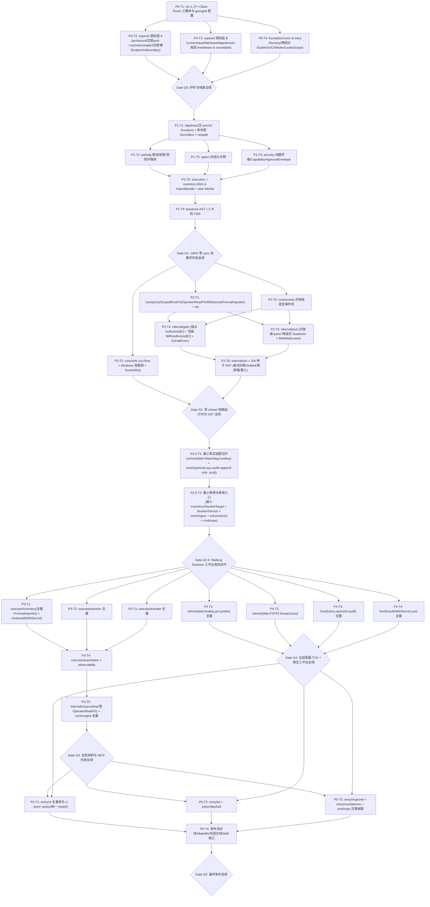

# XOps v2 全新架构分阶段实施计划（Implementation Plan）

> **关联架构宪法**：[XOps v2 全新架构定稿规范（Architecture RFC v2.2 校准终稿）](./v2-architecture-rfc.md)（ADR-001 – ADR-016）  
> **计划状态**：已完成两轮评审与 6 项施工前微观校准（**尚未启动编码**；严禁在审批动工前修改 Go 业务源码）  
> **执行铁律**：**Go 1.27+** · 全仓 3 个 `go.mod` 零 `replace`（`core/` 与 `tools/xopsvet/` 全程 `GOWORK=off`，根 CLI 开发期经 `go.work`，打 `core/v2.0.0` Tag 发布时三模块全量 `GOWORK=off`）· **先筑 `xopsvet` 护栏与三平台 CI 再写业务代码** · **Gate G2 后即交付 Walking Skeleton 纵向真机闭环** · 严禁新旧双轨补丁

---

## 1. 实施总策略与工作区切换规程

1. **隔离重构分支**：从定稿提交新建独立分支 `refactor/v2-architecture`（绝不在 `master` 或 `feat/openssh-compatibility` 上清场；旧代码随时可通过 `git show b15df20:<path>` 只读查阅客观领域规则）。
2. **Commit 0 干净清场**：在 `refactor/v2-architecture` 首个提交中清零旧 Go 源码树（旧 `cmd/`、`pkg/`、`core/`、`internal/`），保留治理文档、跨平台验证骨架（`scripts/validation/`、`deploy/macos-vm/`）与 CI/Makefile 模板；随即在最终规范路径初始化 **Go 1.27+** 三模块工作区（`go.work`、`go.mod`、`core/go.mod`、`tools/xopsvet/go.mod`）。
3. **护栏前置 + 纵向早验**：`Phase 0` 建成 `tools/xopsvet` 全部 8 大精准分析器后方可进入 `Phase 1`；`Gate G2` 通过后立即进入 **`Phase 2.5 Walking Skeleton`** 在 Linux/Windows(ConPTY)/macOS 三平台真机实测最小 `xops ssh` 二进制并锁定端口契约，随后并行铺开 Phase 3 与 Phase 4。
4. **体量、复杂度与编码红线（ADR-001, ADR-013, ADR-014）**：单包生产代码上限 **3,000 LOC**；业务逻辑/状态机单文件上限 **500 LOC**，纯声明式文件（`*_spec.go` / `*_variants.go` / `*_codec.go`）上限 **800 LOC**；认知复杂度 **`gocognit <= 15`**；白名单外 **0 行内 `//nolint`**；`core/domain/**` **100% 零 `sync` / `sync/atomic`**；JSON v2 DTO 禁裸 `time.Duration`。

---

## 2. 阶段依赖拓扑（v2.2 彻底解耦版）



---

## 3. 分阶段任务清单与验收门禁（28 个工作包，7 道硬门禁）

### Phase 0：Go 1.27+ 多模块工作区、精准编译器护栏与并发地基

| 任务 ID | 工作包内容 | 目标路径 / 产物 | 关键不变量与 ADR |
| :--- | :--- | :--- | :--- |
| **`P0-T1`** | **工作区、三平台渐进 CI 与工具链初始化（Go 1.27+）**：建立 `go.work`、`go.mod`、`core/go.mod`、`tools/xopsvet/go.mod`（`go 1.27.0`，**全仓 3 个 `go.mod` 零 `replace`**）；配置 `.golangci.yml`（启用 **`gocognit <= 15`**，关闭 `gocyclo`）；**前置将 `.github/workflows/ci.yml` 切换为 Go 1.27+ Linux/Windows/macOS 渐进式原生流水线**（移除 `scripts/check_core.py`，对已落地模块跑原生 `go test -race` 与 `xopsvet`，确保 `Gate G2` 的 Win32 `osfs` 与 `Gate G2.5` 的 ConPTY 从首日起即可真机跑通）；更新 `Makefile`（统一定义 `VETTOOL` 绝对路径 + `$(go env GOEXE)`，`build` 指向 `./cmd/xops`）。 | `go.work`, `go.mod`, `core/go.mod`, `tools/xopsvet/go.mod`, `.golangci.yml`, `.github/workflows/ci.yml`, `Makefile` | ADR-001, ADR-013 |
| **`P0-T2`** | **`xopsvet` 规则组 A（边界与去隐式）**：`archbound`（强制 RFC §2.3 DAG：**禁 `domain -> sync/sync/atomic`、禁 `pool -> sshnet/osfs`、禁 `gate -> pool/osfs`、禁 `usecase/entry -> osfs`、禁 `mcpruntime -> OperatorReadFS`**）；`noimplicit`（禁 `init()`、禁可变包级 `var`、禁 `trace` 外 `context.WithValue`、禁匿名接口断言、禁白名单外行内 `//nolint:`、**禁 Event/Audit/MCP DTO 裸用 `time.Duration`**）；`osboundary`（封禁白名单外裸 OS/锁/ACL/`os.Root`/env/exec 及对 `RemotePath` 调 `filepath.*`）。 | `tools/xopsvet/analyzers/{archbound,noimplicit,osboundary}/**` | ADR-001, ADR-003, ADR-007, ADR-011 |
| **`P0-T3`** | **`xopsvet` 规则组 B（类型/局部借用/污点）**：`sumexhaust`（`sealed*()` 穷尽与 fail-closed `default`）；`failclosed`（禁吞噬新产生局部 `error` 转裸 `bool`，精确豁免纯 `errors.Is`/`AsType` 分类谓词；禁包外字面量构造 `//xops:opaque`；零值最严检查）；`digestcover`（`WriteCanonical` 编译期字段覆盖）；局部 `linearlease`（禁 `conc` 外裸 `go` + `//xops:borrowed` 闭包形参零逃逸）；类型+局部直连 `secrettaint`（禁 `SecretBox` 进结构/参数 + 禁 `Use` 内 `plain` 进日志/错误/事件/序列化/外层捕获，不对 `len(plain)` 误报）。 | `tools/xopsvet/analyzers/{sumexhaust,failclosed,digestcover,linearlease,secrettaint}/**`, `tools/xopsvet/cmd/xopsvet/main.go` | ADR-008, ADR-009, ADR-011 |
| **`P0-T4`** | **结构化并发与防重入追踪白名单包**：`conc.Nursery`（作用域退出强制 `Cancel+Wait`）；`conc.DualActor[Req, Ctrl]`（**两段式 `select` 优先排空永不阻塞 `controlCh`** + 有界 `acquireCh` + `actorDone` 防关闭挂起）；`conc.CtxMutex`（纯通道可取消锁）；`trace`（只读 `TraceID`/`OpID` + `LeaseScope` 防重入标记）。 | `core/internal/foundation/{conc,trace}/**` | ADR-009, ADR-011 |

**Gate G0 硬验收**：
```sh
VETTOOL="$(pwd)/bin/xopsvet$(go env GOEXE)"
(cd tools/xopsvet && GOWORK=off go test -race -count=1 ./... && GOWORK=off go build -o "$VETTOOL" ./cmd/xopsvet)
(cd core && GOWORK=off go vet -vettool="$VETTOOL" ./... && GOWORK=off go test -race -shuffle=on -count=50 ./internal/foundation/...)
```

---

### Phase 1：100% 零 `sync` 纯函数数学领域核（`core/domain/**`）

| 任务 ID | 工作包内容 | 目标路径 / 产物 | 验证重点 |
| :--- | :--- | :--- | :--- |
| **`P1-T1`** | **代数基元（含 `json/v2 Duration`）、单协程 `SecretBox` 与端点**：`Option[T]`（仅结构体可选字段）、`NonEmpty[T]`、`FirstWins[T]`、**`Duration`（实现 `TextAppender`/`TextMarshaler`/`TextUnmarshaler` 解决 `json/v2` `SemanticError`）**；`SecretBox`（普通 `wiped bool` 单协程 `//xops:borrowed`、`Use` + `clear()`、故意不实现任何编码接口白嫖 `json/v2` 原生拒绝、可选 `goexperiment.runtimesecret` 钩子）；`Endpoint`/`HostPort`/`CanonicalHost`（实现 `TextAppender`/`TextMarshaler`）。 | `core/domain/{algebraic,secret,netaddr}/**` | 零 `sync`/`sync/atomic`、`json/v2` 往返与 `SecretBox` `SemanticError` 单测 |
| **`P1-T2`** | **路径、软链与受保护路径代数**：`RemotePath`、`RemoteName`、`LocalRootedDest`、`LocalDir`、`LocalSourcePath`（均实现 `TextAppender`/`TextMarshaler`）、`ValidateLocalComponent`、软链策略 `(b)` + NFC/NFD 折叠碰撞、UTF-8 `ProtectedPathMatcher`。 | `core/domain/pathalg/**` | 幂等律、逃逸/碰撞 Fuzz、跨 OS 表驱动 |
| **`P1-T3`** | **四层 OpenSSH 选项幺半群与纯求解器**：`ParseOption`、`PathList`、`AlgoPolicy`、`ProxyRoute`、`ControlPolicy`、`EnvFilter`、`OptionLayer`（`*_spec.go`/`*_codec.go` ≤ 800 LOC）与唯一纯入口 `ResolveEffectivePolicy`。 | `core/domain/option/**` | 结合律/单位元/吸收律属性测试 + 往返 Fuzz |
| **`P1-T4`** | **纯数学安全核**：`Verdict` 交半格、`RiskLevel`/`Decision` 并半格、`NodeOverrides` 格折叠；幻影 `Capability` 类型集、`OperationID`（`TextAppender`）、`OperationBinding`、`ApprovalEnvelope`、`CanonicalScopeEscalated`（**不含 `Authorized[C]`，保持 `core/domain/security` 100% 纯数学**）。 | `core/domain/security/**` | 交换/结合/幂等/单调律、零值最严、`json/v2` `Deterministic(true)` 测试 |
| **`P1-T5`** | **命令计划、资产图 DAG、导入包与 Merkle 连接计划**：`CommandPlan` + `ExecutionOutcome` ADT；`Host`/`Identity`/`Node`/`AuthMethod` ADT/`NodeOrigin` ADT/Tarjan DAG/`ImportBundle`；`HopSpec`/`SealedConnectionPlan`/`WriteCanonical`（零反射）+ `ManagedHandle[K]`。 | `core/domain/{execution,inventory,plan}/**` | `digestcover` 0 违例、Tarjan 环路测试、命令 Fuzz |
| **`P1-T6`** | **判别式 Playbook AST 与 5 大纯 Mealy FSM**：`Playbook` vNext AST、`StepAction` ADT、`FoldPlaybookReport`；纯函数 `VaultSagaFSM`、`ApprovalFSM`、`TransferFSM`、`EnsureFSM`、`PendingEnrollFSM`。 | `core/domain/{playbook,fsm}/**` | 全状态转换表遍历、`sumexhaust` 0 违例 |

**Gate G1 硬验收**：
```sh
VETTOOL="$(pwd)/bin/xopsvet$(go env GOEXE)"
(cd core && GOWORK=off go build ./domain/... && GOWORK=off go vet -vettool="$VETTOOL" ./domain/... && GOWORK=off golangci-lint run --max-issues-per-linter=0 --max-same-issues=0 ./domain/... && GOWORK=off go test -race -shuffle=on -count=1 ./domain/...)
(cd core && GOWORK=off go test -run='^$' -fuzz=. -fuzztime=5s ./domain/pathalg ./domain/option ./domain/execution ./domain/security)
```

---

### Phase 2：出站端口、TCK、`core/osfs` 与完全解耦的核心运行时引擎

| 任务 ID | 工作包内容 | 目标路径 / 产物 | 验证重点 |
| :--- | :--- | :--- | :--- |
| **`P2-T1`** | **出站端口契约与 TCK**：`InventoryStore`、`JournalStore`、`FormatImporter`、**双模态本地 FS 端口（`ScopedRootFS` 与 `OperatorReadFS`）**、`SecretVault`（**全作用域 `WithSecret(ctx, ref, fn)`，零命令式返回**）、`KeySignerPort`、`HostTrustPort`、`DialerPort`、`MuxSocketPort`、`RemoteFSPort`、`ProcessPort`、`TerminalPort`、`Clock`、`Entropy`、`AuditSink`（含 `AuditReconciler`）、`InteractionPort`，以及对应 `core/ports/tck`。 | `core/ports/**`, `core/ports/tck/**` | 零具体协议库依赖、TCK 全编译 |
| **`P2-T2`** | **三平台句柄安全原语（`core/osfs`）**：基于 Go `*os.Root` 实现 `ScopedRootFS`（**所有写锁统一锁于同 Root 下旁路 `<name>.lock`，绝不对数据文件本身加锁后 `Root.Rename`**）与 `OperatorReadFS`（支持跨盘符与受 `SymlinkPolicy` 管控的只读源文件）；实现 `OpenRegular`/`CreateExclusive`/`OpenLockedContext`/`AtomicReplace`/`SocketSlot`、Windows Handle DACL + `\\?\` + `AF_UNIX` 对端令牌、Unix 对端 UID。 | `core/osfs/**` | 过 `ScopedRootFS`/`OperatorReadFS` TCK；三平台交叉编译 + 原生验证 |
| **`P2-T3`** | **作用域化双层事件流（`core/events`）**：Sealed `Event` ADT（`*_variants.go` ≤ 800 LOC，全字段通过 `json/v2` 往返校验，零裸 `time.Duration`）、`OperationStream`、`AuditDispatcher`、`SystemBus`。 | `core/events/**` | 慢渲染不阻塞、`json/v2` 全变体编解码测试、`secrettaint` 0 泄密 |
| **`P2-T4`** | **独占 `Authorized[C]` 的能力门控（`core/internal/gate`）**：在 `gate` 包内定义 `Authorized[C]`（Go 编译器原生封死外部构造）与包级泛型 **`gate.WithAuthorized[C](ctx, g, req, run)`**；提供 `OnHaltFunc` 出站熔断回调（零 `gate -> pool` 依赖）；实现 `StrictAgentProfile` 下 `AuditPostWriteError` 立即触发 `Halted` 熔断 + 启动期 `ReconcileCrashedAudits`。 | `core/internal/gate/**` | 进程内零孤儿、重启对账、`ENOSPC` 熔断、重放对抗测试 |
| **`P2-T5`** | **仅依赖 `core/ports` 的双通道纯内存 Actor Merkle 连接池（`core/internal/pool`）**：彻底零 `sshnet` 依赖；落地两段式 `select` 优先排空 `controlCh`、100% 纯内存非阻塞循环、控制/数据面分离、`ReleaseLease` 监听 `actorDone`、仅在用户回调 `fn(scopedCtx, sess)` 入口注入 `trace.LeaseScope`、`WithMultiLease` 拓扑序申请、父代 `Epoch` CAS、90ms 有界拆断、SlotMap、接收 `GateHalted` 全量吊销。 | `core/internal/pool/**` | 满邮箱归还不死锁、多跳拨号不误触 `ErrReentrantLease`、池关闭归还不挂起、数据面高并发基准、`linearlease` 0 逃逸 |
| **`P2-T6`** | **确定性仿真器（`core/internal/sim`）与 10,000 种子 DST**：实现 `SimClock`、`SeededRand`、`SimScopedRootFS`、`SimOperatorReadFS` 及故障注入全端口（全部过 `tck`）；10,000 种子仿真覆盖 `SIGKILL` 崩溃对账、`ENOSPC` 熔断（验证 `WithAuthorized` 外包 `WithLease` 无自锁）、满邮箱背压、多跳 90ms 拆断、并发 `Retire`/`Acquire` 与 5 大全局不变量。 | `core/internal/sim/**`, `core/internal/{pool,gate}/dst_test.go` | 10,000 种子 `-race -shuffle=on` + `goleak` 0 泄漏、单种子 100% 复现 |

**Gate G2 硬验收**：
```sh
VETTOOL="$(pwd)/bin/xopsvet$(go env GOEXE)"
(cd core && GOWORK=off go build ./... && GOWORK=off go vet -vettool="$VETTOOL" ./... && GOWORK=off golangci-lint run --max-issues-per-linter=0 --max-same-issues=0 ./...)
GOOS=windows GOARCH=amd64 sh -c 'cd core && GOWORK=off go build ./...'
GOOS=darwin  GOARCH=amd64 sh -c 'cd core && GOWORK=off go build ./...'
(cd core && GOWORK=off go test -race -shuffle=on -count=1 ./...)
(cd core && GOWORK=off XOPS_DST_SEEDS=10000 go test -race -count=1 -run '^TestDST_' ./internal/pool ./internal/gate)
# 并由 P0-T1 已前置切好的 GitHub Actions Linux/Windows/macOS 原生 Runner 执行 core/osfs 原生 TCK
```

---

### Phase 2.5：Walking Skeleton（可行走骨架纵向切片 — 零旧代码桥接）

| 任务 ID | 工作包内容 | 目标路径 / 产物 | 验证重点 |
| :--- | :--- | :--- | :--- |
| **`P2.5-T1`** | **最小真实传输与宿主切片**：`sshnet/dial`（`x/crypto/ssh` + `WithSecret` + 强制 `Nursery` **`ssh.Channel` Watchdog**）与 `sshnet/hostkey`（单一加锁 `O_NOFOLLOW` `knownHostsDB`）；最小 `internal/host/{openssh,sys,audit}`（只读 `~/.ssh/config`、Unix PTY + Windows ConPTY/JobObject Relay、带只追加 `~/.xops/run/<ProcessInstanceID>.lock` `O(1)` 崩溃对账的 JSONL `AuditSink`）。 | `core/internal/sshnet/{dial,hostkey}/**`, `internal/host/{openssh,sys,audit}/**` | 多跳断连 Watchdog `goleak` 回归、多终端并发与只追加对账测试、`ssh -G` 最小差分 |
| **`P2.5-T2`** | **最小只读目标解析、最小会话用例、引擎接线与骨架二进制**：显式纳入最小只读 **`usecase/inventory.ResolveTarget`**（首阶段支持 `OriginAdHoc` 与 `OriginOpenSSHVirtual`，避免临时塞进 `session` 或 `cmd/xops`）+ 最小 `usecase/session`（`WithAuthorized` 外包 `WithLease`）+ `core/engine`（将 `sshnet` 注入 `pool`、将 `gate.OnHaltFunc` 绑定至 `pool.GateHalted`）+ 最小 `entry/cli`（`xops ssh` + `version`）+ `cmd/xops`（注入 `ScopedRootFS` 与 `OperatorReadFS`）。 | `core/internal/usecase/{inventory,session}/**`, `core/engine/**`, `internal/entry/cli/**`, `cmd/xops/**` | 编译真实 `bin/xops`；Linux/Windows(ConPTY)/macOS 原生 CI 端到端跑通并锁定端口契约 |

**Gate G2.5 硬验收**：三平台原生 CI 跑通真实 `bin/xops ssh` 闭环（`core/` 跑 `GOWORK=off`，根 CLI 经 `go.work`）+ `xopsvet`（绝对路径 `VETTOOL`）& `golangci-lint` 0 issues + `goleak` 0 泄漏。

---

### Phase 3 & Phase 4（Gate G2.5 后完全独立的双轨并行）

> **双轨并行契约纪律**：`Gate G3` 与 `Gate G4` 相互独立并汇入 Phase 5；并行期间若极个别场景确需微调 `Gate G2.5` 已锁定的 `core/ports` 签名，必须在**同一提交内**同步更新 `core/ports/tck` 与 `core/internal/sim` 并通过 `Gate G2`，确保双轨零摩擦。

- **Phase 3（全量用例服务 + MCP 运行时 + `core/engine`）**：
  - `P3-T1`：`usecase/inventory`（CAS CRUD、DAG、5 处引用删除、`FormatImporter` 调度、`Doctor`、`WithPendingEnrollment`）& `usecase/credential`（`VaultSagaFSM` + 全作用域 `WithSecret`）。
  - `P3-T2`：`usecase/session` 全量（`sudo`/`su`、2 阶段探针、SlotMap 持久 PTY、`-L`/`-R`/`-D`/StreamLocal/TUN、ControlMaster `-O`/Persist）。
  - `P3-T3`：`usecase/transfer` 全量（并行分片 `scp` 经 `OperatorReadFS` 读源 + `ScopedRootFS` 写目标、SFTP 工作区、远端原子 `read`/`write`/`patch`/`stat`、MCP HTTP 10 GiB 传输与恢复）。
  - `P3-T4`：`usecase/automation`（批量 `exec`、Playbook `EnsureFSM` + `FoldPlaybookReport`）& `usecase/observability`（TUI 指标/日志流、POSIX 强校验 GUI）。
  - `P3-T5`：`core/internal/mcpruntime`（stdio + Streamable HTTP、7 判别式工具、**物理仅注入 `ScopedRootFS` 零 `OperatorReadFS`**、启动期 `O(1)` 崩溃对账 + `RecoverJournals`、Python 独立客户端）& `core/engine` 全量门面。
  - **`Gate G3`**：`core/` 全包 `GOWORK=off` 编译、`xopsvet` 0 违例、`golangci-lint`(`gocognit<=15`) 0 issues、全用例+MCP 端到端仿真与对抗测试全绿。
- **Phase 4（全量真实协议与 CLI 本机宿主适配器）**：
  - `P4-T1`：`sshnet/{dial,hostkey,priv,probe}` 全量（OTP/Keyboard-Interactive、SSHFP、随机 `-p` 提权握手、2 阶段探针）。
  - `P4-T2`：`sshnet/{sftp,forward,mux}` 全量（`sshnet/sftp` 非截断打开 + `SSH_FXP_FSTAT` 类型/`(dev,ino)` 锚定 + 原子 `posix-rename@openssh.com`；SOCKS5/TUN；`PROTOCOL.mux` v4）。
  - `P4-T3`：`internal/host/{store,openssh,audit}` 全量（YAML vNext `version: 2`、`openssh`/`csv` `FormatImporter`、旁路锁 CAS + CRC WAL、全量 `ssh -G` 差分、多终端并发安全的 `run/*.lock` 崩溃对账）。
  - `P4-T4`：`internal/host/{vault,sys}` 全量（Argon2id KDF Helper + XChaCha20-Poly1305 AEAD dirfd 库、OS Keychain、外部 Helper，全走 `WithSecret` 与 0 v1 迁移代码；`ProcessStdioConn`、SSHFP DNS、POSIX 孤儿进程组 `suspend` 判定）。
  - **`Gate G4`**：全部真实适配器 100% 过 `core/ports/tck` + 全量 `ssh -G` 差分 + Linux/Windows/macOS 原生 CI 全绿。

---

### Phase 5：全量极薄入口、完整组合根与发布收口

- **`P5-T1`**：`internal/entry/cli` 全量命令（含 `config import` 统一扩展口、`--json`、`--policy`，零 `host/*` 与 `core/osfs` 导入）。
- **`P5-T2`**：`internal/entry/tui`（Bubble Tea v2 流投影 + `Nursery` 排空终端接管）& `internal/entry/sftpshell`。
- **`P5-T3`**：`internal/entry/{mcpcmd,muxdaemon}` & 完整 `cmd/xops` 组合根（启动期 `O(1)` 崩溃对账 + 严格逆序关闭）。
- **`P5-T4`**：发布构建流水线收口（打 `core/v2.0.0` Tag、根 `go.mod` 锁定正式版本并触发三模块全量 `GOWORK=off` 验收、原生 `sudo`/fish/zsh 回归）、`Makefile` 发布目标、双语文档、`AGENTS.md`、`skills/xops-agent/` 收口。
- **`Gate G5`**：`core/` & `tools/xopsvet/` `GOWORK=off` + 根 CLI（分支期经 `go.work`，发版 Tag 后 `GOWORK=off`）+ `VETTOOL` 绝对路径 `xopsvet` 0 违例 + `golangci-lint`(`gocognit<=15`) 0 issues + 10k DST + 原生 3-OS CI + `npm run docs:check` 全绿。

---

## 4. Phase 0 / Phase 2 编码落地备忘（首日防踩坑细则）

> 本节作为 v2.2 冻结架构的编码级实现备忘，直接指导 `P0-T2`/`P0-T3`/`P0-T4`/`P1-T1`/`P2-T1`/`P2-T4`/`P2.5-T1` 施工，无需再修改 RFC：

1. **`xopsvet/linearlease` 放行同步嵌套 Bracket 闭包且保持递归污点追踪（`P0-T3`）**：业务编排中 `pool.WithLease(..., func(ctx, sess) { return vault.WithSecret(..., func(box) { return sess.Exec(...) }) })` 属于合法同步栈内嵌套捕获。`linearlease` 放行直接作为实参传给同步 `With*` / `Use` / `//xops:syncclosure` 的栈内子回调捕获，**但在递归遍历该子闭包体时必须继续将捕获到的外层 `//xops:borrowed` 标识符保持为不可逃逸状态**，严禁在内层回调里转手丢入 `Nursery.Go`、外层变量/结构体字段/容器/channel 或作为返回值逃逸。
2. **`xopsvet/archbound` 符号级拦截与 `core/domain` 纯 stdlib 白名单（`P0-T2`）**：
   - `ScopedRootFS` 与 `OperatorReadFS` 同驻 `core/ports/localfs.go`，`archbound` 须遍历 `pass.TypesInfo.Uses` 增加符号级封禁规则，直接拦截 `core/internal/mcpruntime` 引用 `core/ports.OperatorReadFS`；
   - `core/domain/**` 采用 **fail-closed 纯 stdlib 白名单**（覆盖 `bytes`、`cmp`、`crypto/sha256`、`crypto/subtle`、`encoding`、`encoding/base64`、`encoding/binary`、`encoding/hex`、`encoding/json/jsontext`、`encoding/json/v2`、`errors`、`fmt`、`hash`、`io`、`iter`、`maps`、`math`、`math/bits`、`net/netip`、`path`、`regexp`、`slices`、`sort`、`strconv`、`strings`、`time`、`unicode`、`unicode/utf8`、`unicode/utf16`），并通过 `TypesInfo.Uses` 封禁 `time.Now`/`Since`/`Until`/`NewTimer`/`NewTicker`/`After`/`Sleep` 等时钟与定时函数。
3. **`conc.DualActor` 控制通道采用无界环形队列 + 1 缓冲唤醒信号（`P0-T4`）**：禁止直接用定长原生 `chan Ctrl` 充当 `controlCh`（高并发批量或 `Halted` 瞬时集中归还仍会满溢反压）。`DualActor` 对外暴露 `SendControl(msg Ctrl)`，内部以极薄互斥锁保护无界环形切片队列（锁内仅做入队/出队，零业务逻辑）+ `controlReady chan struct{}`（容量 1 非阻塞唤醒），并监听 `actorDone` 确保池关闭后永不挂起。
4. **`run/<ProcessInstanceID>.lock` 严格只追加协议与慢路径核验（`P2-T4` / `P2.5-T1`）**：
   - **禁止高并发截断重写**：`.lock` 文件严格采用 **Append-Only 协议**（进程内互斥锁保护内存 `active map[OperationID]struct{}`，`Stage` 追加 `+<opID>\n`，`Unstage` 追加 `-<opID>\n`）；**仅当内存活跃集合归零时才允许执行 `Truncate(0)`**（对长驻 MCP HTTP 进程，若行数超阈值可短暂暂停准入并排空活跃操作后再截断压缩），杜绝 `Truncate(0)` 窗口遇 `SIGKILL` 漏检并发在途操作。
   - `gate.WithAuthorized` 严格按 **`Stage(+opID) -> Audit(Authorized) -> run() -> Audit(Finalized) -> Unstage(-opID)`** 顺序执行；正常关闭前清空 `.lock`。
   - **正常启动（99.999%）**：无死亡进程锁文件，严格 **O(1) 零读取 `audit.jsonl`**。
   - **崩溃恢复慢路径（0.001%）**：独占 `TryLock` 抢到死亡进程 `.lock` 后，先按 `+`/`-` 差集还原未关闭 `opID`，再核对 `audit.jsonl` 中该 `ProcessInstanceID` 实际「已写 `Authorized` 且无 `Finalized`」的记录后补写 `AbortedByCrash`，杜绝任意指令边界强杀产生的无头或重复终态记录。
5. **Windows 清理已加锁 `.lock` 文件防 `ERROR_SHARING_VIOLATION`（`P2-T2` / `P2.5-T1`）**：在 Windows 上对持锁句柄未关闭文件执行 `os.Remove` 会报共享冲突。`core/osfs` 与对账清理须固定按 **「持独占锁截断/清空文件内容（标记已消费） -> 解锁并关闭句柄 -> `Remove`（忽略 `ErrNotExist`）」** 执行，三平台行为一致且并发幂等。
6. **入站 `SecretBox` 全作用域闭包化（`P1-T1` / `P2-T1`）**：在 `core/domain/secret` 中提供 **`secret.WithBytes(raw []byte, fn func(box *SecretBox) error) error`**（深拷贝并立即 `clear(raw)`，回调退出无条件 `defer box.Wipe()`），并让 `InteractionPort.PromptSecret(ctx, req, func(box *SecretBox) error) error` 同走回调借用形态，实现连交互输入密码写入 `Vault.PutAndVerify` 在内的全链路零手写 `defer box.Wipe()`。

---

## 5. 持久化进度跟踪清单（Execution Checklist）

- **Phase 0**：`[ ] P0-T1` · `[ ] P0-T2` · `[ ] P0-T3` · `[ ] P0-T4` · **`[ ] Gate G0`**
- **Phase 1**：`[ ] P1-T1` · `[ ] P1-T2` · `[ ] P1-T3` · `[ ] P1-T4` · `[ ] P1-T5` · `[ ] P1-T6` · **`[ ] Gate G1`**
- **Phase 2**：`[ ] P2-T1` · `[ ] P2-T2` · `[ ] P2-T3` · `[ ] P2-T4` · `[ ] P2-T5` · `[ ] P2-T6` · **`[ ] Gate G2`**
- **Phase 2.5（Walking Skeleton）**：`[ ] P2.5-T1` · `[ ] P2.5-T2` · **`[ ] Gate G2.5`**
- **Phase 3**：`[ ] P3-T1` · `[ ] P3-T2` · `[ ] P3-T3` · `[ ] P3-T4` · `[ ] P3-T5` · **`[ ] Gate G3`**
- **Phase 4**：`[ ] P4-T1` · `[ ] P4-T2` · `[ ] P4-T3` · `[ ] P4-T4` · **`[ ] Gate G4`**
- **Phase 5**：`[ ] P5-T1` · `[ ] P5-T2` · `[ ] P5-T3` · `[ ] P5-T4` · **`[ ] Gate G5`**
