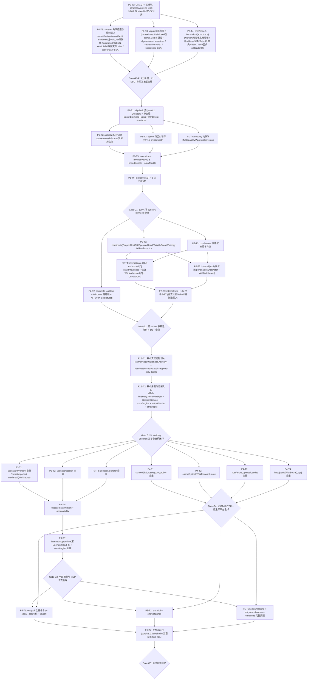

# XOps v2 全新架构分阶段实施计划（Implementation Plan）

> **关联架构宪法**：[XOps v2 全新架构定稿规范（Architecture RFC v2.3.3 校准终稿）](./v2-architecture-rfc.md)（ADR-001 – ADR-016）  
> **计划状态**：**Phase 0 – Phase 5 全量收口完成**——Phase 0（`Gate G0-R2`）、Phase 1（`Gate G1`）、Phase 2（`P2-T1`–`P2-T6` + `Gate G2`）、Phase 2.5（`P2.5-T1`–`P2.5-T2` + `Gate G2.5` Walking Skeleton）、Phase 3（`P3-T1`–`P3-T5` + `Gate G3`）、Phase 4（`P4-T1`–`P4-T4` + `core/engine` 真实协议装配 + `Gate G4`）与 **Phase 5（`P5-T1`–`P5-T4` + `Gate G5`）** 均已全量完成（`core/v1.0.0` 已在根 `go.mod` 锁定正式版本，三模块全量 `--gowork-off` 验证通过，`core/ports` 零漂移，Gate G0/G0-R/G0-R2 → G1 → G2 → G2.5 → G3 ∥ G4 → G5 全部过闸闭环）  
> **执行铁律**：**Go 1.27+** · 全仓 3 个 `go.mod` 零 `replace`（`core/` 与 `tools/xopsvet/` 全程 `GOWORK=off`，根 CLI 开发期经 `go.work`，打 **`core/v1.0.0`** Tag 发布时三模块全量 `GOWORK=off`）· **先筑 `xopsvet` 护栏与四端统一 `verify.go` CI 再写业务代码** · **Gate G2 后即交付 Walking Skeleton 纵向真机闭环** · 严禁新旧双轨补丁

---

## 1. 实施总策略与工作区切换规程

1. **隔离重构分支**：从定稿提交新建独立分支 `refactor/v2-architecture`（绝不在 `master` 或 `feat/openssh-compatibility` 上清场；旧代码随时可通过 `git show b15df20:<path>` 只读查阅客观领域规则）。
2. **Commit 0 干净清场**：在 `refactor/v2-architecture` 首个提交中清零旧 Go 源码树（旧 `cmd/`、`pkg/`、`core/`、`internal/`），保留治理文档、跨平台验证骨架（`scripts/validation/`、`deploy/macos-vm/`）与 CI/Makefile 模板；随即在最终规范路径初始化 **Go 1.27+** 三模块工作区（`go.work`、`go.mod`、`core/go.mod`、`tools/xopsvet/go.mod`）。
3. **护栏前置 + 纵向早验**：`Phase 0` 建成 `tools/xopsvet` 全部 **9 大正交分析器**（共享 `vetutil`/`vetssa`/`secretfact` 底座）、`scripts/ci/verify.go` 四端统一 CI SSOT 与 `core/conc` / `core/internal/foundation/{actor,trace}` 地基并通过 **`Gate G0-R`** 后方可进入 `Phase 1`；`Gate G2` 通过后立即进入 **`Phase 2.5 Walking Skeleton`** 在 Linux/Windows(ConPTY)/macOS 三平台真机实测最小 `xops ssh` 二进制并锁定端口契约，随后并行铺开 Phase 3 与 Phase 4。
4. **体量、复杂度与编码红线（ADR-001, ADR-013, ADR-014）**：单包生产代码上限 **3,000 LOC**；业务逻辑/状态机单文件上限 **500 LOC**，纯声明式文件（`*_spec.go` / `*_variants.go` / `*_codec.go`）上限 **800 LOC**；认知复杂度 **`gocognit <= 15`**；8 个特权包生产源码外（含全仓所有白盒与外置测试）**0 行内 `//nolint:`**；`core/domain/**` **100% 零 `sync` / `sync/atomic`**；持久化/序列化 DTO 禁裸 `time.Duration`；平台特异实现拆入构建标签文件以规避 `go/ssa` 死块剪枝。

---

## 2. 阶段依赖拓扑（v2.3.3 彻底解耦版）



---

## 3. 分阶段任务清单与验收门禁（28 个工作包，7 道硬门禁）

### Phase 0：Go 1.27+ 多模块工作区、9 大正交编译器护栏、CI SSOT 与并发地基

| 任务 ID | 工作包内容 | 目标路径 / 产物 | 关键不变量与 ADR |
| :--- | :--- | :--- | :--- |
| **`P0-T1`** | **工作区、四端统一 CI SSOT（`scripts/ci/verify.go`）与工具链初始化（Go 1.27+）**：建立 `go.work`、`go.mod`、`core/go.mod`、`tools/xopsvet/go.mod`（`go 1.27.0`，**全仓 3 个 `go.mod` 零 `replace`**，正式发版 Tag 标定为 **`core/v1.0.0`**）；配置 `.golangci.yml`（启用 **`gocognit <= 15`**，关闭 `gocyclo`）；落地纯 stdlib **`scripts/ci/verify.go`**（`//go:build ignore`，外层无 `GOWORK=off`、内部按模块显式设/剔 `GOWORK`，支持 `--stage=xopsvet|core|root|cross|dst|all`、`--pkg`、`--verbose`、`--skip-lint`、`--gowork-off`、`--self-test`，保留 `cross` 阶段跨平台 `golangci-lint` 并内置自身 `gofmt` 与根默认环境 `go vet` 自检，全模块强制 `-race -shuffle=on`）；收薄 `Makefile`（兼容无 `sh.exe` Windows 原生 Make，保留 `LDFLAGS` `-X 'main.build*'`）、`.github/workflows/ci.yml`（保留 `macos-test` `outputs.has_root`）、`.forgejo/workflows/local-ci.yml`（全 bash step 统一 `set -eu`，保留 `ubuntu-native` `-tags=integration`）、`scripts/local-ci/run.sh`（自动补齐 `xopsvet` 单测/自检/lint 与 `-shuffle=on`）；`scripts/ci_changes.py` 增补 `go.sum`/`go.work.sum`/`core/go.sum`/`tools/xopsvet/go.sum`/`scripts/ci/verify.go`（不把 `local-ci.yml` 纳入 `CROSS_PLATFORM_EXACT`）。 | `go.work`, `go.mod`, `core/go.mod`, `tools/xopsvet/go.mod`, `.golangci.yml`, `scripts/ci/verify.go`, `.github/workflows/ci.yml`, `.forgejo/workflows/local-ci.yml`, `scripts/local-ci/run.sh`, `scripts/{ci_changes.py,test_ci_changes.py}`, `Makefile` | ADR-001, ADR-013 |
| **`P0-T2`** | **`xopsvet` 共享底座与规则组 A（边界、去隐式与 OS 边界）**：建好 `internal/vetutil`（复用 `passes/inspect`、拆出不入接口方法与签名的 **`ContainsValueType`** / **`ContainsExportedValueType`** / **`ContainsNonStructValue`**、覆盖全引用类型树与 `*types.Union` 的 **`TypeContains`** / **`TypeContainsLocalPred`** 及防多态递归崩溃的 `Origin()` 去重、共享 `HasTypeParam` / `ParamTypeAt` / `UnwrapStructType`、含数字边界 `SplitIdentTokens`、`ClassifyPass`、`AllowNolintInFile`、`IsCompileTimePureExpr`、`StructSerialTags`、`ReportSortedDedup`）、`internal/secretfact`（跨包导出 `//xops:secretuse` `Fact` 与 `//xops:syncclosure` `SyncFact` 并输出 `*Result`）、`internal/vetssa`（7 文件落地共享 SSA 数据流底座：分离 `WriteTargetRoots` 严格归属与 `RootStorageValues` 后向反染、`scanCellStores` / `LoadedCellValues`、`FlushFreeVarsToOuter` 多级回写、三态 `AuditTracker` + `ReturnMask`、`ResolveStdlibIterCalls` / `ResolveDirectStdlibIterCallback`、`ResolvePos` 确定定位与 `pkg.init` 按指令判测试、`CheckNoErasure`）；`archbound`（强制 RFC v2.3.3 §2.3 DAG：`core/engine` 生产双禁 `tck`/`sim`、`core/osfs` 封禁 `crypto/tls`/`log/syslog`/`reflect` 及非 `x/sys/{unix,windows}` 三方包并经 `osfs_net.go` 实施四道防线、`conc`/`actor`/`trace` 零例外纯非 I/O stdlib 且封死未登记包、`domain` 白名单含禁时区符号与测试隔离、`mcpruntime` 禁 `OperatorReadFS`）；`noimplicit`（`new(expr)`/Map Key/全包级 `error` 哨兵/按文件 `nolint` 禁白盒测试/`context_iface` 补参数化泛型实参代入、`ChangeType`+`IsInvoke` 并保留嵌入 `context.Context` 声明豁免/`duration_dto` 双协议 JSON+YAML 合取与 map 值继承/`cmd/xops` `//xops:buildvar`）；`osboundary`（生产 OS/env/exec 补 `x/sys/{unix,windows}` 原语、`pkg.init` 按指令判测试、SSA `RemotePath` 嵌套字段敏感与值构造器零误报、SSA Unix Listen 覆盖 `Phi` 与窄接口）。 | `tools/xopsvet/internal/{vetutil,secretfact,vetssa}/**`, `tools/xopsvet/analyzers/{archbound,noimplicit,osboundary}/**` | ADR-001, ADR-003, ADR-007, ADR-011 |
| **`P0-T3`** | **`xopsvet` 规则组 B（类型/局部借用/机密双分析器）**：`sumexhaust`（复用 `vetutil` 数字边界分词与 `new` 解包，`LayerCorePortsTCK` 纳入 `inTest`）；`failclosed`（零白名单、零弱化、`zerovalue` 纳入 `sync/atomic.Bool` + 否定前缀极性检查 + 禁指针正向门控）；`digestcover`（`WriteCanonical` 编译期字段覆盖）；**`secretbox`**（新正交拆包：Rule 1 `ContainsValueType` + Rule 3 5 包白名单 + `*ast.StructType` 零匿名嵌入 + `CheckNoErasure` 含 `any` 泛型，联合豁免 `core/domain/secret` 白盒测试直调 `jsonv2.Marshal*`）；**`secrettaint`**（聚焦 Rule 2 SSA：出参全面 Fail-Closed + 精确符号级密码学消费表去 `argon2`/`AEAD.Open`/整包 `ssh` 且 `hash.Hash.Write` 验标准库源头/`AEAD.Seal` 不染 `dst` + 未知回调全路径 Fail-Closed 与 `SecretCB` 仅放行直接形参 + 嵌套同步 `box.Use`/`runtime/secret.Do` + `CallerParam` 隔离 + `sinks_narrow.go` Phase 4 模式钩子）；`linearlease`（裸 `go` 仅 `core/conc`、彻底废除 `With*`/`Use` 命名猜测仅认显式 Fact + `(*secret.SecretBox).Use` + `runtime/secret.Do` + IIFE + 白名单同步 `iter.Seq`、基于 `vetssa` 全量 SSA 零逃逸）。 | `tools/xopsvet/analyzers/{sumexhaust,failclosed,digestcover,secretbox,secrettaint,linearlease}/**`, `tools/xopsvet/cmd/xopsvet/main.go` | ADR-008, ADR-009, ADR-011 |
| **`P0-T4`** | **结构化并发、纯内存双通道 Actor 与显式熵防重入追踪地基**：`core/conc`（唯一裸 `go` 白名单；`Nursery` 废除私有哨兵 `errScopeCompleted`，落地不可逆双吸收态单调状态机 `nurseryScopedCompleting`/`nurseryCanceled` + 锁外读 `parentCtx.Err()` + `n.cancel(nil)` + 要求 `n.ctx.Err() != nil` 且拒吞 `singleUnwrapper` 的 `filterExpectedScopeCancel` + `Wait`/`Close` 状态转移 + 统一参数校验序；`CtxMutex`）；`core/internal/foundation/actor`（0 裸 `go` 纯内存 `DualActor[Req, Ctrl]`，两段式 `select` + `acquireCh` 控制排空后复核停机转 `drainAndStopWithPending(req)` + 全停机路径确定性 `stopCh` 优先 + 零分配 `ringQueue.reset()`）；`core/internal/foundation/trace`（移除 `"crypto/rand"`，提供纯 `TraceIDFromBytes`/`OpIDFromBytes` + 显式 `NewTraceIDFrom(io.Reader)`/`NewOpIDFrom(io.Reader)`，`trace_test.go` 同样零 `crypto/rand`；全局单层不可重入 `LeaseScope`）。 | `core/conc/**`, `core/internal/foundation/{actor,trace}/**` | ADR-003, ADR-009, ADR-011 |

**Gate G0-R 硬验收**：
```sh
go run ./scripts/ci/verify.go --stage=all
(cd core && GOWORK=off go test -race -shuffle=on -count=50 ./conc/... ./internal/foundation/...)
go run ./scripts/ci/verify.go --stage=cross
python3 -m unittest discover -s scripts -p test_ci_changes.py -v
npm run docs:check
```
> 附加体量与质量红线：`tools/xopsvet` 生产总 LOC **≤ 9,500 LOC**（预计 ~9,080 LOC，严禁删减简体中文注释），最大单包 ≤ 1,700 LOC，`secrettaint` ≤ 1,100 LOC，`osfs_net.go` ≤ 300 LOC，全仓业务单文件 ≤ 450 LOC，0 处 `//nolint:`。

---

### Phase 1：100% 零 `sync` 纯函数数学领域核（`core/domain/**`）

| 任务 ID | 工作包内容 | 目标路径 / 产物 | 验证重点 |
| :--- | :--- | :--- | :--- |
| **`P1-T1`** | **代数基元（含 `json/v2 Duration`）、单协程 `SecretBox` 与端点**：`Option[T]`（仅结构体可选字段）、`NonEmpty[T]`、`FirstWins[T]`、**`Duration`（实现 `TextAppender`/`TextMarshaler`/`TextUnmarshaler` 解决 `json/v2` `SemanticError`）**；`SecretBox`（含正向门控 **`valid bool`** 与 `wiped bool` 过 `failclosed`、单协程 `//xops:borrowed`、`Use` + 常量时间比对 **`Equal(other *SecretBox) bool`**（`crypto/subtle`，免除 `tck` 明文需求）+ `clear()`、入站 **`secret.WithBytes`** 仅标 `//xops:syncclosure` + `//xops:borrowed` 且**禁标 `//xops:secretuse`**、故意零编码接口白嫖 `json/v2` 原生拒绝（`core/domain/secret` 白盒测试直调 `jsonv2.Marshal*` 由 `secretbox` 联合豁免）、`core/domain/secret` 独占 `"runtime/secret"` 供 `//go:build goexperiment.runtimesecret` 钩子并由 `linearlease`/`secrettaint` 同步闭包放行）；`Endpoint`/`HostPort`/`CanonicalHost`（实现 `TextAppender`/`TextMarshaler`）。 | `core/domain/{algebraic,secret,netaddr}/**` | 零 `sync`/`sync/atomic`、`json/v2` 往返与 `SecretBox` `SemanticError`/`Equal`/`GOEXPERIMENT=runtimesecret` 实测 |
| **`P1-T2`** | **路径、软链与受保护路径代数**：`RemotePath`、`RemoteName`、`LocalRootedDest`、`LocalDir`、`LocalSourcePath`（均实现 `TextAppender`/`TextMarshaler`）、`ValidateLocalComponent`、软链策略 `(b)` + 基于 **`golang.org/x/text/unicode/norm`** 的 NFC/NFD 折叠碰撞、UTF-8 `ProtectedPathMatcher`。 | `core/domain/pathalg/**` | 幂等律、逃逸/碰撞 Fuzz、跨 OS 表驱动 |
| **`P1-T3`** | **四层 OpenSSH 选项幺半群与纯求解器**：`ParseOption`、`PathList`（`IdentityFile`/`CertificateFile` 单指令单路径三态 + `terminated` 封口）、`KnownHostsList`（`UserKnownHostsFile` 独立 `none`/多路径且 `FirstWins` 合并）、`AlgoPolicy`（跨指令/跨层 `FirstWins` 合并 + `-` 独占支持 `*`/`?` 通配 + 边界单次 `Apply(L_0)`）、`HostNameSpec`（严格 `%%`/`%h` 模板 + `HostNameSpecFromHost`）、`ProxyRoute`、`ControlPolicy`（三槽 `FirstWins` 直积 + `!Path().IsEnabled()` 时 `EffectiveMaster()`/`EffectivePersist()` 失败关闭归零投影）、`EnvFilter`、`OptionLayer`（`*_spec.go`/`*_codec.go` ≤ 800 LOC；`core/domain/option` 独占 `"crypto/sha1"` 专供 OpenSSH `%C = SHA1(%l%h%p%r%j)`，其中 `%j` 在 `ProxyJumpChain` 激活时取末跳无方括号规范主机名，供 `host/openssh` 与 `sshnet/mux` 共用）与唯一纯入口 `ResolveEffectivePolicy`（固定 `t1(CLI) > t2(SavedNode) > t3(XOpsGlobal) > t4(OpenSSH)` + `DefaultOptionLayer()`，非 OpenSSH 来源按 `INV-D2` 仅对 `t4` 裁剪至 `OptionClassMux ∪ OptionClassTransport`）。 | `core/domain/option/**` | 结合律/单位元/吸收律属性测试 + `%C` 哈希与往返 Fuzz |
| **`P1-T4`** | **纯数学安全核**：`Verdict` 交半格、`RiskLevel`/`Decision` 并半格、`NodeOverrides` 格折叠；幻影 `Capability` 类型集、`OperationID`（`TextAppender`）、`OperationBinding`、`ApprovalEnvelope`、`CanonicalScopeEscalated`（**不含 `Authorized[C]`，保持 `core/domain/security` 100% 纯数学**）。 | `core/domain/security/**` | 交换/结合/幂等/单调律、零值最严、`json/v2` `Deterministic(true)` 测试 |
| **`P1-T5`** | **命令计划、资产图 DAG、导入包与 Merkle 连接计划**：`CommandPlan` + `ExecutionOutcome` ADT；`Host`/`Identity`/`Node`/`AuthMethod` ADT/`NodeOrigin` ADT/Tarjan DAG/`ImportBundle`；`HopSpec`/`SealedConnectionPlan`/`WriteCanonical`（零反射）+ `ManagedHandle[K]`。 | `core/domain/{execution,inventory,plan}/**` | `digestcover` 0 违例、Tarjan 环路测试、命令 Fuzz |
| **`P1-T6`** | **判别式 Playbook AST 与 5 大纯 Mealy FSM**：`Playbook` vNext AST、`StepAction` ADT、`FoldPlaybookReport`；纯函数 `VaultSagaFSM`、`ApprovalFSM`、`TransferFSM`、`EnsureFSM`、`PendingEnrollFSM`。 | `core/domain/{playbook,fsm}/**` | 全状态转换表遍历、`sumexhaust` 0 违例 |

**Gate G1 硬验收**：
```sh
go run ./scripts/ci/verify.go --stage=xopsvet
go run ./scripts/ci/verify.go --stage=core --pkg=./domain/...
(cd core && GOWORK=off GOEXPERIMENT=runtimesecret go test -race -shuffle=on -count=1 ./domain/secret/...)
(cd core && GOWORK=off go test -run='^$' -fuzz=. -fuzztime=5s ./domain/pathalg ./domain/option ./domain/execution ./domain/security)
```

---

### Phase 2：出站端口、TCK、`core/osfs` 与完全解耦的核心运行时引擎

| 任务 ID | 工作包内容 | 目标路径 / 产物 | 验证重点 |
| :--- | :--- | :--- | :--- |
| **`P2-T1`** | **出站端口契约与 TCK**：`InventoryStore`、`JournalStore`、`FormatImporter`、**双模态本地 FS 端口（`ScopedRootFS` 与 `OperatorReadFS`）**、`SecretVault`（**全作用域 `WithSecret(ctx, ref, fn)`，零命令式返回**）、`KeySignerPort`、`HostTrustPort`、`DialerPort`、`MuxSocketPort`、`RemoteFSPort`、`ProcessPort`、`TerminalPort`、`Clock`、**`Entropy`（满足 `io.Reader` 契约以零摩擦喂给 `trace.NewTraceIDFrom`/`NewOpIDFrom`）**、`AuditSink`（含 `AuditReconciler`）、`InteractionPort`（**全部作用域 Bracket 接口方法必须显式标注 `//xops:syncclosure` + `//xops:borrowed`**），以及对应 `core/ports/tck`（测试契约夹具层，0 生产可达，凭 `SecretBox.Equal` 与 `secret.WithBytes` 零明文校验）。 | `core/ports/**`, `core/ports/tck/**` | 零具体协议库依赖、TCK 全编译 |
| **`P2-T2`** | **三平台句柄安全原语（`core/osfs`）**：基于 Go `*os.Root` 实现 `ScopedRootFS`（**所有写锁统一锁于同 Root 下旁路 `<name>.lock`，绝不对数据文件本身加锁后 `Root.Rename`**）与 `OperatorReadFS`（支持跨盘符与受 `SymlinkPolicy` 管控的只读源文件）；实现 `OpenRegular`/`CreateExclusive`/`OpenLockedContext`/`AtomicReplace`/`SocketSlot`/`ProbeStaleUnixSocket`（在 `archbound/osfs_net.go` 四道 `net` 符号防线下合法使用 `(*net.ListenConfig).Listen`/`(*net.ListenConfig).ListenPacket`/`(*net.Dialer).DialUnix` 与 `net.ListenUnix`/`ListenUnixgram`/`ResolveUnixAddr` 等本地 `AF_UNIX` API，平台差异逻辑拆入构建标签文件）、Windows Handle DACL + `\\?\` + `AF_UNIX` 对端令牌、Unix 对端 UID。 | `core/osfs/**` | 过 `ScopedRootFS`/`OperatorReadFS` TCK；`osfs_net` 0 违例；三平台交叉编译 + 原生验证 |
| **`P2-T3`** | **作用域化双层事件流（`core/events`）**：Sealed `Event` ADT（`*_variants.go` ≤ 800 LOC，全字段通过 `json/v2` 往返校验，零裸 `time.Duration`）、`OperationStream`、`AuditDispatcher`、`SystemBus`。 | `core/events/**` | 慢渲染不阻塞、`json/v2` 全变体编解码测试、`secretbox`/`secrettaint` 0 泄密 |
| **`P2-T4`** | **独占 `Authorized[C]` 的能力门控（`core/internal/gate`）**：在 `gate` 包内定义 `Authorized[C]`（内置正向门控 `valid bool` + `revoked *atomic.Bool`，Go 编译器原生封死外部构造）与包级泛型 **`gate.WithAuthorized[C](ctx, g, req, run)`**；提供 `OnHaltFunc` 出站熔断回调（零 `gate -> pool` 依赖）；实现 `StrictAgentProfile` 下 `AuditPostWriteError` 立即触发 `Halted` 熔断 + 启动期 `ReconcileCrashedAudits`。 | `core/internal/gate/**` | 进程内零孤儿、重启对账、`ENOSPC` 熔断、重放对抗测试 |
| **`P2-T5`** | **仅依赖 `core/ports` 的双通道纯内存 Actor Merkle 连接池（`core/internal/pool`）**：彻底零 `sshnet` 依赖；基于 **`actor.DualActor`**（两段式 `select` 优先排空 `controlCh` + `step()` 停机复核 + 全停机路径 `stopCh` 优先 + 发送者屏障 + 零分配 `reset()`）与 **`core/conc.Nursery`** 落地 100% 纯内存非阻塞循环、控制/数据面分离、`ReleaseLease` 监听 `actorDone`、仅在用户回调 `fn(scopedCtx, sess)` 入口注入全局单层不可重入 `trace.LeaseScope`、`WithMultiLease` 拓扑序申请、父代 `Epoch` CAS、90ms 有界拆断、SlotMap、接收 `GateHalted` 全量吊销。 | `core/internal/pool/**` | 满邮箱归还不死锁、多跳拨号不误触 `ErrReentrantLease`、池关闭归还不挂起、数据面高并发基准、`linearlease` 0 逃逸 |
| **`P2-T6`** | **确定性仿真器（`core/internal/sim`）与 10,000 种子 DST**：实现 `SimClock`、`SeededRand`（实现 `io.Reader` 喂给 `trace`）、`SimVault`（纳入 5 包明文白名单但不授予 `//nolint:`，0 生产可达）、`SimScopedRootFS`、`SimOperatorReadFS` 及故障注入全端口（全部过 `tck`）；10,000 种子仿真覆盖 `SIGKILL` 崩溃对账、`ENOSPC` 熔断（验证 `WithAuthorized` 外包 `WithLease` 无自锁）、满邮箱背压、多跳 90ms 拆断、并发 `Retire`/`Acquire` 与 5 大全局不变量。 | `core/internal/sim/**`, `core/internal/{pool,gate}/dst_test.go` | 10,000 种子 `-race -shuffle=on` + `goleak` 0 泄漏、单种子 100% 复现 |

**Gate G2 硬验收**：
```sh
go run ./scripts/ci/verify.go --stage=all
go run ./scripts/ci/verify.go --stage=cross
go run ./scripts/ci/verify.go --stage=dst
# 并由四端统一 verify.go 在 GitHub Actions / 本地多平台原生 Runner 执行 core/osfs 原生 TCK 与 xopsvet
```

---

### Phase 2.5：Walking Skeleton（可行走骨架纵向切片 — 零旧代码桥接）

| 任务 ID | 工作包内容 | 目标路径 / 产物 | 验证重点 |
| :--- | :--- | :--- | :--- |
| **`P2.5-T1`** | **最小真实传输与宿主切片**：`sshnet/dial`（`x/crypto/ssh` + `WithSecret` + 强制 **`core/conc.Nursery`** `RunScoped` **`ssh.Channel` Watchdog**）与 `sshnet/hostkey`（单一加锁 `O_NOFOLLOW` `knownHostsDB`）；最小 `internal/host/{openssh,sys,audit}`（只读 `~/.ssh/config`，`host/openssh` 必须将全部匹配的 `Host`/`Match`/`Include` 指令自上而下经 `ApplyParsedOption` 折叠为单一 `t4` `OptionLayer`；Unix PTY + Windows ConPTY/JobObject Relay + `core/conc.Nursery`；带只追加 `~/.xops/run/<ProcessInstanceID>.lock` `O(1)` 崩溃对账的 JSONL `AuditSink`）。 | `core/internal/sshnet/{dial,hostkey}/**`, `internal/host/{openssh,sys,audit}/**` | 多跳断连 Watchdog `goleak` 回归、多终端并发与只追加对账测试、`ssh -G` 最小差分 |
| **`P2.5-T2`** | **最小只读目标解析、最小会话用例、引擎接线与骨架二进制**：显式纳入最小只读 **`usecase/inventory.ResolveTarget`**（首阶段支持 `OriginAdHoc` 与 `OriginOpenSSHVirtual`，避免临时塞进 `session` 或 `cmd/xops`）+ 最小 `usecase/session`（`WithAuthorized` 外包 `WithLease`）+ `core/engine`（生产源码仅装配 `sshnet` 注入 `pool` 与 `gate.OnHaltFunc -> pool.GateHalted`，禁导 `tck`/`sim`，仿真装配走 `core/engine/*_test.go`）+ 最小 `entry/cli`（`xops ssh` + `version`，零包级 `var`，接收显式 `BuildInfo`）+ `cmd/xops`（以 **`//xops:buildvar`** 接收 `-X 'main.buildVersion/buildCommit/buildTime'` 并回退 `runtime/debug.ReadBuildInfo()`，注入 `ScopedRootFS` 与 `OperatorReadFS`）。 | `core/internal/usecase/{inventory,session}/**`, `core/engine/**`, `internal/entry/cli/**`, `cmd/xops/**` | 编译真实 `bin/xops`；验证 `xops version` 注入元信息；Linux/Windows(ConPTY)/macOS 原生 CI 端到端跑通并锁定端口契约 |

**Gate G2.5 硬验收**：三平台原生 CI 经 `go run ./scripts/ci/verify.go --stage=all` 跑通真实 `bin/xops ssh` 闭环（`core/` 与 `tools/xopsvet/` `GOWORK=off`，根 CLI 经 `go.work`）+ `xopsvet` & `golangci-lint` 0 issues + `goleak` 0 泄漏。

---

### Phase 3 & Phase 4（Gate G2.5 后完全独立的双轨并行）

> **双轨并行契约纪律**：`Gate G3` 与 `Gate G4` 相互独立并汇入 Phase 5；`Gate G2.5` 已冻结 `core/ports` 与 `core/internal/pool` 跨轨契约（涵盖 `MuxSocketPort.{Serve,OpenProxy,DialMux}`、`ForwardEndpointKind`、`JournalGenerationSnapshot` / `LoadGenerations` / `PruneGeneration`、`TUNDevicePort`、`RemoteRenameSpec` / `RemoveDir` / `Chtimes`、`RootHandle.Chtimes` 及 `pool.RegisterLeaseHandleWith`）。并行期间若极个别场景确需微调已锁定签名，必须在**同一提交内**同步更新 `core/ports/tck` 与 `core/internal/sim` 并通过 `Gate G2`，确保双轨零摩擦。

- **Phase 3（全量用例服务 + MCP 运行时 + `core/engine`）**：
  - `P3-T1`：`usecase/inventory`（CAS CRUD、DAG、5 处引用删除、`FormatImporter` 调度、`Doctor`、`WithPendingEnrollment`）& `usecase/credential`（`VaultSagaFSM` + 全作用域 `WithSecret`）。
  - `P3-T2`：`usecase/session` 全量（`sudo`/`su`、2 阶段探针、SlotMap 持久 PTY、`-L`/`-R`/`-D`/StreamLocal/TUN、ControlMaster `-O`/Persist）。
  - `P3-T3`：`usecase/transfer` 全量（并行分片 `scp` 经 `OperatorReadFS` 读源 + `ScopedRootFS` 写目标、SFTP 工作区、远端原子 `read`/`write`/`patch`/`stat`、MCP HTTP 10 GiB 传输与恢复）。
  - `P3-T4`：`usecase/automation`（批量 `exec`、Playbook `EnsureFSM` + `FoldPlaybookReport`）& `usecase/observability`（TUI 指标/日志流、POSIX 强校验 GUI）。
  - `P3-T5`：`core/internal/mcpruntime`（stdio + Streamable HTTP、7 判别式工具、**物理仅注入 `ScopedRootFS` 零 `OperatorReadFS`**、启动期 `O(1)` 崩溃对账 + `RecoverJournals`、Python 独立客户端）& `core/engine` 全量门面（生产源码严禁导入 `tck`/`sim`，仿真测试装配在 `core/engine/*_test.go`）。
  - **`Gate G3`**：`core/` 全包 `GOWORK=off` 编译、`xopsvet` 0 违例、`golangci-lint`(`gocognit<=15`) 0 issues、全用例+MCP 端到端仿真与对抗测试全绿。
- **Phase 4（全量真实协议与 CLI 本机宿主适配器）**：
  - `P4-T1`：`sshnet/{dial,hostkey,priv,probe}` 全量（OTP/Keyboard-Interactive、SSHFP、随机 `-p` 提权握手、2 阶段探针；`sshnet/priv` 纳入明文白名单并支持双层嵌套 `keyBox.Use -> passBox.Use`；`sshnet/dial` 适配 `ssh.KeyboardInteractiveChallenge` 经 `secrettaint/sinks_narrow.go` 结构化窄模式钩子落地，0 `//nolint:`）。
  - `P4-T2`：`sshnet/{sftp,forward,mux}` 全量（`sshnet/sftp` 非截断打开 + `SSH_FXP_FSTAT` 类型/`(dev,ino)` 锚定 + 原子 `posix-rename@openssh.com`；SOCKS5/TUN；`PROTOCOL.mux` v4）。
  - `P4-T3`：`internal/host/{store,openssh,audit}` 全量（YAML vNext `version: 2`、`openssh`/`csv` `FormatImporter`、旁路锁 CAS + CRC WAL、`host/openssh` 将全部匹配的 `Host`/`Match`/`Include` 指令自上而下经 `ApplyParsedOption` 折叠为单一 `t4` `OptionLayer` + 全量 `ssh -G` 差分、多终端并发安全的 `run/*.lock` 崩溃对账）。
  - `P4-T4`：`internal/host/{vault,sys}` 全量 + `core/osfs` Windows Named Pipe 本地 IPC 核验拨号 + `xopsvet` 窄规则定稿：
    - `core/osfs` 增补 **`DialWindowsNamedPipeVerified(ctx, pipePath) (net.Conn, error)`**（`OPEN_EXISTING`、`FILE_FLAG_OVERLAPPED | SECURITY_SQOS_PRESENT | SECURITY_IDENTIFICATION`、`FILE_TYPE_PIPE` 校验、`GetSecurityInfo(SE_KERNEL_OBJECT, OWNER|DACL)` + `WindowsACLPipeServerSafe` 阻断非受信任主体 `FILE_CREATE_PIPE_INSTANCE=0x04 | WRITE_DAC | WRITE_OWNER | GENERIC_ALL | GENERIC_WRITE` 同时放行 `LocalSystem` `openssh-ssh-agent` 的合法双工 `FILE_WRITE_DATA`；对 `archbound/osfs_net.go` 与 `core/ports` 零改动）；
    - `internal/host/vault` 按子包物理隔离为 `internal/host/vault/{offline,wincred,keychain,secretservice,helper}`（使 FFI/`unsafe` 后端的 `unsafe.Slice`/`uintptr->unsafe.Pointer` 永不触发 `vault/offline` Argon2id + XChaCha20-Poly1305 AEAD dirfd 的 `hasUnsafeVaultForge`），根 CLI `go.mod` 在 `CGO_ENABLED=0` 下引入 `github.com/ebitengine/purego`（macOS `Security.framework`）与 `github.com/godbus/dbus/v5`（Linux Secret Service）（句柄/符号存结构体，0 `init()`/0 包级 `var`），全走 `WithSecret` 与 0 v1 迁移代码；`secrettaint/sinks_narrow.go` 定稿 4 项子包级窄钩子（0 `//nolint:`，非外置测试生产文件）：`vault/wincred`（+ `vault` Phase 0 夹具 `CREDENTIALW` + `LazyProc.Call`）、`vault/keychain`（`purego.SyscallN` 未染毒 arg 0）、`vault/secretservice`（专属 DH AES-128-CBC 保持全局 `sinks.go` 纯 AEAD + `plain` 回退）、`vault/helper`（`(ports.ProcessPort).Run` 仅 `stdin` 染毒）；
    - `osboundary` 保持 `windows.CreateFile`、`windows.GetSecurityInfo`、`os.NewFile`、`unix.Fstat` 在 `core/osfs` 外 100% 封禁（零动态路径校验器豁免），在 `LayerHostSys`（`internal/host/sys/**` 非外置测试生产文件）仅放行精确编译期字面量 `"/dev/net/tun"`（`TUNSETIFF` 校验）或 `"/dev/tty"`（`term.IsTerminal`/`IoctlGetTermios` 校验）的直接 `golang.org/x/sys/unix.Open` 调用（须 `O_CLOEXEC` 且无 `O_CREAT`）；
    - `internal/host/sys` 承接生产 `SSHAgentPort`（Windows 调 `osfs.DialWindowsNamedPipeVerified`，过 `tck.RunSSHAgentSuite`）、TTY `InteractionPort`（Unix `/dev/tty`，过 `tck.RunInteractionSuite`）、`TUNDevicePort`（支持 Linux `/dev/net/tun`、macOS `AF_SYSTEM` `utun`，Windows/FreeBSD 返回 `ports.ErrUnsupported`，配未导出 `driverOpener` 测试接缝过 `tck.RunTUNDeviceSuite` + 原生内核冒烟测试）、`ProcessStdioConn`、`SSHFPLookupPort`（经注入 `ports.OperatorReadFS` `SymlinkFollow` 读 `/etc/resolv.conf`，0 `osboundary` 豁免）、POSIX 孤儿进程组 `suspend` 判定。
  - **`Gate G4`**：全部真实适配器 100% 过 `core/ports/tck` + 全量 `ssh -G` 差分 + Linux/Windows/macOS 原生 CI 全绿。

---

### Phase 5：全量极薄入口、完整组合根与发布收口

- **`P5-T1`**：`internal/entry/cli` 全量命令（含 `config import` 统一扩展口、`--json`、`--policy`，零 `host/*` 与 `core/osfs` 导入，零包级 `var`）。
- **`P5-T2`**：`internal/entry/tui`（Bubble Tea v2 流投影 + **`core/conc.Nursery`** `RunScoped`/`RunWait` 排空终端接管）& `internal/entry/sftpshell`。
- **`P5-T3`**：`internal/entry/{mcpcmd,muxdaemon}`（使用 `core/conc.Nursery` 监督后台协程）& 完整 `cmd/xops` 组合根（`//xops:buildvar` 显式注入 `BuildInfo` + 启动期 `O(1)` 崩溃对账 + 严格逆序关闭）。
- **`P5-T4`**：发布构建流水线收口（严守 Go Module SIV 打 **`core/v1.0.0`** Tag、根 `go.mod` 锁定正式版本并触发 `go run ./scripts/ci/verify.go --stage=all --gowork-off` 三模块全量验收、原生 `sudo`/fish/zsh 回归）、`Makefile` 发布目标、面向用户双语文档、`AGENTS.md`、`skills/xops-agent/` 收口。
- **`Gate G5`**：三模块（打 `core/v1.0.0` Tag 后全量 `--gowork-off`）+ `xopsvet` 0 违例 + `golangci-lint`(`gocognit<=15`) 0 issues + 10k DST + 原生 3-OS CI + `npm run docs:check` 全绿。

---

## 4. Phase 0 / Phase 1 / Phase 2 / Phase 4 编码落地备忘（防踩坑细则）

> 本节作为 v2.3.3 冻结架构的编码级实现备忘，直接指导 `P0-T1`–`P0-T4`/`P1-T1`/`P1-T3`/`P2-T1`/`P2-T2`/`P2-T4`/`P2.5-T1`/`P4-T1`/`P4-T3`/`P4-T4` 施工：

1. **`xopsvet/linearlease` 100% 显式同步闭包 Fact 与 SSA 零逃逸（`P0-T3` / `P2-T1`）**：彻底废除凭 `With*`/`Use` 函数名隐式放行的做法，仅承认显式 `//xops:syncclosure`/`//xops:borrowed`/`//xops:secretuse` Fact + 精确 `(*secret.SecretBox).Use` + 标准库 `runtime/secret.Do` + IIFE + 白名单同步 `iter.Seq`（绝不把 `defer` 当作同步闭包放行），并在递归审计子闭包体时沿 `MakeClosure.Bindings`（穿透 Go 1.22+ 循环 `Phi`）与写后子切片反向溯源追踪至根分配对象，同时严隔调用方非种子 `CallerParam`。
2. **`xopsvet/archbound` 符号级拦截、`core/osfs` 四道 `net` 防线与 `core/domain` 纯数学白名单（`P0-T2` / `P1-T1`–`P1-T3` / `P2-T2`）**：
   - `ScopedRootFS` 与 `OperatorReadFS` 同驻 `core/ports/localfs.go`，`archbound` 遍历 `pass.TypesInfo.Uses` 拦截 `core/internal/mcpruntime` 引用 `core/ports.OperatorReadFS`；
   - `core/engine` 生产文件双禁 `core/ports/tck` 与 `core/internal/sim`（仿真装配直接走 `core/engine/*_test.go`），数学保证全仓 **0 生产二进制可达 `tck` 与 `sim`**；
   - `core/osfs` 禁 `net/*` 与 `os/exec`，导入 `"net"` 由 `archbound/osfs_net.go` 实施 18 项包级白名单 + 3 含 `ctx` 方法与 3 包级 Unix 函数直接调用绑定及精确常量网络名 + 零同构克隆（`field.Pkg().Path() == "net"`，不误杀 `SocketSlot`）/ 全 `*ast.StructType` 零匿名嵌入 / `vetssa.CheckNoErasure`（含 `any` 泛型）+ 完整类型树与复合字面量字段白名单；
   - `core/conc` 与 `core/internal/foundation/{actor,trace}` 零例外共享纯内存非 I/O stdlib 约束（禁 `crypto/rand`/`path/filepath`/`io/ioutil`/`log/syslog`/`plugin`/`embed`），全路径封死 `FoundationOther`；
   - `core/domain/**` 采用 **fail-closed 纯数学白名单**（29 纯 stdlib + `golang.org/x/text/unicode/norm`；子包独占：`core/domain/option` → `"crypto/sha1"`、`core/domain/secret` → `"runtime/secret"`），并经 `TypesInfo.Uses` 封禁时钟与定时函数。
3. **`actor.DualActor` 控制通道、停机线性化、入站发送者屏障与零分配 panic 清理（`P0-T4`）**：`actor.DualActor` 物理封锁于 `core/internal/foundation/actor`（0 裸 `go`、纯内存非 I/O stdlib）。禁止用定长原生 `chan Ctrl` 充当 `controlCh`，对外暴露 `SendControl(msg Ctrl)`，内部以极薄互斥锁保护无界环形切片队列 + 1 缓冲非阻塞 `controlReady` 信号并监听 `actorDone`；入站 `SendAcquire(ctx, req)` 采用对称 `acqMu + acqClosed + acqSenders` 屏障（持锁外校验 `ctx.Err()`）；`step(ctx)` 在 `acquireCh` 支路执行 `drainControls()` 后必须立即复核 `isShutdown(ctx)`，若已停机则调用 `drainAndStopWithPending(req)`（严格 FIFO：`beginStop -> acqSenders.Wait -> drainControls -> onDrainRequest(req) -> drainAcquireCh -> closeAndDrainControls`）；全停机路径（`checkShutdown`、主 `select`、`isShutdown`）统一确定性 `stopCh` 优先于 `ctx.Done()`；`Run(ctx)` 挂 LIFO 异常防护 `defer` 置 `acqClosed=true`、关 `stopCh`、在 `ctrlMu` 下置 `ctrlClosed=true` 并调用零分配 `ctrlQueue.reset()` 清空滞留指针（不调 `acqSenders.Wait()`）。
4. **`run/<ProcessInstanceID>.lock` 严格只追加协议与慢路径核验（`P2-T4` / `P2.5-T1`）**：
   - **禁止高并发截断重写**：`.lock` 文件严格采用 **Append-Only 协议**（进程内互斥锁保护内存 `active map[OperationID]struct{}`，`Stage` 追加 `+<opID>\n`，`Unstage` 追加 `-<opID>\n`）；**仅当内存活跃集合归零时才允许执行 `Truncate(0)`**（对长驻 MCP HTTP 进程，若行数超阈值可短暂暂停准入并排空活跃操作后再截断压缩），杜绝 `Truncate(0)` 窗口遇 `SIGKILL` 漏检并发在途操作。
   - `gate.WithAuthorized` 严格按 **`Stage(+opID) -> Audit(Authorized) -> run() -> Audit(Finalized) -> Unstage(-opID)`** 顺序执行；正常关闭前清空 `.lock`。
   - **正常启动（99.999%）**：无死亡进程锁文件，严格 **O(1) 零读取 `audit.jsonl`**。
   - **崩溃恢复慢路径（0.001%）**：独占 `TryLock` 抢到死亡进程 `.lock` 后，先按 `+`/`-` 差集还原未关闭 `opID`，再核对 `audit.jsonl` 中该 `ProcessInstanceID` 实际「已写 `Authorized` 且无 `Finalized`」的记录后补写 `AbortedByCrash`，杜绝任意指令边界强杀产生的无头或重复终态记录。
5. **Windows 清理已加锁 `.lock` 文件防 `ERROR_SHARING_VIOLATION`（`P2-T2` / `P2.5-T1`）**：在 Windows 上对持锁句柄未关闭文件执行 `os.Remove` 会报共享冲突。`core/osfs` 与对账清理须固定按 **「持独占锁截断/清空文件内容（标记已消费） -> 解锁并关闭句柄 -> `Remove`（忽略 `ErrNotExist`）」** 执行，三平台行为一致且并发幂等。
6. **入站 `SecretBox` 全作用域闭包化、`valid` 正向门控与常量时间比对（`P1-T1` / `P2-T1`）**：`SecretBox` 同时持正向门控 `valid bool` 与 `wiped bool`（过 `failclosed`），提供常量时间比对 **`Equal(other *SecretBox) bool`**（`crypto/subtle`，免除 `tck` 明文消费）；`core/domain/secret` 提供 **`secret.WithBytes(raw []byte, fn func(box *SecretBox) error) error`**（深拷贝并立即 `clear(raw)`，回调退出无条件 `defer box.Wipe()`，**仅标 `//xops:syncclosure` + `//xops:borrowed`，禁标 `//xops:secretuse`**），并让 `InteractionPort.PromptSecret(ctx, req, func(box *SecretBox) error) error` 同走回调借用形态，实现连交互输入密码写入 `Vault.PutAndVerify` 在内的全链路零手写 `defer box.Wipe()`。
7. **`P4-T1`/`P4-T4` 结构化窄消费器钩子、`osboundary` 窄常量规则、`core/osfs` Named Pipe 与 `cmd/xops` `//xops:buildvar` 约定（`P2.5-T2` / `P4-T1` / `P4-T4`）**：
   - **`core/osfs` Windows Named Pipe 本地 IPC**：`core/osfs` 在既有常规文件句柄、旁路锁、ACL、`os.Root` 与本地 `AF_UNIX` `SocketSlot` 之上统一承接受验 Windows Named Pipe 客户端拨号 **`DialWindowsNamedPipeVerified(ctx, pipePath) (net.Conn, error)`**（强制 `OPEN_EXISTING`、`FILE_FLAG_OVERLAPPED | SECURITY_SQOS_PRESENT | SECURITY_IDENTIFICATION`、`FILE_TYPE_PIPE` 校验、`GetSecurityInfo(SE_KERNEL_OBJECT, OWNER|DACL)` + `WindowsACLPipeServerSafe` 阻断非受信任主体 `FILE_CREATE_PIPE_INSTANCE=0x04 | WRITE_DAC | WRITE_OWNER | GENERIC_ALL | GENERIC_WRITE` 同时放行 `LocalSystem` `openssh-ssh-agent` 的合法双工 `FILE_WRITE_DATA`），对 `archbound/osfs_net.go` 与 `core/ports` **零改动**；
   - **`osboundary` 窄常量 `LayerHostSys` 规则**：`windows.CreateFile`、`windows.GetSecurityInfo`、`os.NewFile`、`unix.Fstat` 在 `core/osfs` 之外 **100% 封禁**（零动态路径校验器豁免）；在 `LayerHostSys`（`internal/host/sys/**` 非外置测试生产文件）仅放行直接调用 `golang.org/x/sys/unix.Open` 且 arg 0 为精确编译期字符串字面量 `"/dev/net/tun"`（Linux TUN/TAP，由 `TUNSETIFF` 校验）或 `"/dev/tty"`（Unix 管道 stdin 下 `InteractionPort` 控制终端，由 `term.IsTerminal`/`IoctlGetTermios` 校验）、置位 `O_CLOEXEC` 且不含 `O_CREAT`；`SSHFPLookupPort` 经注入的 `ports.OperatorReadFS`（`SymlinkFollow`）读取 `/etc/resolv.conf`（0 `osboundary` 豁免）；`TUNDevicePort` 支持 Linux `/dev/net/tun`、macOS `AF_SYSTEM` `utun`，Windows/FreeBSD 返回 `ports.ErrUnsupported`（保留未导出 `driverOpener` 测试接缝供 `tck.RunTUNDeviceSuite` + 原生内核冒烟测试）；
   - **`internal/host/vault` 子包隔离、`CGO_ENABLED=0` 根依赖与 `secrettaint/sinks_narrow.go` 定稿**：`sshnet/dial`（`ssh.KeyboardInteractive` 挑战闭包 + `box.Use`）与 `sshnet/priv`（正向 SSH 通道写入白名单）保持既有 `P4-T1` 钩子；`internal/host/vault` 将 FFI/`unsafe` OS 后端物理隔离为 `internal/host/vault/{offline,wincred,keychain,secretservice,helper}`，防止 `unsafe.Slice` / `uintptr->unsafe.Pointer` 触发 `vault/offline`（Argon2id + XChaCha20-Poly1305 AEAD dirfd）中的 `hasUnsafeVaultForge`；根 CLI `go.mod` 在 `CGO_ENABLED=0` 下批准引入 `github.com/ebitengine/purego`（macOS `Security.framework`）与 `github.com/godbus/dbus/v5`（Linux Secret Service），句柄与符号地址存储于适配器结构体字段（0 `init()`、0 包级 `var`）。`tools/xopsvet/analyzers/secrettaint/sinks_narrow.go`（0 `//nolint:`，仅非外置测试生产文件）定稿 4 项 `P4-T4` 子包级窄钩子：① `vault/wincred`（+ `vault` Phase 0 夹具）：`CREDENTIALW` 作用域自有结构体字段存储 + `LazyProc.Call`；② `vault/keychain`：`purego.SyscallN` 且 arg 0 `fn uintptr` 未染毒；③ `vault/secretservice`：DH AES-128-CBC（`crypto/cipher.NewCBCEncrypter` + `(cipher.BlockMode).CryptBlocks` 严格限定于 `sinks_narrow.go` 的 `vault/secretservice` 子包，保持全局 `sinks.go` 纯 AEAD）+ `plain` 回退（`dbusSecret.Value` 作用域自有字段存储 + `(dbus.BusObject|*dbus.Object).{CallWithContext,Call}` 仅限精确常量方法 `"org.freedesktop.Secret.Collection.CreateItem"` / `"org.freedesktop.Secret.Item.SetSecret"` 且 recv/`ctx`/`flags`/`method` 未染毒）；④ `vault/helper`：`(ports.ProcessPort).Run(ctx, spec, stdin)`（recv/`ctx`/`spec` 未染毒，仅允许 arg 2 `stdin io.Reader` 染毒）；
   - 构建元信息仅在 `cmd/xops` 精确路径 `package main` 非测试文件中以 `//xops:buildvar` 声明未导出单内置 `string`（`buildVersion`/`buildCommit`/`buildTime`）接收 `Makefile` `-X 'main.build*'` 注入，全包（含 `cmd/xops/*_test.go`）零运行期篡改，封装为显式 `BuildInfo` 值结构体传入 `internal/entry/cli`。
8. **`ssh -G` 差分测试预言机（Oracle）契约（`P1-T3` / `P2.5-T1` / `P4-T3`）**：
   - **单一 `t4` 自上而下折叠**：`internal/host/openssh` 必须将单份 `~/.ssh/config`（含递归 `Include`）中全部命中的 `Host`/`Match` 块指令按遭遇序自上而下依次经 `ApplyParsedOption` 折叠进**同一个 `t4` `OptionLayer`**（严禁为各块独立构造 `OptionLayer` 再经 `FoldOptionLayers` 合并，否则会反转同文件内 `SendEnv` / `-PATTERN` 的先后求值序）；
   - **算法默认基线注入**：比对 `Ciphers`/`MACs`/`KexAlgorithms`/`HostKeyAlgorithms` 解析结果时，差分测试须先经 `ssh -F /dev/null -G` 提取本机 OpenSSH 内置默认集 `openSSHDefaultL0`，再对胜出的 `AlgoPolicy` 单次调用 `AlgoPolicy.Apply(openSSHDefaultL0)` 后与 `ssh -F <cfg> -G` 输出做等价比对（避免不同 OpenSSH 版本内置算法表漂移造成误报）；
   - **`IdentityFile`/`CertificateFile` 截断归一化**：OpenSSH `ssh -G` 原始转储会输出 `"none"` 之后的冗余条目，差分预言机须在首个 `"none"` 处截断 raw `ssh -G` 的 `identityfile`/`certificatefile` 列表，再与 `PathList` 求解结果对齐；
   - **多路复用原始槽位 vs 运行期投影**：与 `ssh -G` 差分比对 `controlmaster`/`controlpersist` 原始字段时对接 `ControlPolicy.Master()` / `Persist()`，而连接池与 `mux` 运行期门控必须一律消费失败关闭投影 **`EffectiveMaster()` / `EffectivePersist()`**（当 `!Path().IsEnabled()` 时归零）；
   - **`SendEnv` 单文件精确对齐 vs 四层 `INV-D3` 优先级**：纯 `t4` 单份配置经遭遇序 `ApplyParsedOption` 与 `ssh -F <cfg> -G` 100% 精确一致；跨四层经 `OptionLayer.Compose` 合并时严格遵守 `INV-D3`（`t1(CLI) > t2(SavedNode) > t3(XOpsGlobal) > t4(OpenSSH)` 高层覆盖低层，不复刻 OpenSSH `-o` 先于配置文件解析导致文件内 `-PATTERN` 反向清掉 CLI `SendEnv` 的历史怪癖）。

---

## 5. 持久化进度跟踪清单（Execution Checklist）

- **Phase 0（v2.3.3 二轮对抗加固闭环，`Gate G0-R2` 已通过）**：`[x] P0-T1` · `[x] P0-T2` · `[x] P0-T3` · `[x] P0-T4` · **`[x] Gate G0-R`** · **`[x] Gate G0-R2`**
- **Phase 1（纯函数领域核闭环，`Gate G1` 已通过）**：`[x] P1-T1` · `[x] P1-T2` · `[x] P1-T3` · `[x] P1-T4` · `[x] P1-T5` · `[x] P1-T6` · **`[x] Gate G1`**
- **Phase 2（出站端口、TCK、`core/osfs` 与零 `sshnet` 依赖运行时闭环，`Gate G2` 已通过）**：`[x] P2-T1` · `[x] P2-T2` · `[x] P2-T3` · `[x] P2-T4` · `[x] P2-T5` · `[x] P2-T6` · **`[x] Gate G2`**
- **Phase 2.5（Walking Skeleton 闭环，`Gate G2.5` 已通过并完成 Phase 3 ∥ Phase 4 端口冻结）**：`[x] P2.5-T1` · `[x] P2.5-T2` · **`[x] Gate G2.5`**
- **Phase 3（全量用例服务、MCP 运行时与 `core/engine` 全量门面闭环，`Gate G3` 已通过且 `core/ports` 零漂移）**：`[x] P3-T1` · `[x] P3-T2` · `[x] P3-T3` · `[x] P3-T4` · `[x] P3-T5` · **`[x] Gate G3`**
- **Phase 4（全量真实协议、本机宿主适配器、`core/engine` 真实默认装配与 Phase 5 就绪性闭环，`Gate G4` 已通过且 `core/ports` 零漂移）**：`[x] P4-T1` · `[x] P4-T2` · `[x] P4-T3` · `[x] P4-T4` · **`[x] Gate G4`**
- **Phase 5（全量极薄入口、完整 `cmd/xops` 组合根、发布与文档收口，`core/v1.0.0` 已在根 `go.mod` 锁定且三模块 `--gowork-off` 与 `Gate G5` 已通过）**：`[x] P5-T1` · `[x] P5-T2` · `[x] P5-T3` · `[x] P5-T4` · **`[x] Gate G5`**
