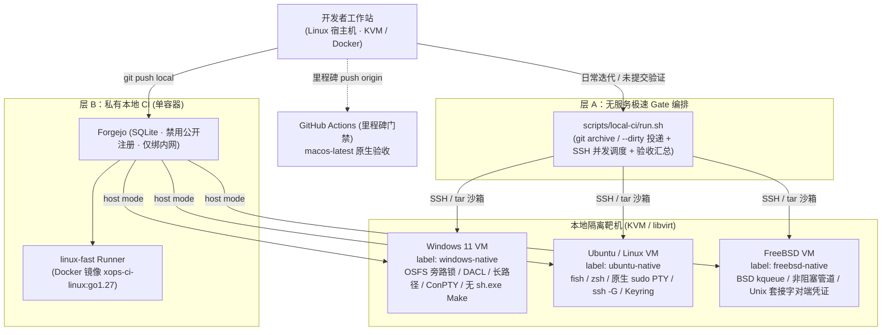

# XOps v2 本地多平台测试与私有 CI 搭建指南

> **适用范围**：XOps v2 开发与 Gate `G0`–`G5` 验收（参见 [v2-implementation-plan.md](./v2-implementation-plan.md)）。  
> **架构模式**：**层 A（无服务多平台 Gate 编排脚本）+ 层 B（自建私有 Forgejo + 原生 `forgejo-runner`）**。  
> **平台覆盖策略**：本地原生覆盖 **Linux（容器/宿主机 + 隔离 Linux VM）、Windows 11、FreeBSD**；**macOS** 日常通过本地 `GOOS=darwin` 交叉编译、跨平台 `xopsvet` 与交叉 Lint 检查，里程碑 Gate（`G2`/`G2.5`/`G4`/`G5`）交由 GitHub Actions `macos-latest` 云端原生 Runner 补齐（避免在非 Apple 硬件上维护高成本、低复现性的 macOS 虚拟化环境）。

---

## 1. 整体架构与分层职责



### 建议资源基线

| 组件 | 建议配置 | 运行策略 | 说明 |
| :--- | :--- | :--- | :--- |
| **Forgejo + `linux-fast` Runner** | 512 MiB 内存上限（构建峰值视项目而定） | 常驻 | 内置 SQLite，零外部数据库依赖 |
| **Windows 11 VM** | ≥ 4 vCPU，**≥ 8 GiB RAM**，≥ 40 GiB 磁盘 | 常驻或按需 | Go 1.27 `-race` 在 Windows 上需配合 MinGW-w64 GCC，8 GiB 内存可避免高并发测试 OOM |
| **Ubuntu / Linux VM** | ≥ 2 vCPU，≥ 4 GiB RAM，≥ 20 GiB 磁盘 | 按需唤醒 | 可配合 `virsh managedsave` 在空闲时落盘释放全部内存 |
| **FreeBSD VM** | ≥ 2 vCPU，≥ 4 GiB RAM，≥ 20 GiB 磁盘 | 按需唤醒 | 建议确保根分区可用空间 ≥ 10 GiB 以容纳 Go 工具链与模块缓存 |

> **配置隔离原则**：所有私有环境参数（宿主机与 VM 的内网 IP、账号名、专用 SSH 私钥、Forgejo 凭据与 Runner Token）均保存在仓库外部目录 **`~/.config/xops-local-ci/`**（权限 `0700`），**禁止写入 Git 跟踪路径**。下文所有 `192.0.2.x` 地址均为 RFC 5737 文档示例地址。

---

## 2. 宿主机私有配置与靶机基线准备

### 2.1 创建宿主机外部配置（不入 Git）

1. 生成专用于本地 CI 调度的 Ed25519 密钥对（与个人常用密钥隔离）：
   ```sh
   mkdir -p ~/.config/xops-local-ci && chmod 700 ~/.config/xops-local-ci
   ssh-keygen -t ed25519 -N "" -f ~/.config/xops-local-ci/id_ed25519 -C "xops-local-ci"
   chmod 600 ~/.config/xops-local-ci/id_ed25519
   ```
2. 创建 `~/.config/xops-local-ci/env`（填入你本机实际的桥接地址、VM 名称与账号）：
   ```sh
   # 宿主机内网桥接地址（供 Forgejo 与 VM 内 Runner 访问）
   XOPS_CI_HOST_IP="192.0.2.10"
   XOPS_CI_FORGEJO_PORT="3000"
   XOPS_CI_FORGEJO_SSH_PORT="2222"
   XOPS_CI_SSH_KEY="${HOME}/.config/xops-local-ci/id_ed25519"

   # 三台 KVM 靶机（VM 名对应 virsh --connect qemu:///system list --all）
   XOPS_CI_WIN_VM="win11-ci"
   XOPS_CI_WIN_HOST="192.0.2.11"
   XOPS_CI_WIN_USER="<win_user>"

   XOPS_CI_UBUNTU_VM="ubuntu-ci"
   XOPS_CI_UBUNTU_HOST="192.0.2.12"
   XOPS_CI_UBUNTU_USER="<ubuntu_user>"

   XOPS_CI_FREEBSD_VM="freebsd-ci"
   XOPS_CI_FREEBSD_HOST="192.0.2.13"
   XOPS_CI_FREEBSD_USER="root"
   ```

### 2.2 靶机工具链基线

将 `~/.config/xops-local-ci/id_ed25519.pub` 分发至三台靶机的 `authorized_keys`（Windows 管理员账户需写入 `C:\ProgramData\ssh\administrators_authorized_keys` 并收紧 ACL 仅限 `SYSTEM` 与 `Administrators`），随后按平台准备工具链：

#### ① Windows 11 靶机
- **工具链**：安装 **Go 1.27+**、**`golangci-lint` v2.15+**、**Git for Windows**、**系统级 PowerShell 7（`pwsh`）** 以及 **64 位 MinGW-w64（如 WinLibs，同时提供 `gcc.exe` 与 GNU `make.exe`）**。
- **关键防坑**：
  1. **系统级 `pwsh`**：请使用便携版或 MSI 安装到系统公共路径（如 `C:\xops-ci\tools\pwsh`）并加入机器级 `PATH`；避免仅依赖 Microsoft Store 用户态 `WindowsApps` 路径，否则以 `SYSTEM` 运行的后台 Runner 无法找到 `pwsh.exe`。
  2. **保持无 `sh.exe` 纯 Windows Make 环境**：仅将 `C:\Program Files\Git\cmd` 加入系统 `PATH`（不加 `Git\usr\bin`），并设置 `git config --system core.autocrlf false` 与 `git config --system core.longpaths true`。
  3. **Defender 排除 CI 沙箱**：Go `-race` 会高频生成与删除临时 `.test.exe`，建议将工作与缓存目录加入排除项并固化环境变量：
     ```powershell
     New-Item -ItemType Directory -Force -Path C:\xops-ci\work, C:\xops-ci\runs, C:\xops-ci\cache\mod, C:\xops-ci\cache\build, C:\xops-ci\tmp, C:\xops-ci\bin, C:\xops-ci\tools, C:\xops-ci\runner | Out-Null
     Add-MpPreference -ExclusionPath "C:\xops-ci"
     [Environment]::SetEnvironmentVariable("GOMODCACHE", "C:\xops-ci\cache\mod", "Machine")
     [Environment]::SetEnvironmentVariable("GOCACHE", "C:\xops-ci\cache\build", "Machine")
     [Environment]::SetEnvironmentVariable("GOTMPDIR", "C:\xops-ci\tmp", "Machine")
     [Environment]::SetEnvironmentVariable("GORACE", "atexit_sleep_ms=0", "Machine")
     ```

#### ② Ubuntu / Linux 隔离靶机
- 安装 **Go 1.27+**、**`golangci-lint` v2.15+**、`git`、`fish`、`zsh`、`make`、`rsync`、`build-essential`、`dbus-x11`、`gnome-keyring`。
- 创建持久化缓存 `/var/cache/xops-ci/{mod,build}` 与沙箱 `/tmp/xops-ci`，为 Runner 用户执行 `loginctl enable-linger <ubuntu_user>` 以确保无交互登录时后台 Runner 仍自动运行。

#### ③ FreeBSD 靶机
- 安装 **Go 1.27+**、**`golangci-lint` v2.15+**、`git`、`bash`、`rsync`、`gmake`、`ca_root_nss`。
- 若基础云镜像根分区较小，需先扩容虚拟磁盘及 ZFS/UFS 分区，再准备 `/var/cache/xops-ci/{mod,build}` 与 `/tmp/xops-ci`。

#### ④ 可选：KVM 干净快照
完成工具链与 Runner 部署后，可为靶机建立基线快照，便于在破坏性测试（ACL、Keyring、断电模拟等）后快速复原：
- 标准 BIOS `qcow2` 靶机可直接执行 `virsh --connect qemu:///system snapshot-create-as <VM> clean-go127`；
- UEFI + raw NVRAM 靶机建议使用 `--disk-only --atomic` 外置快照或在关机状态备份基线磁盘镜像。

---

## 3. 层 B：单容器私有 Forgejo 与多平台 Runner

### 3.1 启动私有 Forgejo（配置存于 `~/.config/xops-local-ci/forgejo/`）

编写 `~/.config/xops-local-ci/forgejo/docker-compose.yml`（**仅绑定内网桥接地址，禁用公开注册**）：

```yaml
services:
  forgejo:
    image: codeberg.org/forgejo/forgejo:17
    container_name: xops-local-forgejo
    restart: unless-stopped
    mem_limit: 512m
    environment:
      - USER_UID=1000
      - USER_GID=1000
      - FORGEJO__database__DB_TYPE=sqlite3
      - FORGEJO__server__DOMAIN=<HOST_LAN_IP>
      - FORGEJO__server__ROOT_URL=http://<HOST_LAN_IP>:3000/
      - FORGEJO__server__SSH_DOMAIN=<HOST_LAN_IP>
      - FORGEJO__server__SSH_PORT=2222
      - FORGEJO__service__DISABLE_REGISTRATION=true
      - FORGEJO__actions__ENABLED=true
      - FORGEJO__security__INSTALL_LOCK=true
    volumes:
      - forgejo_data:/data
      - /etc/localtime:/etc/localtime:ro
    ports:
      - "<HOST_LAN_IP>:3000:3000"
      - "<HOST_LAN_IP>:2222:22"
      - "127.0.0.1:3000:3000"

volumes:
  forgejo_data:
    name: xops_local_forgejo_data
```

初始化管理员、创建私有仓库并挂载本地 `local` 远端（不影响 `origin`）：
```sh
docker compose -f ~/.config/xops-local-ci/forgejo/docker-compose.yml up -d
docker exec -u git xops-local-forgejo forgejo admin user create \
  --username <FORGEJO_USER> --password '<STRONG_PASSWORD>' --email dev@local.invalid --admin --must-change-password=false
git remote add local ssh://git@<HOST_LAN_IP>:2222/<FORGEJO_USER>/xops-cli.git
```

### 3.2 注册 4 类分级 `forgejo-runner`

通过 `docker exec -u git xops-local-forgejo forgejo actions generate-runner-token` 获取注册令牌后，按以下标签契约部署 4 个 Runner（Linux 直接使用官方发布二进制；Windows 与 FreeBSD 可直接从相同 `forgejo/runner` Tag 使用 `CGO_ENABLED=0` 交叉编译生成）：

| Runner 角色 | 建议运行方式 | 注册 Label | 覆盖的 XOps v2 验证项 |
| :--- | :--- | :--- | :--- |
| **`runner-linux-fast`** | 宿主机守护进程 + 本地预构建镜像 `xops-ci-linux:go1.27`（Go 1.27 + `golangci-lint` + Node） | `linux-fast:docker://xops-ci-linux:go1.27` | `xopsvet`（10 大分析器）、`core/` 独立 `GOWORK=off`、Windows/Darwin 交叉编译、跨平台 `xopsvet` 与交叉 Lint、DST、`docs:check` |
| **`runner-windows-native`** | Windows 计划任务/服务（`host` 模式，`capacity: 1`） | `windows-native:host` | `core/osfs`（旁路锁/DACL/长路径/AF_UNIX）、ConPTY Relay、Credential Manager、`GetUserDefaultLocaleName` 区域探测、无 `sh.exe` Make |
| **`runner-ubuntu-native`** | Ubuntu `systemd --user`（`host` 模式 + `linger`） | `ubuntu-native:host` | `fish`/`zsh` 探测、原生 `sudo` PTY、`ssh -G` 差分、D-Bus Keyring、离线 Vault 演练 |
| **`runner-freebsd-native`** | FreeBSD `rc.d` 服务（`host` 模式） | `freebsd-native:host` | BSD `kqueue`、非阻塞管道、Unix 套接字对端凭证、FreeBSD 原生构建测试 |

### 3.3 渐进式多平台流水线（`.forgejo/workflows/local-ci.yml` + 统一 `scripts/ci/verify.go` SSOT）

仓库中的 [.forgejo/workflows/local-ci.yml](../../.forgejo/workflows/local-ci.yml)、[Makefile](../../Makefile)、[.github/workflows/ci.yml](../../.github/workflows/ci.yml) 与 [scripts/local-ci/run.sh](../../scripts/local-ci/run.sh) 统一委托纯 Go 标准库校验驱动 **[scripts/ci/verify.go](../../scripts/ci/verify.go)**（`//go:build ignore`）作为四端唯一验证事实源：
- **零环境漂移与跨平台一致性**：统一通过 `go run ./scripts/ci/verify.go ...` 调用（外层不设 `GOWORK=off`，兼容 Windows 无 `sh.exe` Make 与 Phase 2.5+ 根 CLI），由 `verify.go` 在子进程按模块显式设置或剔除 `GOWORK`（`tools/xopsvet` 与 `core/` 强制 `GOWORK=off`，根 CLI 默认走 `go.work`，发版传 `--gowork-off`）；支持 `--stage=xopsvet|core|root|cross|dst|all`（`--stage=cross` 同步执行 Windows/macOS 交叉编译、宿主机 `xopsvet` 跨平台静态检查与 `golangci-lint`）、`--pkg`、`--verbose`、`--skip-lint`、`--gowork-off` 与 `--self-test`，全模块强制 `-race -shuffle=on`，并自检自身 `gofmt` 与根默认环境 `go vet`；
- **纯内网 `git` 检出**：通过 Forgejo 注入的 `${GITHUB_SERVER_URL}` 与 `${GITHUB_TOKEN}` 直接执行浅克隆（全部 bash step 统一 `set -eu`），**无需在靶机安装 Node.js，也不依赖外网下载 Action**；
- **与 GitHub Actions 零冲突**：GitHub 仅解析 `.github/workflows/`，自动忽略 `.forgejo/workflows/`；
- **按实施阶段渐进激活**：`Phase 0` 起自动在各原生靶机完整执行 `xopsvet` 单测/自检/lint 与 `core/` `GOWORK=off` 验证（规避 `runtime.GOOS` 死块剪枝盲区），随着 `cmd/xops` 与 `internal/host` 落地自动解锁根 CLI 与 `ubuntu-native` `-tags=integration` 门禁。

---

## 4. 层 A：无服务本地多平台 Gate 编排脚本

在尚未提交代码或需要快速定向复现单平台问题时，可直接运行 [scripts/local-ci/run.sh](../../scripts/local-ci/run.sh)（自动加载 `~/.config/xops-local-ci/env`）：

```sh
# 四平台工具链与 Go -race 冒烟验证
./scripts/local-ci/run.sh --smoke --targets linux,win11,ubuntu,freebsd

# 按 Gate 并发验收（--auto-power 自动唤醒休眠 VM，结束后仅休眠本次唤醒的 VM）
./scripts/local-ci/run.sh --gate g2 --targets linux,win11,freebsd --auto-power

# 打包当前未提交工作区，定向验证 Windows 上的 core/osfs
./scripts/local-ci/run.sh --gate g2 --targets win11 --dirty --pkg ./osfs
```

脚本核心契约：
- **干净沙箱投递**：默认使用 `git archive HEAD`，`--dirty` 使用 `git ls-files` + `tar`（排除 `.git`/`bin`/`node_modules`），解压至靶机独立临时运行目录并在退出时自动清理；
- **严格退出码与真断言**：独立捕获每台靶机的真实退出码（避免包装命令吞掉错误码），并检查测试日志存在有效 `--- PASS:` 且零 `--- FAIL:`；
- **诚实平台报告**：汇总表显式区分本地原生已验证平台与需由 GitHub Actions `macos-latest` 补齐的平台。

---

## 5. 本地 CI 与 GitHub Actions 分工矩阵

| 门禁阶段 | 层 A（本地编排脚本） | 层 B（本地私有 Forgejo） | GitHub Actions 云端 CI |
| :--- | :---: | :---: | :---: |
| **`Gate G0` / `G1`**（护栏 + 纯领域核） | Linux 宿主机（秒级） | `linux-fast` + `windows-native` | PR 自动复检 |
| **`Gate G2`**（`core/osfs` + 10k DST） | 宿主机 DST + Windows + FreeBSD | 全部 4 路本地 Runner | 推分支触发 **`macos-latest`** 补齐 Darwin `osfs` 原生验收 |
| **`Gate G2.5`**（Walking Skeleton） | 宿主机 + Windows (ConPTY) + FreeBSD | 全部 4 路本地 Runner | 推分支触发 **`macos-latest`** 补齐 Darwin PTY 验收 |
| **`Gate G3` / `G4`**（用例 + 全适配器 TCK） | 按改动包定向跑对应靶机 | 全部 4 路本地 Runner | 推分支触发 **`macos-latest`**（Keychain / Unix 套接字） |
| **`Gate G5`**（发布级验收） | 全量本地预检 | 全量 4 Runner + `10k` DST | Linux + Windows + **`macos-latest`** 全量通过 + 锁版本后三模块 `GOWORK=off` 验收 |

---

## 6. 安全与运维红线

1. **禁止将个人 KVM 靶机注册为公开 GitHub 仓库的 Self-Hosted Runner**：避免外部 PR 在内网靶机触发任意代码执行。
2. **禁止在仓库中硬编码私网拓扑与凭据**：真实 IP、用户名、密钥、Token 与 Compose 凭据文件仅存于 `~/.config/xops-local-ci/`。
3. **定期维护缓存与快照**：升级靶机 Go 或 Runner 版本后应删除旧快照并重建干净基线，避免 `qcow2` 差分链持续膨胀。
