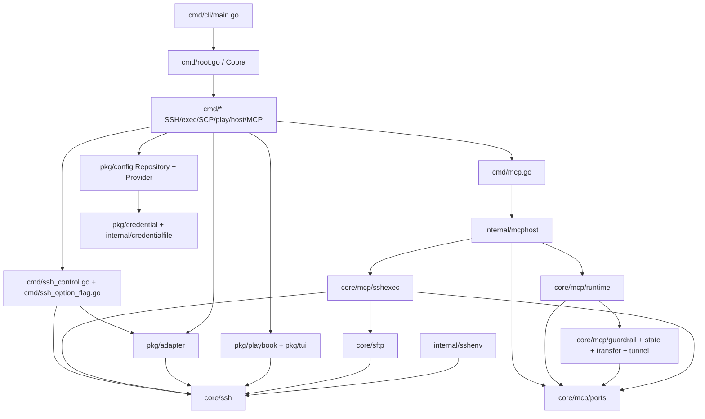

# XOps CLI Architecture Map (for Developers and Coding Agents)

Baseline: `master` @ `a12d52f` (2026-10-13). This map summarizes the architecture verified from source code and design documents; it is a navigation aid rather than an exhaustive function-level call graph.

## System Capabilities

XOps is an operations CLI written in Go covering host/identity management, SSH/SFTP/SCP, batch command execution and Playbooks, TUI, port forwarding, and stdio/HTTP MCP servers across Linux, Windows, and macOS. See `README.md` and `README_en.md`.

## Architecture Entry Points

**Note**: The diagram shows both composition and Go dependency directions (for example, `core/mcp/runtime`, `core/mcp/sshexec`, and `internal/mcphost` all depend one-way on `core/mcp/ports`; `core/sftp` depends on `core/ssh`; `core/ssh` preserves strict unidirectional decoupling, receiving host context from `internal/sshenv`). Use `go list -json ./...` to inspect the exact Go import graph.

## Recommended Reading Order

1. **Process startup / composition root**: `cmd/cli/main.go:main` -> `cmd/root.go:Execute` -> `cmd/{ssh,exec,mcp,play,credential,ssh_control,ssh_option_flag}.go`.
2. **Configuration and credential state**: `pkg/config/{provider,repository,store,target,encrypted_runtime,schema_v2,validate,openssh}.go`; `pkg/credential/service.go`; `internal/credentialfile`.
3. **Connection / execution semantics**: `pkg/adapter/ssh_adapter.go` -> `core/ssh/{connector,plan,command_plan,command_execution,execution_config,probe}.go`.
4. **OpenSSH Connection Multiplexing**: `cmd/{ssh_control,ssh_option_flag}.go` -> `pkg/adapter/ssh_adapter.go:ResolveControl` (4-tier resolution hierarchy: CLI > Node > Global > OpenSSH) -> `core/ssh/{control_config,mux_protocol,mux_client,mux_proxy_conn,mux_server,mux_rights_unix,connector}.go` (`PROTOCOL.mux` v4 binary wire protocol, 0600 socket atomic link defense, peer UID validation, `ControlPersist` background daemon and graceful shutdown).
5. **MCP layering**: `cmd/mcp.go:runMCPServer` -> `internal/mcphost/{config,host}.go` -> `core/mcp/runtime/{server,invocation}.go` -> `core/mcp/ports/types.go`, `core/mcp/sshexec/backend.go`, `core/mcp/guardrail/*` (Note: in CLI mode, `internal/mcphost.host` directly implements `StateSource` and `ExecutionGate`; dynamic publication hosts use `core/mcp/state.Coordinator`).
6. **Batch orchestration**: `cmd/exec.go`, `cmd/exec_execution.go`, and `pkg/playbook/{engine,runner}.go` (supporting transparent ControlPath socket reuse across task steps).
7. **Interactive UI & terminal**: `pkg/tui/*`, `cmd/sftpshell/*`, `internal/terminal/*`.

## "Read the Index First, Then Inspect Source"

- Authoritative boundary specs: `core/README.md`, `docs/en/development/shared-core-decoupling.md`.
- OpenSSH Connection Multiplexing: `docs/en/development/openssh-multiplexing-design.md`.
- SSH OTP & Multi-Factor Authentication: `docs/en/development/ssh-otp-keyboard-interactive-design.md`.
- SSH interpreter evolution: `docs/en/development/ssh-execution-compatibility.md`, `ssh-execution-implementation.md`, `ssh-execution-probe-{design,implementation}.md`.
- MCP HTTP transfers: `docs/en/development/mcp-http-transfer-design.md`, `docs/en/guide/mcp-http.md`.
- Offline store compatibility: `docs/en/development/compatibility.md`, `docs/en/development/credential-experience-design.md`.
- Testing & automation: `.github/workflows/ci.yml`, `offline-compatibility.yml`, `Makefile`, `scripts/check_core.py`, `package.json`.

## Anti-Rot Conventions

For any module, record only: responsibility, non-responsibilities, source entry points, dependencies, resource/state ownership, critical invariants, representative tests, open questions, and verified baseline. Do not translate comments file-by-file.

Plans or historical baselines in older design records must not be confused with current implementation; when discrepancies arise, current source code and passing tests take precedence.
