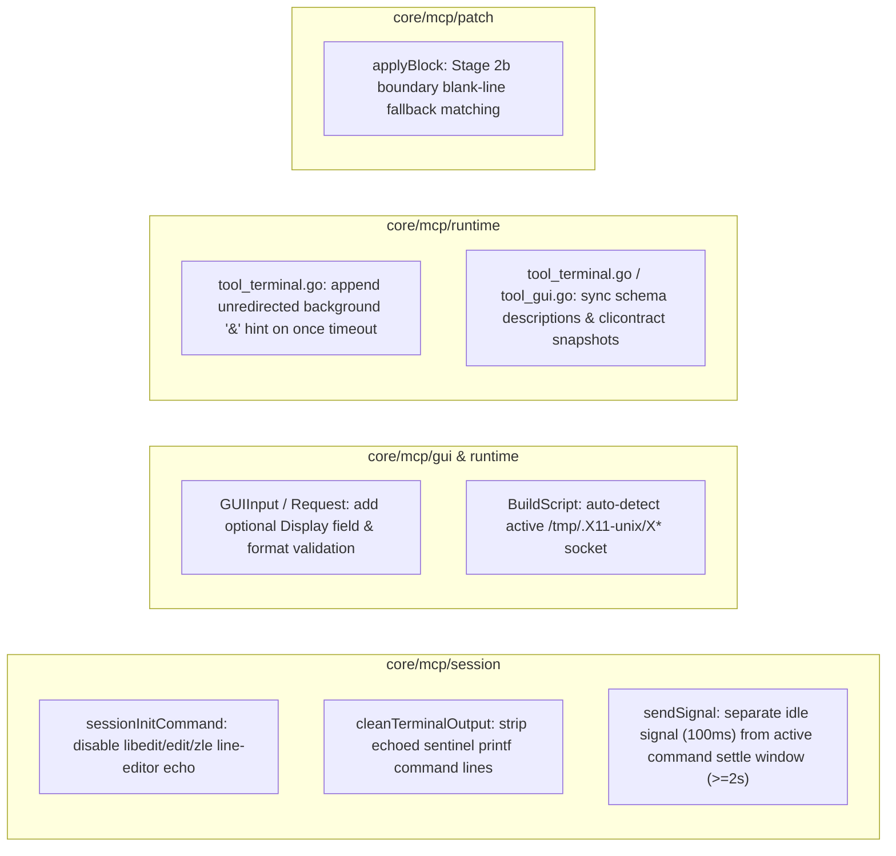

# MCP Improvement Plan Based on Live FreeBSD Validation

Status: Implemented.

---

## 1. Background and Summary of Live Validation Findings

During live testing of the refactored MCP toolset (`nodes`, `terminal`, `file`, `transfer`, `tunnel`, `gui`) and X11 graphical desktop deployment on a FreeBSD 15.1-RELEASE (`amd64`, ZFS `zroot`) remote node, all six tools completed their end-to-end workflows. At the same time, five actionable cross-platform (FreeBSD / minimal Unix) and real-network/virtualization issues were identified:

| ID | Severity | Finding | Root Cause |
| :--- | :--- | :--- | :--- |
| **P1-1** | High (Output Pollution) | Persistent PTY sessions (`session != "once"`) on FreeBSD return output containing the echoed user command and the trailing internal sentinel command `printf '\n%s%s_%d___\n' '___MCP_' 'DONE_<hex>' "$?"` | FreeBSD `/bin/sh` enables `libedit` (`set -o emacs`) by default in interactive PTYs, `tcsh` enables `edit`, and `zsh` enables `zle`. Built-in line editors reset terminal `termios` before each input line and force character echo, overriding `RequestPty(ECHO: 0)` and `stty -echo` |
| **P1-2** | High (Signal Status False Negative) | Sending `SIGINT`/`SIGTERM` to a blocked command (e.g., `xwd`) in a persistent session returns `[Status: Signal SIGINT sent; command still running]` even though the process exits shortly after | `sendSignal` in `core/mcp/session/manager.go` waits only `signalSettleWindow` (`100ms`) regardless of whether a command is in flight; over real SSH networks and VMs, process exit + shell `wait4` + sentinel `printf` frequently takes `150ms–500ms` |
| **P2-1** | Medium (Display Addressing) | When `:0` is unavailable due to hardware driver issues and `Xvfb` is started on `:1`, the `gui` tool cannot target `:1` or automatically discover `/tmp/.X11-unix/X1` | `GUIInput` in `core/mcp/runtime/tool_gui.go` lacks a `display` field, and `BuildScript` in `core/mcp/gui/driver.go` hardcodes `export DISPLAY="${DISPLAY:-:0}"` |
| **P2-2** | Medium (Timeout Diagnostics) | Running background jobs in `session="once"` (e.g., `Xvfb :1 & sleep 1; xdpyinfo`) without stdio redirection hangs for 3 minutes until failing with a generic `context deadline exceeded` | `session="once"` uses a non-PTY SSH exec channel; background children inherit `stdout/stderr` pipes so remote `sshd` never sends `CHANNEL_EOF`; timeout errors lack a diagnostic hint explaining the open background pipes |
| **P3-1** | Low (Patch Tolerance) | `file(action="patch")` returns `ErrNoMatch` when a model includes an extra leading or trailing blank line inside a `<<<<` search block | Stage 2 line-by-line whitespace-insensitive matching in `core/mcp/patch/patch.go` requires exact line-count equality with `searchLines` and does not fall back to trimming boundary blank lines |

---

## 2. Approved Engineering Decisions 

1. **Extend MCP Tool Schemas and Update Contract Snapshots**:
   - Add an optional `Display string` field (`json:"display,omitempty"`) to `GUIInput` (`core/mcp/runtime/tool_gui.go`);
   - Update `gui` and `terminal` schema descriptions to accurately reflect FreeBSD/Unix X11 support as well as `posix`, `fish`, and `csh`/`tcsh` execution and persistent session support;
   - Update `internal/clicontract/testdata/mcp-stdio-tools.json` and `mcp-http-tools.json` via `go test ./internal/clicontract -update-mcp-contract`.
2. **Preserve Package Boundaries and Zero External Dependencies**:
   - All changes remain strictly within `core/mcp/{session,gui,runtime,patch}` and `internal/clicontract/testdata`, preserving the `core/**` zero CLI/external dependency boundary.

---

## 3. Detailed Component Design



### 3.1 `core/mcp/session`: Persistent PTY Echo Suppression, Sentinel Filtering, and Signal Settle Window

#### 3.1.1 Disable Interactive Shell Line-Editor Echo (`sessionInitCommand`)
In `sessionInitCommand(dialect ssh.LaunchDialect)` (`core/mcp/session/manager.go`):
- **POSIX (`default`)**: Prepend `set +o emacs 2>/dev/null; set +o vi 2>/dev/null; unsetopt zle PROMPT_SP 2>/dev/null;` and clear primary/secondary prompts `PS1=''; PS2=''; PROMPT=''; PROMPT2='';` before `stty -echo noflsh 2>/dev/null`, disabling forced character echo in FreeBSD `/bin/sh` (`libedit`), `bash`/`ksh`, and `zsh` (`zle`).
- **C-Shell (`LaunchCsh`)**: Prepend `unset edit; set prompt=''; set prompt2=''; set rprompt='';` before `stty -echo noflsh >& /dev/null`, disabling `tcsh` built-in line-editor echo.

```go
func sessionInitCommand(dialect ssh.LaunchDialect) string {
	switch dialect {
	case ssh.LaunchFish:
		return "stty -echo noflsh 2>/dev/null; function fish_prompt; end; function fish_right_prompt; end; function fish_mode_prompt; end; set -g fish_greeting ''; set -gx TERM dumb; set -gx NO_COLOR 1; set -gx DEBIAN_FRONTEND noninteractive; set -gx GIT_TERMINAL_PROMPT 0; set -gx CI true\n"
	case ssh.LaunchCsh:
		return "unset edit; set prompt=''; set prompt2=''; set rprompt=''; stty -echo noflsh >& /dev/null; setenv TERM dumb; setenv NO_COLOR 1; setenv DEBIAN_FRONTEND noninteractive; setenv GIT_TERMINAL_PROMPT 0; setenv CI true\n"
	default:
		return "set +o emacs 2>/dev/null; set +o vi 2>/dev/null; unsetopt zle PROMPT_SP 2>/dev/null; PS1=''; PS2=''; PROMPT=''; PROMPT2=''; stty -echo noflsh 2>/dev/null; export TERM=dumb NO_COLOR=1 DEBIAN_FRONTEND=noninteractive GIT_TERMINAL_PROMPT=0 CI=true\n"
	}
}
```

#### 3.1.2 Defense-in-Depth Stripping of Echoed Sentinel `printf` Lines (`cleanTerminalOutput`)
Compile `echoedSentinelCmdPattern` in `core/mcp/session/manager.go` and apply it in `cleanTerminalOutput` so any echoed internal sentinel command line is stripped before returning output:

```go
echoedSentinelCmdPattern = regexp.MustCompile(`(?m)^[^\n]*printf '\\n%s%s_%d` + sentinelEnd + `\\n' '` + sentinelHead + `' '` + sentinelTail + `[0-9a-f]+' [^\n]*\n?`)
```

#### 3.1.3 Separate Idle Signal and Active Command Settle Windows (`sendSignal`)
- Introduce `activeSignalSettleWindow = 2 * time.Second`;
- When `sentinel == ""` (idle session), keep `signalSettleWindow = 100 * time.Millisecond`;
- When `sentinel != ""` (an active command is being interrupted), `sendSignal` waits up to `max(req.Timeout, activeSignalSettleWindow)` via `waitSentinel(ctx, sentinel, settleTimeout)`.
- Because `waitSentinel` wakes immediately on `s.notifyCh`, commands that terminate upon receiving the signal return `StateCompleted` within milliseconds, while commands that genuinely ignore the signal report `StateRunning` after the settle window.

---

### 3.2 `core/mcp/gui` & `core/mcp/runtime/tool_gui.go`: `display` Parameter and Active X11 Socket Auto-Detection

#### 3.2.1 Schema and Input Extension (`GUIInput` & `gui.Request`)
Extend `GUIInput` in `core/mcp/runtime/tool_gui.go`:

```go
type GUIInput struct {
	NodeID  string `json:"nodeID" jsonschema:"Target SSH node ID or alias"`
	Action  string `json:"action" jsonschema:"GUI action: shot, click, double_click, right_click, move, type, key, scroll, or drag"`
	Coord   []int  `json:"coord,omitempty" jsonschema:"Normalized 0-1000 coordinates: [x, y] for click/move/scroll, or [start_x, start_y, end_x, end_y] for drag"`
	Text    string `json:"text,omitempty" jsonschema:"Text to input for type, key combination for key (e.g. ctrl+c, Return), or direction for scroll (up, down, left, right)"`
	Display string `json:"display,omitempty" jsonschema:"Optional X11 display (e.g. :0, :1); auto-detected when omitted"`
}
```

#### 3.2.2 Validation and Auto-Detection Script Generation (`core/mcp/gui/driver.go`)
1. **Strict Format Validation**: In `Request.Validate()`, require non-empty `Display` to match `^:[0-9]+(\.[0-9]+)?$`, rejecting any whitespace, quotes, command substitution, or path characters to prevent shell injection.
2. **Active Display Probing**: In `BuildScript`:
   - When `req.Display` is set, emit `export DISPLAY=':1'`;
   - When `req.Display` is empty, if `DISPLAY` is unset in the remote environment and `/tmp/.X11-unix/X0` does not exist as a socket, scan `/tmp/.X11-unix/X*` for the first active X11 socket (such as `/tmp/.X11-unix/X1` for `Xvfb :1`), falling back to `:0`:
     ```sh
     if [ -z "${DISPLAY:-}" ]; then
       if [ ! -S /tmp/.X11-unix/X0 ]; then
         for _sock in /tmp/.X11-unix/X*; do
           if [ -S "$_sock" ]; then DISPLAY=":${_sock#/tmp/.X11-unix/X}"; break; fi
         done
       fi
       export DISPLAY="${DISPLAY:-:0}"
     fi
     ```

---

### 3.3 `core/mcp/runtime/tool_terminal.go`: `once` Mode Unredirected Background Job Timeout Hint and Schema Sync

1. **Unredirected Background Job Timeout Hint**:
   - Add helper `hasUnredirectedBackgroundJob(cmd string) bool` to detect unquoted single `&` operators (excluding `&&`, `>&`, `&>`, `2>&1`) in subcommands that do not redirect to `/dev/null`. When `session="once"` fails with `context.DeadlineExceeded`, append:
     ```text
     (hint: background jobs '&' in session='once' inherit SSH stdout/stderr pipes and block channel closure; redirect '>/dev/null 2>&1 </dev/null &' or use a persistent session)
     ```
2. **Schema Description Sync**:
   - Update `TerminalInput.Session` and `TerminalInput.Execution` `jsonschema` descriptions to accurately reflect `posix`, `fish`, and `csh` login shell persistent session support as well as `csh`/`tcsh` interpreter support.

---

### 3.4 `core/mcp/patch/patch.go`: Stage 2b Boundary Blank-Line Fallback

In `applyBlock(content string, block Block)`:
- When both Stage 1 (exact substring match) and Stage 2 (line-by-line `TrimSpace` match) fail to match, check whether `searchLines` has leading or trailing blank lines (`strings.TrimSpace(line) == ""`);
- If stripping leading/trailing blank lines yields a non-empty `trimmedSearchLines`, run Stage 2b line-by-line matching:
  - If exactly one match is found (`len(matchIndices) == 1`), apply the replacement across the matched slice and record `fuzzy = true` (surfaced via `FileOutput.FuzzyBlocks`);
  - If multiple matches are found, return `ErrAmbiguousMatch`; otherwise return `ErrNoMatch`.

---

## 4. Affected Files and Verification Criteria

### 4.1 Planned File Modifications
- `core/mcp/session/manager.go`
- `core/mcp/session/manager_test.go`
- `core/mcp/gui/driver.go`
- `core/mcp/gui/driver_test.go`
- `core/mcp/runtime/tool_gui.go`
- `core/mcp/runtime/tool_terminal.go`
- `core/mcp/runtime/tool_minimal_test.go`
- `core/mcp/patch/patch.go`
- `core/mcp/patch/patch_test.go`
- `internal/clicontract/testdata/mcp-stdio-tools.json`
- `internal/clicontract/testdata/mcp-http-tools.json`
- `docs/development/mcp-minimal-tools-design.md` and `docs/en/development/mcp-minimal-tools-design.md` (sync tool parameter tables during implementation)

### 4.2 Acceptance and Regression Commands
```sh
# 1. Update and verify MCP contract snapshots
go test ./internal/clicontract -update-mcp-contract
go test ./internal/clicontract ./internal/mcphost

# 2. Run race and shuffled unit tests on affected packages
go test -race -shuffle=on -count=1 ./core/mcp/... ./internal/mcphost ./internal/clicontract

# 3. Verify core zero-external-dependency and architecture boundaries
python3 -m unittest discover -s scripts -p test_check_core.py
python3 scripts/check_core.py --race

# 4. Full build, linter, and bilingual documentation check
go build ./...
golangci-lint run ./...
npm run docs:check
```
