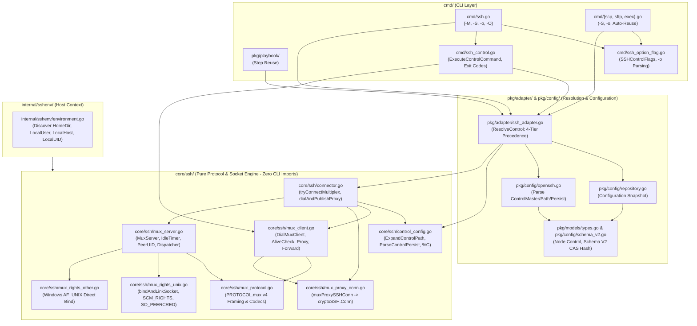
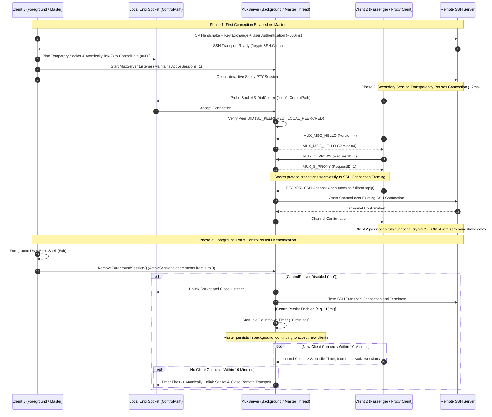

# OpenSSH Connection Multiplexing (-M / -S / -O & ControlMaster / ControlPath / ControlPersist) Permanent Design Specification

**Document Status**: Implemented and Verified (M1–M4 fully complete)  
**Governing Documents**: [Architecture & Governance Map](./governance/architecture-map.md), [Shared Core Decoupling Design](./shared-core-decoupling.md), [SSH Diagnostics Design](./ssh-diagnostics.md)  
**Language Version**: English Development Specification (Chinese version: [openssh-multiplexing-design.md](../../development/openssh-multiplexing-design.md))

---

## 1. Background and Objectives

### 1.1 Background and Problem Statement

In distributed system administration, batch command execution, automated operations, and playbook orchestration, CLI tools frequently initiate multiple remote connections to the same target nodes. Traditional SSH clients perform a complete handshake for every single connection: TCP connection establishment, SSH protocol version exchange, key exchange (KEX), server host key verification, user authentication (publickey/password/MFA/OTP challenge-response), and session channel negotiation. In cross-region networks, over jump hosts (bastions), or with multi-factor authentication enabled, this handshake typically costs hundreds of milliseconds to multiple seconds per session.

Native OpenSSH resolves this bottleneck using Connection Multiplexing (connection sharing via `-M`, `-S`, `-O`, and the configuration directives `ControlMaster`, `ControlPath`, and `ControlPersist`): the initial session acts as a Master by establishing the primary SSH transport and listening on a local Unix domain socket (or a Windows 10+ `AF_UNIX` socket). Subsequent client invocations connect to this socket, sharing the pre-authenticated SSH transport and achieving zero additional network handshakes, zero redundant authentication prompts, and millisecond-level session establishment.

To ensure deep interoperability with modern DevOps ecosystems (including Ansible, system-native `/usr/bin/ssh`, and automated orchestration platforms), `xops-cli` must provide connection multiplexing strictly compatible with OpenSSH, while preserving its architectural layering and decoupling invariants.

### 1.2 Core Design Principles

1. **Strict Wire Protocol Compatibility (`PROTOCOL.mux` v4)**:
   The communication wire layer strictly adheres to the OpenSSH specification, sharing identical binary framing, big-endian integer encodings, and request/response opcodes (`MUX_MSG_HELLO`, `MUX_C_*`, `MUX_S_*`), enabling seamless socket sharing with system-native OpenSSH.
2. **Zero Degradation of Upper-Layer Features (`MUX_C_PROXY`)**:
   Multiplexed connections transition the local control socket into transparent SSH transport framing via `MUX_C_PROXY`. Wrapped as `muxProxySSHConn` (satisfying `golang.org/x/crypto/ssh.Conn`) and constructed into a standard `*cryptoSSH.Client`, all existing capabilities—interactive PTY sessions, SFTP file transfers, remote batch execution, and sudo/su dialect probe caches—function natively with zero behavioral degradation or feature branching.
3. **Strict Unidirectional `core/ssh` Decoupling Invariant**:
   The multiplexing protocol and socket engine reside entirely within `core/ssh`, with zero imports from `cmd/**`, `pkg/**`, or root `internal/**` (enforced by `scripts/check_core.py --race`). Host environment discovery (username, UID, hostname, home directory) is explicitly injected via `core.Environment`.
4. **Defense-in-Depth Security Model**:
   Unix domain sockets enforce strict permissions (`0600`), defense against hard-link races via atomic `link(2)` socket creation, and verification of peer credentials (Peer UID validation via `SO_PEERCRED` on Linux and `LOCAL_PEERCRED` on Darwin/BSD) to block unauthorized hijacking or privilege escalation in multi-user systems.
5. **Clear 4-Tier Resolution Hierarchy**:
   Resolution priority flows from CLI Session Flags > Node Configuration > Global Defaults > OpenSSH Configuration (`~/.ssh/config`), supporting fine-grained property inheritance and one-shot explicit bypass (`-S none`).

### 1.3 Goals and Non-Goals

| In Scope (Goals) | Out of Scope (Non-Goals) |
| :--- | :--- |
| OpenSSH `PROTOCOL.mux` version 4 binary wire encoding/decoding | Supporting deprecated protocol versions 1–3 |
| Full support in `xops ssh` for `-M` (single master), `-M -M` (confirmation master), `-S`, `-o`, and `-O` | Providing simulated sockets on legacy Windows versions lacking `AF_UNIX` (prior to Windows 10 1803) |
| `-O` control commands: `check`, `exit`, `stop`, `forward`, `cancel`, `proxy`, `conninfo`, `channels` | Supporting stateless control commands without an active master process |
| `ControlMaster` modes: `no`, `yes`, `ask`, `auto`, `autoask` | Bypassing local OS file permissions to create world-writable sockets |
| `ControlPath` token expansion: `%%`, `%h`, `%p`, `%r`, `%n`, `%u`, `%l`, `%L`, `%i`, `%d`, `%j`, `%C` (SHA-1 hash), `~`, and `${ENV}` | Allowing unchecked paths that exceed OS `sockaddr_un` limits (108/104 bytes) |
| `ControlPersist` support: `no`, `yes`/`0` (indefinite), duration syntax (`10m`, `1h`, `600s`, `1d`, `1w`), and idle timeout termination | Guaranteeing socket survival across kernel OOM kills or host power loss |
| Automatic detection and transparent socket reuse across `scp`, `sftp`, `exec`, and `play` | Modifying the remote SSH server daemon (all multiplexing is negotiated between client and local master) |
| Cross-platform support: Linux, macOS, BSD, and Windows 10+ (via `MUX_C_PROXY` without fd passing) | Supporting Unix-specific `SCM_RIGHTS` fd passing on non-Unix platforms |

---

## 2. System Architecture and Data Flow

### 2.1 Component Boundaries and Layered Architecture

The system architecture adheres strictly to the module boundaries mandated in `AGENTS.md`:



### 2.2 Connection Multiplexing and Handshake Sequence

The sequence diagram below details master initialization, client socket reuse, and background daemon transition:



### 2.3 `core/ssh` Decoupling Invariants

In strict adherence to repository architectural invariants (`AGENTS.md` and `docs/development/shared-core-decoupling.md`):
- Source and test code in `core/ssh/` must **never** import `cmd/**`, `pkg/**`, or root `internal/**` (verified with zero violations by `python3 scripts/check_core.py --race`).
- Host environment discovery is centralized in `internal/sshenv/environment.go:Discover()` and injected explicitly via `core.Environment`:
  ```go
  type Environment struct {
      InitializationError error
      KnownHostsFile      string
      AgentSocket         string
      DefaultKeyPaths     []string
      ResolveKeyPath      func(string) string
      InteractiveIO       InteractiveIO
      InputBridge         InputBridge
      HomeDir             string // User home directory (~ expansion)
      LocalUser           string // Local logged-in username (%u expansion)
      LocalHost           string // Local host FQDN (%l expansion)
      LocalUID            string // Local user numeric UID (%i expansion)
  }
  ```

---

## 3. OpenSSH Binary Wire Protocol & Framing (`PROTOCOL.mux` v4)

### 3.1 Protocol Version and Message Opcode Definitions

`core/ssh/mux_protocol.go` implements the OpenSSH `PROTOCOL.mux` version 4 binary wire framing. All MUX packets follow network byte order (Big-Endian):

```
+-------------------------------+-------------------------------+
|     uint32 packet_length      |      uint32 packet_type       |
|    (4 + len(payload) bytes)   |       (Message Opcode)        |
+-------------------------------+-------------------------------+
|                        payload bytes ...                      |
+---------------------------------------------------------------+
```

The protocol opcodes match the native OpenSSH specifications:

```go
const (
    MuxProtoVersion    uint32 = 4
    MuxProtocolVersion uint32 = 4
)

// Client -> Master request message types
const (
    MUX_MSG_HELLO        uint32 = 0x00000001
    MUX_C_NEW_SESSION    uint32 = 0x10000002
    MUX_C_ALIVE_CHECK    uint32 = 0x10000004
    MUX_C_TERMINATE      uint32 = 0x10000005
    MUX_C_OPEN_FWD       uint32 = 0x10000006
    MUX_C_CLOSE_FWD      uint32 = 0x10000007
    MUX_C_NEW_STDIO_FWD  uint32 = 0x10000008
    MUX_C_STOP_LISTENING uint32 = 0x10000009
    MUX_C_PROXY          uint32 = 0x1000000f
    MUX_C_EXT_INFO       uint32 = 0x20000001
)

// Master -> Client response message types
const (
    MUX_S_OK                uint32 = 0x80000001
    MUX_S_PERMISSION_DENIED uint32 = 0x80000002
    MUX_S_FAILURE           uint32 = 0x80000003
    MUX_S_EXIT_MESSAGE      uint32 = 0x80000004
    MUX_S_ALIVE             uint32 = 0x80000005
    MUX_S_SESSION_OPENED    uint32 = 0x80000006
    MUX_S_REMOTE_PORT       uint32 = 0x80000007
    MUX_S_TTY_ALLOC_FAIL    uint32 = 0x80000008
    MUX_S_PROXY             uint32 = 0x8000000f
    MUX_S_EXT_INFO          uint32 = 0x90000001
)

// Forwarding types
const (
    MUX_FWD_LOCAL   uint32 = 1
    MUX_FWD_REMOTE  uint32 = 2
    MUX_FWD_DYNAMIC uint32 = 3
)
```

### 3.2 Proxy Mode Transition (`MUX_C_PROXY`) & `muxProxySSHConn` Wrapping

For internal CLI sessions (`ssh`, `scp`, `sftp`, `exec`, `play`), `xops-cli` prioritizes the `MUX_C_PROXY` mode:
1. The client dials the Unix domain socket and completes the `MUX_MSG_HELLO` handshake (the Master advertises a `target@xops` canonical target identity extension so clients can verify static `ControlPath` sockets and fail closed with `ErrControlTargetMismatch` on cross-host mismatches).
2. The client transmits `MUX_C_PROXY (request_id=1)`.
3. The server replies with `MUX_S_PROXY (request_id=1)`, immediately emits an initial no-reply global notification packet (`hostkeys-00@openssh.com`, `WantReply: false`), and answers OpenSSH `SSH_MSG_PING (192)` with `SSH_MSG_PONG (193)` in the proxy loop.
4. From that byte forward, the Unix socket stream acts as the raw SSH Connection Protocol (RFC 4254) transport.
5. The client invokes `cryptoSSH.NewControlClientConn(rawConn)` to negotiate channel demultiplexing, and wraps the connection via `muxProxySSHConn`:
   ```go
   type muxProxySSHConn struct {
       cryptoSSH.Conn
       rawConn    net.Conn
       target     TargetContext
       remoteAddr net.Addr
       localAddr  net.Addr
       user       string
   }
   ```
6. The client constructs `*cryptoSSH.Client` using `cryptoSSH.NewClient(proxyConn, chans, reqs)`. This client is completely transparent to upper-layer services (SFTP subsystem clients, interactive PTY requests, environment variable passing, probe dialect caches) with zero feature degradation.
7. **Flow control and channel ordering** (`core/ssh/mux_server.go:proxySessionState`):
   - The master-to-client direction honours the receive window and maximum packet size the client advertised in its channel open. Every data packet reserves its exact size through `clientFlowWindow.reserve` first and the credit is refunded by `SSH_MSG_CHANNEL_WINDOW_ADJUST`. Ignoring the window makes `x/crypto` fail the whole multiplexed connection with `ssh: remote side wrote too much` once 2 MiB is outstanding, which large downloads and high-throughput commands would hit.
   - The client-to-master direction never blocks the read loop: client data is queued per channel (`orderedQueue`) and written to the remote channel by a dedicated relay goroutine, which credits the client window only after the write succeeded. Relaying inline would let one channel whose remote end stopped reading stdin stall the shared read loop, and with it every other channel on the master (including `-O` queries and new sessions).
   - Global requests (`tcpip-forward`, keepalive probes) also go through one ordered worker: RFC 4254 global replies carry no request ID, so concurrent replies would be paired with the wrong request.
   - No late packet is written for a channel the client already closed: `x/crypto` fails the entire multiplexed connection on a non-request packet for an unknown channel ID.
   - **A channel close is answered exactly once**: when the client sends `SSH_MSG_CHANNEL_CLOSE`, the master must answer with its own close (RFC 4254 §5.3; `x/crypto` only releases the client-side channel and wakes blocked readers after that answer). `proxyChan.closeSent`, written under `writeMu`, is the single close marker: both `handleClose` and the natural end of the remote streams call the same `closeChannel`, so exactly one packet is sent, and `writeChannelPacket` drops every later channel packet (data, extended data, EOF, window adjust, channel request, success/failure reply) instead of tearing down the client's mux with a post-close packet. Once the whole proxy session ends (`closeAll`), `writeChannelPacket`, `writePacket` and `closeChannel` suppress every write through the same `closed` flag, so woken relay workers neither write into the dead transport nor wait for an answer that cannot arrive.

### 3.3 Classic Passenger Mode & Unix `SCM_RIGHTS` fd Passing

To maintain full compatibility with system-native `/usr/bin/ssh` connecting to a `xops-cli` master socket, standard passenger mode is implemented on Unix platforms (Linux/macOS/BSD) in `core/ssh/mux_rights_unix.go`:
- **`MUX_C_NEW_SESSION`**: Encodes `want_tty`, `want_x11_forwarding`, `want_agent`, and `subsystem_flag` as 4-byte `uint32` (`0` or `1`) per OpenSSH `PROTOCOL.mux` v4. The master receives 3 file descriptors (stdin, stdout, stderr) transmitted via Unix control messages (`recvFDs(unixConn, 3)` using `net.UnixConn.ReadMsgUnix` and `unix.ParseUnixRights`), opens a raw `"session"` channel (`sshClient.OpenChannel("session", nil)`) supporting `exec`, `shell`, and `subsystem` (e.g. `sftp`), half-closes the remote channel via `CloseWrite()` (`SSH_MSG_CHANNEL_EOF`) on local stdin EOF, and transmits `MUX_S_EXIT_MESSAGE` after closing inherited descriptors upon session completion.
- **Descriptor receive contract**: OpenSSH's `mm_send_fd` transmits one descriptor per control message, so `recvFDs` accumulates until the request is satisfied instead of assuming one `recvmsg` carries them all. Receiving is bounded (5s, `passengerFDReceiveTimeout`), every descriptor is marked `FD_CLOEXEC` immediately, and descriptors beyond the requested count are closed rather than handed to the caller.
- **Single ownership**: `recvFiles` hands each descriptor to an `*os.File` and only `File.Close()` may release it afterwards. A handler must never `unix.Close` the same descriptor number again: the second close can hit an unrelated descriptor a concurrent goroutine has since reused. `MUX_C_NEW_STDIO_FWD` returns only after both copy directions exit, so deferred cleanup cannot race an in-flight write.
- **`MUX_C_NEW_STDIO_FWD`**: Encodes `connect_port` as `uint32` per `PROTOCOL.mux` v4; receives 2 file descriptors (stdin and stdout), establishing bidirectional streaming over `Client.Dial("tcp", host:port)` and calling `CloseWrite()` on local stdin EOF while draining remote output.
- **Cross-Platform Fallback**: On Windows (`core/ssh/mux_rights_other.go`), because Winsock `AF_UNIX` does not support Unix file descriptor passing (`SCM_RIGHTS`), passenger requests are rejected with a clear diagnostic directing clients to use `MUX_C_PROXY`.

### 3.4 Resource Limits & DOS Defense

To defend against memory exhaustion (OOM) from malicious or corrupted clients:
- `MaxMuxPacketLength = 256 * 1024` (256 KB)
- `MaxMuxStringLength = 64 * 1024` (64 KB)
- Length fields are strictly validated before allocating buffers for `io.ReadFull`.

---

## 4. Unix Domain Socket Security & Lifecycle

### 4.1 Strict Permission Enforcement

Socket files represent a critical local trust boundary. If an unauthorized local user could write to the control socket, they could hijack sessions to the remote server via the master.
- Parent directory permissions are enforced as `0700` (`rwx------`).
- The control socket file itself is enforced as `0600` (`rw-------`).
- To avoid mutating process-wide umask (`unix.Umask`), which causes race conditions with concurrent goroutines and file writes, `xops-cli` never modifies process umask, instead enforcing permissions explicitly via `os.Chmod(targetPath, 0600)`.

### 4.2 Atomic Hard-Link Creation & Race Defense

When multiple concurrent processes independently attempt to start a master, binding directly via `net.Listen("unix", path)` introduces file overwrite and TOCTOU vulnerabilities.

`core/ssh/mux_rights_unix.go` implements an atomic creation algorithm based on POSIX `link(2)` (`bindAndLinkSocket`):
1. **Three-Tier Path Budget Strategy**: Given OS buffer limits for `sockaddr_un.sun_path` (108 bytes on Linux/Windows, 104 bytes on Darwin/BSD):
   - If target path budget has $\ge 8$ bytes remaining, append a compact suffix (`path.m%04x.t`).
   - Else if parent directory budget has $\ge 8$ bytes remaining, create a compact temporary path inside the directory (`dir/.m%04x.t`).
   - If path budget is completely exhausted (extreme path lengths), fallback to direct binding on the target path with immediate chmod.
2. **Atomic Hard Link**: The process binds and chmods the temporary path, then invokes `os.Link(tempPath, targetPath)`:
   - If link succeeds: this process won the master election and immediately unlinks the temporary path (`os.Remove(tempPath)`).
   - If `EEXIST` is returned: another master was concurrently established; this process closes its temporary listener and returns `ErrMasterAlreadyExists`.

### 4.3 Peer UID Verification (Both Directions)

Even with `0600` file permissions, local root or users with elevated capabilities could connect to the socket. For defense-in-depth:
- **Linux** (`mux_peer_linux.go`): Queries peer credentials via `unix.GetsockoptUcred(fd, unix.SOL_SOCKET, unix.SO_PEERCRED)`.
- **macOS / FreeBSD** (`mux_peer_darwin.go` / `mux_peer_freebsd.go`): Queries peer credentials via `unix.GetsockoptXucred(fd, unix.SOL_LOCAL, unix.LOCAL_PEERCRED)`.
- **Validation**: The master verifies that the peer UID matches the expected local user UID. Any mismatch causes immediate connection termination with an audit entry and `ErrUnauthorizedPeer`.
- **Client-side parity**: `DialMuxClient` / `DialMuxProxyStream` / `DialControlProxy` run the same `checkPeerUID` before the handshake and require the master endpoint to belong to the effective local UID (default `localPeerUID()`) or `0` (root). Without it, any local user could win the race for a socket path in a shared directory such as `/tmp` and impersonate the master to collect commands, privilege passwords, and transferred data. `WithExpectedPeerUID` only changes the expectation and can never disable the check: `0` means "expect root", so a client running as root also rejects a socket planted by another user (treating `0` as "skip the check" allowed exactly that hijack). Only platforms without peer credentials (Windows) make `checkPeerUID` a no-op.
- **Windows** (`mux_rights_other.go`): Because Windows AF_UNIX relies on NTFS security descriptors (DACLs) and lacks `SO_PEERCRED`, `localPeerUID()` returns `0` and peer UID checks are safely bypassed on this platform.
- **Master-side default**: `StartMuxServer` falls back to `localPeerUID()` (the effective UID on Unix) when `Environment.LocalUID` is missing or unparseable, so a host that forgets to inject its context can never silently disable the master-side credential check; an explicit `LocalUID` still wins. `Connector` derives its client-side expectation from the same `expectedPeerUIDFromEnvironment`, so both ends agree even when a host injects a UID that differs from the effective one (containers).

### 4.4 Stale Socket Detection and Safe Unlinking

If a prior master crashed abnormally (`kill -9` or power failure), an inactive socket file remains on disk.
- Before connecting, the client verifies via `os.Lstat` and `isControlSocketFileInfo` that the path is an actual Unix domain socket (never unlinking regular files or directories on Unix), and only treats the socket as stale when the mode permits master creation (`Master != no`) and dialing explicitly returns `ECONNREFUSED` (transient handshake timeouts never unlink a live busy master).
- **Race-Free Unlink**: To prevent unlinking a newly started master created by a concurrent process, unlinking verifies `os.SameFile(origFi, currentFi)`. The file is only removed if the on-disk inode and device match the initial failed probe.

---

## 5. Configuration Model & 4-Tier Resolution Hierarchy

### 5.1 4-Tier Resolution Precedence

`pkg/adapter/ssh_adapter.go:ResolveSSHOptions` (and `ResolveControl` derived from it) evaluates OpenSSH client options and multiplexing configurations strictly according to the following precedence:

$$\text{Tier 1 (CLI Session Overrides)} > \text{Tier 2 (Node Config)} > \text{Tier 3 (Global Defaults)} > \text{Tier 4 (OpenSSH Config)}$$

1. **Tier 1 (CLI Session Overrides)**: Command-line flags `-M`, `-M -M`, `-S <path>`, `-S none`, and `-o Key=Value`.
2. **Tier 2 (Node Configuration)**: Target node definition in `config.yaml` (`nodes[name].ssh_options`).
3. **Tier 3 (Global Defaults)**: Root-level default configuration in `config.yaml` (`ssh_options`).
4. **Tier 4 (OpenSSH Config Fallback)**: Parsed from `~/.ssh/config` matching the target host (including `ControlMaster`, `ControlPath`, `ControlPersist`, and connection/authentication/algorithm options). Within Tier 4, concrete host entries take precedence over wildcard patterns (`Host *`).

### 5.2 Orthogonal Field-by-Field Merging

`core/ssh/ssh_options.go:Options` uses a registry-driven (`optionRegistry`) normalized key-value model where all supported OpenSSH options are orthogonal and merged independently across the 4 tiers:
- A higher tier leaves unset options to be inherited from lower tiers.
- **Explicit Disablement (`-S none` or `control_path: "none"`)**: If any higher tier explicitly specifies `control_path: "none"` (or `ControlPath=none`), multiplexing is disabled globally for that session: `control_master` is normalized to `"no"`, `control_persist` is cleared, and the client falls back to direct connection.

### 5.3 ControlPath Token Expansion

`core/ssh/control_config.go:ExpandControlPath` supports standard OpenSSH `ssh_config(5)` tokens:

| Token | Expansion Meaning | Example |
| :--- | :--- | :--- |
| `%%` | Literal percent sign | `%` |
| `%h` | Remote target hostname or IP address | `192.168.1.10` / `prod-app01` |
| `%p` | Remote target port (defaults to 22) | `22` / `2222` |
| `%r` | Remote target username | `root` / `ubuntu` |
| `%n` | Original target host argument as supplied on CLI | `app-alias` |
| `%u` | Local logged-in username | `wuyue` |
| `%l` | Local host FQDN hostname | `devbox.localdomain` |
| `%L` | Local hostname up to the first dot | `devbox` |
| `%i` | Local user numeric UID | `1000` |
| `%d` | Local user home directory | `/home/wuyue` |
| `%j` | ProxyJump bastion host (if configured) | `bastion.corp` |
| `%C` | **Connection Feature Hash** (40-char SHA-1 hex) | `b4a2...3f1c` |
| `~` | Tilde prefix expanded to local home directory | `~/.ssh/sockets` -> `/home/wuyue/.ssh/sockets` |
| `${VAR}` | Environment variable expansion | `${XDG_RUNTIME_DIR}/ssh.sock` |

### 5.4 `%C` Hash Token & Socket Length Constraints

Unix domain sockets are constrained by kernel buffer sizes:
- Linux / Windows: 108 bytes
- macOS (Darwin) / FreeBSD / OpenBSD: 104 bytes

Socket templates such as `~/.ssh/cm-%r@%h:%p` easily exceed 104 bytes when using long usernames, FQDNs, or nested paths, triggering `bind: invalid argument` (EINVAL). OpenSSH addresses this via `%C`.
`ComputeConnectionHash` strictly mirrors the OpenSSH algorithm:

$$\text{Hash} = \text{SHA-1}(\%l + \%h + \%p + \%r + \%j)$$

The result is a fixed 40-character lowercase hexadecimal string. The recommended standard socket path is:
`~/.ssh/cm-%C` (approximately 54 bytes, comfortably within all OS limits).

### 5.5 Schema V2 `ssh_options` Extensible Configuration & CAS Entity Versioning

In `pkg/config/types.go` and `schema_v2.go`, both global and per-node configurations use the extensible `ssh_options` mapping (`*ssh.Options`):
- **Canonical `snake_case` Persistence & OpenSSH Input Compatibility**: When marshaled to disk, `ssh_options` always writes canonical `snake_case` keys (consistent with the rest of `xops_config.yaml`). When unmarshaling manually edited files, both canonical `snake_case` and OpenSSH standard `PascalCase` / case-insensitive option names (e.g., `ControlMaster`, `StrictHostKeyChecking`) are accepted. Unknown keys or duplicate representations of the same option are rejected during validation.

```yaml
# config.yaml (Schema V2)
ssh_options:
  control_master: auto
  control_path: ~/.ssh/cm-%C
  control_persist: 10m
  connect_timeout: 15s
  server_alive_interval: 30s
  strict_host_key_checking: accept-new

nodes:
  web01:
    host_ref: host-web01
    identity_ref: id-ops
    ssh_options:
      control_master: "yes"
      control_path: /tmp/custom-%h-%p
      control_persist: "0"
      tcp_keep_alive: "yes"
```

- **Supported OpenSSH Options Registry (`core/ssh/ssh_options.go`, 19 options isolated by `OptionClass`)**:
  - **Multiplexing (`OptionClassMux`)**: `control_master` (`ControlMaster`), `control_path` (`ControlPath`), `control_persist` (`ControlPersist`)
  - **Transport & Algorithms (`OptionClassTransport`)**: `connect_timeout` (`ConnectTimeout`), `server_alive_interval` (`ServerAliveInterval`), `server_alive_count_max` (`ServerAliveCountMax`), `tcp_keep_alive` (`TCPKeepAlive`), `host_key_algorithms` (`HostKeyAlgorithms`), `ciphers` (`Ciphers`), `macs` (`MACs`), `kex_algorithms` (`KexAlgorithms`; all supporting full list, `+` append, `^` prepend, and `-` remove modifiers)
  - **Authentication Control (`OptionClassAuth`)**: `pubkey_authentication` (`PubkeyAuthentication`), `password_authentication` (`PasswordAuthentication`), `kbd_interactive_authentication` (`KbdInteractiveAuthentication` / `ChallengeResponseAuthentication`), `identities_only` (`IdentitiesOnly`), `preferred_authentications` (`PreferredAuthentications`), `batch_mode` (`BatchMode`)
  - **Host Key Trust (`OptionClassTrust`)**: `strict_host_key_checking` (`StrictHostKeyChecking`: `yes`/`ask`/`accept-new`/`no`/`off`), `user_known_hosts_file` (`UserKnownHostsFile`)
- **Trust & Inheritance Boundaries**:
  - `OptionClassTrust` options are **never inherited from `~/.ssh/config` (Tier 4)**; they are accepted only from CLI `-o` (Tier 1) and explicit `xops` configuration (Tier 2 / Tier 3). When a remote host key has changed (`known_hosts` mismatch) and `StrictHostKeyChecking=no` is explicitly set, XOps follows OpenSSH native semantics by disabling password and keyboard-interactive authentication (allowing only public-key authentication) to prevent credential disclosure.
  - Managed `xops` nodes only inherit `OptionClassMux` and `OptionClassTransport` from Tier 4 (`~/.ssh/config`), and `ParseOpenSSHHosts` persists only those two classes when importing nodes.
  - MCP Host and credential-verification paths pass `WithHostTrustOverrides(false)` and `WithControlMultiplexing(false)`, stripping `OptionClassTrust` and `OptionClassMux` to preserve fail-closed host key verification.
- **CAS Versioning**: `SSHOptions` participates in the `NodeRef` CAS content hash (`pkg/config/repository.go:nodeEntityVersion`), so a change invalidates dependent optimistic-concurrency preconditions for that node. `nodeAuthVersion` stays scoped to authentication material.

---

## 6. CLI Commands & Control Subcommands

### 6.1 CLI Flag Specification

`cmd/ssh_option_flag.go` provides standard flags across commands:

- **`xops ssh`**:
  - `-M`: Enable master mode (equivalent to `-o ControlMaster=yes`).
  - `-M -M` (repeated): Enable confirmation master mode (equivalent to `-o ControlMaster=ask`).
  - `-S <path>`: Specify control socket path (or `-S none` to disable connection sharing).
  - `-o Key=Value`: Pass OpenSSH client options (supports `Port`, `User`, `IdentityFile`, `ProxyJump`, and all 19 `ssh_options` listed in section 5.5, case-insensitively in either `PascalCase` or `snake_case`).
  - `-O <ctl_cmd>`: Send control command to active master.
- **`xops scp`, `xops sftp`, `xops exec`**:
  - Register `-S` and `-o` flags.
  - Automatically evaluate 4-tier resolution: if an active master socket exists for the target node, reuse it transparently without requiring extra flags.
- **`xops play`**:
  - Automatically reuses active control sockets across consecutive steps for the same node, eliminating repeated handshake latency.

### 6.2 `-O` Control Commands & OpenSSH Diagnostic Output

`cmd/ssh_control.go` implements OpenSSH-aligned control actions:

| Command (`-O`) | Function | Standard Output / Diagnostic (stderr) | Exit Code |
| :--- | :--- | :--- | :--- |
| `check` | Verify if master is alive and return PID | `Master running (pid=<pid>)` | 0 |
| `exit` | Request master to disconnect and exit | `Exit request sent.` | 0 |
| `stop` | Request master to stop listening on socket while retaining existing sessions; a master with nothing to drain retires immediately | `Stop listening request sent.` | 0 |
| `forward` | Request dynamic/local/remote port forwarding on master (`-L`, `-R`, `-D`) | `Allocated port <port>...` / `Forwarding request sent.` | 0 |
| `cancel` | Cancel an existing port forwarding on master (`-L`, `-R`, `-D`) | `Forwarding cancel request sent.` | 0 |
| `proxy` | Align with OpenSSH `-O proxy` semantics: connect to the active master via `MUX_C_PROXY` and execute the requested remote command or session over the multiplexed connection (requires a target `<host>` or `--host <host>`) | Remote command/session stdout & stderr | Remote exit status (255 on socket/proxy/validation failure) |
| `proxy-stream` | (Extension) Transition current stdio to a raw `MUX_C_PROXY` bidirectional byte-stream pipe with the master (`<host>` may be omitted when `-S` is specified) | Binary stdio stream | 0 |
| `conninfo` | (Extension) Query master connection metadata | Connection summary text | 0 |
| `channels` | (Extension) Query active open channels on master | Channel list text | 0 |

### 6.3 Strict Error Formatting and Exit Code Propagation

OpenSSH control commands observe strict conventions:
1. **Exit Code Specification**: Returns `0` on success, and strictly `255` on any failure (missing socket, connection refused, master error, invalid arguments). Flag-level failures behave the same: `-O restart`, `-O check -M`, `-O check -S none`, and `-O` with an invalid `-o` all return `ControlExitError{Code: 255}` before any socket is contacted, and the top-level handler prints the message once in plain text (the `Reported` marker prevents double printing).
2. **Error Message Formatting**: Socket connection failures format syscall errors identically to OpenSSH:
   `Control socket connect(/path/to/socket): No such file or directory` or
   `Control socket connect(/path/to/socket): Connection refused`
   without extra logging prefixes like `Error: `.
3. **CLI Root Support**: In `cmd/cli/main.go`, `cmd.ExitCodeFromError(err)` extracts the exit code from `ControlExitError`, preserving code 255; when `cmd.ErrorAlreadyReported(err)` is false the handler prints the message itself (without `logger.PrintError` coloring).
4. **`-O` without a destination**: Except for `-O proxy` (which opens a remote session and requires a target host), management and raw-stream commands (`check`/`exit`/`stop`/`forward`/`cancel`/`proxy-stream`/`conninfo`/`channels`) with `-S /path/to/socket` may omit `<host>`, because the request addresses the socket itself. Without `-S` the socket must still resolve from the node, a global default, or the OpenSSH configuration, so a missing target remains an error.

---

## 7. ControlPersist Background Daemon Lifecycle

### 7.1 Persist Syntax Parsing

`core/ssh/control_config.go:ParseControlPersist` parses OpenSSH persist values:
- `"no"` / `"false"` / `""`: Disabled; master terminates immediately upon foreground exit.
- `"yes"` / `"true"` / `"0"`: Indefinite persistence; master persists in background indefinitely until stopped via `-O exit` or OS shutdown.
- **Duration Units**: Conforms to `sshd_config(5)` time formats:
  - `s` / `S`: Seconds (bare integers default to seconds, e.g. `"600"` -> 600s)
  - `m` / `M`: Minutes (e.g. `"10m"` -> 600s)
  - `h` / `H`: Hours (e.g. `"1h"` -> 3600s, `"1h30m"` -> 5400s)
  - `d` / `D`: Days (e.g. `"1d"` -> 86400s)
  - `w` / `W`: Weeks (e.g. `"1w"` -> 604800s)

### 7.2 Foreground Session Protection & Idle State Machine

`core/ssh/mux_server.go` maintains thread-safe state management:
1. **Active Session Counter (`activeSessions atomic.Int32`)**:
   - Starting a foreground master invokes `srv.AddForegroundSession()`, setting count to 1.
   - Incoming passenger or proxy clients increment the counter.
   - While `activeSessions > 0`, the idle timer is held inactive.
2. **Session Release & Idle Trigger**:
   - When a client disconnects and `removeActiveSession()` drops `activeSessions` to 0:
     - If `Persist` is disabled: master immediately executes graceful shutdown (`s.Shutdown()`).
     - If `Persist` is indefinite: master remains running with no timer scheduled.
     - If `Persist` specifies a duration: starts `time.Timer` tracked by generation counter (`idleGen`).
3. **Generation Counter Race Protection (TOCTOU Defense)**:
   - If a new client connects while the idle timer is pending, `addActiveSession()` increments `idleGen` under mutex protection and stops the timer.
   - If a stale timer fires concurrently, `currentGen != timerGen` ensures the timeout is discarded, preventing premature termination of active masters.

### 7.3 Background Daemon Transition & `srv.Wait()`

When running `xops ssh -f -N` or when the foreground session exits:
- The command loop waits on `srv.Wait()` for master shutdown.
- Upon receiving termination signals (SIGINT/SIGTERM), `-O exit`, or idle timeout expiration, `shutdownOnce` ensures unified cleanup: unlinking the socket, closing the listener, terminating channels, and closing the underlying SSH transport.

### 7.4 Master Ownership & `ControlPersist` Handoff (Implementation Contract)

Multiplexing configuration only matters while a master is alive, so ownership must be explicit:

1. **The starting `Connector` owns its masters**: `Connector.masters` records every `MuxServer` this instance started, and `Connector.CloseAll()` shuts them down before closing the pool, releasing the control socket and the `activeMuxServers` entry. Otherwise `xops exec/scp/sftp/play/ssh` leaves a socket that dials successfully but fronts a closed transport, forcing every later command to probe and clean it up.
   - **The connector is itself an active session**: `maybeStartMasterListener` creates the master with `MuxMasterOptions.InitialActiveSessions = 1` and keeps that reference until `ReleaseMaster` or `CloseAll`. Without it, a `ControlPersist=30s` master arms its idle timer at creation and cuts off `sftp`/`scp`/`exec`/`play` (and jump hosts) that run longer than that window; with `ControlPersist=no`, another client disconnecting drops `activeSessions` to 0 and kills them the same way.
   - **`ReleaseMaster` drops the reference without stopping the master**: the handoff uses it to make the master idle-eligible. The master stays in `Connector.masters`, so `CloseAll` still cleans up when the handoff fails, and a repeated release cannot drive the counter negative.
2. **A `-N` process holds its master until shutdown**: `xops ssh -M -N` (including the `-f -N` child) retains the single foreground-session reference acquired by `Connector` (`InitialActiveSessions = 1`) and waits on `select { <-runCtx.Done(); <-srv.Wait() }` in `runConnectedSession`, avoiding double-counting (`activeSessions == 2`) while ensuring the first client disconnect never kills the `-N` process.
3. **One-shot and interactive sessions hand the master to a background daemon**: when `ControlPersist` is enabled and the foreground session ends, `SshOptions.handoffPersistentMaster` releases and shuts down every master started by this `Connector` (including intermediate `ProxyJump` masters) to free the sockets, re-execs a child marked `XOPS_CLI_SSH_MUX_DAEMON=1` and `XOPS_CLI_SSH_BG_CHILD=1` that only serves the control socket (forced `-N`, empty command, `--*-stdin` reads skipped, stdio on `/dev/null`), then confirms the new master within a bounded `waitForControlSocket` (10s). A failed handoff writes a stderr warning and never changes the exit status of the command that already ran.
   - **No handoff** for a `-N` process (it already owns the master, so a second fork would duplicate it), for the `-f` background child, for the daemon itself (`XOPS_CLI_SSH_MUX_DAEMON=1`), for **implicit Tier 4 (`~/.ssh/config`) configurations** (`ControlConfig.ImplicitTier4 == true`: when multiplexing comes solely from `~/.ssh/config` without explicit CLI flags or `xops` Node/Global configuration, existing sockets are reused transparently during the command, but no detached background daemon is spawned on command exit), or when the session was cancelled (Ctrl-C / context cancellation): reviving the master there would resurrect what the operator just stopped. For `ControlMaster=ask/autoask`, the detached daemon starts with `-o ControlMaster=ask` and a `SessionConfirmer` that invokes `SSH_ASKPASS` (or system `ssh-askpass` when `DISPLAY`/`WAYLAND_DISPLAY` is set), failing closed if no askpass program is available or if confirmation is denied.
   - **Isolation for credential verification and MCP**: Credential verification (`adapter.VerifyConnection`) and MCP Host runtime connectors explicitly pass `adapter.WithControlMultiplexing(false)` so they never attach to or create external control sockets on disk, guaranteeing that credential checks always perform a real authentication handshake and MCP sessions remain isolated.
   - **One-time credentials are never handed off**: a session that used `--otp` does not start a daemon. The code was already consumed by the parent; replaying it in the child cannot succeed and can trip server-side MFA lockouts.
   - **An early daemon exit no longer stalls the shell**: the parent watches the child with `cmd.Wait()`, so `waitForControlSocket` returns and warns as soon as the child dies instead of waiting out the 10s readiness timeout.
   - **The daemon must not hold a foreground session**: a bounded `ControlPersist=10m` relies on the idle timer expiring. The daemon calls `Connector.ReleaseMaster` right after connecting, so `activeSessions` returns to 0 and the idle timer arms normally; keeping the reference like a foreground process would leave `activeSessions > 0` forever, so the timer never fires and the process leaks. A `-N` foreground master is the opposite case and must be counted, otherwise the first client disconnect kills it.
   - **The handoff releases the connector reference first**: `handoffPersistentMaster` calls `Connector.ReleaseMaster` before `PrepareHandoff()`; otherwise the master never reports "no active sessions" and the transfer is always refused.
   - **Handoff drains external users before reserving the master**: when a foreground command (`ssh`/`scp`/`sftp`/`exec`) finishes, `drainOwnedMasters` (`MuxServer.WaitForDrain`) first waits for any attached secondary client sessions or `-O forward` listeners to finish while the connector still holds its foreground reference (preventing premature idle timeouts), then calls `Connector.ReleaseMaster` and `MuxServer.PrepareHandoff()` to atomically reserve the master (rejecting new `addActiveSession` and `-O forward` requests, with `CancelHandoff` rolling back partial reservations across multi-hop jump chains). If `-O stop`/`-O exit` was received, the master drains and exits without spawning a daemon, never cutting off active users or resurrecting a stopped master.
4. **The `-f` parent must not claim the socket**: `runParentDaemon` only validates connectivity and tunnels and builds its connector with a **node-scoped** `SessionControlOptions{Path: "none"}` (`disableSessionControlForParent`), leaving `ControlPath` to the background child. It must be node-scoped because `buildAdapterOptions` may already have registered a session `-M/-S/-o` override for that node, and a node override outranks the global default, so `WithGlobalSessionControl` would be ignored. Otherwise the parent binds the socket, closes its client, and exits while the child attaches to a master that is about to disappear.
5. **A jump-chained target is reused before its chain is built**: `Connector.connectPlan` first tries the cached transport and any active control master for the final target (`reuseJumpChainedTarget`). On a hit the bastion is never dialed or re-authenticated (including its OTP/MFA factors). Cached intermediate hops are still probed first so a bastion that stopped answering while it keeps forwarding cannot be hidden by the target's own probe.
6. **`-M` never degrades into a passenger, while explicit `-S` allows attaching to an existing master**: when `-M` or `-o ControlMaster=yes/ask` is passed on the CLI, or when `ControlMaster=yes/ask` is set in configuration without `-S` on the CLI, a live master on the path is not reused as a proxy; the command dials its own connection and the later bind reports the conflict (matching OpenSSH's "socket already exists, disabling multiplexing"). When `-S <path>` is explicitly passed on the CLI without `-M` or `-o ControlMaster=yes/ask`, `ControlConfig.AllowReuse = true` allows attaching to and reusing an active master on that socket (or starting a master if the socket does not exist).
7. **`ControlMaster=ask/autoask` aligns with OpenSSH `SSH_ASKPASS` confirmation**: `MuxServerOptions.AskConfirmation` plus `ConfirmSession`, injected through `Connector.WithSessionConfirmer` (the CLI uses its `InteractionHandler`). Matching OpenSSH `mux_master_confirm` (`read_passphrase(..., RP_USE_ASKPASS)`), confirmation is delegated exclusively to `SSH_ASKPASS` without falling back to the local terminal (preventing any contention with an active interactive shell), and supports `SSH_ASKPASS`, `SSH_ASKPASS_REQUIRE` (`never`/`prefer`/`force`), `SSH_ASKPASS_PROMPT=confirm`, `DISPLAY`, and `WAYLAND_DISPLAY`. On Windows, in addition to native PE binaries and `.bat`/`.cmd` scripts, `buildAskpassCommand` resolves `#!` shebang scripts (such as `.sh` helpers and extensionless Git-for-Windows `ssh-askpass` / `git-gui--askpass` scripts, discovering Git/MSYS2 POSIX shells while skipping WSL `bash.exe` launcher stubs), `.ps1` PowerShell scripts, and MSYS paths, searching only absolute `PATH` directories for bare command names to prevent current-directory hijacking. A missing askpass program, a failing prompt, or a refusal always yields `MUX_S_PERMISSION_DENIED`; there is no silent admission.

---

## 8. Localization & i18n

CLI help and flag usage hints are localized in `pkg/i18n/locales/` (`active.zh.yaml` and `active.en.yaml`). `-O` runtime output is deliberately excluded: the `check`/`exit`/`stop`/`forward`/`cancel` text and error prefixes are a compatibility contract with the system `ssh -O` command (section 6.4), so they must stay byte-identical to OpenSSH and are asserted verbatim by tests instead of being translated.

| Localization Key | Chinese Translation | English Translation |
| :--- | :--- | :--- |
| `flag_ssh_master` | 启用连接共享 Master 模式；重复指定进入确认模式 | Places the ssh client into 'master' mode for connection sharing; repeated flags place ssh into confirmation mode |
| `flag_ssh_control_path` | 指定连接共享控制套接字路径，或使用 'none' 禁用 | Specify path to control socket for connection sharing, or 'none' to disable |
| `flag_ssh_option` | 以 Key=Value 格式传递配置选项 | Can be used to give options in the format used in the configuration file (Key=Value) |
| `flag_ssh_control_command` | 向运行中的主进程发送控制命令：check, exit, stop, forward, cancel, proxy, proxy-stream, conninfo, channels | Send control command to active master: check, exit, stop, forward, cancel, proxy, proxy-stream, conninfo, channels |

---

## 9. Testing & Quality Assurance Matrix

To guarantee robustness against regressions, the project maintains a layered quality gate:

| Verification Level | Test Scope | Verification Command | Acceptance Criteria |
| :--- | :--- | :--- | :--- |
| **Architecture Decoupling** | Verify `core/**` zero imports from `cmd/**`, `pkg/**`, or `internal/**` | `python3 -m unittest discover -s scripts -p test_check_core.py`<br>`python3 scripts/check_core.py --race` | 0 violations, isolated tests pass |
| **Wire Protocol Unit Tests** | `core/ssh` packet serialization, big-endian encoding, length checks, token expansion | `go test -v -race ./core/ssh/` | 100% pass, zero data races |
| **Socket Concurrency & Stress** | Master concurrent proxy requests, channel contention, async WaitGroup sync | `go test -v -race -shuffle=on -count=1 ./core/ssh/` | 100% pass, zero deadlocks |
| **Configuration & 4-Tier Hierarchy** | 4-tier precedence, `-S none` disablement, OpenSSH `~/.ssh/config` parsing | `go test -v -race ./pkg/config/... ./pkg/adapter/...` | 100% pass |
| **CLI Control & Exit Codes** | `-O` command execution, exit code 255 propagation, stderr format, flag parsing | `go test -v -race ./cmd/...` | 100% pass |
| **Playbook Connection Reuse** | Multi-step tasks and cross-node socket sharing with zero re-authentication | `go test -v -race ./pkg/playbook/` | 100% pass |
| **Static Code Quality** | Repository-wide linting, complexity checks, and bug analysis | `golangci-lint run ./...` | 0 warnings, 0 errors |
| **Bilingual Documentation Sync** | Consistency of Chinese and English page paths, sections, and public pages | `npm run docs:check` | 0 discrepancies, Page paths match |
