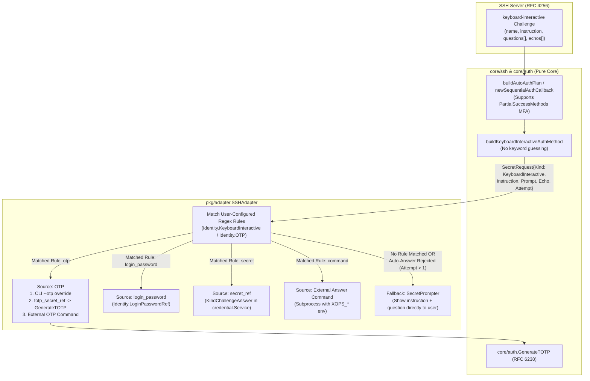

# SSH OTP and `keyboard-interactive` Login Design

**Status**: Implemented (M1–M4 fully completed and verified)

**Related Documents**: [Zero-Configuration Credential Design](./credential-experience-design.md), [Shared Core and MCP Interface Decoupling](./shared-core-decoupling.md), [SSH Diagnostics Design](./ssh-diagnostics.md)

**Language**: English development documentation

---

## 1. Background and Goals

### 1.1 Background

Currently, the SSH authentication pipeline in `xops-cli` (`core/ssh/connector.go`, `core/ssh/auth.go`) only supports `publickey` (explicit private key, SSH agent, default keys) and traditional `password` authentication. It does not yet support RFC 4256 `keyboard-interactive` (`ssh.KeyboardInteractiveChallenge`) or OTP/2FA dynamic passcodes.

In production environments, bastion hosts, PAM modules (such as `pam_google_authenticator.so`, `pam_oath.so`, `pam_unix.so`), and OpenSSH servers configured with multi-factor authentication (e.g., `AuthenticationMethods publickey,keyboard-interactive` or `password,keyboard-interactive`) rely heavily on `keyboard-interactive` challenge-response flows. Because server challenge prompts can be arbitrary strings in any language or custom format, attempting to guess whether a prompt is a password or OTP via built-in keyword matching is brittle and risks accidentally persisting a one-time code as a login password.

### 1.2 Core Design Principles

1. **No Built-in Keyword Guessing**:
   The client never uses hardcoded keyword lists to guess whether a `keyboard-interactive` question is a password or an OTP challenge. Question classification and response policies are determined entirely by the user.
2. **Pass Unmatched Prompts Directly to the User**:
   When authentication enters `keyboard-interactive` and a prompt does not match any user-configured automation rule, the client passes the server's banner (`name`/`instruction`), question text (`question`), and echo flag (`echo`)—sanitized against terminal control sequences—directly to the user (`SecretPrompter`), letting the user decide what to enter. Interactive responses to `keyboard-interactive` prompts never trigger automatic password persistence (`PasswordCallback`).
3. **Explicit Configuration for Automated Login**:
   - **Explicit OTP Configuration (`otp`)**: Users can explicitly configure a managed TOTP secret seed reference (`totp_secret_ref`, RFC 6238 / RFC 4226) or an external OTP provider command (`command`) for automated OTP injection.
   - **Regex Question Matching & Auto-Answer Rules (`keyboard_interactive.rules`)**: Users can configure regular expression patterns (`prompt_pattern` and optional `instruction_pattern`) to match server questions and automatically supply answers from a bound source.
   - **External Answer/OTP Providers (`command`)**: Both OTP configuration and challenge-response rules support executing an external command to dynamically retrieve answers from external secret managers or scripts (e.g., `1password`/`op`, `oathtool`, `pass`, custom enterprise helpers).

### 1.3 In-Scope and Out-of-Scope Commitments

| In Scope | Out of Scope |
| :--- | :--- |
| RFC 4256 `keyboard-interactive` single-stage login and multi-stage `PartialSuccessMethods` MFA | Heuristic built-in keyword guessing to classify prompts as password vs. OTP |
| Passing unmatched server prompts directly to the terminal user (after control character sanitization) | Automatically saving interactive `keyboard-interactive` answers as `login_password` in the credential store |
| Identity-level explicit `otp` configuration (RFC 6238 TOTP secret ref or external command) and CLI `--otp` override | Storing plaintext TOTP seeds or plaintext static challenge answers in `config.yaml` |
| Regex-based question matching rules (`prompt_pattern` / `instruction_pattern`) and automated responses | Executing unescaped external command strings through `sh -c` |
| Four automated answer sources: `otp`, `login_password`, `secret` (credential ref), and `command` (external command) | Infinite retry loops when an automated answer is rejected by the server |

---

## 2. Architecture and Authentication Data Flow



### 2.1 Authentication Method Ordering and Multi-Stage MFA (`PartialSuccessMethods`)

1. **`auth_type` Values**:
   `Identity.AuthType` and `core/ssh.Config.AuthType` support:
   - `"auto"` (default): Candidate order is `explicit key (publickey) -> ssh-agent (publickey) -> default keys (publickey) -> password -> keyboard-interactive`.
   - `"keyboard-interactive"`: Prioritizes `keyboard-interactive` (coordinating with `password` via `AuthCallback` if the server's `AllowedMethods` requires multi-stage authentication).
   - `"otp"`: Prioritizes `keyboard-interactive` with explicit OTP response (also compatible with `password + keyboard-interactive` multi-stage MFA).
   - `"key"` / `"agent"` / `"password"`: Preserves primary method semantics; if the primary stage succeeds with `SSH_MSG_USERAUTH_FAILURE (partial_success=true)` and `ctx.AllowedMethods` requests `"keyboard-interactive"`, chains `keyboard-interactive` as the second factor.

2. **`PartialSuccessMethods` Stage Progression**:
   `core/ssh/auth.go:newSequentialAuthCallback` tracks `stage := len(ctx.PartialSuccessMethods)`. Whenever `stage` advances, the previous candidate achieved partial success (e.g., `publickey` succeeded and the server now requires `keyboard-interactive`), so the per-stage tried candidate state is reset for the new stage.

### 2.2 `keyboard-interactive` Prompt Handling and Fallback Rules

1. **Empty Question Packet Compatibility (`len(questions) == 0`)**:
   Per RFC 4256, PAM servers frequently send an initial packet containing only `name` or `instruction` with `len(questions) == 0`. The client treats this as an informational banner rather than a failure in non-interactive mode, merges non-empty banner text into the next non-empty prompt's `SecretRequest.Instruction`, and returns `nil, nil`.

2. **Rule Matching Precedence (Triggered Only When `Attempt == 1`)**:
   For each question `questions[i]`:
   - **Step 1 (Match `keyboard_interactive.rules`)**: Evaluate `Identity.KeyboardInteractive.Rules` in order. If `rule.PromptPattern` matches `questions[i]` (and `rule.InstructionPattern`, when configured, matches `Instruction`), resolve the answer from `rule.Source`.
   - **Step 2 (Match explicit `otp` configuration)**: If no rule matched, check `Identity.OTP` or the CLI `--otp` override:
     - If `OTP.PromptPattern` is configured and matches `questions[i]`, resolve the answer via OTP;
     - If `OTP.PromptPattern` is empty, effective `AuthType == "otp"` (or `--otp` / `--otp-stdin` was provided), and the challenge has a single question (`len(questions) == 1`), resolve the answer via OTP.
   - **Step 3 (Direct user prompt)**: If no automation rule matches, return `ssh.ErrInteractionRequired` so `SecretPrompter` displays the sanitized `Instruction`, `Prompt` (`questions[i]`), and `Echo` (`echos[i]`) directly to the user.

3. **Loop Prevention on Rejected Auto-Answers (`Attempt > 1`)**:
   Within a single SSH handshake, the client tracks `Attempt` per question. If an automated answer was supplied at `Attempt == 1` and the server rejects it and re-sends the challenge (`Attempt >= 2`), the client skips `SecretResolver` and falls back to `SecretPrompter` for interactive user input (or returns `ErrInteractionRequired` in non-interactive mode).

---

## 3. Configuration Model and Schema V2 Specification

### 3.1 `config.yaml` Example

```yaml
schema_version: 2
identities:
  # Scenario 1: Managed TOTP seed with explicit OTP auth_type
  jump-totp:
    user: devops
    auth_type: otp
    otp:
      totp_secret_ref:
        store_id: default
        item_id: 11111111111111111111111111111111
      prompt_pattern: "(?i)(verification code|otp)"

  # Scenario 2: Multi-prompt keyboard-interactive + external command providers
  bastion-pam:
    user: ops
    auth_type: keyboard-interactive
    login_password_ref:
      store_id: default
      item_id: 22222222222222222222222222222222
    otp:
      command: /usr/local/bin/op
      args: ["item", "get", "bastion-otp", "--otp"]
      timeout: 10s
    keyboard_interactive:
      rules:
        - name: unix-password
          prompt_pattern: "^Password:\\s*$"
          source: login_password
        - name: google-auth-otp
          prompt_pattern: "^Verification code:\\s*$"
          source: otp
        - name: dynamic-pin
          prompt_pattern: "^Enter Security PIN:"
          source: command
          command: /usr/local/bin/get-security-pin
          args: ["--env", "prod"]
          timeout: 5s
        - name: static-challenge
          prompt_pattern: "^Department Code:"
          source: secret
          secret_ref:
            store_id: default
            item_id: 33333333333333333333333333333333
```

### 3.2 Go Domain Model (`pkg/models/types.go`)

```go
// OTPConfig defines explicit OTP automation settings for an Identity.
type OTPConfig struct {
	TOTPSecretRef *credential.Ref `yaml:"totp_secret_ref,omitempty" json:"totp_secret_ref,omitempty"`
	Command       string          `yaml:"command,omitempty" json:"command,omitempty"`
	Args          []string        `yaml:"args,omitempty" json:"args,omitempty"`
	Timeout       time.Duration   `yaml:"timeout,omitempty" json:"timeout,omitempty"`
	PromptPattern string          `yaml:"prompt_pattern,omitempty" json:"prompt_pattern,omitempty"`
}

// ChallengeAnswerSource defines the answer source for a keyboard-interactive rule.
type ChallengeAnswerSource string

const (
	ChallengeSourceOTP           ChallengeAnswerSource = "otp"
	ChallengeSourceLoginPassword ChallengeAnswerSource = "login_password"
	ChallengeSourceSecret        ChallengeAnswerSource = "secret"
	ChallengeSourceCommand       ChallengeAnswerSource = "command"
)

// ChallengeRule defines a single regex prompt matching and automated response rule.
type ChallengeRule struct {
	Name               string                `yaml:"name,omitempty" json:"name,omitempty"`
	PromptPattern      string                `yaml:"prompt_pattern" json:"prompt_pattern"`
	InstructionPattern string                `yaml:"instruction_pattern,omitempty" json:"instruction_pattern,omitempty"`
	Source             ChallengeAnswerSource `yaml:"source" json:"source"`
	SecretRef          *credential.Ref       `yaml:"secret_ref,omitempty" json:"secret_ref,omitempty"`
	Command            string                `yaml:"command,omitempty" json:"command,omitempty"`
	Args               []string              `yaml:"args,omitempty" json:"args,omitempty"`
	Timeout            time.Duration         `yaml:"timeout,omitempty" json:"timeout,omitempty"`
}

// KeyboardInteractiveConfig defines the ordered list of challenge-response rules.
type KeyboardInteractiveConfig struct {
	Rules []ChallengeRule `yaml:"rules,omitempty" json:"rules,omitempty"`
}
```

### 3.3 Schema V2 Validation Rules (`pkg/config/schema_v2.go`)

1. **Zero-Plaintext Enforcement (`checkForbiddenPlaintextFields`)**:
   Plaintext secret fields (`totp_secret`, `otp_secret`, `answer`, `secret`) under `identities.<id>` or `keyboard_interactive.rules` are rejected. All static secrets must use `credential.Ref` (`KindTOTPSecret = "totp_secret"`, `KindChallengeAnswer = "challenge_answer"`).
2. **`OTPConfig` Validation**:
   - Exactly one of `totp_secret_ref` or `command` must be configured;
   - `totp_secret_ref` must be a valid credential reference whose `store_id` is configured in `credential.stores`;
   - `command` must be non-empty and must not contain shell metacharacters (`;|&\`$\n`);
   - `prompt_pattern` (if set) must compile via `regexp.Compile`;
   - `timeout` must not be negative.
3. **`KeyboardInteractiveConfig` Validation**:
   - Every rule must have a non-empty `prompt_pattern` that compiles via `regexp.Compile` (and `instruction_pattern`, if set, must also compile);
   - Rule `name` values must be unique within an Identity, and `name` is required when `source == "secret"`;
   - Source-specific validation:
     - `source: otp`: forbids `secret_ref` / `command` on the rule (uses the Identity `otp` block or runtime `--otp`);
     - `source: login_password`: forbids `secret_ref` / `command` on the rule;
     - `source: secret`: requires a valid `secret_ref` (with `store_id` configured in `credential.stores`) and forbids `command`;
     - `source: command`: requires a valid `command` and forbids `secret_ref`.

---

## 4. External Answer and OTP Provider Protocol (`internal/credentialhelper`)

`internal/credentialhelper/answer_command.go` reuses the cross-platform subprocess execution primitives from `internal/credentialhelper/process.go`:

1. **Process Execution and Injection Safety**:
   - Executes `exec.CommandContext(execCtx, command, args...)` directly without `/bin/sh -c` or `cmd.exe /c`;
   - Binds child `Stdin` to `os.DevNull` so external commands never hang waiting for terminal input.
2. **Context Environment Variables**:
   Passes read-only context environment variables to the subprocess:
   - `XOPS_NODE`: Target node name
   - `XOPS_HOST`: Target host address
   - `XOPS_USER`: SSH username
   - `XOPS_IDENTITY`: Identity configuration name
   - `XOPS_PROMPT`: Sanitized server `question` text
   - `XOPS_INSTRUCTION`: Sanitized server `name`/`instruction` text
   - `XOPS_ECHO`: `"true"` or `"false"`
   - `XOPS_NON_INTERACTIVE`: `"1"` in non-interactive mode, `"0"` in interactive mode
3. **Output Handling and Bounded Lifecycle**:
   - Default timeout of `15s` (overridable via `timeout`); terminates the entire process tree via `session.KillTree()` on timeout or cancellation;
   - Reads up to `4096` bytes from `Stdout`, stripping a single trailing newline (`\r\n` or `\n`);
   - Sanitizes `Stderr` via `SanitizeDiagnostic` before returning non-zero exit errors.

---

## 5. Module Implementation Breakdown

1. **`core/auth`**:
   - Add `core/auth/totp.go` and `core/auth/totp_test.go` implementing zero-dependency RFC 4226 / RFC 6238 TOTP generation and `otpauth://` / Base32 parsing.
2. **`core/ssh`**:
   - Update `core/ssh/types_api.go` (`SecretKindOTP`, `SecretKindKeyboardInteractive`, and `SecretRequest` fields `Instruction`, `Prompt`, `Echo`, `Attempt`, `NumPrompts`);
   - Add `core/ssh/keyboard_interactive.go` and update `core/ssh/auth.go` and `core/ssh/connector.go`.
3. **`pkg/credential`, `pkg/models`, `pkg/config`, `internal/mcphost`**:
   - Add `KindTOTPSecret` and `KindChallengeAnswer` (`pkg/credential/ref.go`) and `Target.RuleName` (`pkg/credential/service.go`, `pkg/credential/journal.go`);
   - Extend `Identity` (`pkg/models/types.go`) and `IdentityV2` (`pkg/config/schema_v2.go`);
   - Update `pkg/config/repository.go`, `credential_edit.go`, `asset_delete.go`, `backup_references.go`, `migration_backend_plan.go`, `migration_finalize.go`, and `internal/mcphost/credential_binding.go`.
4. **`internal/credentialhelper` and `pkg/adapter`**:
   - Add `internal/credentialhelper/answer_command.go`;
   - Update `pkg/adapter/ssh_adapter.go` to evaluate regex rules, generate TOTP codes, and invoke external commands.
5. **`cmd`, `pkg/tui`, `pkg/i18n`**:
   - Update `cmd/ssh_interaction.go` to sanitize and display server prompts and respect `Echo`;
   - Add `--otp` / `--otp-stdin` to `cmd/ssh.go`, `cmd/exec.go`, `cmd/exec_input.go`, `cmd/scp.go`, `cmd/sftp.go`;
   - Extend `cmd/identity.go`, `cmd/utils/credential.go`, `pkg/tui/form.go`, and `pkg/i18n/locales/active.{zh,en}.yaml` to manage OTP and `keyboard-interactive` credentials.

---

## 6. Verification and Testing Matrix

1. **Core Decoupling and Algorithm Tests**:
   ```bash
   python3 -m unittest discover -s scripts -p test_check_core.py
   python3 scripts/check_core.py --race
   go test -v -race ./core/auth/...
   ```
2. **SSH `keyboard-interactive` and MFA Handshake Tests**:
   ```bash
   go test -v -race -shuffle=on -count=1 ./core/ssh/...
   ```
   - Verifies direct pass-through of unmatched prompts (including `Instruction`, `Prompt`, `Echo=true/false`) without triggering `PasswordCallback`;
   - Covers regex auto-response rules, fallback to prompt when auto-answer is rejected (`Attempt == 2`), empty challenge probe packets (`len(questions) == 0`), and multi-stage MFA (`publickey -> keyboard-interactive`, `password -> keyboard-interactive`).
3. **External Answer Commands, Schema V2, and Adapter Tests**:
   ```bash
   go test -v -race ./internal/credentialhelper/... ./pkg/credential/... ./pkg/config/... ./pkg/adapter/... ./internal/mcphost/...
   ```
4. **CLI, TUI, Documentation, and Lint Quality Gates**:
   ```bash
   go test -v ./cmd/... ./pkg/tui/... ./internal/clicontract/...
   npm run docs:check
   golangci-lint run ./...
   ```
